# 2 · Build a syllabus and take it from draft to active

**Who:** instructors · **Where:** Syllabus → *Syllabus Builder* and *My Syllabus* · Requirements FR-SYL (lifecycle), FR-CW-01 (outline drives courseware).

A syllabus passes five stations: **Drafted → Checked → Out for Approval → Approved — Uploaded → Active**. Signatures (Dean review → CAO approval → EVP noting) happen offline on the downloaded file; EduPulse never marks a syllabus approved by itself. Only an **Active** syllabus, whose Course Outline you have reviewed, drives courseware generation.

The screenshots follow one real syllabus (IT 102 — Computer Programming 1) through every station.

`SYL-LIFE-001` maps the lifecycle to `tests/snapshots/manual.spec.ts` and `tests/browser/workflows.spec.ts`. The October 24 DOCX/PDF import recapture uses generated sample documents and real browser extraction; both acceptance and retry are asserted. The capture run records local input evidence separately from authenticated production behavior.

## Build the draft

To import an existing draft, click the upload area or drop a **.docx** or **.pdf** file of up to **2 MB** into it. Review **Extracted Sections Preview**, then click **Use This Syllabus** to fill the form. Importing does not save the draft. The sample below contains course information and one outline week; review missing sections before saving.

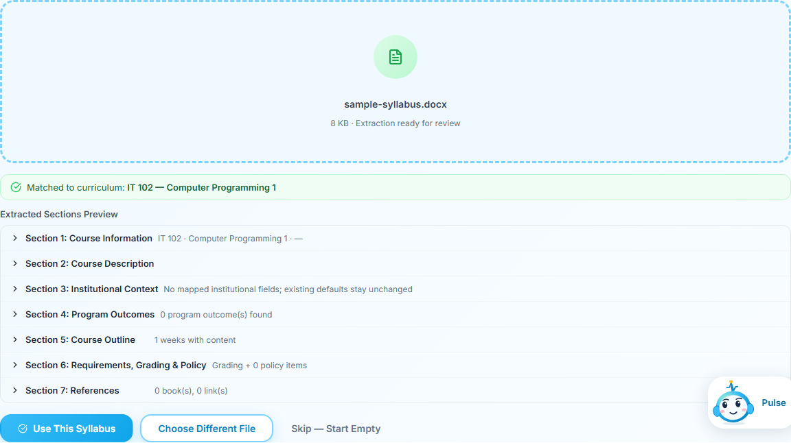

**Choose Different File** clears the preview. Unsupported or oversized files display an error; damaged DOCX or PDF files display a reading error. Click **Try Again**, then select a corrected file. You can select the same filename again.

PDF text is read into the same seven-section preview. Scanned pages are read with OCR on your device (up to 60 pages); check the results against the original, especially numbers and weekly table rows. Unrecognized layouts and week ranges need manual editing.

PDF is the primary institutional intake format; Word `.docx` is also supported. The builder introduction and accepted-format hint list PDF first. Activation and retained-attachment validation accept both formats. Download for Approval exports PDF for the offline approval route.

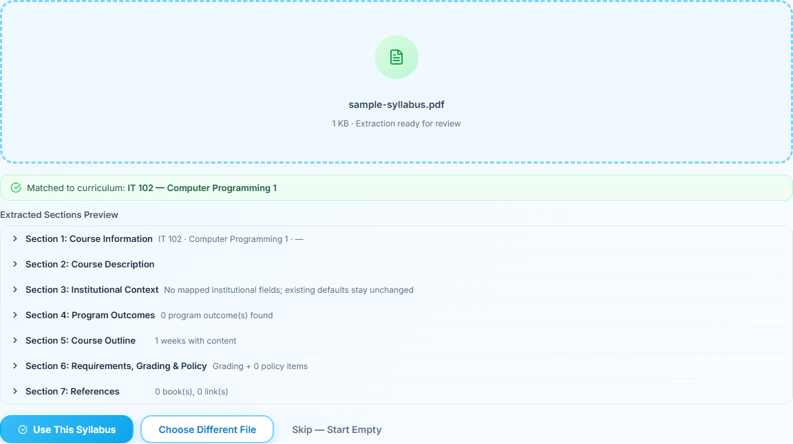

1. Open **Syllabus → Syllabus Builder** and choose the **Course**. Course title, period offered and academic year fill in from the curriculum and are locked; so is the course description in Section 2.

   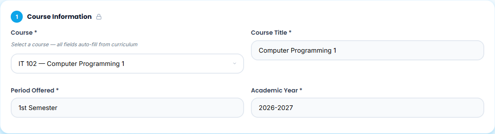

2. In **Section 5 · Course Outline**, write each week's **intended learning outcome** and **topics** (use **Add Topic** for more), and optionally activities, teaching materials and assessments. Weeks 9 and 18 are the midterm and final examinations. This outline is what courseware is generated from, so write measurable outcomes.

   For a new draft, ask Pulse to generate the editable fields for the selected course. Review its field-by-field proposal, research sources and pending institutional rules before applying or saving it. See [Generate a syllabus from the selected course](../09-pulse-actions/README.md#generate-a-syllabus-from-the-selected-course). **Load curriculum outline** remains a reference-copy action.

   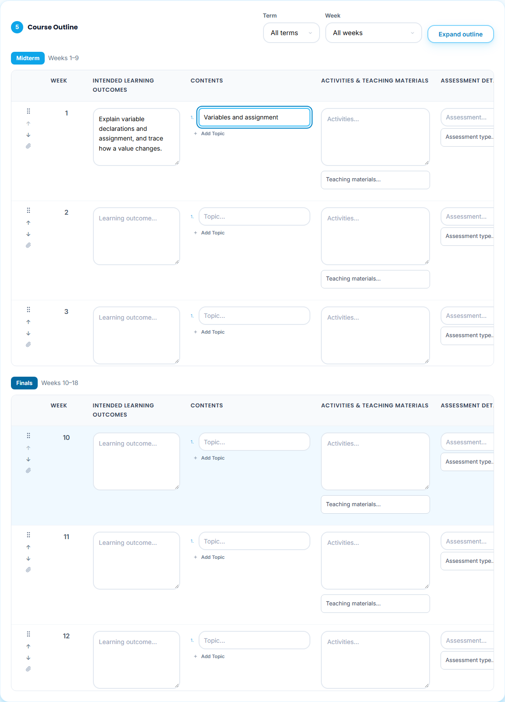

3. Complete Sections 6 (requirements, grading, policies) and 7 (references), then click **Save as Drafted** at the bottom. (**Mark as Checked** saves and checks in one step.)

   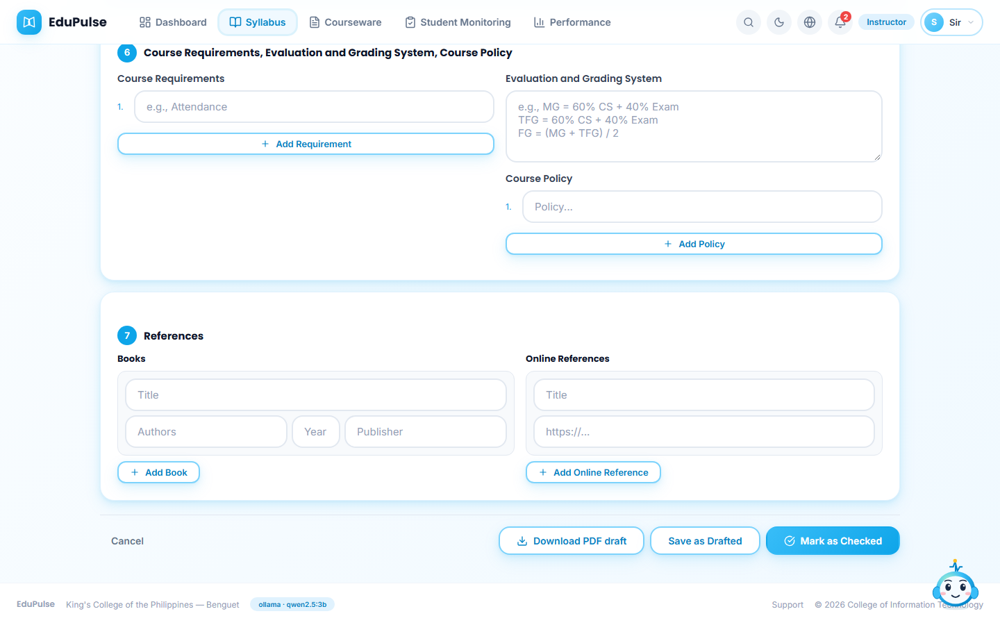

## Move it through the stations

4. The syllabus appears in **My Syllabus** with status **Drafted**, version **v1**, and *18 weeks (not yet extracted)*. The **Next step** column always shows the one action that moves it forward.

   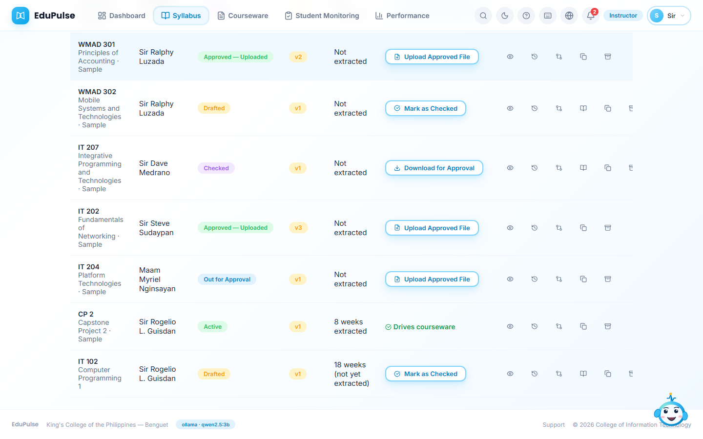

5. After re-reading it, click **Mark as Checked**. The status becomes **Checked** and the next step becomes **Download for Approval**.

   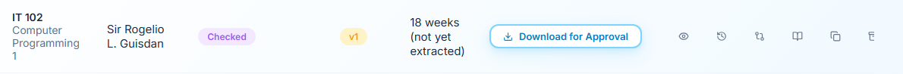

6. Click **Download for Approval** to save the PDF for the offline signatory route. The status becomes **Out for Approval** and the next step is **Upload Approved File**.

   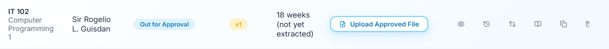

7. When the signed file returns, click **Upload Approved File**. Tick the confirmation that the offline approvals are complete (EduPulse does not verify signatures) and choose the **Approved DOCX or PDF** (up to 500 KB). The file must contain the matching course code and a usable weekly outline. The original file is kept with its checksum.

   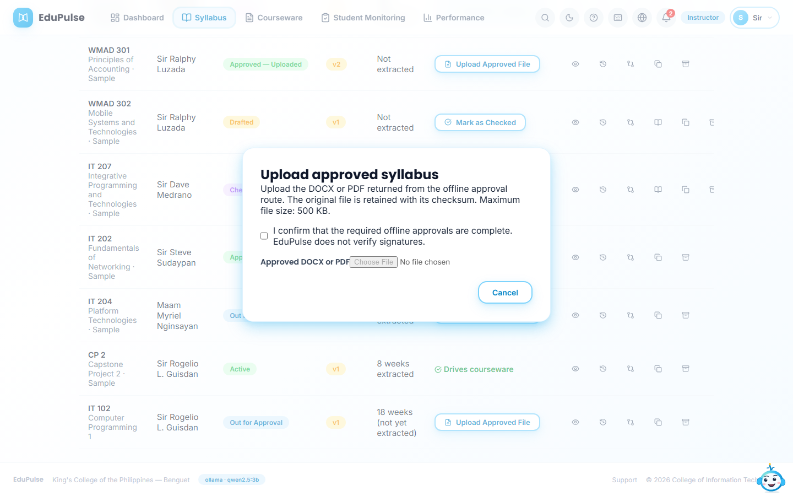

8. The status becomes **Approved — Uploaded** and the next step is **Extract Outline**.

   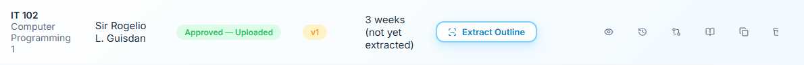

## Activate it

9. Click **Extract Outline**. EduPulse reads Section 5 of the approved file and shows each row (week, outcomes, contents, assessments; exam weeks are marked *Milestone*). Each teaching row becomes one courseware generation unit. Check it against the signed document, then click **Confirm Extraction — Activate Syllabus**.

   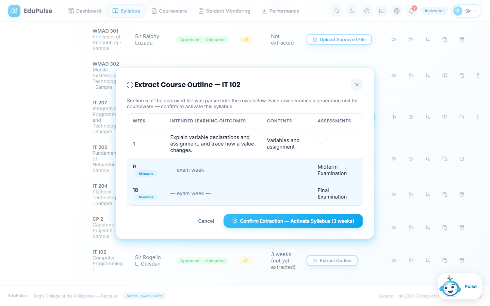

10. The syllabus is **Active**, the outline shows as extracted, and the next-step column reads **Drives courseware**. It now appears in Courseware ([manual 3](../03-courseware-generation-and-review/README.md)).

    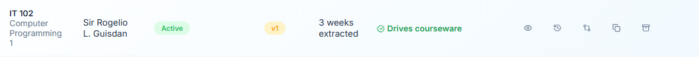

11. **Version History** (clock icon) lists recorded changes with station, version, time and author. **Saved syllabus versions** retains up to ten editable snapshots, with **View saved version** and **Restore version as draft** when snapshots exist. Restoring clears approval and extraction; the current approved attachment can be downloaded separately. **Remove attachment and return to draft** handles an incorrectly uploaded file. The lifecycle capture below shows the recorded changes and an empty snapshot list for this newly created sample.

    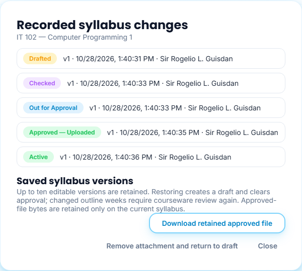

## Good to know

* Edits are saved to the workspace automatically (*Local workspace · Saved*, or the cloud equivalent). **Export backup** downloads everything as JSON.
* Pulse can walk you through any section: drag it onto the section or click **Guide this page** ([manual 7](../07-pulse-guidance/README.md)). Pulse drafts; it cannot check, approve or activate a syllabus.

## Import sections through the conversation

The Pulse attachment reader also recognizes PDF and Word syllabi. Ask for the intended editable section, review its extracted text and choose replacement or addition before applying it to the open builder or saving a draft. Course identity and description stay fixed to the curriculum; this path never grants approval or activates a syllabus. See [Manual 9](../09-pulse-actions/README.md#import-selected-syllabus-sections-from-a-pdf-or-word-file).

## Check wrapped PDF tables and download the draft

The text-layer PDF reader uses ruled table cells to retain wrapped outcomes, topics and rows continued onto later pages. Explicit ranges share the source content across the listed weeks; duplicate entries for one week are combined. The expanded preview shows the extracted fields, including the complete mapped outline. Unmapped or OCR text needs comparison with the original; importing does not certify its accuracy.

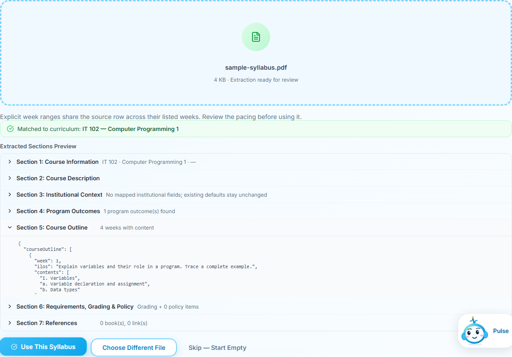

After **Use This Syllabus**, the source remains available to Pulse while this builder is open. Focus a field and press **Alt+P**, or drag Pulse onto a section, then ask for a correction against that file. Check the preview and confirm before it changes the form. Leaving/reloading the builder ends that temporary source context; attach the file again or use an explicitly indexed library document.

**Download PDF draft** downloads the current form as a paginated PDF without marking it checked or saving it. **Download for Approval** downloads the checked syllabus as PDF and advances the existing offline approval workflow. PDF export does not reproduce signatures or certify approval.

Institutional text mapped from the accepted PDF overrides the corresponding fields only in this syllabus. Missing fields preserve the existing values. New drafts use the Information Technology wording from the provided IT-202 syllabus (AY 2025-2026); saved syllabi keep their snapshot. Review this wording against current institutional requirements.

On mobile, the draft actions wrap into separate rows.

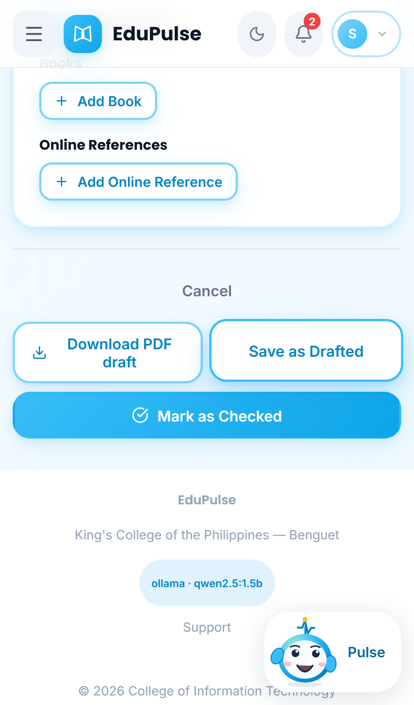

## Revise or restore an active syllabus

In **My Syllabus**, use **Edit syllabus** for a non-sample record, including an active syllabus. Saving the revision retains the earlier editable snapshot and returns the syllabus to Drafted; approval and extraction must be completed again. Previously published courseware is withdrawn. Changed outline weeks additionally return their items to draft with an alignment warning; review or regenerate them against the new approved outline before publishing again.

In **Version History**, **View saved version** previews the retained editable fields. **Restore version as draft** uses the same revision and withdrawal process. Snapshots exclude file bytes and nested history; up to ten are retained. Restoring never reinstates approval or silently republishes courseware. See the [saved-version capture](../../system-walkthrough/09-restored-role-pages/README.md#baseline-workflows-restored-after-owner-confirmation).

Confirmed shared course loads are shown above the builder when available. The identity/description fields remain locked under the later correction. The syllabus author still owns the draft and confirms every change.
