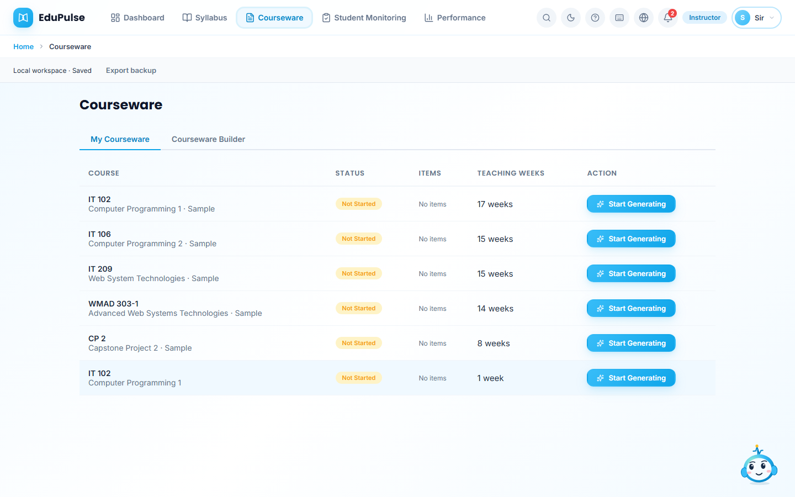
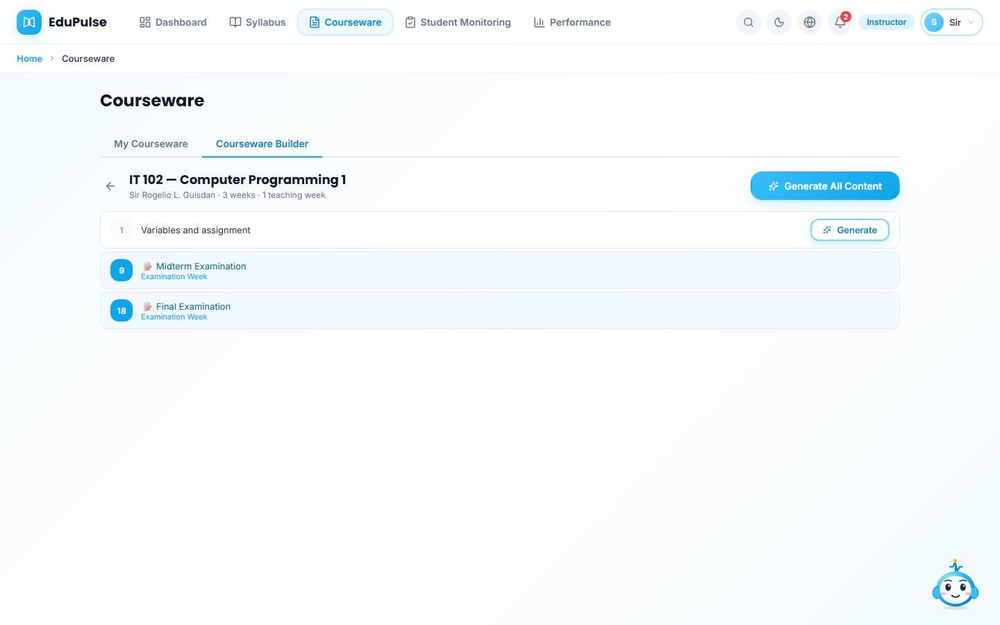
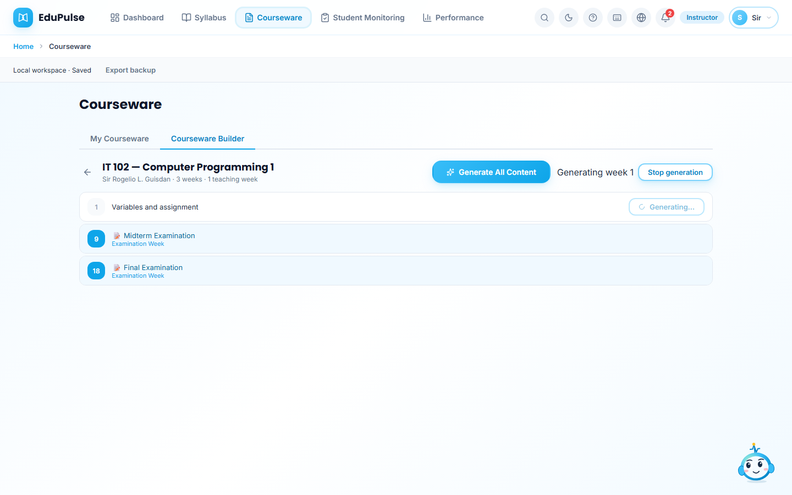
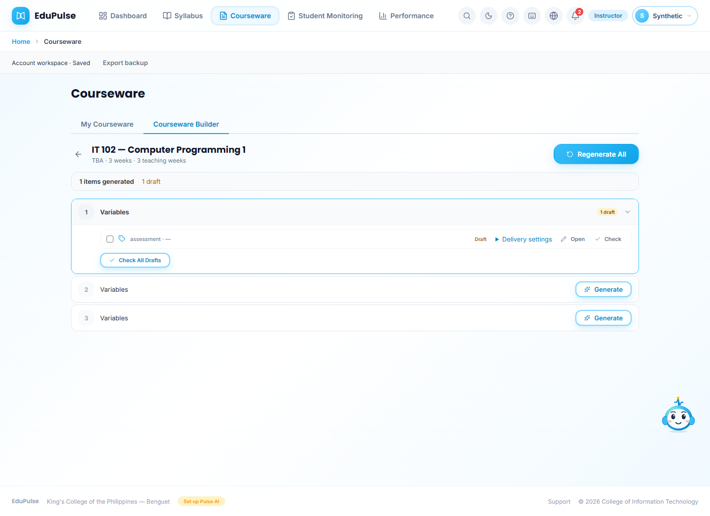
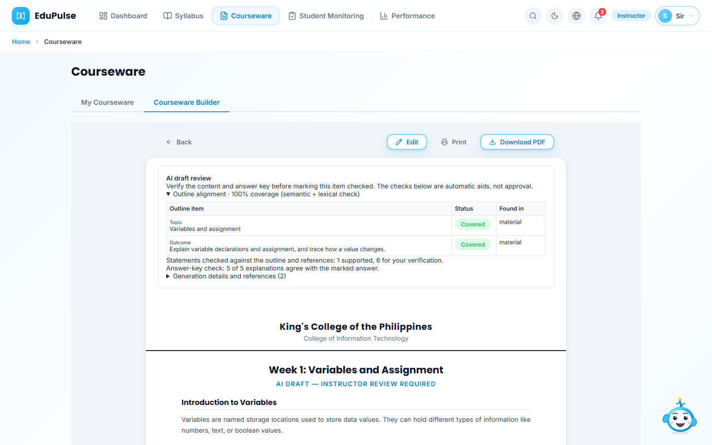
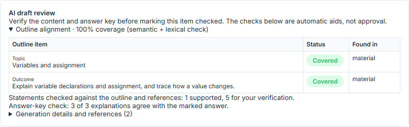

# 3 · Generate and review courseware

**Who:** instructor. **Where:** Courseware → My Courseware and Courseware Builder. The generated material, activity, and assessment stay in Draft until an instructor checks them. The alignment report is an aid to review, not approval.

1. Complete and activate a syllabus outline first. In **My Courseware**, find the instructor's own course and choose **Start Generating**. The sample courses are listed separately; the IT 102 row without “Sample” comes from the completed [syllabus workflow](../02-syllabus-lifecycle/README.md).

   

2. In **Courseware Builder**, find a teaching week with a topic and outcome. The IT 102 outline here has “Variables and assignment” in week 1. Choose that week's **Generate** button. Examination weeks have no Generate button.

   

3. Wait while the local model drafts the week. **Stop generation** cancels this request. The app keeps any existing courseware if generation fails.

   

4. On generation success, the week expands to three separate **Draft** items: a learning material, an activity, and an assessment. Use **Open** to inspect an item. **Check** and **Check All Drafts** are instructor actions; generation itself does not mark the items checked.

   

5. In the material view, read the draft and the **AI draft review** panel before checking it. The panel checks every outline topic and outcome, the planned activity and assessment when listed, and agreement between question explanations and marked answers. It shows which statements were supported by the outline or references and leaves other statements for instructor verification. Open **Generation details and references** to inspect the source trace. **References** lists the syllabus resources and retrieved passages used; model-authored reference lists are removed.

   

   

6. Edit any inaccurate explanation or answer key, then use **Check** only after reviewing the material, activity, and assessment. Drafts are not published or graded automatically.

The generation/material evidence uses the local `qwen2.5:3b` model. The fourth image was refreshed on 28 October with a synthetic saved assessment to show the current draft controls, including Delivery settings; it is not a new model-generation result. Earlier v0.4.0 and 1.5B-model evidence remains in the historical release records. They establish local task evidence, not authenticated hosted behavior or general model accuracy. The review panel may flag incorrect answer explanations; instructors must resolve them before checking or publishing. The [v0.4.0 release record](../../versions/v0.4.0/README.md) maps the original workflow to NFR-AI-06 (goal 6).

## Revise through Pulse

When an instructor opens a saved draft in a document, presentation or assessment editor, Pulse can propose a typed revision to its content. Compare the selected fields before **Confirm and save draft**. The saved receipt waits for the revision-checked database response. Published items and stale targets are protected. See [Manual 9](../09-pulse-actions/README.md#revise-content-or-class-list-records).

## Download a learning document

**Download PDF** in the document viewer exports the displayed sections, including current edits, with embedded fonts, margins and page numbers. Headings, bold and italic text, lists, tables, quotations and code in a section are laid out as formatted text, not printed as Markdown symbols. The download is a genuine PDF rather than a renamed text file or a print-dialog instruction. It does not save edits, change review status or publish the material. Pulse-generated responses have a separate **Download response as PDF** control.

## Map topics and schedule delivery

Open a saved assessment and map each question to the approved outline week using **Question ... syllabus topic**. Select multiple choice, fixed True/False choices or instructor-marked written responses. **Save Assessment** returns edits to Draft. Topic mastery uses graded, mapped responses only.

**Delivery settings** stores release/deadline, duration and 1-3 allowed attempts. Review any changed assessment rules again before publication. A published future release stays hidden until its saved time. See [Manual 13](../13-restored-account-sections/README.md) and the [mapping/delivery captures](../../system-walkthrough/09-restored-role-pages/README.md#baseline-workflows-restored-after-owner-confirmation).
