# 3 · Generate and review courseware

Prepared owned content is reviewable before syllabus activation and shows **Awaiting syllabus approval**. Publish stays disabled until activation. The owner-authorized first-five-week demonstration and primary teaching-set mix are described in [Manual 40](../40-teaching-sets/README.md); normal generated content still starts as a draft.

The instructor dashboard's **Drafts to Review** and **Published Items** cards open course lists filtered to courses containing that content. **Show all courses** clears the filter; selecting a course opens its existing weekly workspace. [Manual 22](../22-dashboard-summary-navigation/README.md) shows both destinations.

The [IT teaching seed](../18-it-course-seed/README.md) adds saved session-authored drafts with explicit provenance, preserving existing items. It does not claim connected-provider inference or student completion. All new items follow the review and publication controls below.

**Who:** instructor. **Where:** Course. One course list combines generation progress and saved items; there are no separate My Courseware and Courseware Builder tabs. Generated items stay in Draft until an instructor checks them. The outline determines the required item types; a discussion or learning week does not automatically require an interactive quiz. The alignment report is an aid to review, not approval.

On-device structured generation now sends a serialized object schema to the installed WebLLM grammar compiler. Worker failures keep their original message as an Error instead of producing the unrelated `pregelTaskId` failure. Existing topic, completeness and answer checks still govern validated parts; complete replacement remains atomic. Private unfinished checkpoints now preserve validated parts for explicit resume. This correction does not establish that every small on-device model can complete every teaching request.

1. If you already have an approved syllabus, choose **Upload syllabi** from Course. Drop or browse for its PDF/DOCX in **My Syllabus**, review the extracted outline and choose **Use syllabus for course** ([Manual 30](../30-approved-syllabus-intake/README.md)). The upload action stays available when courses already exist. For a new draft, the optional builder approval route remains. Find the course in **Course**. A course with saved content shows **View**; an empty course shows **Generate**. Both open its weekly workspace. The list retains status, generated/expected item counts, progress, instructor and teaching weeks. The current example contains synthetic IT 102 and IT 103 courses.

   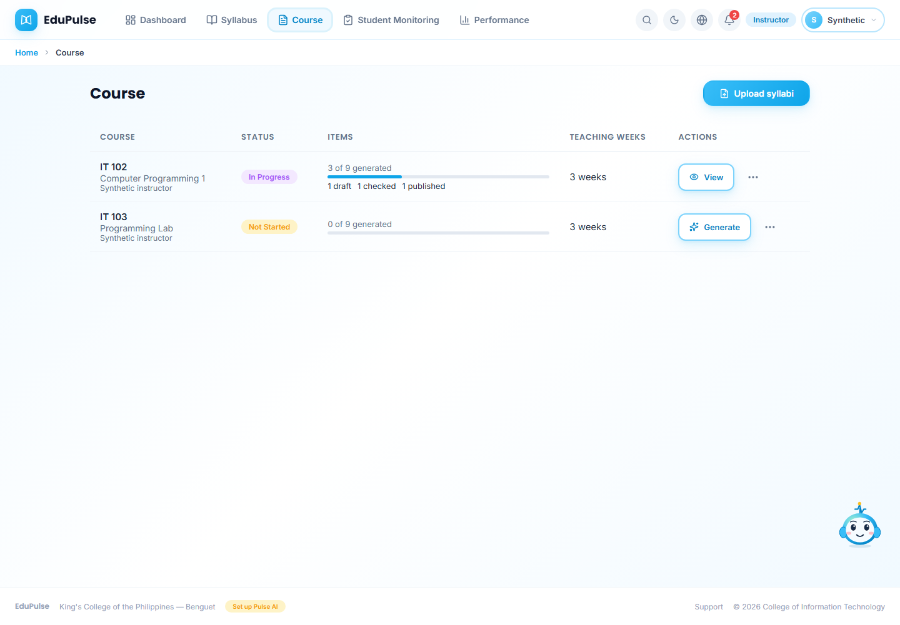

2. In the weekly workspace, an existing week shows **View** to expand its items; an empty teaching week shows **Generate**. This example generates week 2, **Functions**. Examination weeks have no generation action. **Back to courses** returns to the same list. Older course/week links from dashboards and Pulse remain supported.

   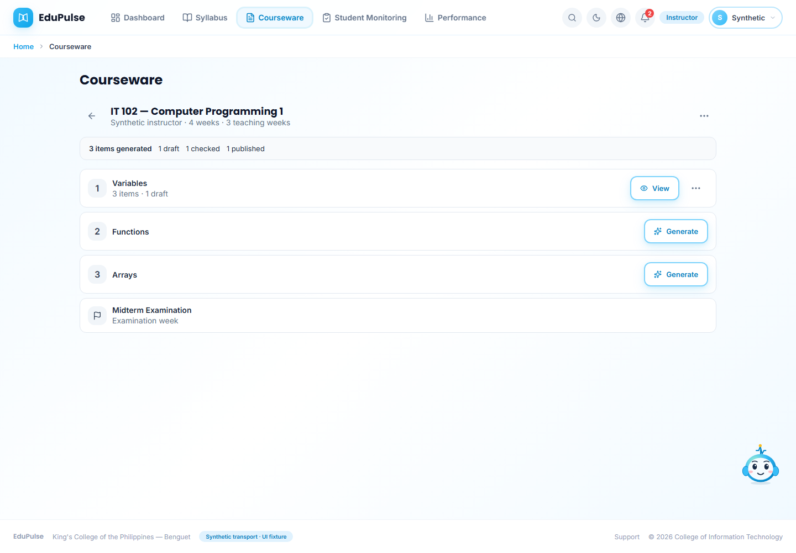

3. Wait while the selected provider or on-device model drafts the planned parts of the week. **Stop generation** cancels this request. If generation cannot run, the course stays open with **Generation did not finish** and the reason; when the cause is the AI connection it also offers **Set up Pulse AI**, which opens **Settings → AI & Knowledge**. **Dismiss** closes the message. The app keeps any existing courseware. A course opened while no provider or on-device model is connected says **Pulse AI is not set up yet** before you generate ([capture](../../system-walkthrough/09-restored-role-pages/47-publication-delivery-settings.png)).

   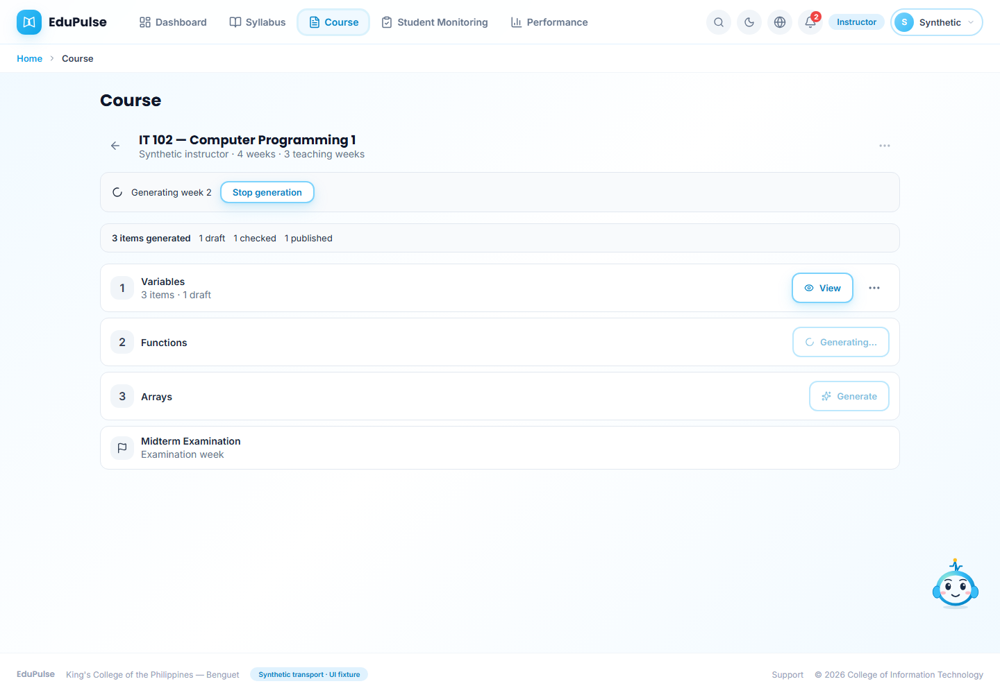

4. On generation success, the week expands to its planned **Draft** items. This synthetic quiz-week example contains a learning material, an activity and an assessment. Other weeks can contain a lesson alone or a lesson and a discussion/laboratory guide; see [Manual 26](../26-outline-driven-courseware/README.md). Use **View** to inspect an item at any review status. Its three-dot menu offers document/presentation views where applicable, **Check**, **Publish** or **Unpublish**, and **Delivery settings**. **Check All Drafts** is in the course and week menus; selected draft checkboxes also expose **Check Selected**. Generation does not check or publish items.

   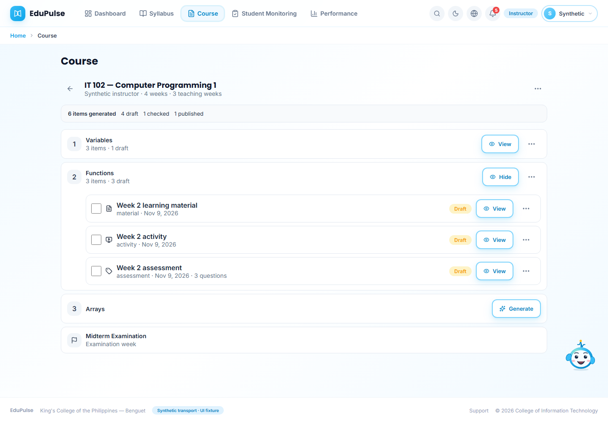

5. In the material view, read the formatted draft first. Enclosed `**words**` display in **bold**; italic text, headings, lists, tables and code also display with their formatting. Code examples retain their literal symbols. Scroll past all sections, including **References**, to the **AI draft review** at the end. Activities and assessments also place this evaluation after their content, before the page footer. The material panel checks full outline-topic and outcome coverage. Activity and assessment panels check their own outcomes and planned format. Answer-key checks appear only when objective questions were checked; instructor-marked written responses are not automatically graded. New results show which statements are supported by read reference passages and leave other statements for instructor verification; outline coverage is measured separately. Older saved reviews can still include outline-based checks. Open **Generation details and references** to inspect the source trace. **References** lists the syllabus resources and retrieved passages used. When the library has no supporting material, public research can supply passages, labelled separately from library sources. Research limitations stay in the review details; model-authored reference lists are removed.

   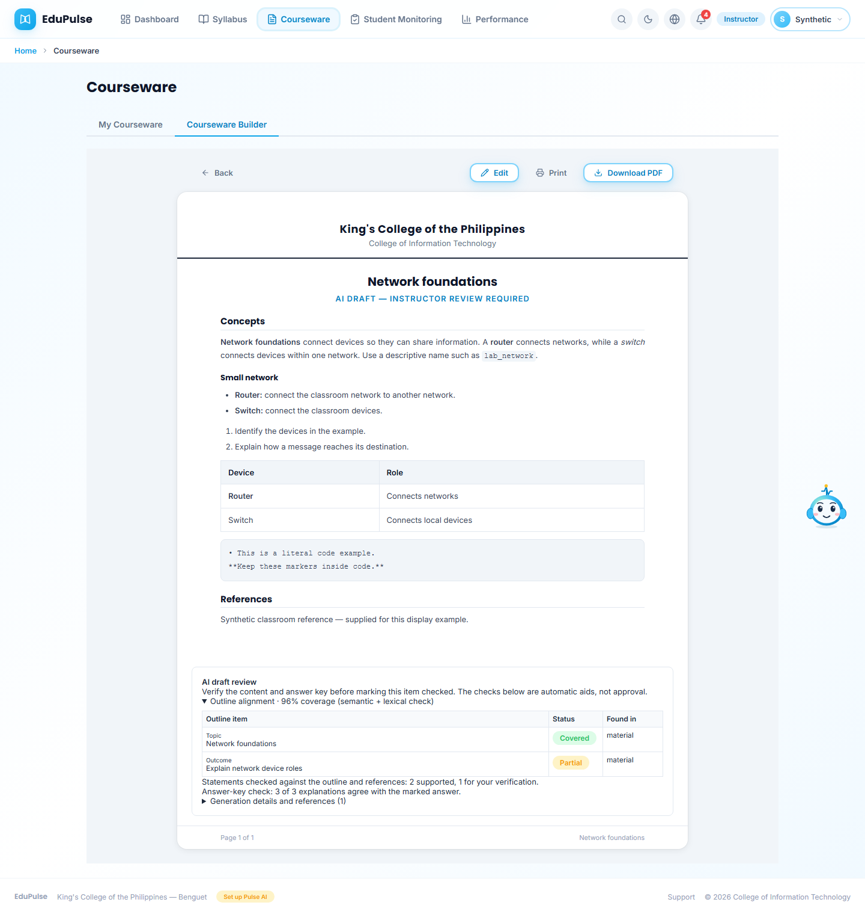

   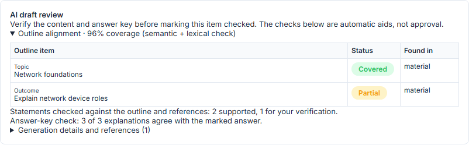

6. Edit any inaccurate explanation or answer key, then use **Check** only after reviewing the material, activity, and assessment. Section text and answer explanations in the editors grow to show their whole entry instead of scrolling inside a small box. Drafts are not published or graded automatically.

Images 1–4 and 12–16 use synthetic account, provider and workspace responses to exercise the combined interface. Images 5–6 and 10–11 use synthetic saved content and evaluation metadata. Their displayed coverage and answer checks are fixture values, not measured model accuracy. The earlier real `qwen2.5:3b` generation capture is retained in the [historical evidence](../../versions/2026-11-06-unified-courseware/validation/results.md); no live model run was repeated for this interface update. These captures do not establish authenticated hosted behavior or general model accuracy. The review panel may flag unsupported statements or incorrect answer explanations; instructors must resolve them before checking or publishing.

The assessment editor keeps its question, topic, answer and explanation controls above **AI draft review**. The checks remain available after the final question and **Add Question**.

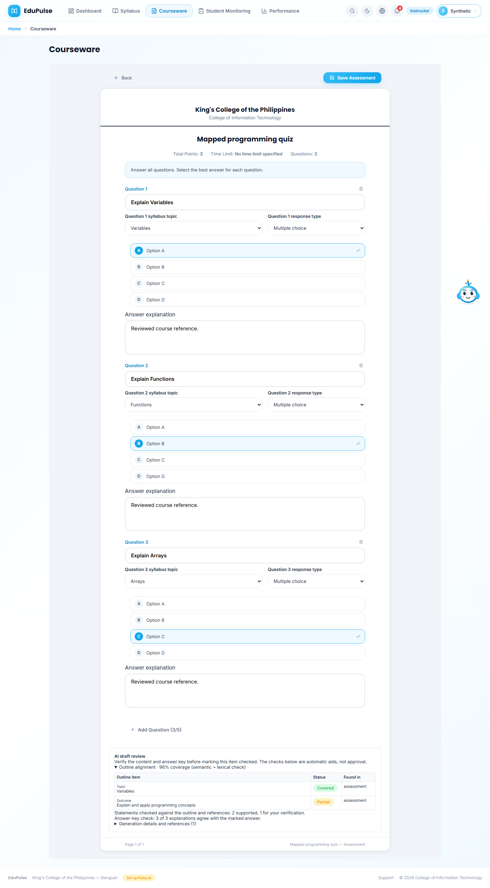

The same document formatting uses the current solid dark surfaces and text colors. Raw formatting remains available through **Edit**; **Save** preserves the source text so reopening the item displays it formatted again. Student document and presentation views format emphasis without showing instructor-only draft evaluation.

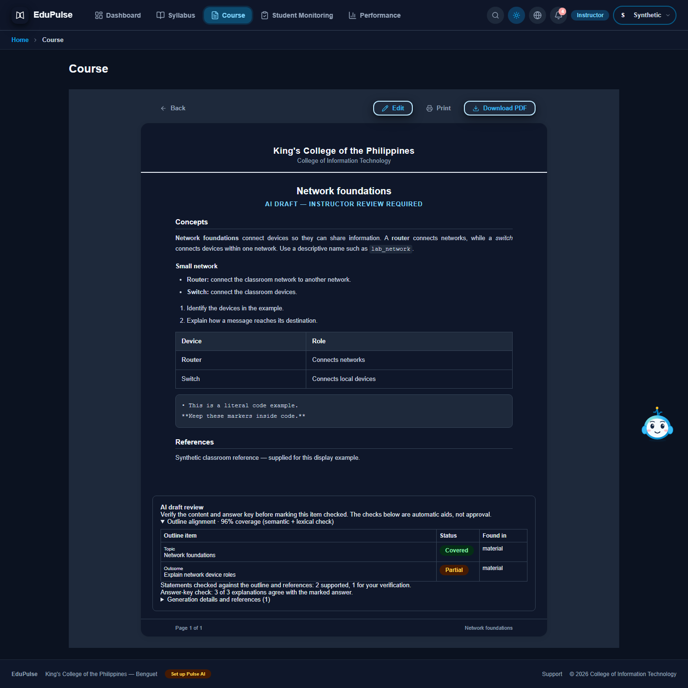

## Course, week and item actions

The course row's three-dot menu opens the weekly outline or focuses the first draft for review. Within an opened course, the header menu offers **Generate missing content**, **Regenerate All** for drafts, **Check All Drafts**, and expand/collapse controls. **Generate All Content** remains directly visible on an empty course. Missing-content generation keeps existing items; regeneration preserves checked/published work, delivery dates and saved assessment rules. A partially published course stays **In Progress** until every teaching week has its planned item types published and no saved items remain unpublished. Expected counts use the actual plan rather than three items per week. Regeneration skips checked/published types before inference and removes an obsolete unreviewed AI draft only after the entire replacement succeeds; manual work remains protected.

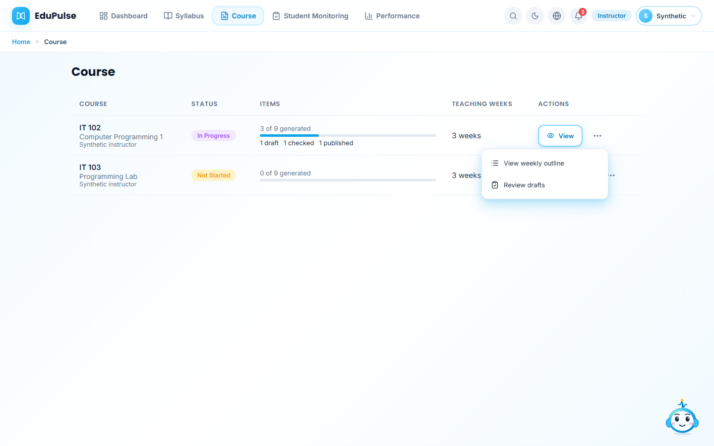

The week menu contains missing-content generation, **Regenerate week** and **Check All Drafts**, with unavailable actions disabled. **View** expands saved items and changes to **Hide** while expanded.

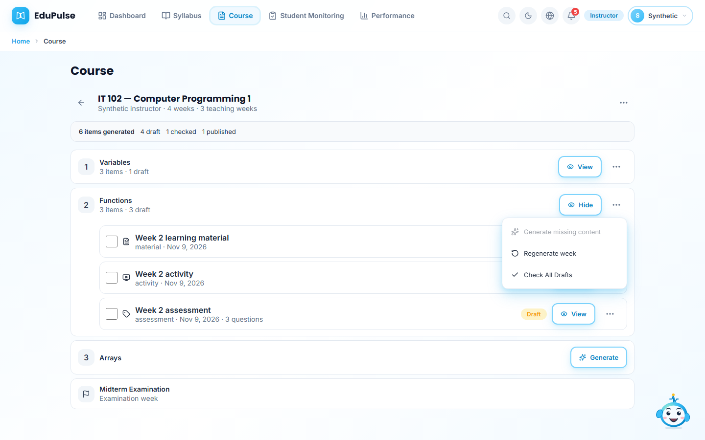

Each saved item keeps a visible **View** button, type and saved generation date where available. Its three-dot menu contains the actions appropriate to its type and status. **Delivery settings** opens below that item; **Close delivery settings** closes the panel. Scheduling and attempt-rule changes still use the saved workspace workflow and require review where indicated.

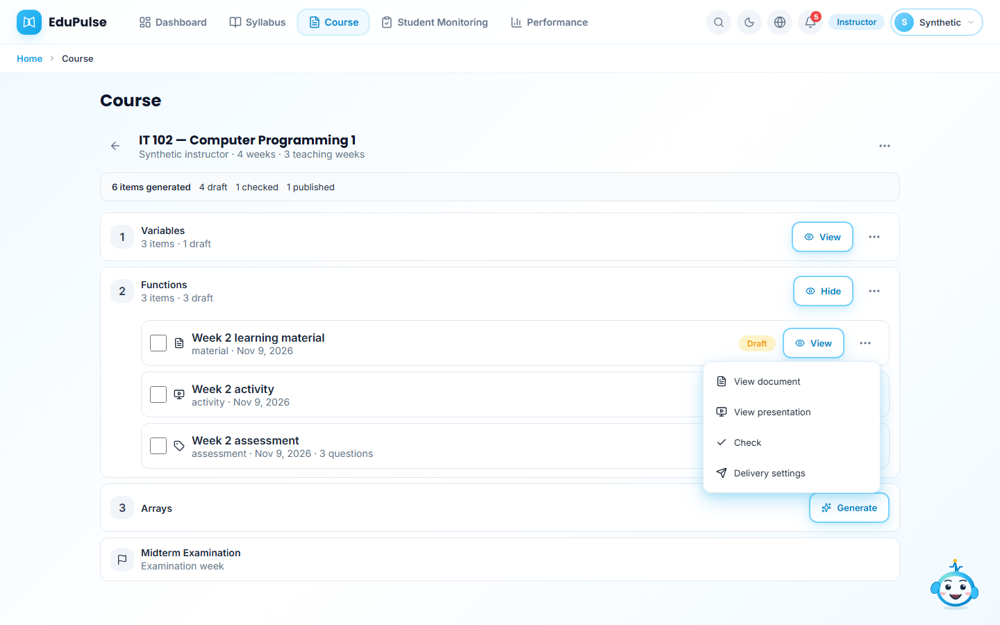

On a phone, course rows stack with their labels and the same primary actions. Menus fit the viewport, support keyboard navigation and dismiss with Escape or an outside click. Solid dark surfaces use the existing theme.

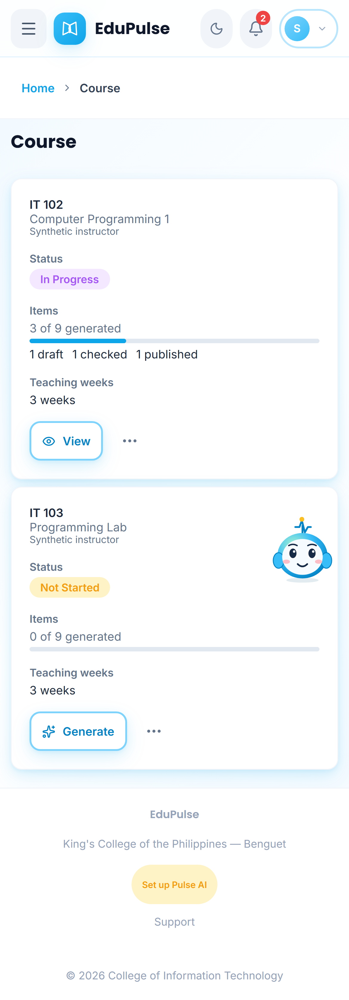

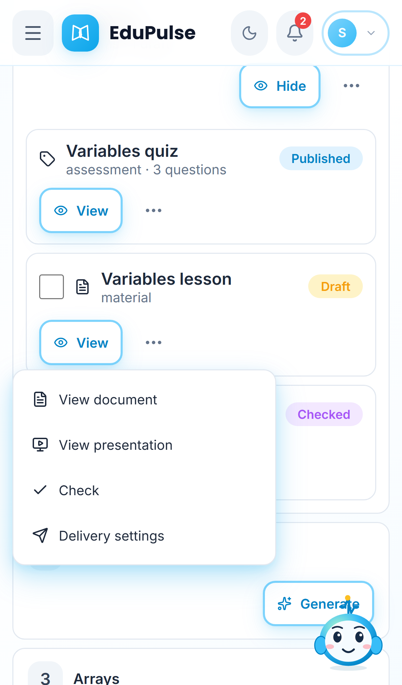

This synthetic provider-failure example shows **Generation did not finish**, the Claude workspace recovery message, **Set up Pulse AI** and **Dismiss** while keeping the opened course available. It does not represent a completed generation request.

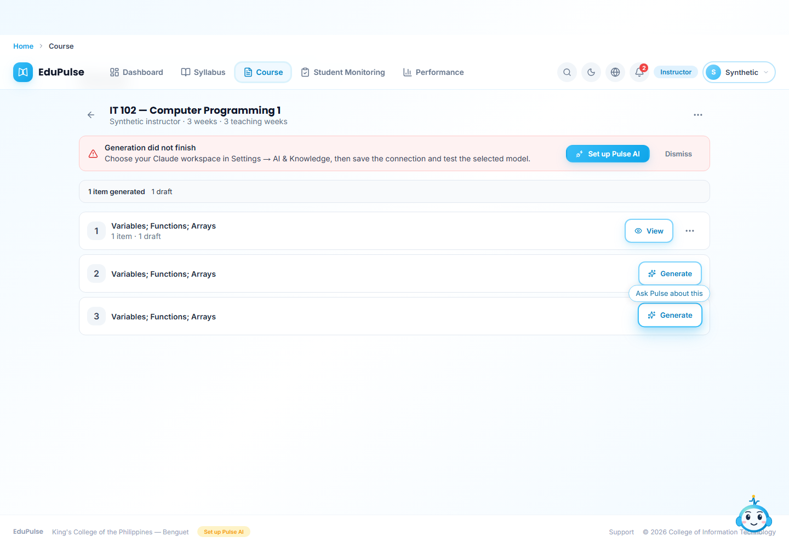

The following editor examples use synthetic saved content, independently of the real model-generation captures above. **Edit** opens the material sections; **Save** keeps the edits and **Cancel** discards the unsaved edit. The section field grows to show all eight example lines.

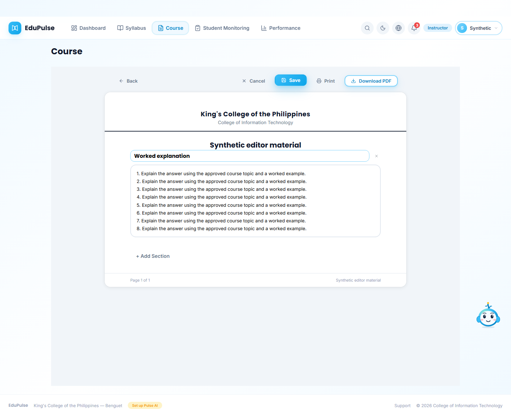

In the assessment editor, **Answer explanation** also grows with its text. The existing topic and response-type controls remain alongside it; changes require **Save Assessment**.

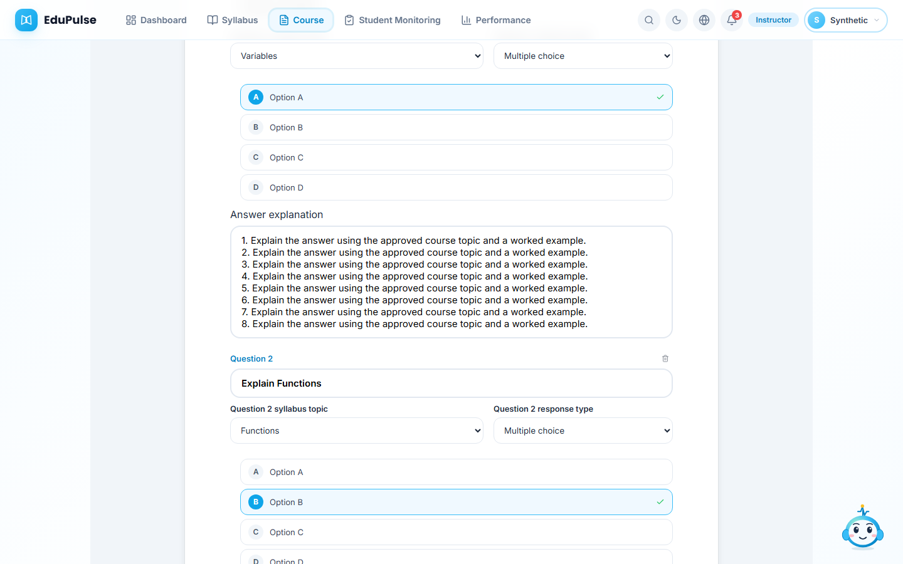

## Revise through Pulse

**Guide this page → Help me get through my review queue** describes the combined workspace and its three-dot review actions.

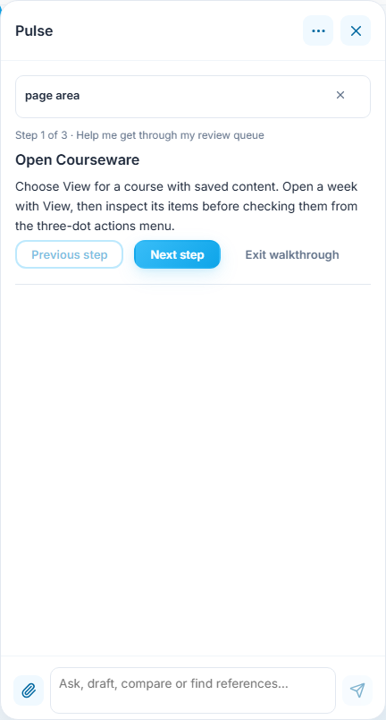

Pulse week generation carries the original request through to the writer, including language and example preferences. “Without web research” disables public searches; “only from the syllabus” also skips private-library retrieval. A file-only week request must first import its source into the syllabus because the week endpoint does not receive chat attachments. The existing **Draft in chat instead** action remains available. [Manual 15](../15-backend-content-delivery/README.md) records the newer prompt-to-save browser capture and its local-model limits.

When an instructor opens a saved draft in a document, presentation or assessment editor, Pulse can propose a typed revision to its content. Compare the selected fields before **Confirm and save draft**. The saved receipt waits for the revision-checked database response. Published items and stale targets are protected. See [Manual 9](../09-pulse-actions/README.md#revise-content-or-class-list-records).

## Download a learning document

**Download PDF** in the document viewer exports the displayed sections, including current edits, with embedded fonts, margins and page numbers. Headings, bold and italic text, lists, tables, quotations and code in a section are laid out as formatted text, not printed as Markdown symbols. The download is a genuine PDF rather than a renamed text file or a print-dialog instruction. It does not save edits, change review status or publish the material. Pulse-generated responses have a separate **Download response as PDF** control.

## Map topics and schedule delivery

Open a saved assessment and map each question to the approved outline week using **Question ... syllabus topic**. Select multiple choice, fixed True/False choices or instructor-marked written responses. **Save Assessment** returns edits to Draft. Topic mastery uses graded, mapped responses only.

Choose **Delivery settings** from an item's three-dot menu to store release/deadline, duration and 1-3 allowed attempts. Review any changed assessment rules again before publication. A published future release stays hidden until its saved time. See [Manual 13](../13-restored-account-sections/README.md) and the [mapping/delivery captures](../../system-walkthrough/09-restored-role-pages/README.md#baseline-workflows-restored-after-owner-confirmation).

Document export shows **Preparing PDF…** while the PDF is created. **Save** awaits its supplied callback, shows a spinner and retains the edited draft if that callback rejects. Workspace autosave remains a separate account operation. Delivery settings and academic save actions use spinners while pending; static three-dot menus still open immediately. See [Manual 19](../19-loading-and-saved-connections/README.md).

The [8 November delivery audit](../../versions/2026-11-08-pulse-context-and-account-support/validation/results.md) verifies that checked drafts stay hidden until publication, notices reach enrolled learners, saved access/assessment activity reaches instructors, and unenrolled students remain blocked. Admin student support previews are read-only for activity/assessments and never count as student completion.

## Return to loaded work

The Course page retains its selected course, expanded weeks and open document/presentation when you navigate away and return. Focus and reconnect do not replace it with a workspace skeleton. Browser Back and **Back to courses** retain their normal destinations. See [Manual 27](../27-cached-workspaces/README.md) for explicit refresh and state-isolation limits.

## Read the syllabus sources

Before generation, Section 7 books/links and the selected week's resources are prepared through **Syllabus sources**. Accessible links are retained once; later generations reuse the saved extraction. Attach readable book chapters where only metadata is available. New draft checks distinguish outline coverage from support by read source passages. Numbered **References** separate used passages from unread syllabus listings; **Review retained source** opens saved text, provenance and original download. Older drafts retain their historical check wording. See [Manual 31](../31-retained-syllabus-sources/README.md) for limits, refresh, private ownership and unavailable-source states.

Course generation also excludes catalog/search HTML that an earlier version had retained. Keeping the original for inspection does not make its listings teaching evidence. Use readable sources; see [reference intake](../35-reference-intake/README.md#older-retained-listings).

Teacher AI review data stays in the authoring workspace. Learner-facing publications omit private review traces, raw retrieval excerpts and answer-key review metadata; published instructional sections and bibliographic references remain. Question keys still live in private scoring storage.

## Interrupted generation

Validated parts now appear as an **Unfinished** preview while the next part is generated. **Stop generation**, later content failures and deliberate reload retain acknowledged progress. **Resume** completes missing compatible parts without regenerating successful ones. The unfinished reader allows viewing/printing/PDF but no editing, checking or release. Complete saved materials stay intact until the replacement finishes. [Manual 26](../26-outline-driven-courseware/README.md#save-parts-and-resume) shows the current progress and recovery screens.
