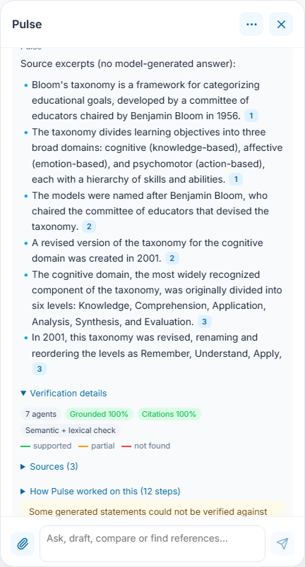
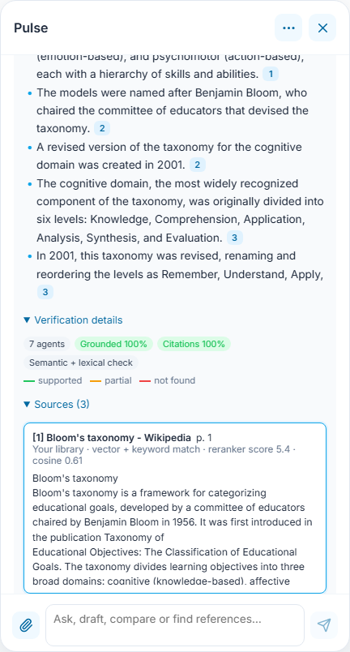
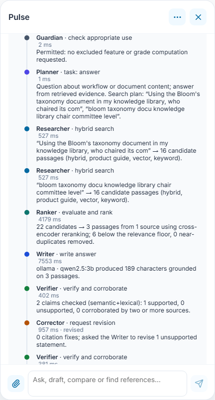
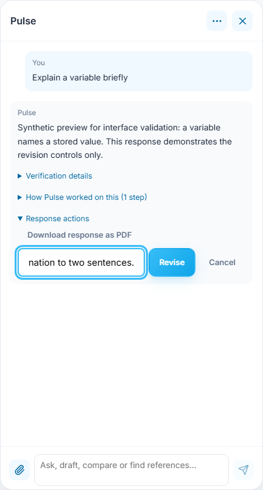
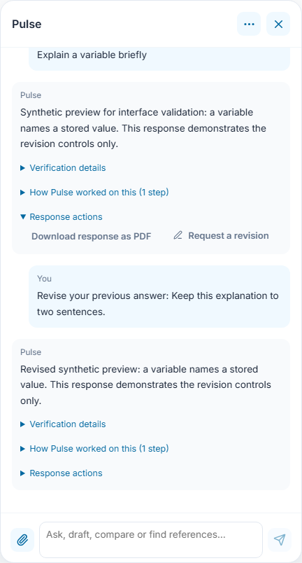
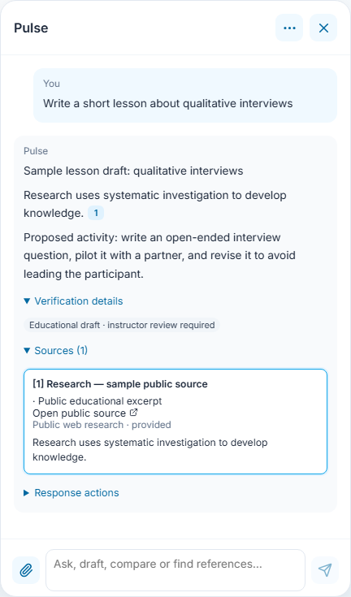

# 5 · Ask Pulse and read a verified answer

**Who:** every role (students get help without assessment answers) · **Where:** the Pulse character at the lower right of every page · Requirements FR-RAG-07–10, FR-GUIDE-10, FR-AGENT-01–02.

## Steps

1. Click **Pulse**, type a question and press **Enter** (Shift+Enter for a new line). Attach up to three files with the paperclip; they are read in the same sandbox as the library.
2. Read the answer and its citations. Expand **Verification details** for grounding, citation and agent indicators. The compact conversation does not underline every sentence by default; these checks describe evidence support, not a guarantee of correctness.

   

3. Click a citation number to open the exact passage, with its page, the document it came from and how it matched.

   

4. Open **How Pulse worked on this** to see each agent’s step, in order:
   * the Guardian’s appropriate-use check, which always comes first;
   * the Planner’s search plan;
   * the Researchers’ searches;
   * what the Ranker kept;
   * the Writer’s model;
   * the Verifier’s check.

   The screenshot shows the Guardian, Planner, Researchers, Ranker and the later writing/checking steps. The badge under the answer counts the agents that worked on it (7 here).

   

5. To change the answer, open **Response actions**, click **Request a revision**, describe what to change and click **Revise**.

   

   The revision-control screenshots use a labelled synthetic response to demonstrate the form and updated answer. They are interface checks, not a live inference-quality result. Source-based responses are checked again after revision; unsupported generated statements can lead to cited source excerpts. Review whether the answer fulfilled the requested change as well as its evidence support.

   

## What Pulse declines

The Guardian checks every request before any other agent works. Pulse declines three kinds of request, each enforcing a rule in the specification:

| Request | Example | Rule |
| --- | --- | --- |
| A student or guest asking Pulse to answer, solve or check assessment items | *“Give me the answers to quiz 2”*, *“Is option B correct for number 4?”* | Pulse guides and reminds students but never answers for them (FLOW_SPEC student role) |
| Plagiarism or AI-authorship detection, integrity scoring, at-risk prediction or proctoring | *“Check this essay for plagiarism”*, *“Predict which students will fail”* | Excluded features (FR-CW-18, FR-ASM-11, NFR-SEC-09, NFR-AI-08) |
| Computing official grades | *“Compute the final grade for BSIT-1A”* | EduPulse is a scoring sheet, not a grading sheet (FLOW_SPEC 7) |

A declined request shows the badge **Declined by the Guardian · appropriate-use rule** and suggests what Pulse can do instead, such as explaining the topic. The timeline then has a single Guardian step, and no search or model runs.

Other requests stay available:
* learning about a topic (*“What is plagiarism and how do I avoid it?”*);
* how to open, take or submit an assessment;
* reviewing your own results;
* an instructor drafting quiz questions and answer keys.

See the [student example](../../system-walkthrough/05-student/09-pulse-declines-assessment-answers.png).

## Good to know

If a connected provider rejects the model or has no API credits, Pulse shows the connection error even when library sources are available. Open **Pulse options → AI settings**, refresh the available models and use **Test selected model**. A saved key and model list alone do not verify generation access. See [connection recovery examples](../08-ai-connections/README.md).

* Without a connected model, Pulse still searches and quotes the best source sentences, labelled **Source excerpts**.
* Document-specific or source-only questions report missing evidence. New educational drafts can use subject knowledge and public research even when the library is empty. A draft is not judged complete merely because it matches a source.
* **Stop** (square button) cancels a running request; **Pulse options → New conversation** starts a new chat; **AI settings** is in the same menu.
* Answers are drafts for your judgement. Validated edit tools can apply or save an instructor-confirmed proposal; conversational text does not establish a completed action. Pulse cannot approve a syllabus or calculate official grades.

For complete syllabus generation, select a course and use the [course-aware drafting flow](../09-pulse-actions/README.md#generate-a-syllabus-from-the-selected-course). Public research sources have links and coverage warnings. **Educational draft · instructor review required** distinguishes new teaching content from a source-grounded answer; editor JSON is context, not a cited academic reference.

This capture uses a synthetic model/research response to demonstrate the real answer and citation controls. The activity is proposed teaching content; the cited statement is separate. The badge does not certify factual accuracy or successful persistence.

## Conversation continuity

Pulse supplies up to 12 recent turns within its bounded prompt budget. Saved preferences and explicit recall come from the current account?s database history, with source labels; they are not proof that an action happened. Open **Pulse options → Conversations and memory**. See [Manual 9](../09-pulse-actions/README.md#private-conversations-and-reusable-preferences) for review, archive, deletion and recall. Requests to navigate or edit use validated tools and confirmation cards.

## Capture provenance

Images 1-3 use the real local Ollama qwen2.5:3b model and the uploaded Wikipedia taxonomy PDF. The model wording could not be fully verified, so the recorded result is explicitly **Source excerpts (no model-generated answer)** with citations. Images 4-5 use labelled synthetic transport to exercise revision controls. The source excerpts and interface fixtures do not establish that a model can satisfy every instruction.
