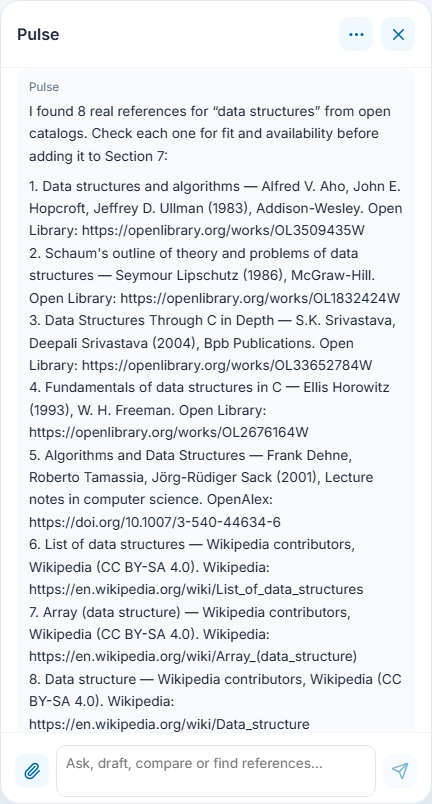

# 6 · Find real references

**Who:** every signed-in account · **Where:** Pulse panel · Requirement FR-RAG-12.

The former settings-library document selector and **Compare in Pulse** control were removed at the owner’s request on 11 November 2026. Existing source data and backend comparison remain available to authorized operations.

## Find references from open catalogs

1. Ask Pulse for references, for example *“Find references about data structures for my syllabus”*. The **Librarian** agent queries three open catalogs only (Open Library for books, OpenAlex for scholarly works, Wikipedia), with no API key, rebuilds every link from the catalog's own identifier, and lists real books and articles with author, year, publisher and link.

   

Check each reference for fit and availability before adding it to Section 7 of your syllabus. If a catalog is unreachable, Pulse lists what the others returned and says which one failed.
