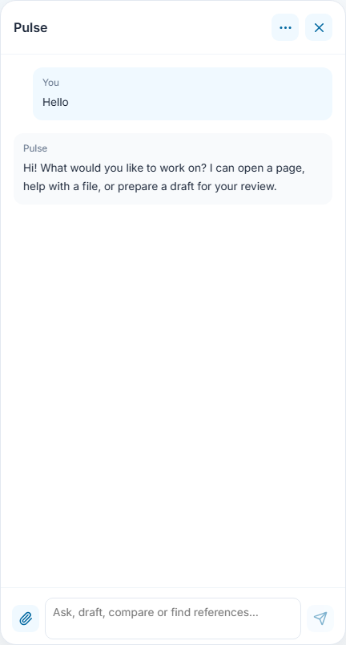
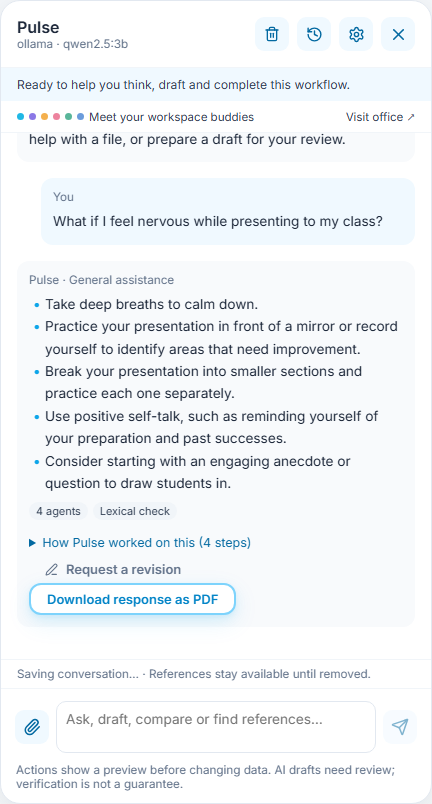
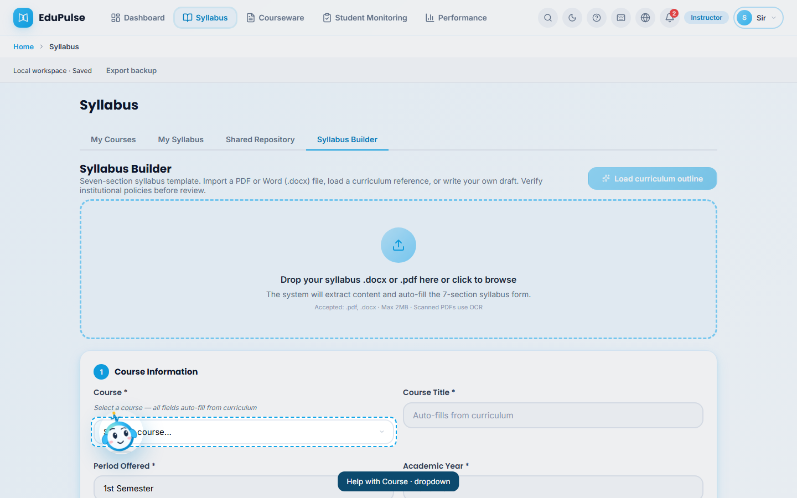
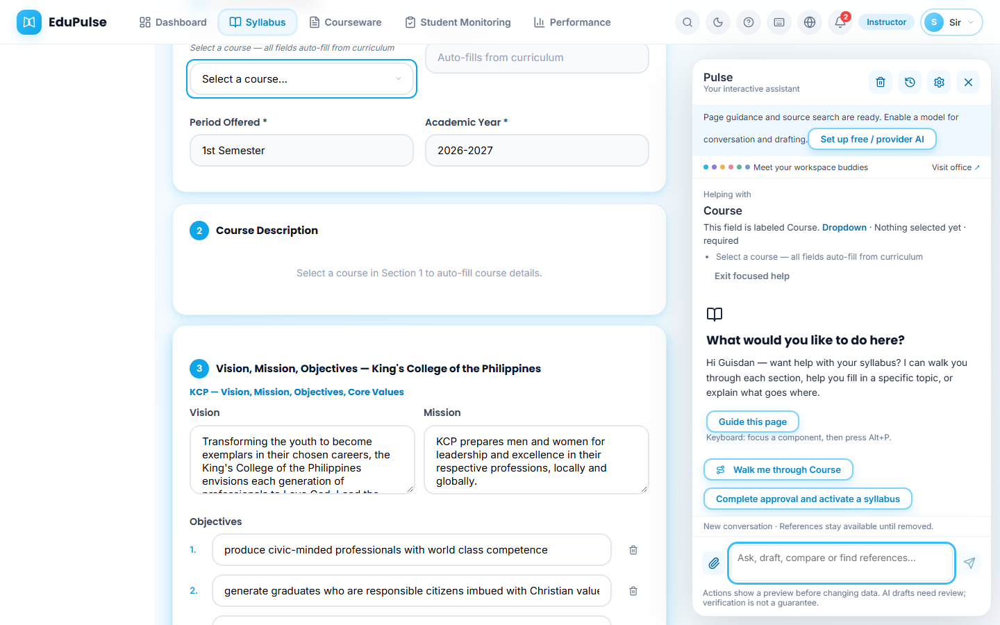
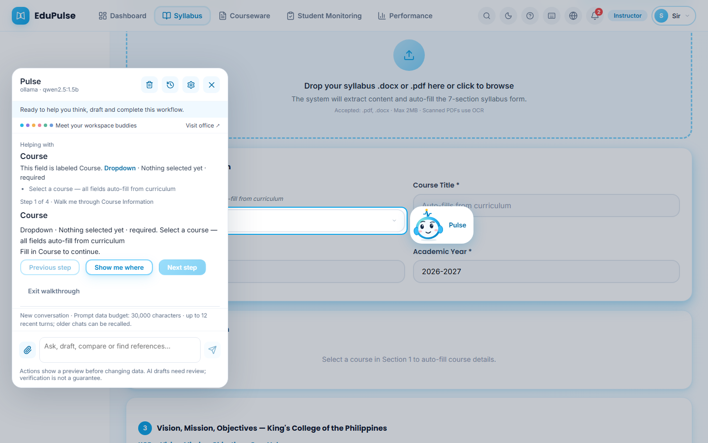
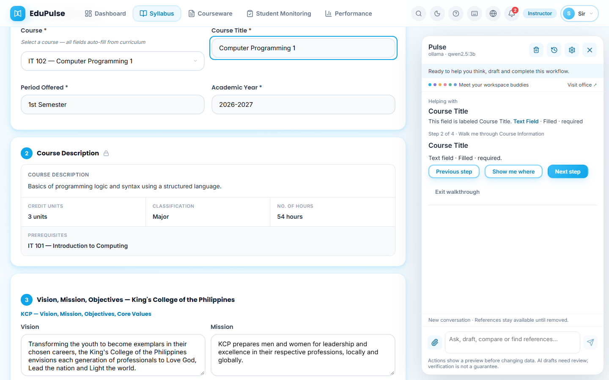
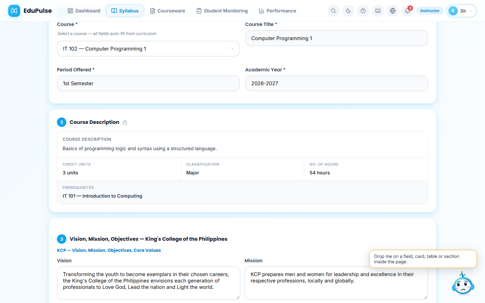

# 7 · Get guidance from Pulse on any part of a page

**Who:** every role · **Where:** the Pulse character at the lower right of every page · Requirements FR-GUIDE-01–10.

Pulse explains the exact component you point it at — a field, card, table or page section — using what is actually on the screen: the control's label, its type, whether it is required, what it currently holds and the hint text around it. It never reads passwords or other sensitive values aloud.

## Conversation and situational help

With a connected model, type a greeting or a situational question in **Ask Pulse**. Pulse uses the conversation rather than requiring a knowledge-library document. Follow-up questions retain the recent exchange. Document summaries, comparisons and institutional questions use source evidence; general replies are not verified institutional policy. Provider failures show a connection error instead of asking for an unrelated document.

Your provider connection belongs to your signed-in account. The system admin can reuse it while switching role views; another signed-in user or a guest cannot inherit it.

## Drag Pulse onto a component

1. Press and drag the Pulse character. While you drag, the component under it is outlined and a label names it (here *Help with Course · dropdown*); the character remains avatar-only; the separate drag hint names the target.

   

2. Release. On wide screens the page and Pulse occupy separate columns; the mascot returns when the panel closes. A compact chip names the selected component. Type a request immediately, or open **Pulse options → Guide selected component** to reveal its walkthrough choices. **Exit focused help** clears the selection.

   

## Follow a section tour

3. The tour goes through the section's visible controls in order (*Step 1 of 4 · Walk me through Course Information*). When a step needs input, **Next step** stays disabled and Pulse says what to do (*Fill in Course to continue*). **Show me where** scrolls to and highlights the control.

   

4. As soon as the value changes, the step updates from the live page. Here the course was chosen, so the next control, **Course Title**, is described as *Text field · Filled · required* (it auto-filled from the curriculum). **Finish walkthrough** ends the tour.

   

## When Pulse cannot help with a drop

5. Dropping Pulse outside the page content (on the top bar or empty space) is refused with a reason: *Drop me on a field, card, table or section inside the page.* Pulse shakes, shows a worried face and returns to its dock. Password fields are refused (*I don’t read password fields*), and areas that belong to another role are refused with a message naming the area.

   

## Other ways to start guidance

You can also say *Guide me through this page* or *Can you redirect me to where I can start building my syllabus?* Pulse opens the authorized page and starts the existing interactive guide when requested. Conversation history survives view switching within the same owner account. **Pulse options → Conversations and memory** opens archive and preference controls; [Manual 9](../09-pulse-actions/README.md#private-conversations-and-reusable-preferences) describes saving, recall and deletion.

* **Click** Pulse, open **Pulse options** and choose **Guide this page** to tour the main area of the current page.
* Rest the pointer on a form control and click **Ask Pulse about this**.
* With the keyboard, focus any control and press **Alt+P**.
* On a touch screen, press and drag Pulse with your finger; it behaves the same way.

To have Pulse **do** something for you (register a class list, file a material under a course, search records, generate a week of courseware or open a page), see [System Manual 9](../09-pulse-actions/README.md).

*Changed in v0.4.0:* tour steps are rebuilt from the live page every time they are shown, so a field filled during the tour is no longer described as “Empty”; the required-field asterisk is no longer read as part of a field's name; and the panel always opens on the side away from Pulse so the two never overlap.

## Meet the office crew

Choose **Pulse options → Workspace buddies** in Pulse for [Workspace buddies](../11-workspace-buddies/README.md). Pip can hand an authorized navigation request back to the real page guide. Exact greetings answer locally; more complex requests show **Thinking…** or **Still working…** while pending. The office does not bypass the tool preview or save confirmation.

On narrower screens, focused help uses a shorter bottom panel; close it to inspect the full page. The outline table scrolls horizontally within its card. The selected component stays outlined without dimming the rest of the editor. Plain greetings retain their local quick response; requests that include work use the action or model route.

Form grids shrink with the available editor width when Pulse opens, so course information fields stay clear of the assistant. Wider outline tables retain their own horizontal scrolling.

## Dialogs and the avatar launcher

The launcher is the Pulse avatar alone, with a keyboard focus ring and an accessible name. Opening a dialog keeps the avatar outside its action area. If Pulse is open, dialogs use a separate desktop column or a scrollable area above the assistant on smaller screens. A second dialog temporarily hides the first; **Escape** closes the top dialog. See [the current layout examples](../12-interface-and-loading/README.md).

Account guidance now describes confirmed shared imports/loading, saved topic results and enrolled publication, with role-specific follow-up actions. Preview personas retain sample warnings. Authenticated Records and Course Loading expose their page targets again; Dean guidance cannot mark results and Associate Dean guidance excludes scores. See the [account Pulse capture](../../system-walkthrough/09-restored-role-pages/README.md#pulse-account-guidance).

## Draft the selected field

Instructors can select an editable field or section and ask Pulse to draft or improve it for the selected course. The proposal lists the selected values for review before applying or saving. Exact field edits preserve neighboring outcomes, weeks and questions. Explicit requests for all fields select the full editable form. See [Manual 14](../14-pulse-and-outline-workspace/README.md).
