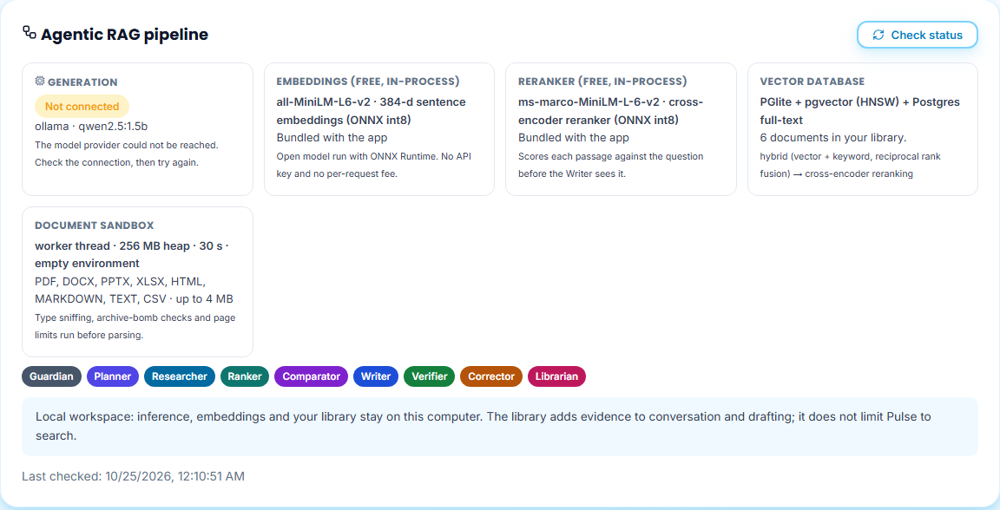
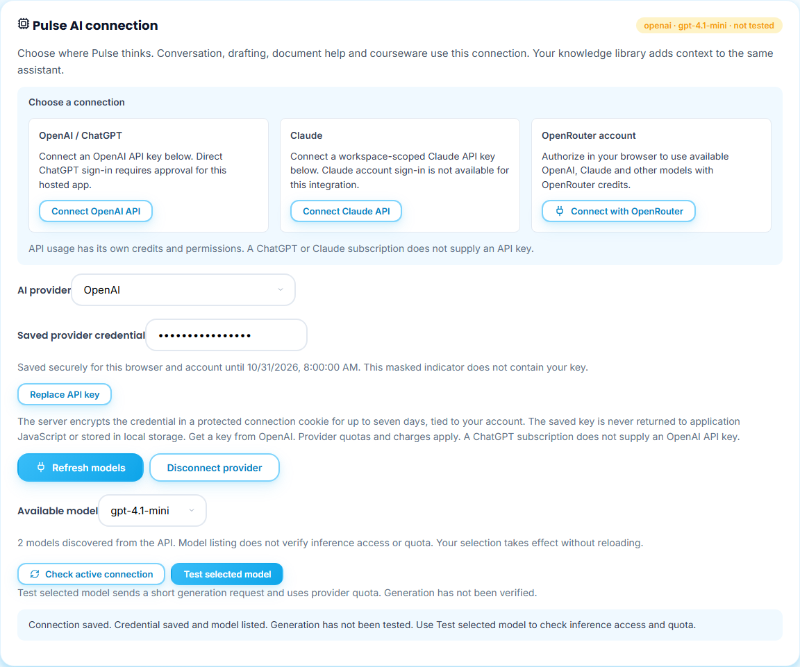
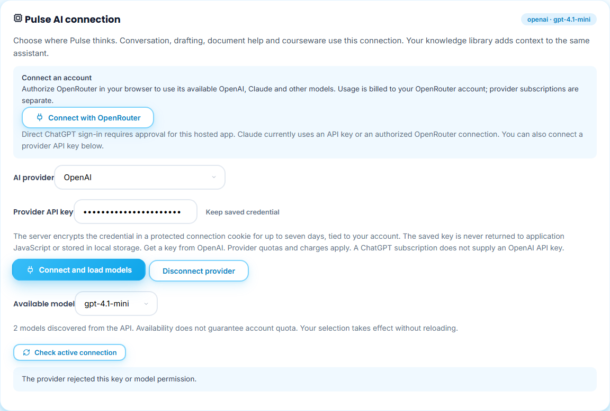
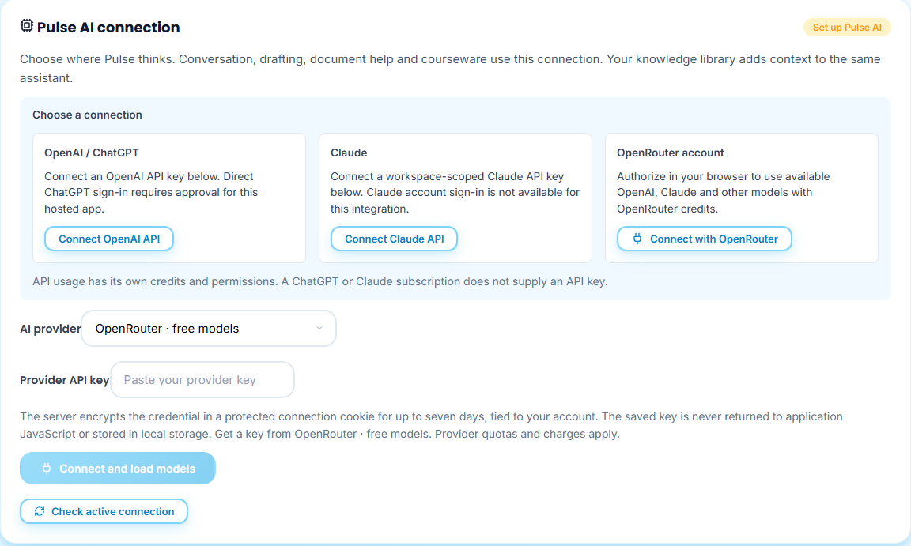
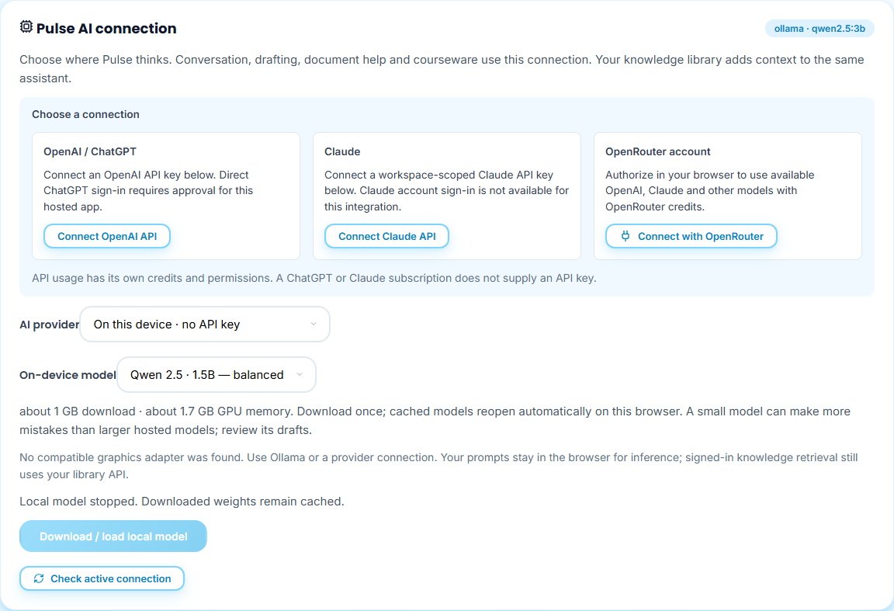

# 8 · Choose where Pulse thinks (AI connections)

**Who:** every account: each admin, instructor and student connects a separate key of their own · **Where:** Settings → *AI & Knowledge* · Requirements FR-SET (as corrected 2026-09-16), NFR-AI-01/02, FR-RAG-05/06.

## Check the pipeline

**Agentic RAG pipeline** shows what is working right now: the generation model, the free embedding model and reranker (always available, no key), the vector database, the document sandbox and the nine named agents, starting with the Guardian, which checks appropriate use before the others work. The agents’ tasks, goals and tracked results are listed in the System Admin console ([System Walkthrough 07](../../system-walkthrough/07-system-admin/README.md)). Use **Check status** after changing anything.

The current capture shows **Not connected** for local Ollama because that runner could not be reached. Embeddings/reranking are bundled, and six documents are in the local library. This is a truthful local status, separate from the synthetic credential UI captures below.

## Connect a provider

1. In **Pulse AI connection**, open **AI provider**. Free options are labelled: Gemini and Groq free tiers, **OpenRouter · free models**, **Hugging Face Inference · free credits**, or OpenAI/Anthropic with your own key.
2. Paste your key and click **Connect and load models**. The key is sent once, encrypted by the server and kept in a protected cookie for up to seven days. It is tied to your signed-in account and is never shown again. For a signed-in account the form opens on OpenAI; this capture, made with a preview persona, shows **OpenRouter · free models**.
3. Pick a model from the list returned by the provider. For OpenRouter and Hugging Face, free models are listed first and marked “(free)”.

After a successful save, **Saved provider credential** shows a masked indicator and expiry, with **Replace API key** and **Refresh models**. The key remains encrypted in the protected cookie for this browser/account; it is not repopulated into an editable field. Reopening Settings restores the saved indicator. Refreshing models preserves an available selected model. Generation status below uses the same live connection state as Pulse, so it updates after connecting, switching models or disconnecting. Model discovery checks access; a prompt can still fail because of quota or model permissions.

**Replace API key** opens an editable password field. A rejected replacement keeps that entry for retry and leaves the previously saved connection intact. **Keep saved credential** cancels replacement and clears the unsaved text.

These two screenshots use synthetic provider responses and fake credentials to exercise saved/failed UI states. The two-model list and expiry are controlled fixtures, not a live OpenAI account, quota test or successful paid inference claim.

## Authorize an account in the browser

Choose **Connect with OpenRouter**. EduPulse redirects to OpenRouter, where you sign in and review authorization. After consent, you return to **AI & Knowledge**; EduPulse exchanges the one-use code on the server, saves an encrypted account-bound credential and loads available models. Canceling or failing authorization preserves the previous connection. OpenRouter usage follows your own account credits/limits, separate from ChatGPT or Claude subscriptions. Manage or revoke the issued key in OpenRouter's account settings; **Disconnect provider** removes EduPulse's local connection cookie.

The redirect, callback, expiry, identity binding and failure paths are regression-tested with synthetic transports. A real user's provider-consent flow has not been completed by the agent. [OpenRouter's official authorization guide](https://openrouter.ai/docs/guides/overview/auth/oauth) defines the protocol.

The owner confirmed that EduPulse has no approved hosted ChatGPT OAuth client. Direct **Continue with ChatGPT** therefore remains unavailable. [OpenAI's hosted-app requirements](https://developers.openai.com/siwc/token-sharing-open-source) require approval; [Claude's public authentication methods](https://platform.claude.com/docs/en/manage-claude/authentication) currently provide API keys and workload/native-app methods rather than consumer Claude sign-in for this web app. API keys and authorized OpenRouter models remain supported.

Keys are never shared between accounts. When the owner admin switches to another view, the account and its key stay the same. The hosted site has no shared server key: without your own key, Pulse answers with quoted source excerpts or uses the on-device model.

Every connect, failed connect and disconnect by a signed-in account is recorded in the system audit log, which the system admin sees in *Audit activity* ([System Walkthrough 07](../../system-walkthrough/07-system-admin/README.md)). The log records only the provider name, never the key.

## Run a model on this device (no key)

Choose **On this device · no API key**, pick **Qwen 2.5 · 1.5B — balanced** (≈1 GB download) or **0.5B — lighter**, then **Download / load local model**. It needs a browser with WebGPU (current Chrome or Edge with graphics acceleration). If your device cannot run it, Pulse says so and keeps the button disabled, as in this capture:

In the downloaded local app, **Ollama · local app server** uses models installed with `npm run ai:setup`.
