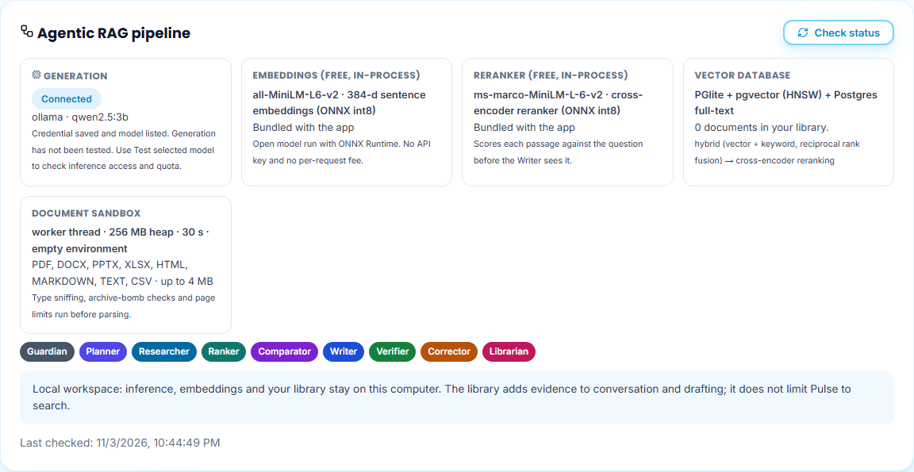
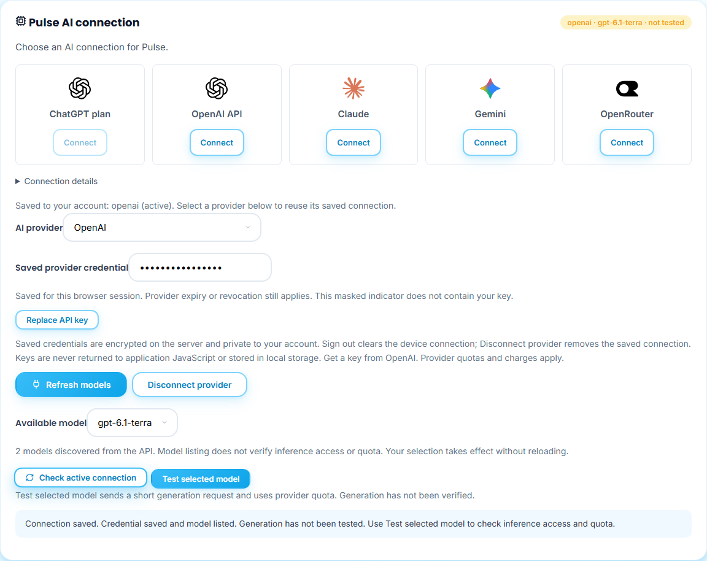
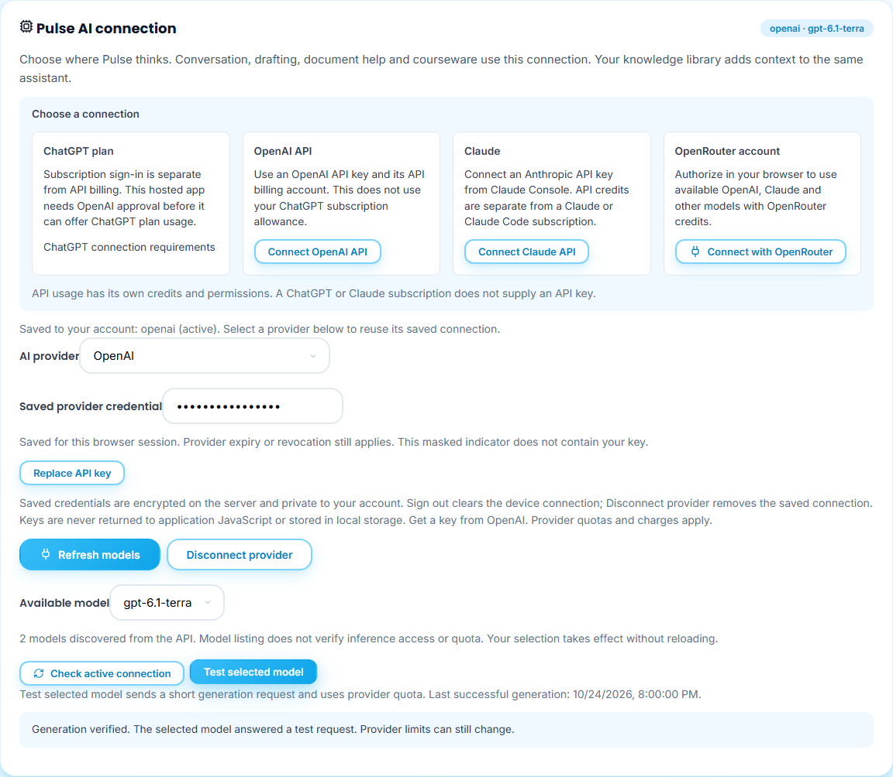
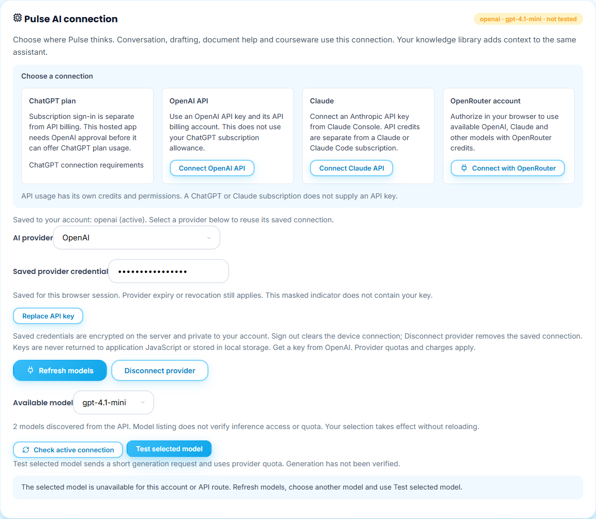
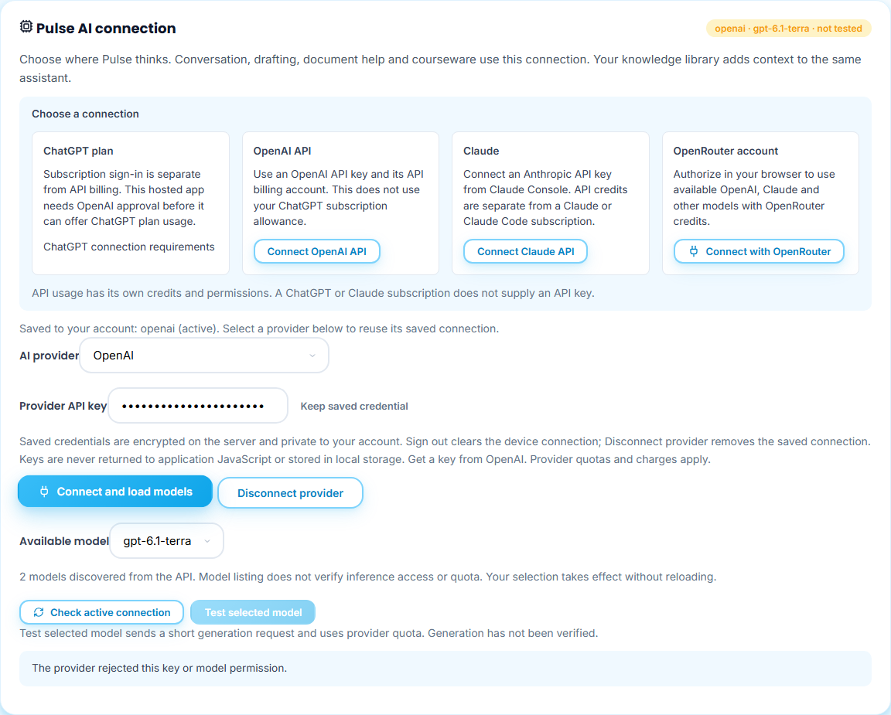
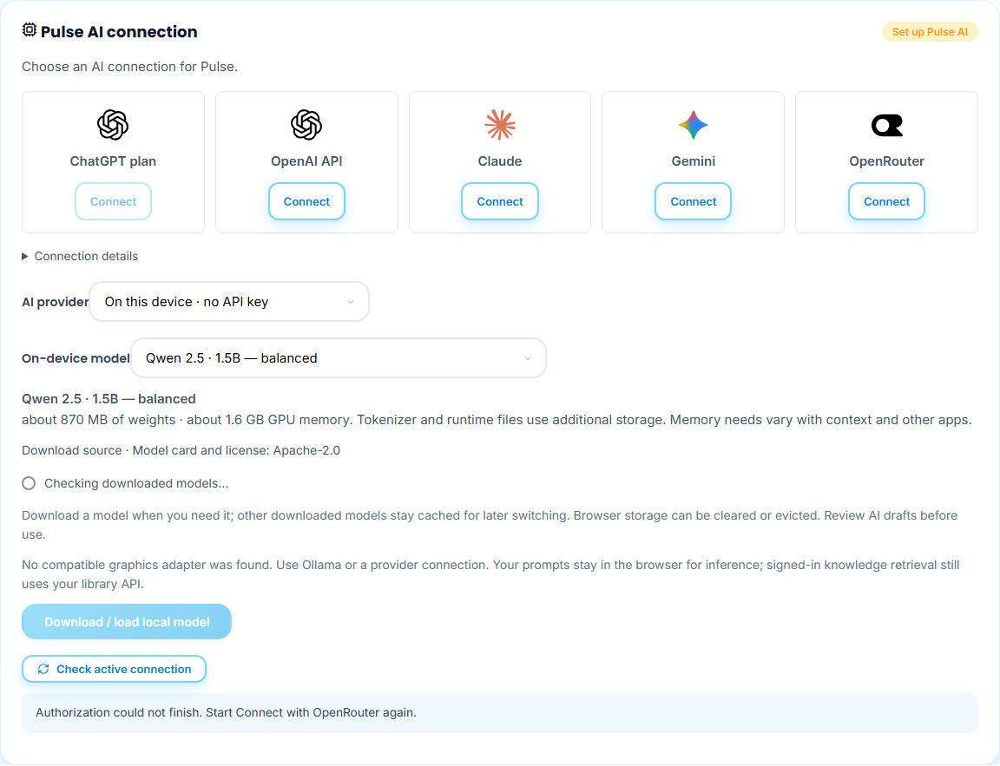
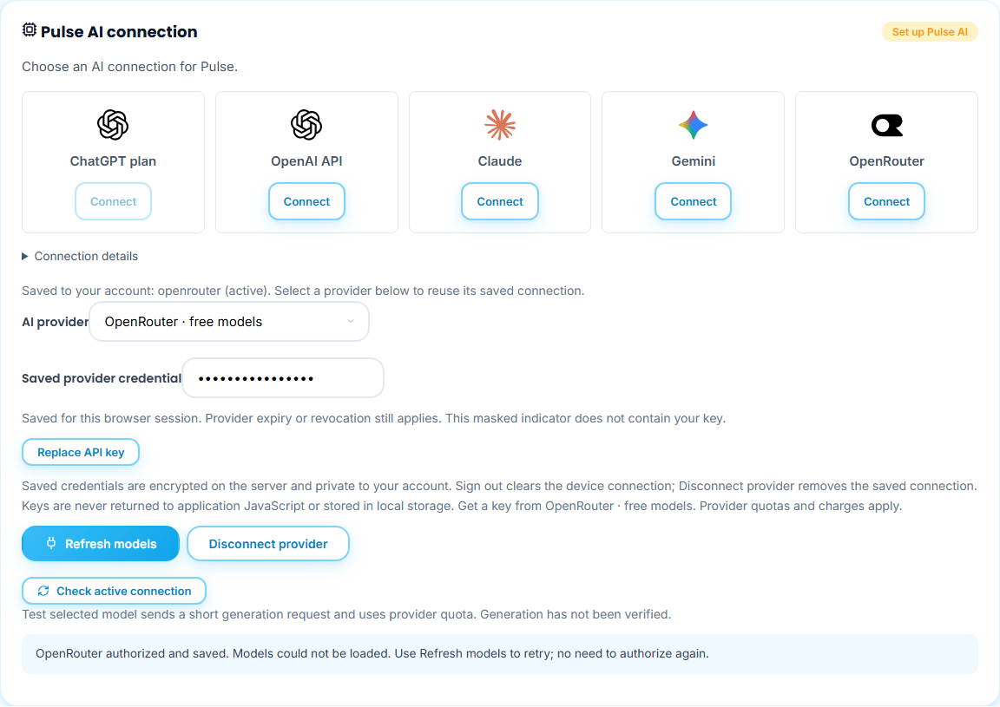
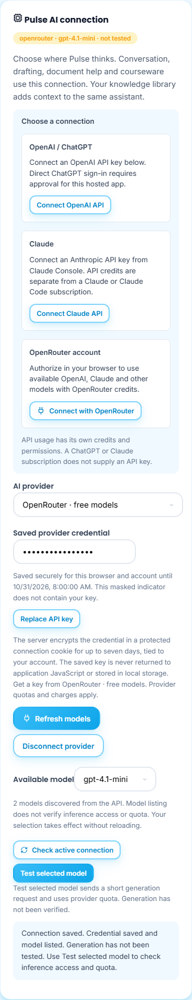
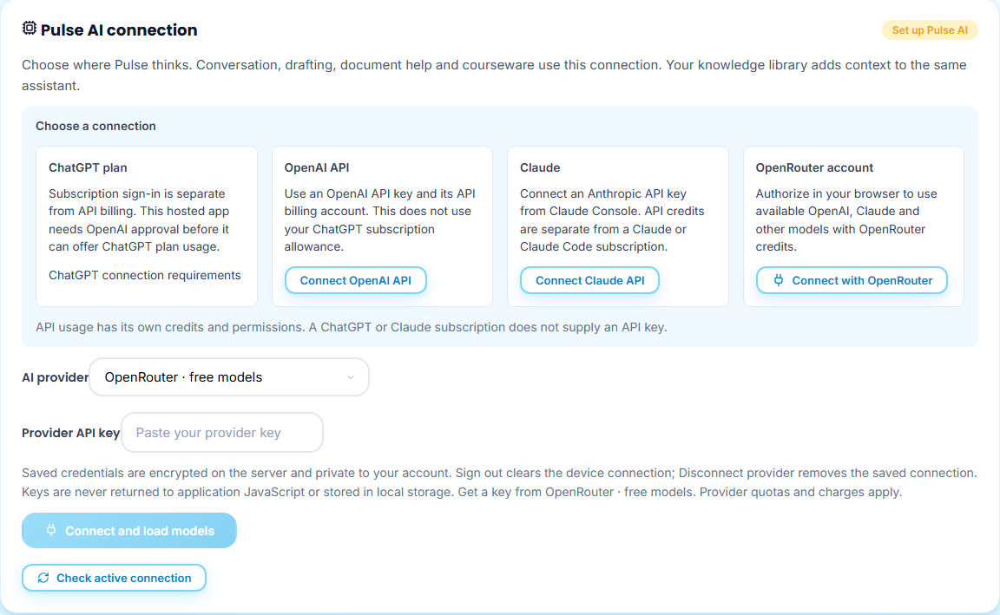
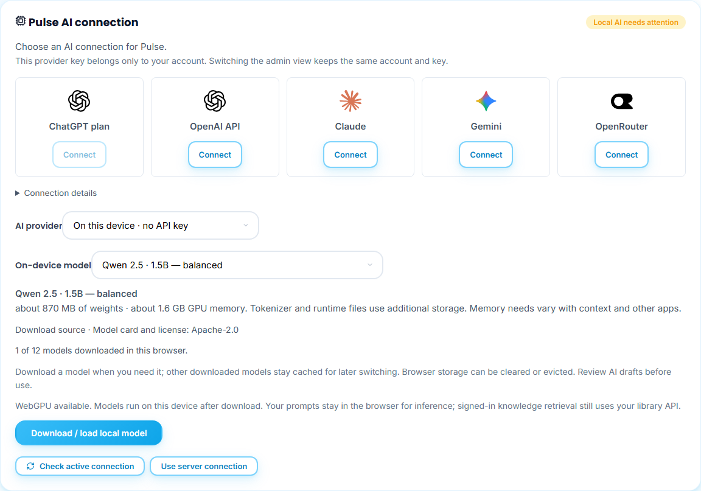

# 8 · Choose where Pulse thinks (AI connections)

**Who:** every account: each admin, instructor and student connects a separate key of their own · **Where:** Settings → *AI & Knowledge* · Requirements FR-SET (as corrected 2026-09-16), NFR-AI-01/02, FR-RAG-05/06.

## Check the pipeline

**Agentic RAG pipeline** shows what is working right now: the generation model, the free embedding model and reranker (always available, no key), the vector database, the document sandbox and the nine named agents, starting with the Guardian, which checks appropriate use before the others work. The agents’ tasks, goals and tracked results are listed in the System Admin console ([System Walkthrough 07](../../system-walkthrough/07-system-admin/README.md)). Use **Check status** after changing anything.

The current pipeline capture shows local **Ollama / qwen2.5:3b**, bundled embeddings/reranking and an empty library before the document tasks run. The connection card says generation has not been tested at this point; use **Test selected model** to verify inference. Synthetic credential UI captures below are labelled separately.

## Connect a provider

1. In **Pulse AI connection**, open **AI provider**. Free options are labelled: Gemini and Groq free tiers, **OpenRouter · free models**, **Hugging Face Inference · free credits**, or OpenAI/Anthropic with your own key.
2. Paste your key and click **Connect and load models**. The key is sent once, encrypted by the server and kept in a protected cookie for up to seven days. It is tied to your signed-in account and is never shown again. For a signed-in account the form opens on OpenAI; this capture, made with a preview persona, shows **OpenRouter · free models**.
3. Pick a model from the list returned by the provider. For OpenRouter and Hugging Face, free models are listed first and marked “(free)”.

Use **Connect OpenAI API** or **Connect Claude API** to select that provider's key form directly. For Claude, **Claude workspace** can stay blank when the key is scoped to one workspace. An unscoped personal/service key needs a workspace: use **Load Claude workspaces**, choose **Available Claude workspaces**, then **Save workspace and load models**. If the key cannot list workspaces, copy its workspace ID from Claude Console. Pulse keeps the saved key and available model; it never chooses a billing workspace automatically. See [workspace recovery](../17-pulse-navigation-and-provider-recovery/README.md). **Connect with OpenRouter** starts browser authorization. The connection choices explain which account sign-in methods are available.

After a successful save, **Saved provider credential** shows a masked indicator and expiry, with **Replace API key** and **Refresh models**. The key remains encrypted in the protected cookie for this browser/account; it is not repopulated into an editable field. Reopening Settings restores the saved indicator. Refreshing models preserves an available selected model. Generation status below uses the same live connection state as Pulse. A returned model catalog is labelled **Model listed · not tested**; listing does not prove inference access or quota.

Choose an **Available model**, then **Test selected model**. This sends a short generation request using provider quota. A successful reply records **Last successful generation** and changes the pipeline badge to **Generation verified**. Switching models, changing workspace or replacing the key requires a new test. **Check active connection** refreshes the catalog/status without sending a generation request.

If the provider rejects the selected model, the alert directs you to **Refresh models**, select another model and test again. The saved credential remains available; the generation-verification mark is cleared. API credit exhaustion and rate limits have separate messages. These errors are also reported from Pulse chat, including requests with library sources.

### Models that think before they answer

Many models reason privately before they reply: most free OpenRouter models, OpenAI's GPT-5 and o-series, and Gemini 2.5. That reasoning comes out of the same length limit as the reply. EduPulse gives it its own room on top of each reply's length, so a short first question no longer runs out before the answer starts. If an OpenRouter model still spends everything on reasoning, EduPulse asks it once more to answer without reasoning. When that is not possible, the alert reads *The model spent its output limit on hidden reasoning before it wrote an answer*. Nothing is applied: try again, ask for a smaller part, or choose another model.

Some models, such as **Cohere: North Mini Code (free)**, have no JSON mode and may write a sentence or a code block around a Pulse proposal or a lesson draft. EduPulse reads the complete proposal inside the reply and checks it as usual.

**Replace API key** opens an editable password field. A rejected replacement keeps that entry for retry and leaves the previously saved connection intact. **Keep saved credential** cancels replacement and clears the unsaved text.

Screenshots 04–10 use synthetic provider responses and fake credentials. The model list, expiry, successful-generation state and failures are controlled UI fixtures; they do not establish live provider access or successful paid inference.

## Authorize an account in the browser

Choose **Connect with OpenRouter**. EduPulse redirects to OpenRouter, where you sign in and review authorization. After consent, you return to **AI & Knowledge**; EduPulse exchanges the one-use code on the server, saves an encrypted account-bound credential and loads available models. Canceling or failing authorization preserves the previous connection. OpenRouter usage follows your own account credits/limits, separate from ChatGPT or Claude subscriptions. Manage or revoke the issued key in OpenRouter's account settings; **Disconnect provider** removes EduPulse's local connection cookie.

The return uses `/auth/provider/openrouter`, separate from EduPulse sign-in. If authorization succeeds but the model catalog is temporarily unavailable, the new credential is still saved. **Refresh models** finishes setup without a second authorization. If your EduPulse session has ended, a visible message asks you to sign in and reconnect.

An unsuccessful code exchange shows an alert in settings, including when you have no previously saved provider. Starting another connection or checking status clears the old authorization notice.

On a phone, the connection choices stack vertically. The same saved credential, model selection and testing controls remain available.

The redirect, callback, expiry, identity binding and failure paths are regression-tested with synthetic transports. A real user's provider-consent flow has not been completed by the agent. [OpenRouter's official authorization guide](https://openrouter.ai/docs/guides/overview/auth/oauth) defines the protocol.

The owner confirmed that EduPulse has no approved hosted ChatGPT OAuth client. Direct **Continue with ChatGPT** therefore remains unavailable. [OpenAI's hosted-app requirements](https://developers.openai.com/siwc/token-sharing-open-source) require approval; [Claude's public authentication methods](https://platform.claude.com/docs/en/manage-claude/authentication) currently provide API keys and workload/native-app methods rather than consumer Claude sign-in for this web app. API keys and authorized OpenRouter models remain supported.

Keys are never shared between accounts. When the owner admin switches to another view, the account and its key stay the same. The hosted site has no shared server key: without your own key, Pulse answers with quoted source excerpts or uses the on-device model.

API-key saves, failed replacements and disconnects by a signed-in account are recorded in the system audit log, which the system admin sees in *Audit activity* ([System Walkthrough 07](../../system-walkthrough/07-system-admin/README.md)). The log records only the provider name, never the key.

## Run a model on this device (no key)

Choose **On this device · no API key**, pick **Qwen 2.5 · 1.5B — balanced** (≈1 GB download) or **0.5B — lighter**, then **Download / load local model**. It needs a browser with WebGPU (current Chrome or Edge with graphics acceleration). If your device cannot run it, Pulse says so and keeps the button disabled, as in this capture:

In the downloaded local app, **Ollama · local app server** uses models installed with `npm run ai:setup`.
