# 9 · Ask Pulse to do it: register a class list, file a material, search, generate, open a page

**Who:** instructors (class lists, generation), students and instructors (materials), every role (search, opening pages) · **Where:** the Pulse panel on any page · Requirements FR-GUIDE-31–36.

Pulse can act on what you ask, not only answer it. It reads your message and any file you attach, then shows an **action card** that says exactly what it will do. Nothing that changes your data happens until you press the card's confirm button; **Cancel** leaves everything as it was. Searches and page changes only read or navigate, so they happen at once.

Pulse first matches familiar requests with fixed rules. Other requests can use a model to propose one typed tool; its output must pass the same field, role and target checks. Conversational text cannot execute code or change a record. Mutation cards require your confirmation, and saved-result receipts wait for the database response. A preview-device receipt explicitly says no cloud save was made.

`PULSE-ACT-001` links this task to `tests/operator.test.ts` and `tests/browser/pulse-actions.spec.ts`. Role-scoped navigation is also exercised by `AUTH-001` in `tests/browser/access.spec.ts`: **Performance** is available to Dean/instructor/student views, and Pulse declines it for Associate Dean and the admin console view. Server courseware generation rechecks the verified role (`AUTH-002`); a role named in a message or request body grants no permission. **Undo** preserves a class list changed after confirmation and displays a notice instead of overwriting newer work. Command-completion guidance follows real saved results, not a model's claim of success.

The class list in these screenshots is sample data: invented names with `example.edu` addresses, not real student records.

## Register a class list (instructors)

1. Open Pulse and attach the EduSuite class list with the paper clip: CSV, Excel (`.xlsx`), PDF, Word (`.docx`) or text, one student per row with a **Name** column (or **Last Name** and **First Name**). Pulse reads it in the same sandbox as the knowledge library. The file chip under the message box confirms it is a class list and counts the students (*class list, 6 students*). Type what you want, for example *Register these students in my course*, and send.

   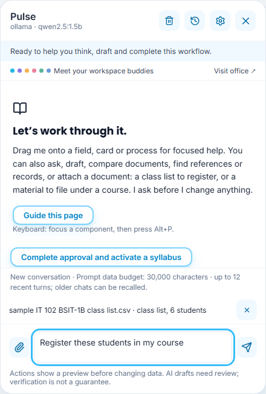

2. The card **Register students from *file*** shows how the file was read (*6 students found (comma-separated table)*), the **Course** and **Block section** (detected from the file name, a course column or the first lines; change them if needed), the first five students (*and 1 more*) and what will change. Here it is a new class list: *This adds a new class list for IT 102 · BSIT-1B to Syllabus → My Courses*. For a course and block you already registered, the card says instead how many students are new and how many are already listed. Rows without a name are reported, never guessed, and duplicate rows are merged. Press **Register *n* students** to confirm, or **Cancel**.

   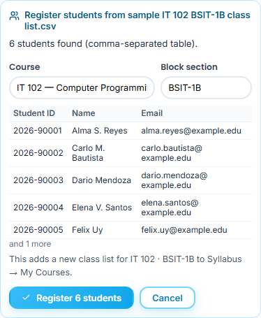

3. Pulse saves the class list to your workspace and opens **Syllabus → My Courses**, where it appears under **Registered Courses**. The card now says what was registered and from which file, with **Open My Courses** and **Undo**. **Undo** removes this registration, or restores the earlier list if it was merged. Your message lists the file under **Attached:** because only the action used it; files that Pulse reads to answer a question are listed under **References:**.

   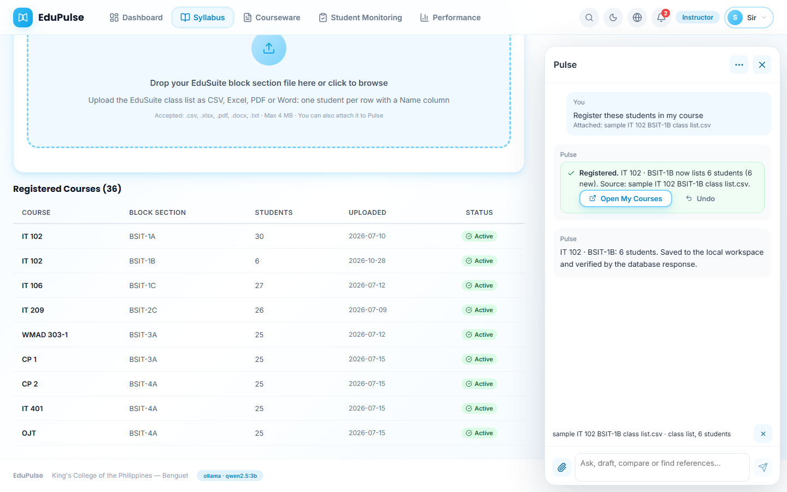

   The **My Courses** tab's own upload area uses the same reader, so a file uploaded there is registered the same way: real names from the file, merged by student ID, email or name ([System Walkthrough, instructor](../../system-walkthrough/04-instructor/README.md#24-syllabus)).

4. Ask about a student, for example *Is Dario Mendoza registered?* Pulse searches your registered class lists, courses, courseware and knowledge library and lists each match with the record it came from (**Source:** the class list file) and **Open** to go to it. With a class list attached, the same question searches the attached list.

   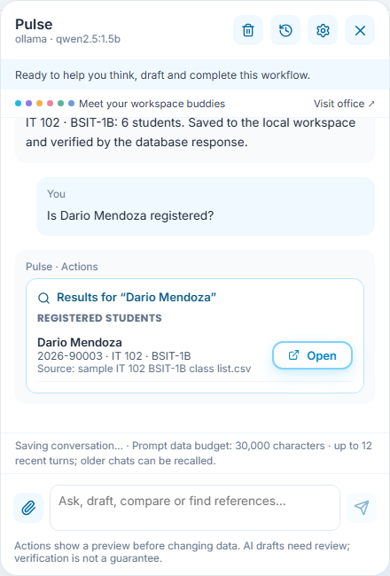

## File a material under a course (students and instructors)

5. Attach a handout, notes or slides and ask *Which course is this for?* (or *save this to IT 209*). The card ranks the courses it matches. The best match is selected. Each suggestion says why: the words from your file and where they appear in the course (its title, description, program outcomes or a syllabus outline week, for example *“flexbox” (Week 3 topics)*), and how strong the match is (**Named in the file**, **Strong match** or **Possible match**; here three courses are offered as possible matches). Your own courses are marked **Your course**. Pulse ranks first by keywords, then re-ranks the shortlist by meaning with the embedding model; the line under the list says which method was used. Pick another course from **Another course** if needed and check the **Title**.

   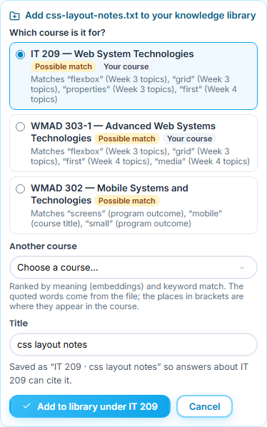

6. Press **Add to library under *course*** to index it in your knowledge library. Its title starts with the course code (*IT 209 · css layout notes*), so later answers about that course find and cite it. The card says how many passages were indexed and that Pulse cites the file by title (and by page, for files that have pages). The card offers **Ask about it**, **Make a study guide** (a cited draft) and **Open knowledge library**, where the document lists its course.

   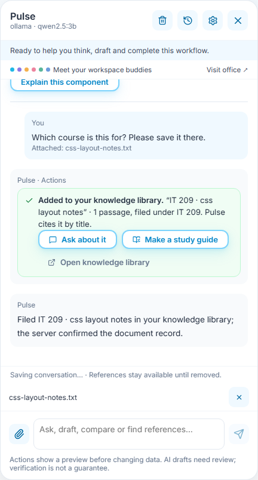

   If you attach a material without a message, Pulse offers the same card plus **Summarize it**, **Make a study guide** and **Make practice questions**, all quoting and citing the file. If you ask a question about the file instead, Pulse answers first and offers to file it underneath the answer.

## Prepare a week of courseware (instructors)

7. Ask, for example, *Generate week 1 materials for IT 102*. The card shows the source it will follow: the course's active syllabus and its **Course Outline** week, here the **Topics** and **Learning outcomes** of Week 1 (activities and assessments appear when the outline lists them). The **Week** list marks weeks that already have items (*has drafts*), and the card says what happens to them: here *This week already has 3 items: drafts are replaced*. Checked or published items are always kept. **Generate Week *n* drafts** writes a lecture material, an activity and a short assessment as drafts for your review, then opens **Courseware** on that course with the week expanded. **Draft in chat instead** writes a draft in the conversation without saving anything. A course without an active syllabus cannot be generated; the card says why and opens **My Syllabus**.

   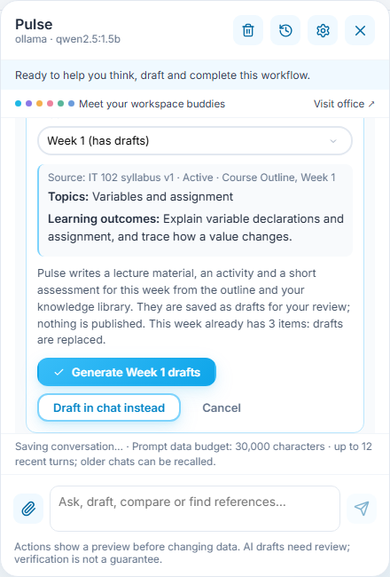

## Use the class-list uploader directly

In **Syllabus → My Courses**, the uploader also reads CSV, Excel `.xlsx`, PDF, Word `.docx` and text class lists. Review the students, course and block before **Register Course**. If a replacement file is refused, the previous preview is cleared so it cannot be registered by mistake. Click **Try Again**, then select the corrected file; the same filename can be selected again. Save legacy `.xls` workbooks as `.xlsx` first.

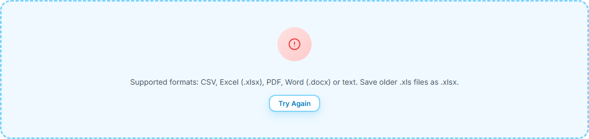

## Open a page

If you confirm another registration for the same class and then undo the earlier action, Pulse preserves the newer changes and shows the notice below. Undo the later action first if you intend to restore the earlier state.

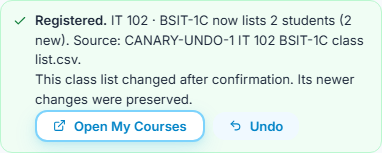

Ask *Take me to the scoring sheet*, *Open my courses* or *Where is the knowledge library?* Pulse opens the page and says so (*Opened Student Monitoring.*). It opens only pages your role can use; otherwise it says the page is not available for your role.

## Answers that cite your own records

When your message names a course that has a syllabus in your workspace (for example *What does IT 102 cover in week 3?*), Pulse adds that syllabus to the references it searches, and the answer cites it like any other source. Files you added under a course are found by the course code in their title.

## Import selected syllabus sections from a PDF or Word file

Attach a PDF or `.docx` and ask *Import the course outline from this syllabus*. Pulse recognizes syllabus structure and offers **Import syllabus sections**. Open the intended **Syllabus Builder**, then choose **Prepare edit preview**. Only sections actually extracted from the source are offered; unreadable or absent content is not invented. Scanned PDF pages use the device OCR worker and still require review.

Choose **Course for this syllabus**, select the fields, and compare **Before** with **Proposed**. **How to integrate sections** offers replacement or addition. Replacement replaces the selected list; addition preserves existing items and combines matching outline weeks. Course identity and description remain fixed curriculum data; approval, signatures, checked status and publication are never imported as permissions.

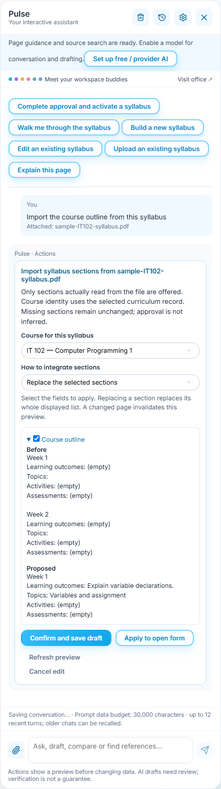

**Apply to open form** changes the mounted form only. **Confirm and save draft** saves an instructor draft after validation and waits for persistence. A page or record changed after the preview requires **Refresh preview**. **Cancel edit** leaves the record unchanged. The screenshot below shows application to the form, not a database save.

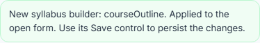

## Revise content or class-list records

Open a syllabus builder, lecture/activity document, presentation or assessment editor. Ask for a precise change, such as *Revise the program outcomes to emphasize worked examples*. Pulse shows the target, selected fields and before/after text. Generated content remains a draft. Published courseware is protected; open a draft version first. Title changes require **Confirm and save draft**.

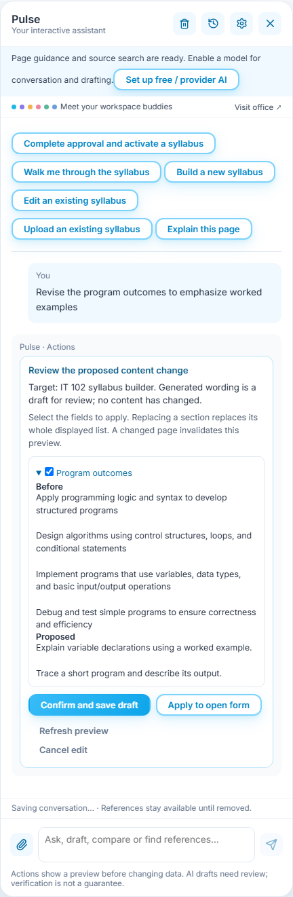

This capture uses a synthetic model response to demonstrate the real preview controls; it is not an inference-quality evaluation. Model schema, field scope and forged-role rejection are tested separately in `tests/pulse-tools.test.ts`.

For a class list, ask *Remove student B102 from the IT 102 class list* or attach an updated export. **Review class-list changes** requires an owned class list and exact selected rows for removal or field edits. **Roster operation** offers merge, replacement, removal and field update. Review **Preview roster changes**, then **Confirm roster changes**. Replacement removes old rows absent from the file. A changed roster invalidates the preview; no model-generated student identities are inserted.

## Private conversations and reusable preferences

Open **Conversations and memory** in the Pulse header. Chats are stored under the signed-in account; local development uses its local database. **New conversation** keeps saved chats available in history. Select a title to reopen its most recent 100 messages; older stored text remains searchable through explicit recall. **Archive**, **Restore**, and **Delete** control history. Deleting a source conversation also removes memories derived from it. Restored action cards are plain transcripts and cannot execute again.

Under **Saved preferences**, automatic saving recognizes non-sensitive response preferences stated by you, such as concise bullet points or a preferred language. Review individual entries with their source label, use **Forget**, disable automatic saving, or enter **Remember a preference** and choose **Save memory**. Files and model answers are not promoted into reusable memory. Credentials and sensitive student records are rejected as memories; obvious pasted credentials are redacted before archival. At 100 preferences, remove an old entry before saving another. A full 500-message thread continues in a new stored thread; older history stays available. Account history holds up to 100 threads.

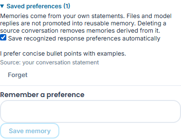

Ask *Recall our previous discussion about programming* to retrieve attributed excerpts from your own saved conversations. These excerpts describe prior statements, not the current state of a record. Missing matches are reported explicitly. Recent conversation context uses at most 12 turns within a 30,000-character prompt budget; larger target edits require a smaller section. On-device model planning uses a smaller input budget for its 4,096-token model window.

**Installed Pulse skills & tools** lists the Navigator, Guide, Syllabus, Registrar, Writer and Memory capabilities. They use a fixed application registry, validated patches and existing database authorization. Public research uses bounded search APIs; arbitrary shell, script and arbitrary-URL fetch tools are not exposed.

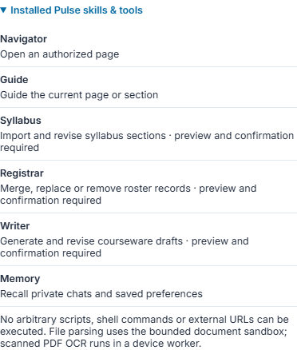

`PULSE-TOOLS-001` maps these flows to `tests/pulse-tools.test.ts`, `tests/browser/pulse-tools.spec.ts`, and `tests/snapshots/pulse-tools.spec.ts`. Browser coverage includes real PDF extraction, stale targets, confirmed roster removal, private recall, and database failure/retry. Provider generation is synthetic only in the generated-edit browser/capture cases; no paid inference result is implied.

## Correct the selected section using its page source

A syllabus accepted through the page uploader is available to Pulse while its builder remains mounted. Select the intended section with drag-and-drop or **Alt+P** and ask, for example, *Make it more accurate to the uploaded file*. Pulse maps this request to that section and prepares a source import; it does not answer with unrelated upload instructions. Choose **Prepare edit preview**, compare the before/proposed fields, and select **Apply to open form** or the separate save confirmation. Unrelated fields stay unchanged and stale previews are rejected.

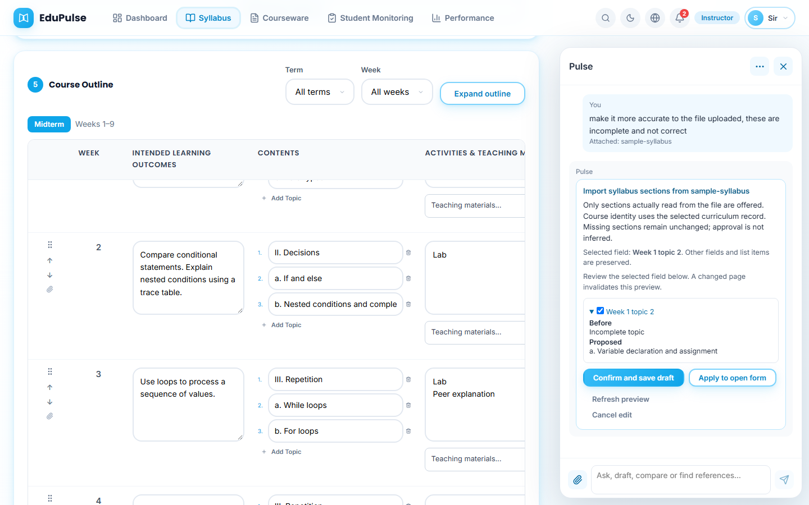

Chat attachments remain available for follow-up questions until removed or the conversation changes. Newly attached files replace the prior follow-up source set. The current editor is also supplied as bounded context, distinct from the imported source. Archive transcripts do not retain raw file bytes or turn old proposals into executable actions.

A request to create learning materials from a supplied outline drafts a response instead of treating the syllabus as a request to import program outcomes. **Download response as PDF** exports a generated response and its listed sources. This draft is not automatically saved or published as courseware; the existing approved-outline generation and review workflow still applies.

On mobile, focused Pulse is a shorter panel. The page remains scrollable above it, and the mascot is hidden while the panel is open. Close Pulse to use the whole screen. Institutional context is also an editable, source-backed section; a confirmed patch merges only the named institution fields and does not update global defaults.

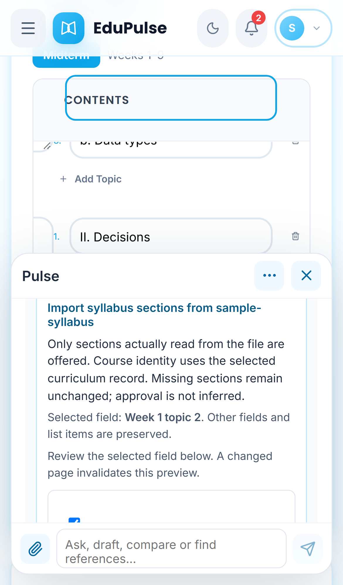

### Hosted availability

Pulse actions require a healthy hosted API. The release process checks native server startup as well as the preview, confirmation and save behavior shown above; a build that passes local tests alone is not treated as proof that hosted actions are available.

## Generate a syllabus from the selected course

Select **IT 104 — Research Methods** (or your intended curriculum course) in **Syllabus Builder**. Ask Pulse, for example, *Generate content for all fields in this syllabus using web research*. An empty library is permitted. Pulse prepares a **Review the proposed content change** card using the selected course and its description. A request for all fields covers the whole form even if Pulse was focused on a particular section.

The card lists editable **Program outcomes**, **Course outline**, **Course requirements**, **Grading system**, **Course policy**, **Books** and **Online references** with **Before** and **Proposed** text. The outline includes every existing week, teaching activities, assessment details, teaching materials and assessment types. Exam weeks retain their labels. Curriculum identity stays locked. Unknown official grading rules remain pending; suggested requirements and policies require instructor review. Missing references do not prevent drafting the teaching content, and invented book metadata or URLs are rejected.

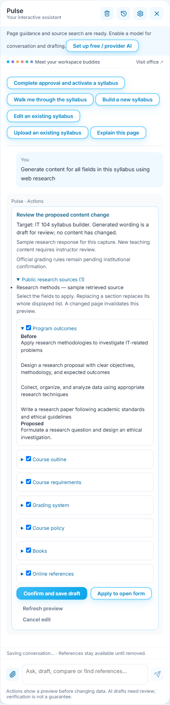

This screenshot uses a **synthetic model/research response** for UI verification, including a sample research link; it does not demonstrate live provider accuracy. **Public research sources** opens the retrieved links. Research limitations appear above the fields. OpenRouter and OpenAI connections can use provider web search where supported; provider search may be billed separately even with a free model. If unavailable, public educational search uses Wikipedia plus the existing bibliographic catalogs and states the coverage limit. On-device and other providers use the same keyless research fallback.

Expand fields and review them, then select **Apply to open form** or **Confirm and save draft**. The former changes the form; the latter waits for a persistence receipt. Nothing is published or approved. A model response missing requested teaching weeks is repaired once and rejected if still incomplete. A failed or truncated response leaves the form unchanged. A source-only request uses the selected sources and does not expand to public research. General conversation and subject explanations remain possible without uploading documents.
