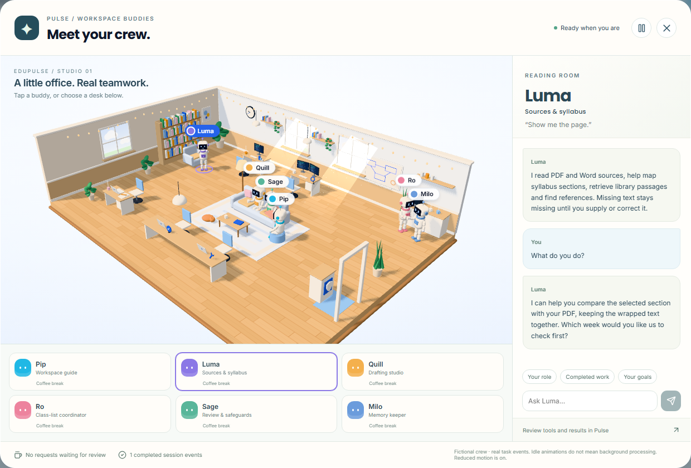
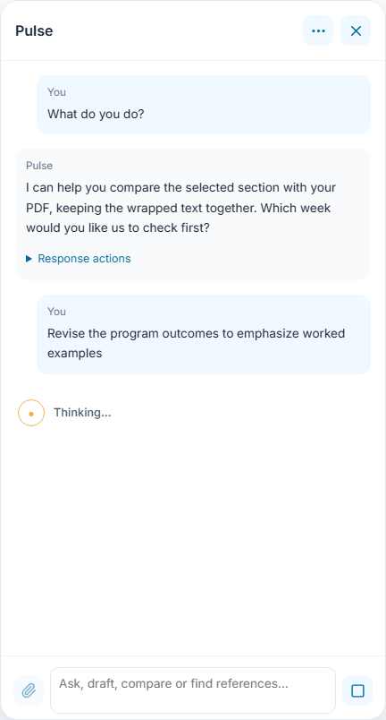
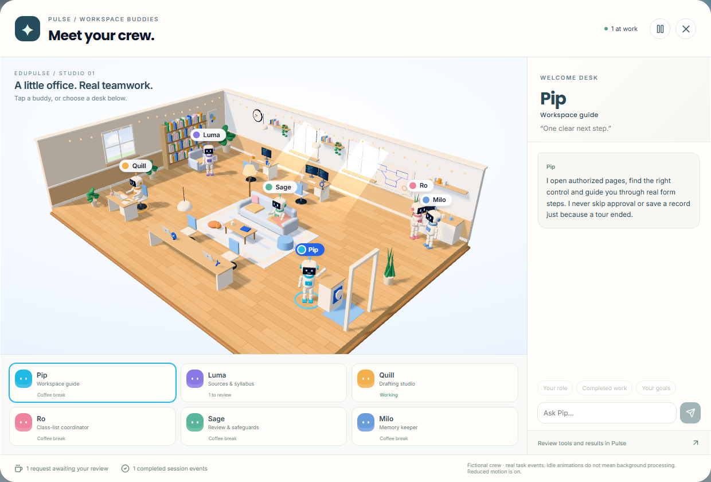
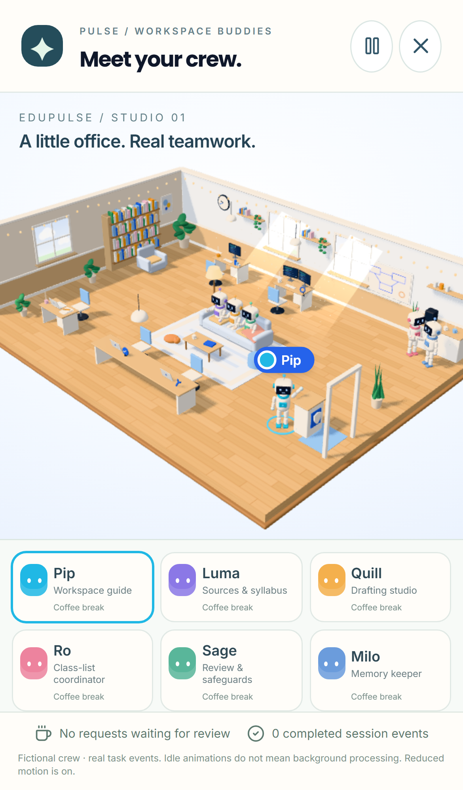

# Workspace buddies and faster conversations

Open Pulse, then choose **Pulse options → Workspace buddies**. The office opens over your current page. It is the same cosy studio as the agent workspace on the public landing page, with the six buddies as its crew. Select a character in the 3D scene or use the six keyboard-accessible desk buttons. **Your role**, **Completed work** and **Your goals** provide specific answers from that buddy. **Close workspace**, Escape, or **Review tools and results in Pulse** returns to the conversation.

Each buddy wears a name tag. The selected buddy stands up beside their station and waves; the others rest in the lounge (the sofa and the pouf) or at the coffee nook until they have work.

| Buddy | Designation | What the buddy handles |
| --- | --- | --- |
| Pip | Workspace guide | Authorized navigation and interactive walkthroughs |
| Luma | Sources & syllabus | PDF/Word sources, syllabus sections and references |
| Quill | Drafting studio | Courseware and reviewable writing proposals |
| Ro | Class-list coordinator | Exact-row roster registration and changes |
| Sage | Review & safeguards | Appropriate use, comparison and source support |
| Milo | Memory keeper | Private conversation history and preference controls |

These are fictional office personalities attached to application capabilities. Completed work uses recorded events from the current mounted session, including preparation and response events; it is not a lifetime achievement count or proof that a database write occurred. Read the actual tool receipt. Earlier receipts are in **Conversations and memory**. A buddy refers requests outside their area to the appropriate colleague. The handoff uses the same role checks and confirmation controls as ordinary Pulse requests.

## Quick replies and meaningful waiting

Exact greetings and thanks are answered locally without a model or retrieval request. Explicit `Replace "old text" with "new text"` requests can prepare a local preview for an editable section. Mixed greetings with an actual task still use the task route. Saving history happens separately. Generated answers still depend on provider speed, model availability and network conditions; no universal 150 ms inference promise is made.

Pulse shows **Thinking…**, followed by **Still working…** for longer requests. **Stop** remains available in Pulse. General conversation uses a smaller context and output budget instead of the full evidence workflow. Source-based questions retain their retrieval and verification steps.

## Working, review and coffee breaks

An active request changes the relevant desk to **Working**: a new request reaches the buddy as a paper plane through the doorway, and the buddy walks along the aisles to their station and sits down to type, draw, read or compare. A proposal waiting for your review shows as **1 to review** on the desk, and that buddy stands by their station holding the page up. A request handed to a colleague flies from one buddy to the other as a paper plane. Idle buddies sit on a coffee break with a mug. These movements follow real task events only; the ambient ones (sipping, looking around, steam from the mugs) do not mean hidden computation is happening. Failed or stopped operations do not count as successful saves. A proposal disappears from the active review queue when cancelled, completed or no longer active in the conversation.

**Pause office animation** stops ambient movement. Reduced-motion preferences produce static poses. On narrow screens, scroll from the office and desks to the buddy conversation. If WebGL is unavailable, the same desk buttons and conversation controls remain usable.

The office is loaded only when opened, in the same lazily loaded 3D chunk as the landing page’s agent workspace. It uses animated 3D geometry over time, with a frame rate capped at 30 and a resolution that drops on slow devices; it is not literal four-dimensional rendering. The loading/working captures use an explicitly delayed synthetic provider response to show those states reliably. The UI, animation, role routing and preview controls are real. No synthetic output is presented as a quality benchmark or a real institutional record.

## Conversational replies

With a connected model, buddy questions use the chosen buddy's designation, capabilities, personality and recent conversation. Follow-ups can explore an explanation instead of repeating a fixed role paragraph. Accomplishment claims are limited to supplied session events; preparation, review and saved results remain distinct. Connection errors appear in the office. Without a model, role questions explicitly show **Offline role guide**. The role conversation shown above uses a labelled synthetic model response to make the screenshot reproducible; it is not an inference-quality evaluation.
