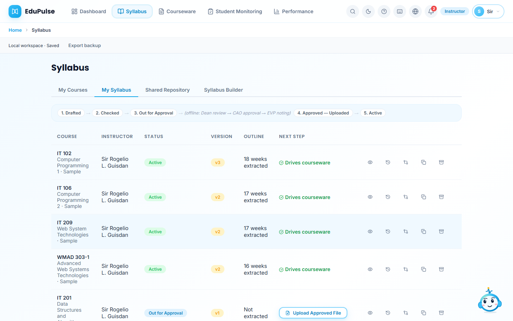
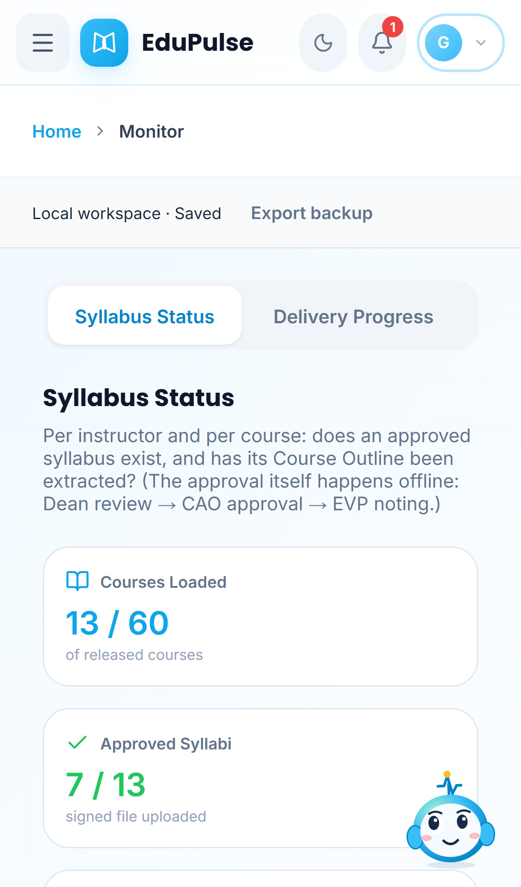
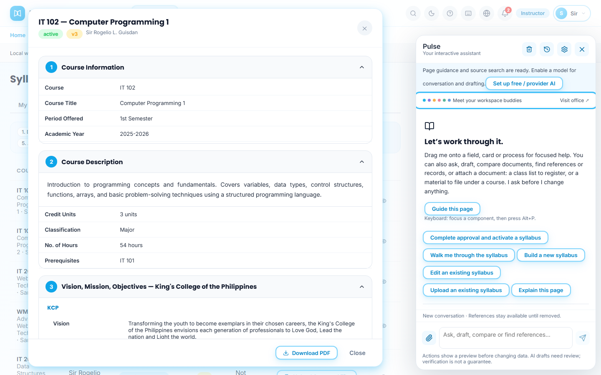
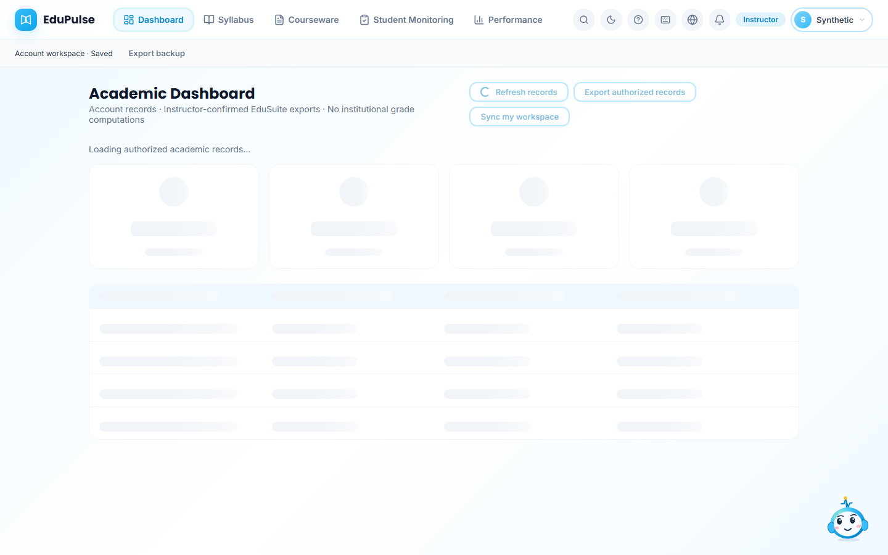
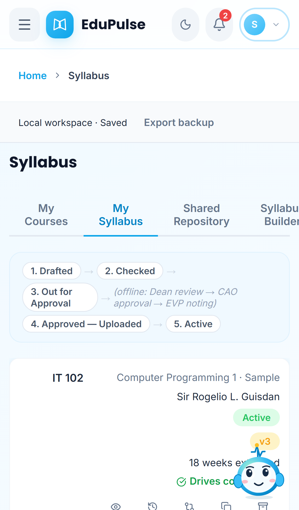
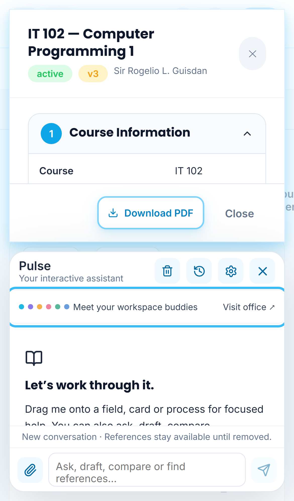
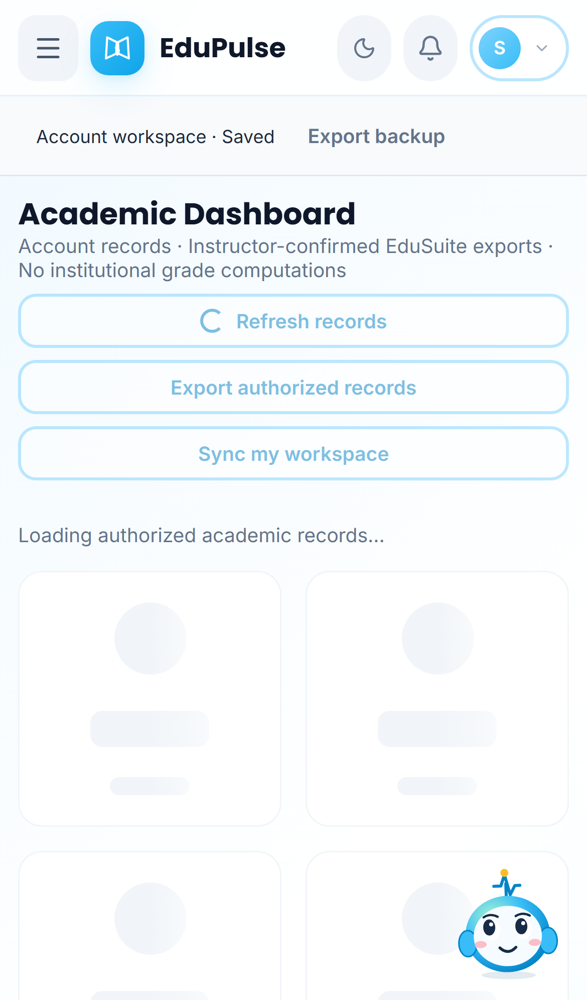

# 12 · Navigation, dialogs and loading feedback

These captures show the current interface. Academic loading/records scenes use synthetic UI transport; they do not establish hosted authentication, database permissions or persistence. The file-scan scene uses an actual synthetic scanned PDF and on-device OCR.

| State | Capture | What to expect |
| --- | --- | --- |
| Page navigation |  | Syllabus views are selected using the page tabs. The duplicate left sidebar is gone; primary areas remain in the top bar. |
| Monitor navigation on mobile |  | Preview Monitor keeps its four subviews in a horizontally scrollable page navigation row. |
| Pulse launcher |  | The character is the entire launcher. Its accessible name remains **Open Pulse assistant**, and it supports keyboard focus and dragging. |
| Dialog with Pulse |  | The syllabus dialog and assistant have distinct desktop columns. Both scroll independently and their controls stay inside their own surface. **Download PDF** exports the displayed syllabus; **Close** and the PDF action remain outside the scrolling document. **Escape** dismisses the top dialog while Pulse stays open. |
| Loading records |  | Skeleton cards and rows reserve the expected layout while a record request is pending. **Refresh records** shows a spinner and cannot be submitted twice. No record counts are guessed. |
| Reading a file |  | A spinner and indeterminate progress bar accompany the current parsing/OCR message. There is no invented completion percentage. A model download uses its actual download progress instead. |
| Mobile tabs |  | Page tabs remain reachable without another navigation strip above them. |
| Mobile dialog and Pulse |  | The dialog scrolls above the assistant. The document and message controls occupy separate vertical areas. |
| Mobile record loading |  | Skeleton cards use two columns and rows remain inside the viewport. |

A failed academic request replaces loading with the actual error and an enabled **Refresh records** control. It does not claim that an unreachable account has zero records. Workspace loading/saving and provider connection checks also show compact spinners. Reduced-motion preferences disable spinning, shimmer and moving bars while retaining readable status text.

The [feature-presence audit](../../session-generated/2026-10-27-feature-presence-audit/README.md) separates retained features, authenticated-view gaps and intentional removals from earlier versions.

A dialog keeps the component context of its source page. Pulse can focus a table or control inside it. Dropping onto the header or backdrop is refused; it cannot select content hidden behind that surface. Syllabus actions occupy a separate footer, so scrolling content cannot show through or cover them.

If you open **workspace buddies** while a document dialog is open, the office owns the keyboard. **Escape** closes the office and returns to the document; it does not dismiss the document underneath.
