# 14 · Pulse field actions and the Course Outline workspace

Instructors draft and revise selected syllabus or courseware fields. Every role can attach references, ask questions and open Help or keyboard guidance from Settings. These captures use preview academic data. Proposal captures use a labelled synthetic model response to test the real preview and apply controls; they do not establish live model quality or hosted persistence.

## A clean conversation

Open the Pulse avatar. The panel starts with **What would you like help with?**, the attachment control and the message box. **Pulse options** contains **New conversation**, **Conversations and memory**, **Guide this page**, **Workspace buddies** and **AI settings**. Selecting a component changes the guide entry to **Guide selected component**. These controls appear when requested.

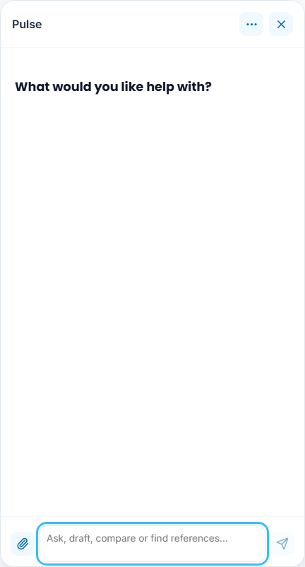

## Draft or improve a field

Select a course, then drag the Pulse avatar onto an editable field or section. You can also click **Ask Pulse about this**, or focus the field and press **Alt+P**. Type a specific request, such as “Draft this field using the selected Research Methods course.” Pulse keeps the selected field in scope. A section request selects the corresponding editable fields; an explicit request for all fields selects the full editable form.

Choose **Prepare edit preview** when offered. Read the selected field's before/proposed values, then choose **Apply to open form** or **Confirm and save draft**. Application changes the mounted form; saving waits for the workspace response. Course identity and status remain protected. Changed, removed or moved targets require a new preview.

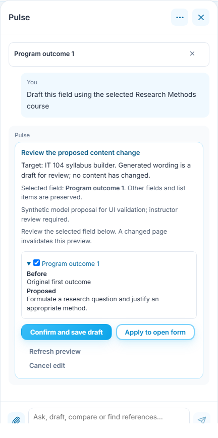

Only the first outcome changes in this example. The neighboring outcome stays intact. The same boundaries preserve other outline weeks, document sections and assessment questions, including question types, topic mappings and author answer settings.

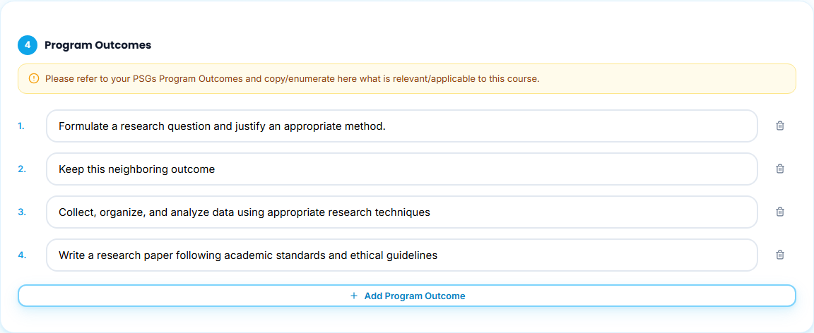

## Drop references into chat

Drop files onto the open panel or the closed Pulse avatar, or use **Attach reference**. Pulse accepts up to three files per message through its existing document reader. Dropping attaches the files and keeps the unsent prompt; press **Send** to make a request. It does not import, save or publish data by itself. Remove an attachment with its chip's remove control. An invalid batch leaves earlier attachments intact.

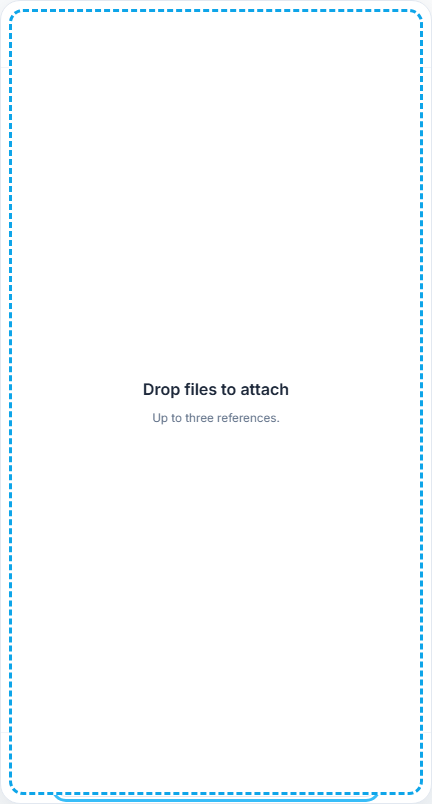

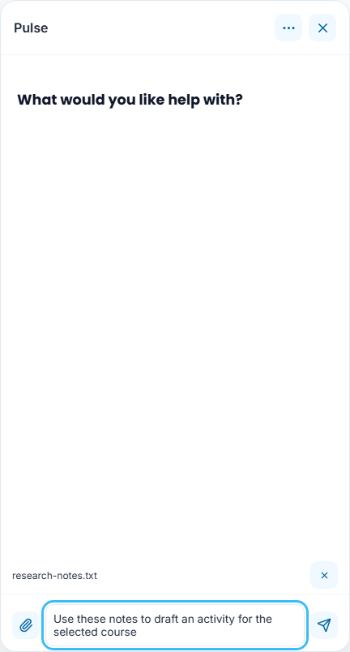

Unsupported files show an error and leave earlier attachments intact. The error uses readable theme colors in dark mode.

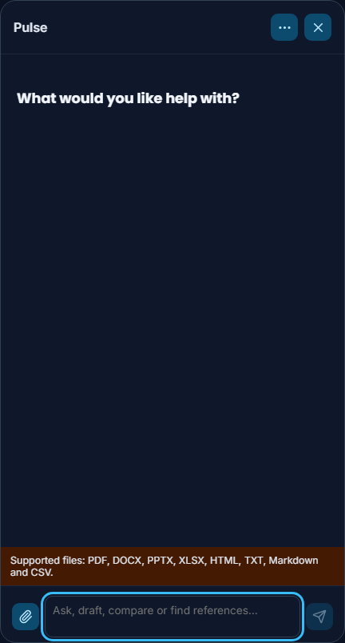

Source links remain accessible in answers. **Verification details** contains evidence indicators; **Response actions** contains revision and PDF controls when available. Drafts and source excerpts retain their labels. Optional indicators do not certify correctness.

## Manage the Course Outline

**Outline term** selects all weeks, Midterm or Finals. **Outline week** narrows the visible rows without deleting their contents. **Expand outline** provides more editing space; **Close expanded outline** or **Escape** restores the page. The table scrolls within its own region and keeps the column headings visible.

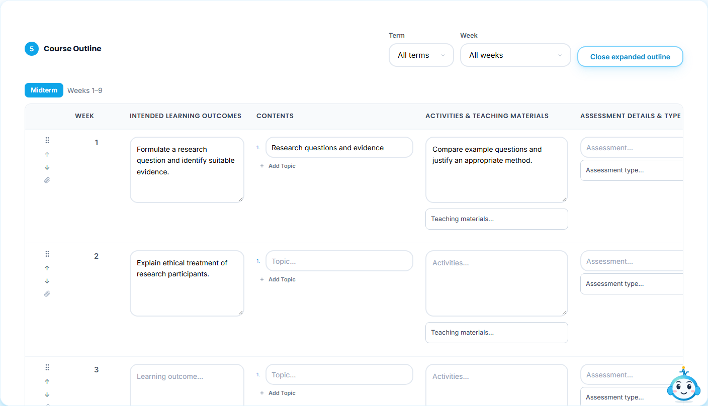

Move teaching content with the row's drag grip or **Move week earlier/later** buttons. Week numbers stay in calendar order, content and resources move together, and examination slots at weeks 9 and 18 remain fixed. Teaching materials and assessment types retain their categorized selectors and removable selections. Open a selector with **Enter** or **Space**; **Escape** closes it before closing the expanded editor.

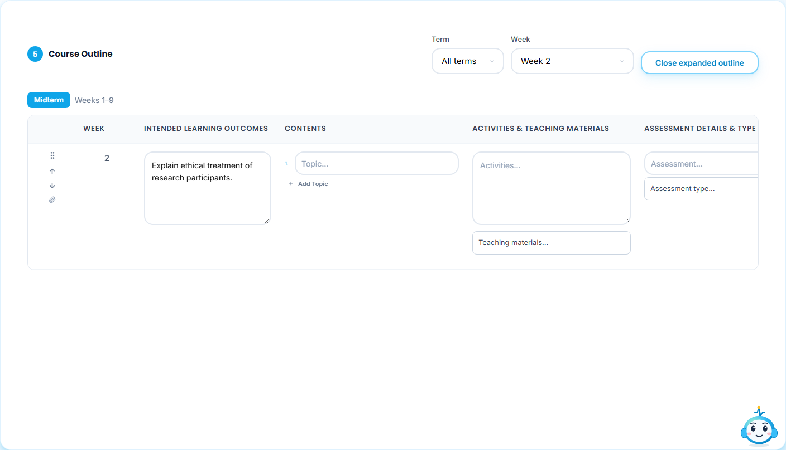

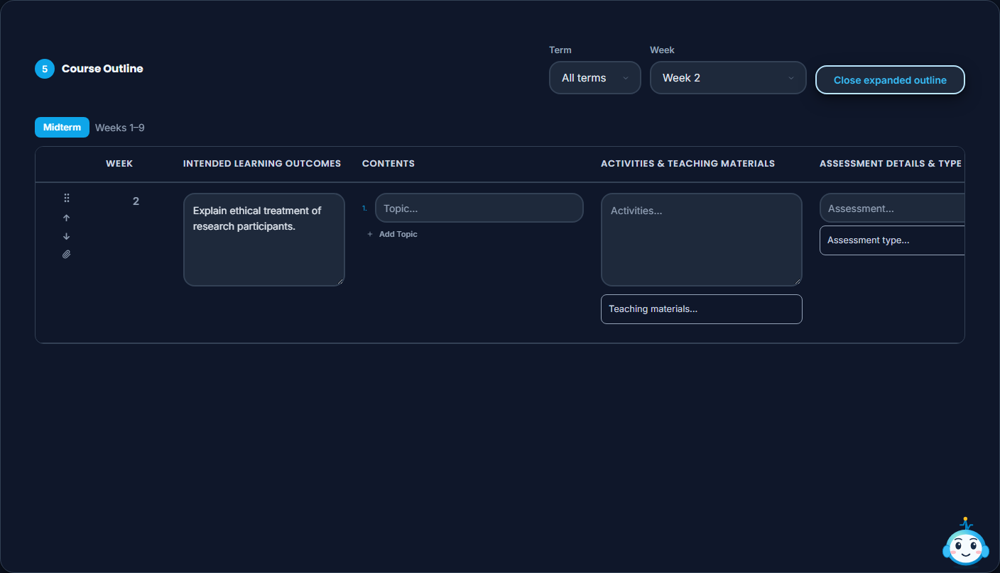

## Help, shortcuts and backups in Settings

Open **Settings → Help & Support** for getting started, contacts and frequently asked questions. The former `/help` address redirects here.

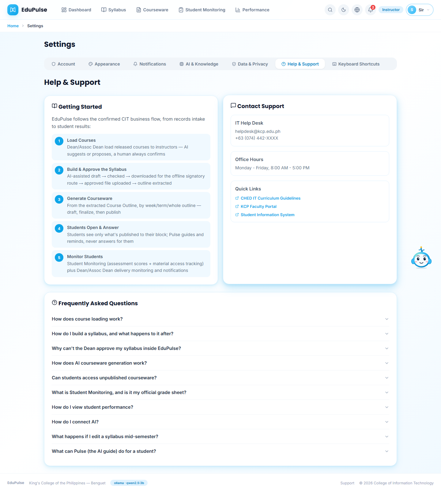

**Settings → Keyboard Shortcuts** lists working shortcuts. **?** opens this tab when focus is outside a form control. Unconnected shortcuts are labelled separately under **Planned shortcuts**.

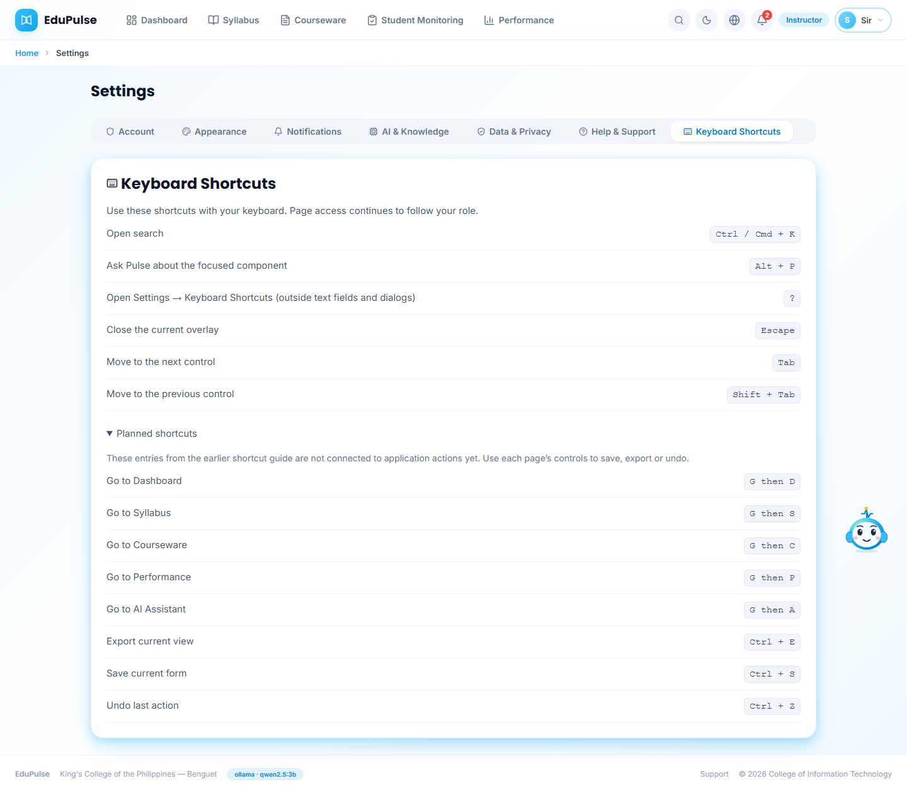

Use **Settings → Data & Privacy → Export workspace backup** to download the owner workspace as JSON. **Export My Data** remains a separate profile export. The healthy saved-workspace strip is removed; an unsaved-data error or conflict still shows recovery and backup controls.

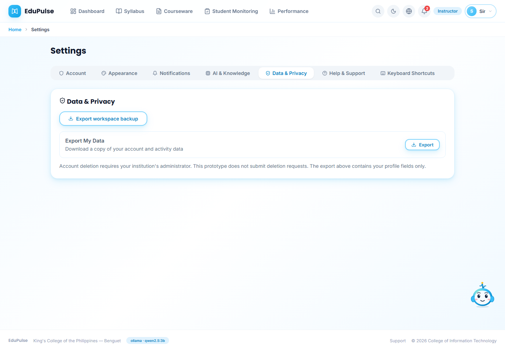

## Smaller screens

Pulse keeps its compact bottom panel. Close it to use the full page. The outline scrolls horizontally inside the editor rather than widening the page, and Settings tabs remain reachable across roles.

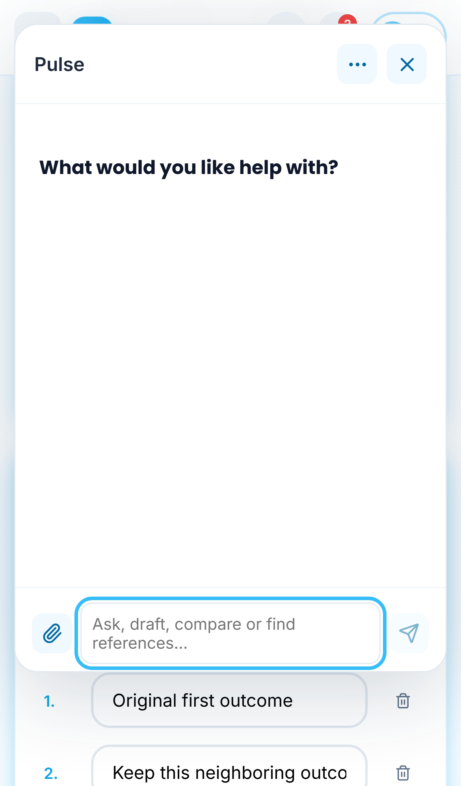

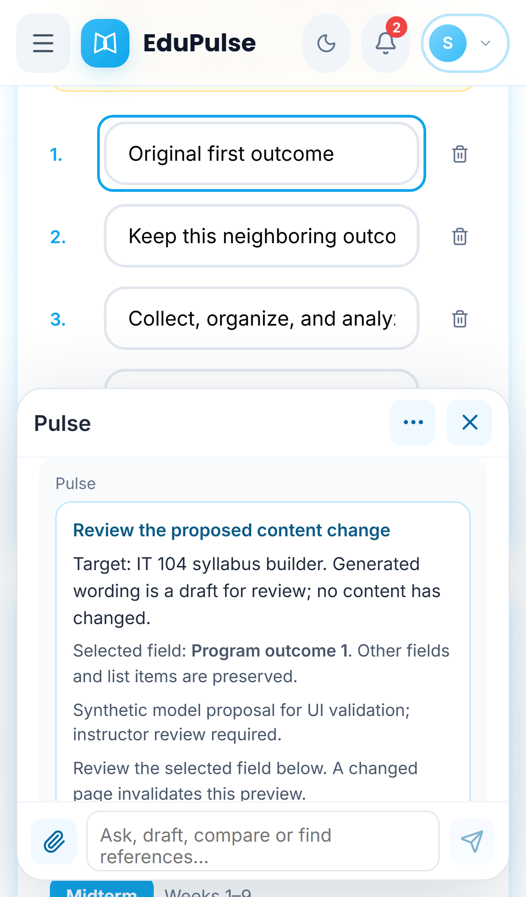

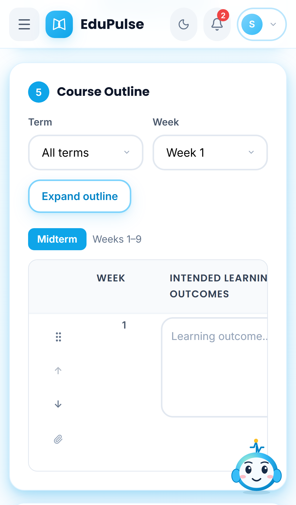

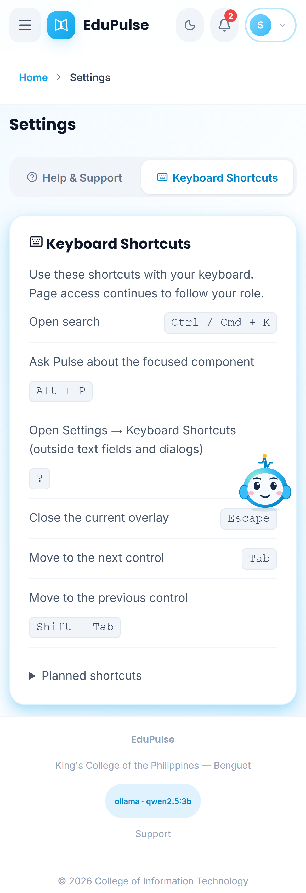
