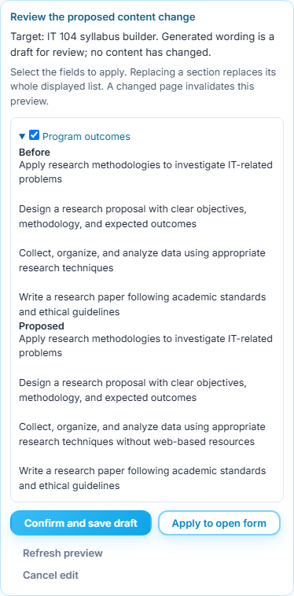
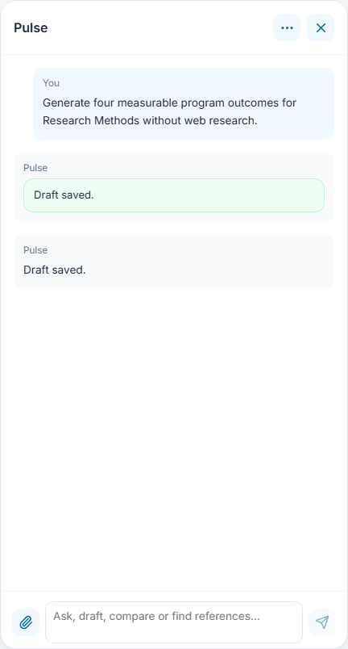
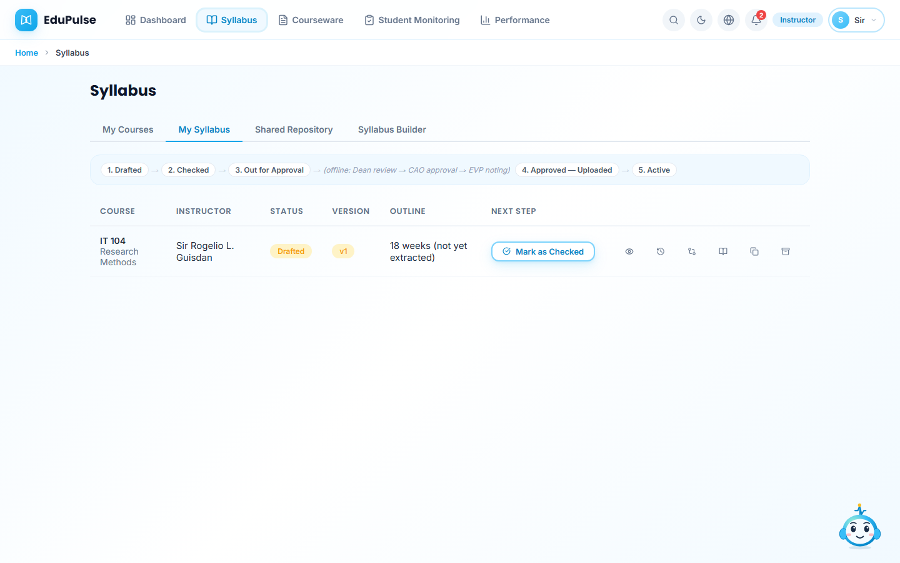
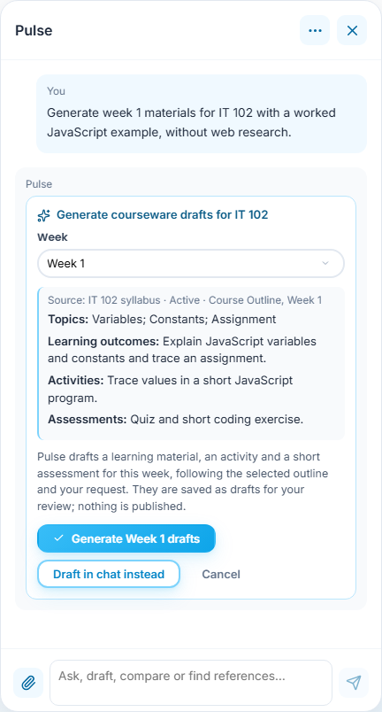
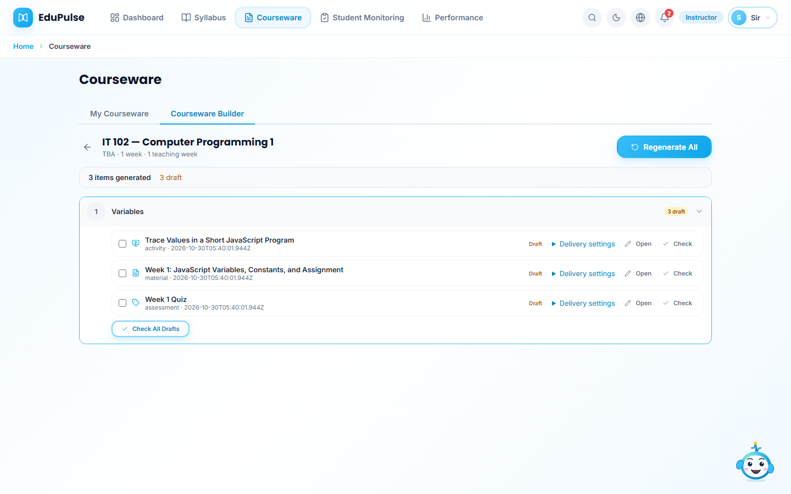
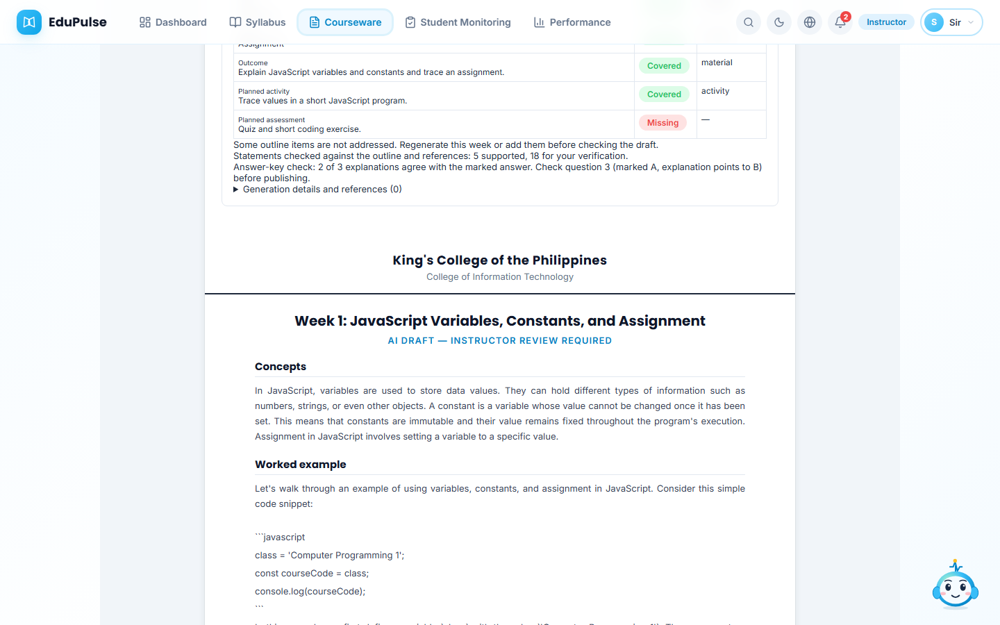

# 15 · Generate content and verify its save

**Who:** instructor. **Where:** Syllabus Builder → Pulse. These captures use an installed local model and an isolated local database with a synthetic course task. No model responses or workspace saves are mocked. They do not establish hosted authentication or universal model correctness.

1. Select **IT 104 — Research Methods**. Open Pulse and ask: “Generate four measurable program outcomes for Research Methods without web research.” The existing **Review the proposed content change** card shows the original field and the generated outcomes. No record changes while the proposal is displayed.

   

2. Review the wording, then choose **Confirm and save draft**. Pulse reports a save only after the workspace API confirms it. **Apply to open form** remains available for an unsaved edit; it is not a database save.

   

3. Reload and open **My Syllabus**. The draft remains in the course list. The capture also compares the saved outcomes returned by the API with the model proposal. Generation does not check, approve, activate or publish a syllabus.

   

For an entire course, ask “Generate a syllabus for my selected course.” Pulse treats this as a whole-syllabus request even if another section had focus. It drafts the general sections, teaching weeks in groups of four, and sourced references, then assembles one reviewable proposal. It validates all existing teaching weeks and preserves exam rows. Missing official grading rules remain pending; new policy and requirement text is marked as proposed for instructor review. References require supplied or retrieved metadata. Each generation stage gets at most one repair attempt. If any stage still fails, nothing changes. An explicit outline or outcomes request remains limited to that section.

Public research is available for educational drafts, including courseware with an empty library. “Without web research” disables external research in a Pulse request; source-only questions stay with their supplied/selected sources. Research failure is reported and does not turn original teaching content into a claimed verified answer. See [courseware review](../03-courseware-generation-and-review/README.md) and [validation evidence](../../versions/2026-10-29-backend-harness/validation/results.md).

4. In **Courseware**, choose an active syllabus and **Start Generating**. Ask Pulse to generate week 1 with a worked JavaScript example, without web research. Review the selected course and week, then choose **Generate Week 1 drafts**. The captured example uses a synthetic active programming outline to isolate generation; it does not demonstrate institutional approval.

   

   The real model returns material, activity and assessment drafts. The capture checks that the request and research restriction reach the API and that all three drafts are stored by the workspace API.

   

5. Reload and choose **Open** for the material. The saved lesson remains available with its review evidence. This captured lesson displays missing assessment alignment and an answer-key warning; it is a draft requiring correction, not an approved example. Prompt preferences such as language and worked examples are passed through when generation starts from Pulse. Short placeholder responses are rejected before saving; the instructor still reviews teaching quality, factual accuracy and answer keys.

   

Coverage measures alignment with the outline, and answer-key checks compare the explanation with the marked option. Neither proves factual correctness. The live audit found incorrect JavaScript statements despite high scores; review code, facts and answer keys before publishing. See the concrete defects in the [validation record](../../versions/2026-10-29-backend-harness/validation/results.md).
