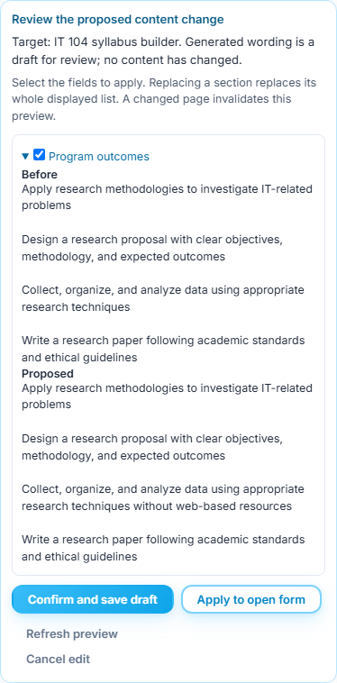
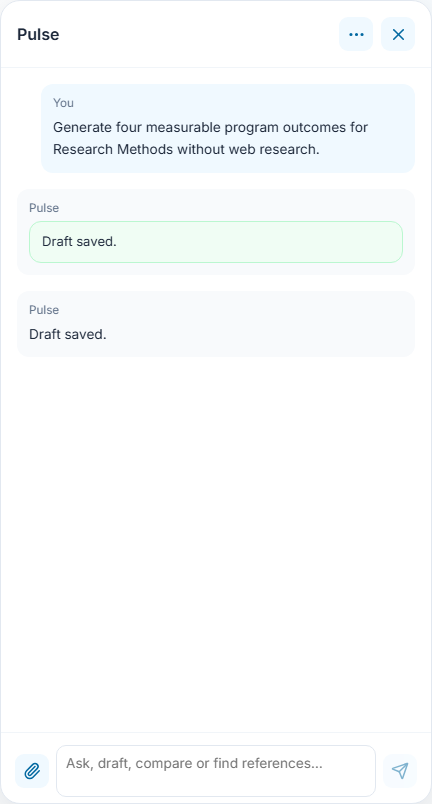
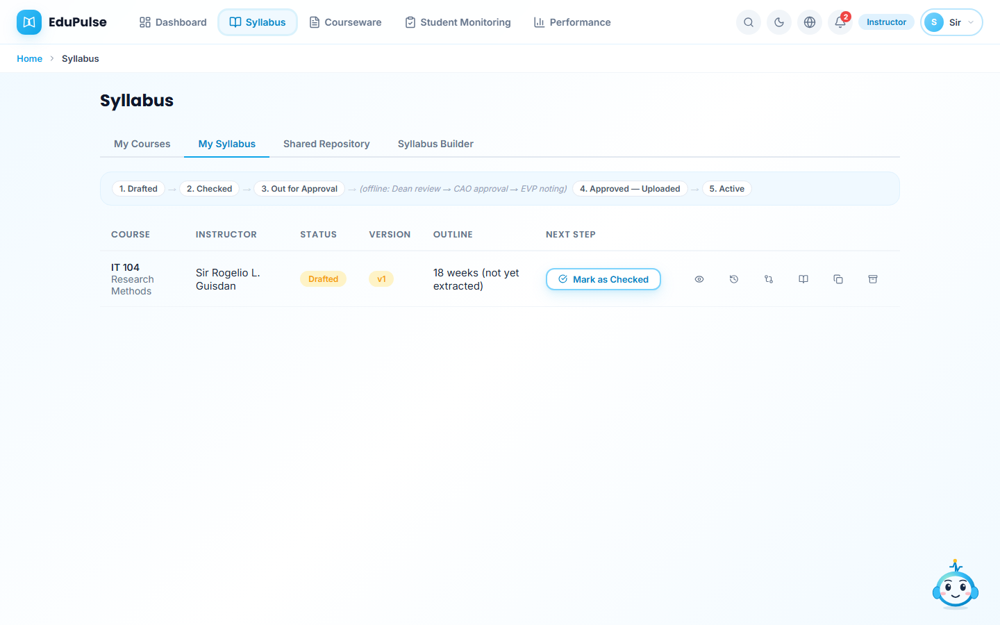
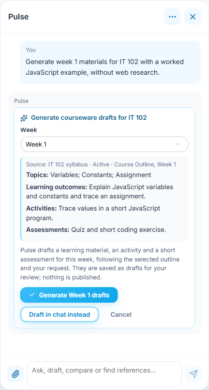
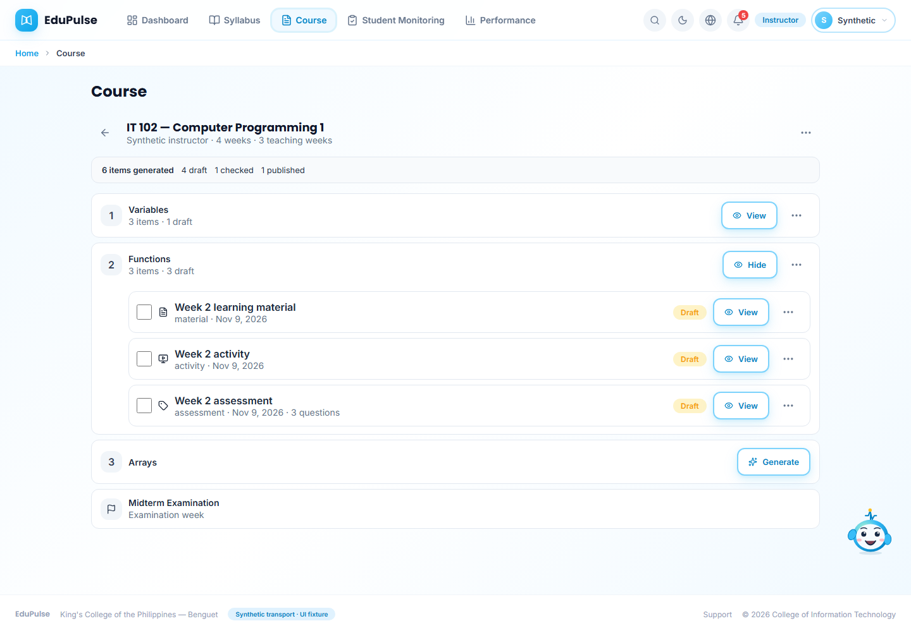
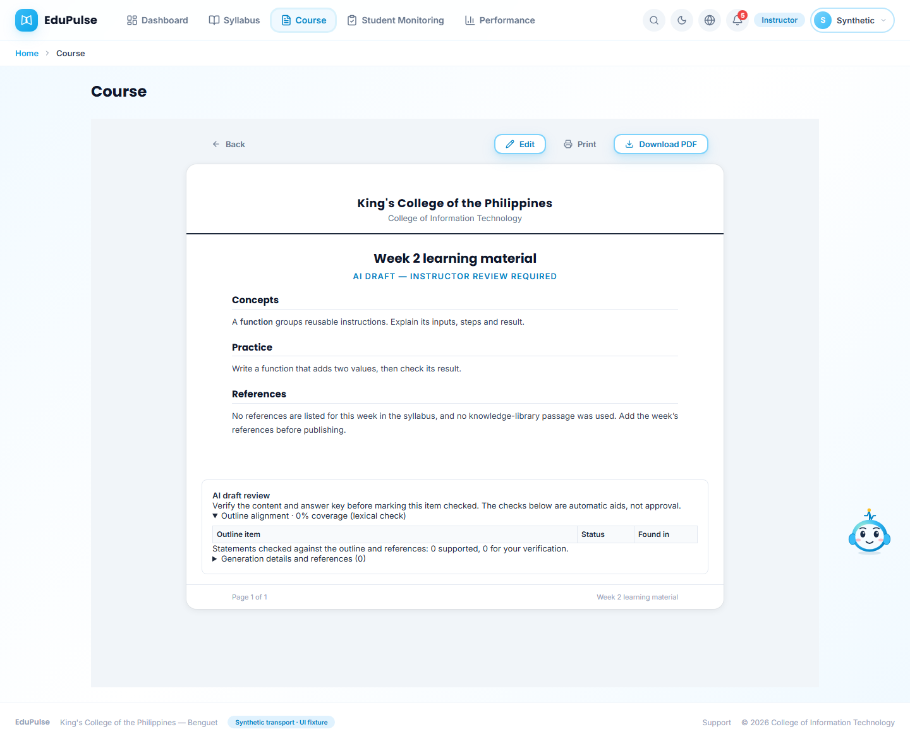

# 15 · Generate content and verify its save

**Who:** instructor. **Where:** Syllabus Builder → Pulse and Courseware. Images 1–3 and 6 retain the earlier installed-local-model workflow with an isolated database and synthetic course task; its model responses and workspace saves were not mocked. Courseware images 4–5 now use synthetic provider/workspace responses to document the combined interface. The [historical courseware model evidence](../../versions/2026-11-06-unified-courseware/validation/results.md) is archived separately. These captures do not establish hosted authentication or universal model correctness.

1. Select **IT 104 — Research Methods**. Open Pulse and ask: “Generate four measurable program outcomes for Research Methods without web research.” The existing **Review the proposed content change** card shows the original field and the generated outcomes. No record changes while the proposal is displayed.

   

2. Review the wording, then choose **Confirm and save draft**. Pulse reports a save only after the workspace API confirms it. **Apply to open form** remains available for an unsaved edit; it is not a database save.

   

3. Reload and open **My Syllabus**. The draft remains in the course list. The capture also compares the saved outcomes returned by the API with the model proposal. Generation does not check, approve, activate or publish a syllabus.

   

For an entire course, ask “Generate a syllabus for my selected course.” Pulse treats this as a whole-syllabus request even if another section had focus. It drafts the general sections, teaching weeks in groups of four, and sourced references, then assembles one reviewable proposal. It validates all existing teaching weeks and preserves exam rows. Missing official grading rules remain pending; new policy and requirement text is marked as proposed for instructor review. References require supplied or retrieved metadata. Each generation stage gets at most one repair attempt. If any stage still fails, nothing changes. An explicit outline or outcomes request remains limited to that section.

Public research is available for educational drafts, including courseware with an empty library. “Without web research” disables external research in a Pulse request; source-only questions stay with their supplied/selected sources. Research failure is reported and does not turn original teaching content into a claimed verified answer. See [courseware review](../03-courseware-generation-and-review/README.md) and [validation evidence](../../versions/2026-10-29-backend-harness/validation/results.md).

4. In **Course**, choose an active syllabus using **Generate** when empty or **View** when content exists. Ask Pulse to generate week 1 with a worked JavaScript example, without web research. Review the selected course and week, then choose **Generate Week 1 drafts**. The Pulse request image retains the earlier synthetic active programming outline; it does not demonstrate institutional approval.

   

   Generation returns the item types required by the current outline. The earlier real-model capture checked that the request and research restriction reached the API and all three drafts were stored. The current quiz-week interface example below uses synthetic week 2 content to show the saved items and their **View** and three-dot actions.

   

5. Reload, expand the week with **View**, then choose **View** for its material. The saved lesson remains available with its review evidence at the end. This current lesson is a synthetic display example requiring instructor review. Prompt preferences such as language and worked examples are passed through when generation starts from Pulse. Short placeholder responses are rejected before saving; the instructor still reviews teaching quality, factual accuracy and answer keys. The [Courseware manual](../03-courseware-generation-and-review/README.md) describes the combined menus and generation controls.

   

Coverage measures alignment with the outline, and answer-key checks compare the explanation with the marked option. Neither proves factual correctness. The earlier live audit found incorrect JavaScript statements despite high scores; review code, facts and answer keys before publishing. See the concrete defects in the [validation record](../../versions/2026-10-29-backend-harness/validation/results.md).

The current bounded writer and atomic save contract are documented in [Manual 26](../26-outline-driven-courseware/README.md). Images 4-5 are controlled UI samples, not evidence of substantial model-generated lessons; the new instructional sample, native API/database test and actual local-model smoke have separate provenance.
