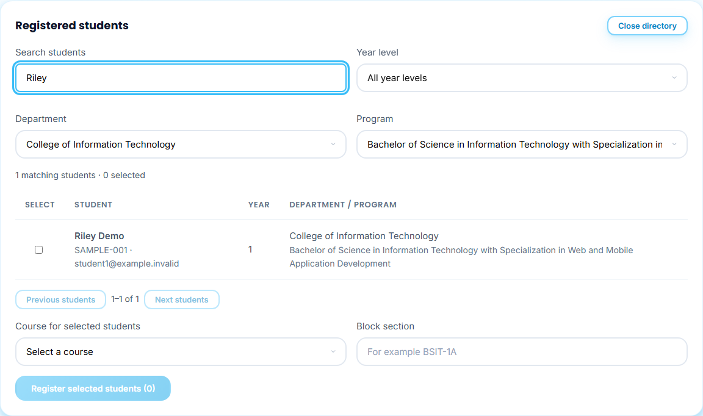
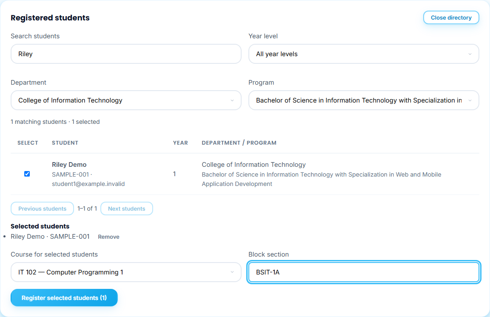
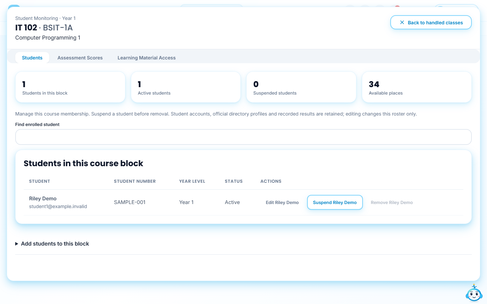
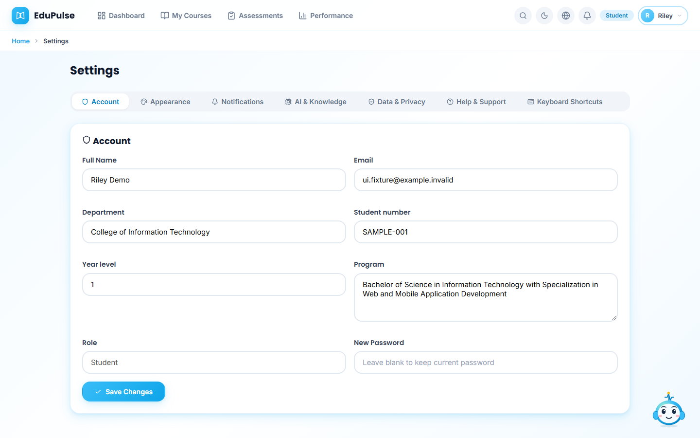

# 16 · Student accounts and course rosters

The [IT course seed](../18-it-course-seed/README.md) records the owner-authorized first/second-year IT enrollment batch. It preserves official identities and keeps student activity separate from generated teaching drafts.

Student accounts are provisioned from the official list. Each account has a name, student number, year level, department and program. Directory membership does not enroll a student in a course. The instructor selects the students for a course and block; only published, released materials from an active approved syllabus become available to enrolled students.

The examples below use synthetic student profiles and a synthetic authenticated session. They demonstrate the interface and saved-workspace handoff, not real student records or a hosted sign-in.

## 1. Find students

Open **Syllabus → My Courses → Choose students**. Search by name or student number, and filter by **Year level**, **Department** and **Program**. **Previous students** and **Next students** page through matches. Selections remain while filters or pages change.

## 2. Select the course roster

Select each student, check **Selected students**, then choose **Course for selected students** and enter **Block section**. Use **Remove** to correct a selection. Up to 35 students can belong to a course block.

Press **Register selected students**. The button waits for the revision-checked workspace save. A failed save retains the selection and displays its error; it does not report success. Registering the same student again merges the roster without duplication. The existing file-upload workflow remains available below the directory.

## 3. Verify the saved roster

After a successful save, **Registered Courses** shows the course, block and student count. Reloading retains the roster. When its matching syllabus is active and reviewed materials are published and released, the selected student can access them. Other registered students cannot access that course merely because they are in the directory.

## 4. Student profile

In **Settings → Account**, a provisioned student sees **Student number**, **Year level** and **Program** alongside their name, login email and department. The identity fields are read-only. Changing a profile display field does not change the official directory or grant access to another course. Initial credentials are distributed privately by the administrator; screenshots and documentation never contain passwords.

Provisioning is a server-side administrative operation. It creates EduPulse sign-in accounts; it does not create Gmail mailboxes or send invitation emails. Existing unrelated accounts are never overwritten, and reruns retain existing account passwords.
