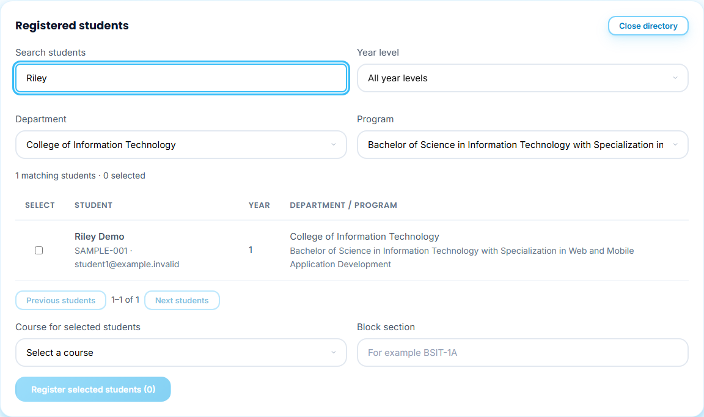
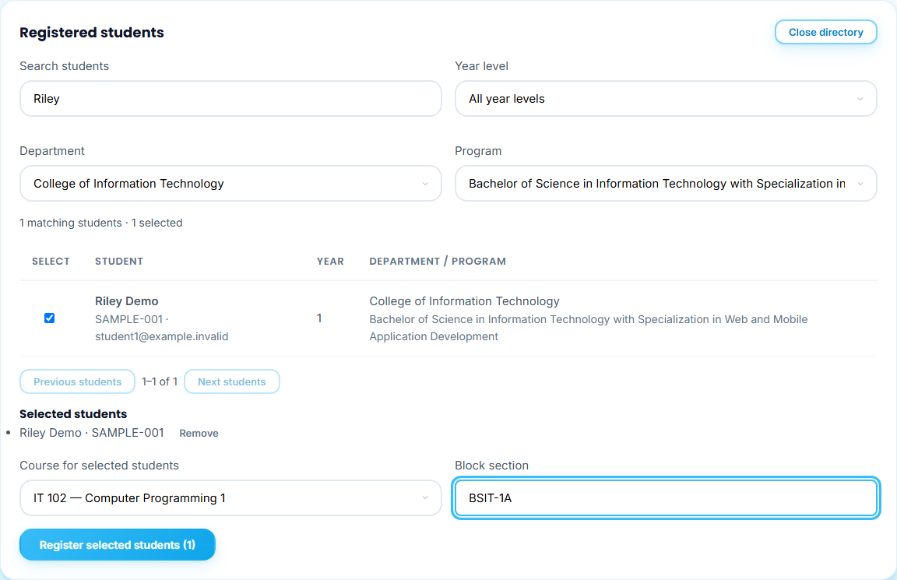
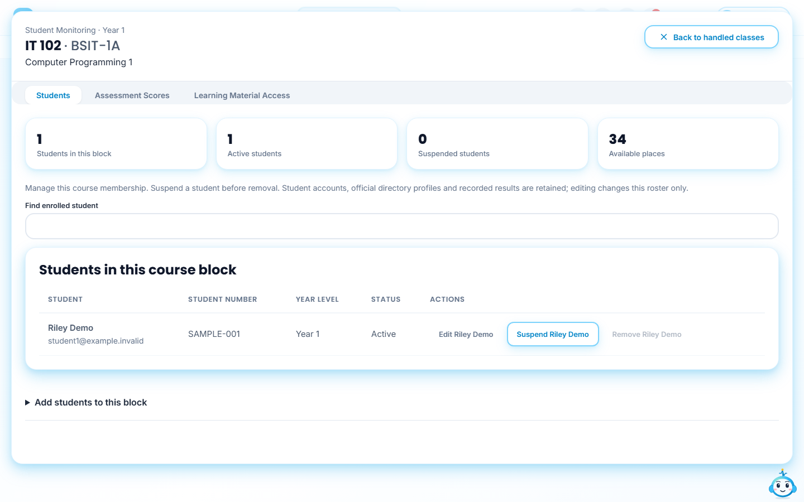
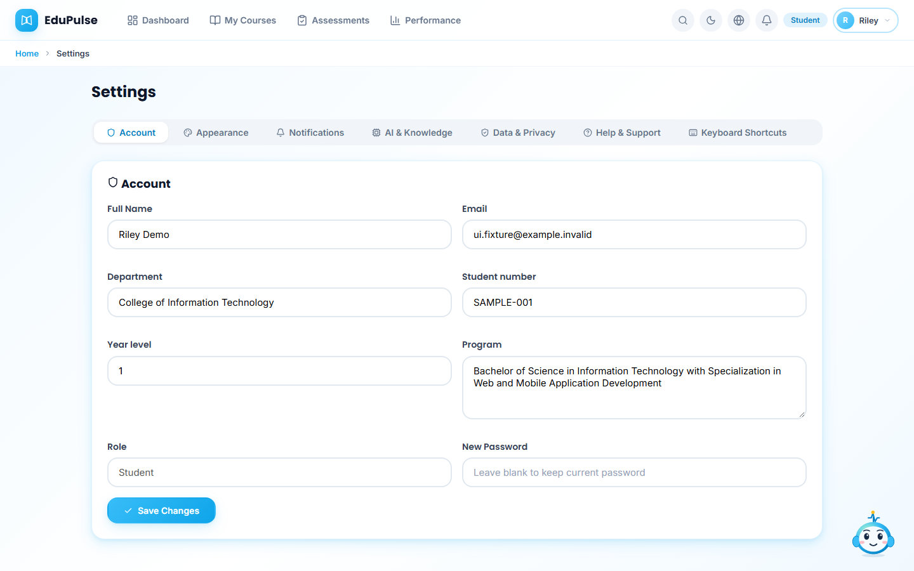

# 16 · Student accounts and course rosters

The [IT course seed](../18-it-course-seed/README.md) records the owner-authorized first/second-year IT enrollment batch. It preserves official identities and keeps student activity separate from generated teaching drafts.

Student accounts are provisioned from the official list. Each account has a name, student number, year level, department and program. Directory membership does not enroll a student in a course. The instructor selects the students for a course and block; only published, released materials from an active approved syllabus become available to enrolled students.

The examples below use synthetic student profiles and a synthetic authenticated session. They demonstrate the interface and saved-workspace handoff, not real student records or a hosted sign-in.

## 1. Find students

Open **Course → the assigned course → Block sections → Add block section → Choose individual students**, or add students to an existing class in Student Monitoring. Confirm the class list in the selected current/next semester. Search by name or student number, and filter by **Year level**, **Department** and **Program**. **Previous students** and **Next students** page through matches. Selections remain while filters or pages change.

## 2. Select the course roster

Select each student, check **Selected students**, then choose **Course for selected students** and enter **Block section**. Use **Remove** to correct a selection. Up to 35 students can belong to a course block.

Press **Register selected students**. The button waits for the revision-checked workspace save. A failed save retains the selection and displays its error; it does not report success. Registering the same student again merges the roster without duplication. Expand **Import an EduSuite class list** below the directory for the existing file-upload workflow.

## 3. Verify the saved roster

After a successful save, the **Students** table shows the saved course memberships. Filter by course or block and use the pagination controls for larger rosters. Reloading retains the roster. When its matching syllabus is active and reviewed materials are published and released, the selected student can access them. Other registered students cannot access that course merely because they are in the directory.

## 4. Student profile

In **Settings → Account**, a provisioned student sees **Student number**, **Year level** and **Program** alongside their name, login email and department. The identity fields are read-only. Changing a profile display field does not change the official directory or grant access to another course. Initial credentials are distributed privately by the administrator; screenshots and documentation never contain passwords.

Provisioning is a server-side administrative operation. It creates EduPulse sign-in accounts; it does not create Gmail mailboxes or send invitation emails. Existing unrelated accounts are never overwritten, and reruns retain existing account passwords.

Saved members can be moved between blocks or removed through their three-dot menu. These edits affect course access, preserve official profiles and past attempts, and survive later shared imports or automatic sync. [Manual 21](../21-automatic-records-and-course-rosters/README.md) illustrates those confirmations.

The active student directory again includes all six original departments. The department selector starts with **All departments**, retaining year/program filtering. On 17 November the 1,869 preserved non-CIT students were reactivated, bringing the active directory to 2,286. Four legacy role placeholders remain retired. Restoring accounts does not invent course enrollments. See [Manual 47](../47-teaching-load-documents/README.md).

Inside a selected monitoring class, course/block fields are locked to that class. The same registered-account search and explicit save are retained. Use the outer registration control to create another confirmed class membership. See [Manual 37](../37-instructor-monitoring/README.md).

### Department home blocks - 18 November 2026

The current directory includes all six departments and groups home blocks by program and recorded year, independently of course enrollment. Use Department to narrow the Students list and Blocks / Sections. Department selection stays in the URL on reload. A block card shows its actual directory members even when it has no courses. The 2027-x-xxxx intake is Year 1; other IDs retain their recorded year. The owner-confirmed allocation places 2,286 existing active students into 109 blocks of at most 35. It creates no teaching load, course enrollment or learner activity.

The student Dashboard shows its own recorded home block and size before any syllabus or course is assigned. Individual registered students, including students from other blocks/departments, remain selectable by the assigned instructor. No nationality is inferred from IDs or names.
