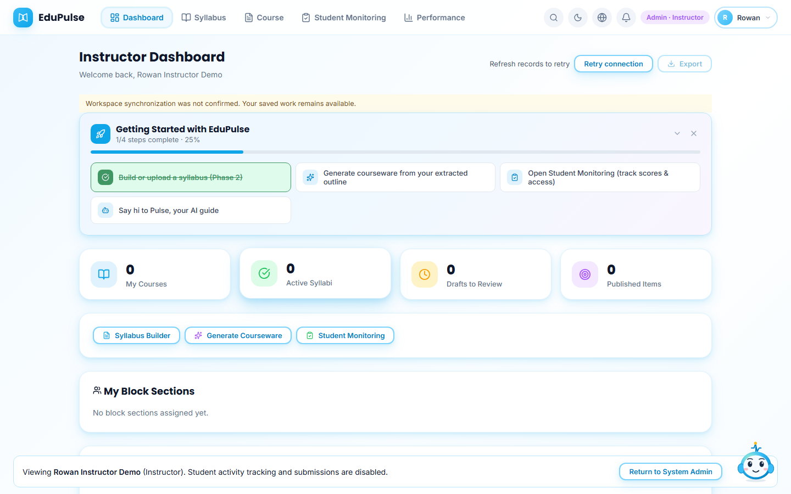
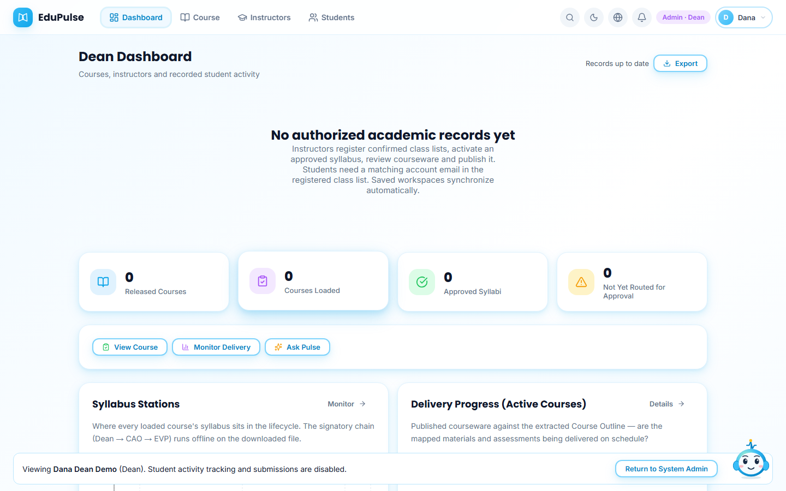
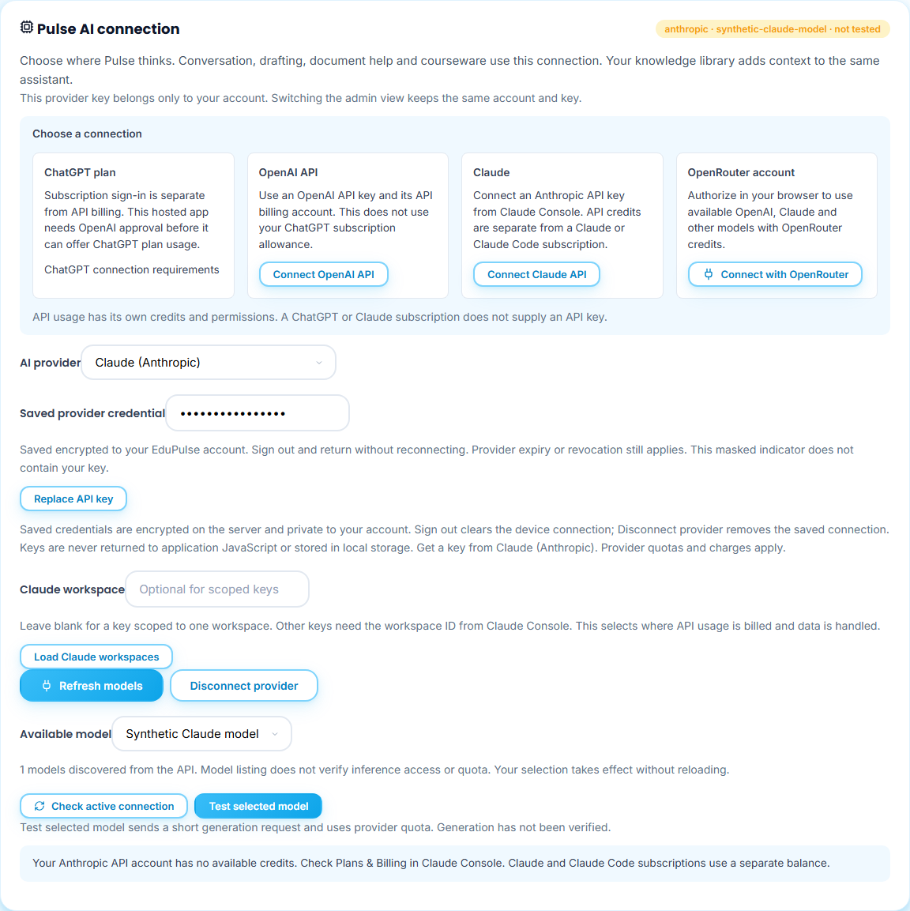
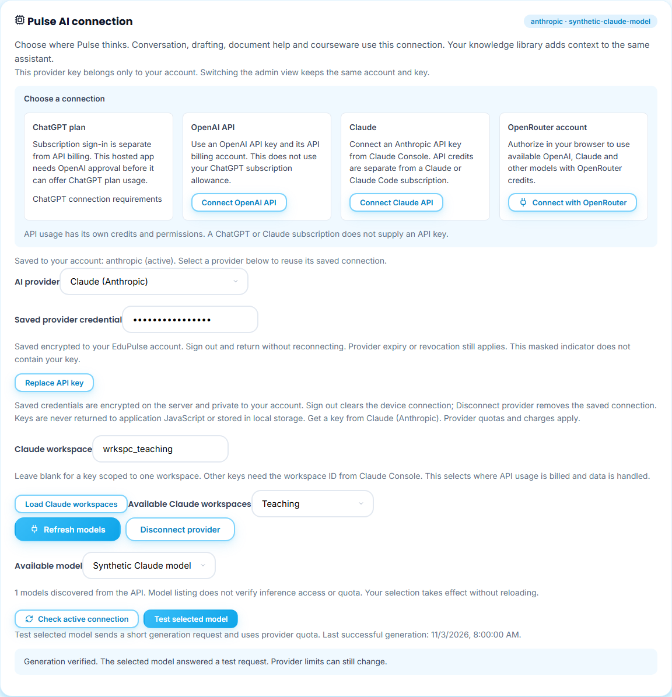

# 17 · Pulse dashboard navigation and provider recovery

These examples use synthetic accounts, records and provider responses. They verify the interface and account-view handoff, not real Google sign-in or successful Anthropic generation.

## Open the requested dashboard

The owner System Admin can ask Pulse **open me the instructors dashboard**. Pulse first opens the account picker. Choose a named instructor account. It confirms **Instructor Dashboard** only after selection succeeds. The account and provider connection stay the same. Ordinary accounts cannot open a different role's dashboard by asking Pulse.

## Correct a destination in conversation

Ask **open the dean's dashboard**, then choose a named Dean account. Pulse opens **Dean Dashboard** after selection. Switching to another person resets the private conversation; open Pulse again for the next request. These navigation requests require no model call. The instructor capture uses a controlled workspace transport and shows an unconfirmed synchronization warning; it is not evidence of a successful hosted workspace load.

## Understand a Claude connection failure

In **Settings → AI & Knowledge**, connect an Anthropic API key from Claude Console and choose **Available model**. **Test selected model** sends a short generation request. Listing models confirms discovery; the test checks whether generation is available for the saved account.

If Anthropic rejects generation because the API balance is unavailable, Pulse explains **Your Anthropic API account has no available credits** and points to **Plans & Billing in Claude Console**. It retains the saved credential and model. Claude and Claude Code subscriptions use a separate balance. After resolving the provider account issue, use **Test selected model** again.

Input limits and response limits receive different messages. A provider failure never counts as completed content generation, approval or a saved academic edit.

## Select a Claude workspace

A key scoped to one workspace can leave **Claude workspace** blank. For an unscoped key, choose **Load Claude workspaces**, pick the intended name in **Available Claude workspaces**, then **Save workspace and load models**. Pulse does not pick a workspace automatically: the choice determines the API billing and data workspace. It preserves your saved credential and available model, and requires another **Test selected model** after the change.

If listing is unavailable, copy the workspace ID from Claude Console → Settings → Workspaces into **Claude workspace**. Keep the key's existing permissions. A rejected workspace/save leaves the previous connection intact. [Anthropic's authentication guide](https://platform.claude.com/docs/en/manage-claude/authentication) explains which keys need this choice.

This screenshot's successful test is a controlled UI response. Hosted provider verification is recorded separately in the release evidence.
