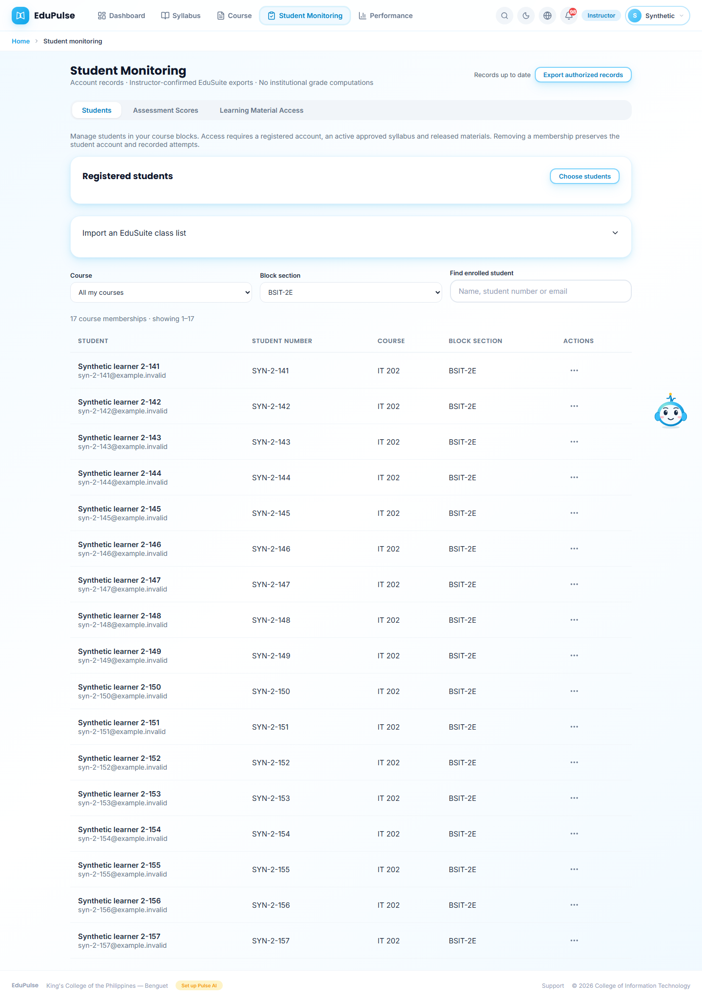
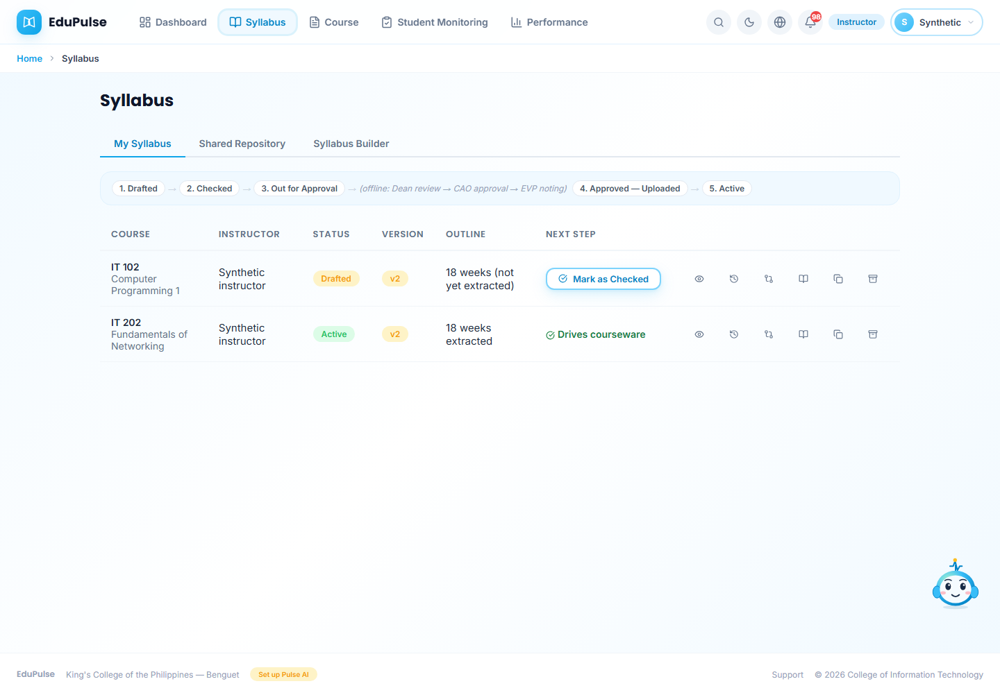
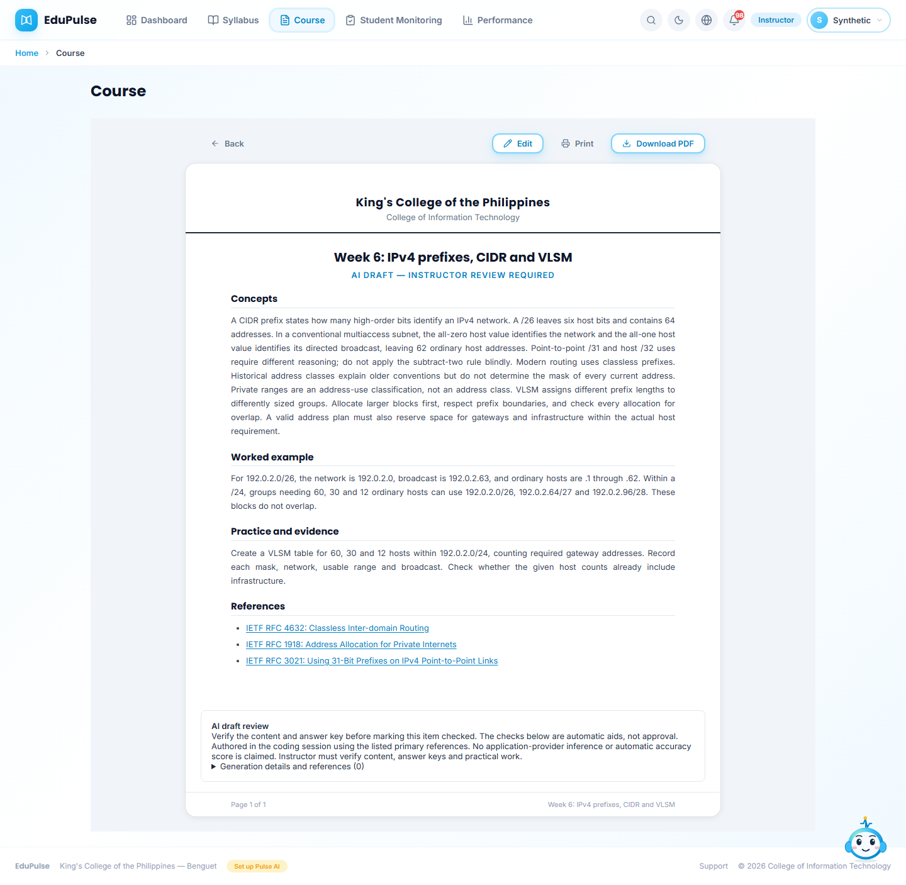
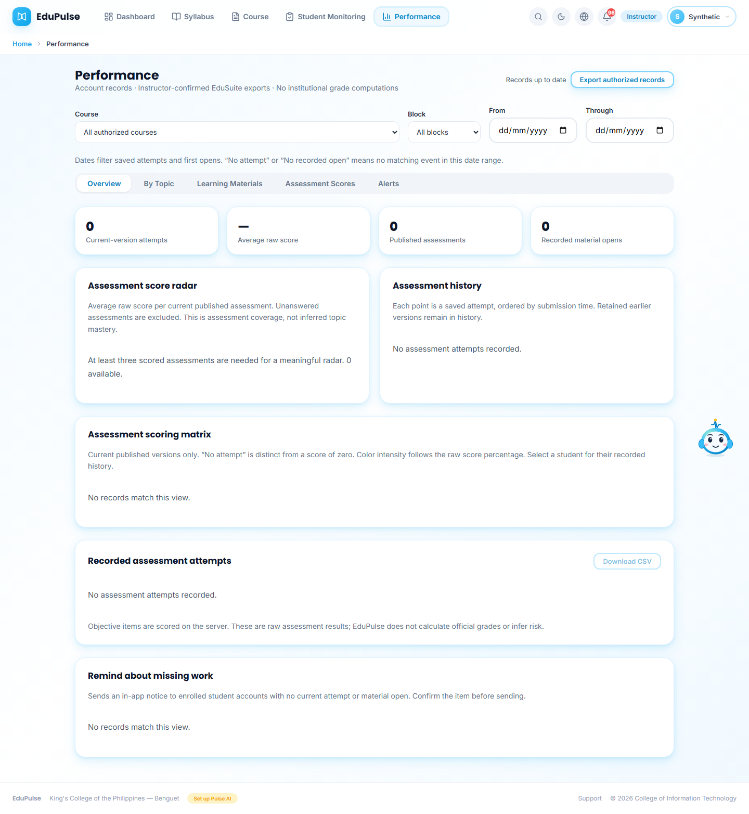

# 18 · Seeded IT courses and actual student progress

The owner authorized the existing IT courses and selected **actual student activity only**. The seed was saved on 6 November 2026 and read back from the hosted database on 7 November. No student submissions, opens, scores, completion dates or approvals were created.

These screenshots use fictional identities and synthetic browser transport. The lesson text is the original authored seed content. The [aggregate hosted readback](../../versions/2026-11-07-it-course-seed/validation/live-records.json) separately verifies real saved records; screenshots do not establish hosted sign-in or student work.

## Check the course blocks

Open **Student Monitoring → Students**. The saved seed contains four Programming 1 blocks and five Networking blocks, each with at most 35 students. Filter **Block section** to inspect a block; the table pages through 25 memberships at a time. The image shows a synthetic final Networking block.

| Course | Cohort | Enrollments | Blocks | New draft items |
| --- | --- | --- | --- | --- |
| IT 102 · Computer Programming 1 | First-year BSIT | 131 | BSIT-1A–1D | 48 |
| IT 202 · Fundamentals of Networking | Second-year BSIT | 157 | BSIT-2A–2E | 45, plus 3 existing items retained |

All 2,286 official profiles remain. Other programs and years were not enrolled. The owner delegated the IT 202 year decision: the seed follows the existing catalog's second-year placement. The retained approval PDF says **1st Year** and AY **2025–2026**. This discrepancy is recorded, not silently edited or presented as a newly verified institutional assignment.

## Review the syllabus

**My Syllabus** shows Programming 1 as **Drafted**, version 2. Its placeholder outline was replaced with 18 calendar weeks: 16 teaching weeks and examinations at weeks 9 and 18. The earlier editable syllabus remains in **Version History**. Proposed requirements and policies are labelled for review, and grading percentages remain pending institutional confirmation.

The active Networking syllabus, approved attachment, outline and three week-1 items were preserved exactly. Programming must complete the existing [syllabus review and offline approval workflow](../02-syllabus-lifecycle/README.md) before activation. No signed file was manufactured.

## Review the teaching drafts

Open Networking in **Course**, expand a week using **View**, then choose **View** beside an item. Missing weeks now have a material, activity and readiness assessment. All new items remain **Draft**. This example gives a concrete subnet calculation, lab task and primary references.

The [complete teaching pack](../../session-generated/2026-11-07-it-course-seed/teaching-pack.md) contains all 31 new weekly packs, the Programming outline, activities and draft answer keys. It makes Programming's saved courseware reviewable while that syllabus is inactive. Content was AI-authored in the coding session; no connected-provider inference, RAG accuracy percentage or student execution is claimed. Sixteen C examples were compiled and run, and subnet calculations were checked separately. Simulator exercises require actual execution and instructor review.

After review, use the existing **Check** and **Publish** actions. Only released publications under an active syllabus become available to enrolled students. [Manual 3](../03-courseware-generation-and-review/README.md) describes those controls.

## Read genuine progress

**Performance → Overview** distinguishes no attempt from a score of zero. At the verified starting state there are no publications, attempts or recorded material opens, so no completed weeks or scores are asserted. The radar remains present with its insufficient-data explanation.

Actual submissions follow server scoring and instructor marking. A recorded material open establishes first access, not reading completion.
