# 19 · Loading feedback and saved AI connections

These captures use synthetic provider responses and synthetic signed-in account transport. They verify the interface, not real inference, API credits, hosted sign-in or completed student work. The approved-file scene delays a native file read, then runs the actual checksum and syllabus parser on a synthetic PDF. All pending scenes hold an actual request or file-read promise; no production delay is added.

## Connect once, return later

Open **Settings → AI & Knowledge**. **ChatGPT plan** is presented separately from **OpenAI API**: a ChatGPT subscription does not supply API billing or a key. This hosted app cannot offer ChatGPT plan sign-in until OpenAI approves the app; **ChatGPT connection requirements** links to the official requirements. **Connect OpenAI API** and **Connect Claude API** select their respective API-key forms. Claude API credits remain separate from Claude subscriptions. **Connect with OpenRouter** opens its browser consent flow.

While saved account connections are being read, the form displays skeleton lines and **Loading saved AI connections…**. Connection actions wait for that read; a failed read offers **Retry saved connections** instead of asking for another key. The pipeline also shows a skeleton during its first status request; later status checks retain the last loaded information.

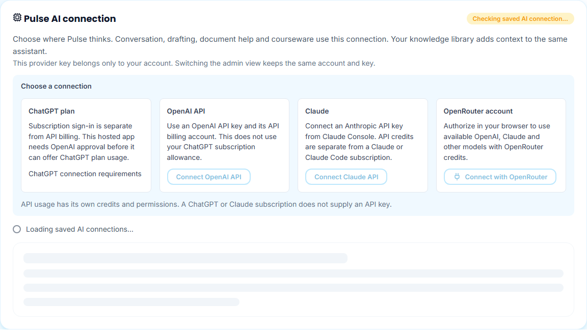

Connect a provider, select an **Available model**, and use **Test selected model** to check actual generation permission and quota. Its button and status show a spinner while the test is pending. Listing models alone remains **Model listed · not tested**.

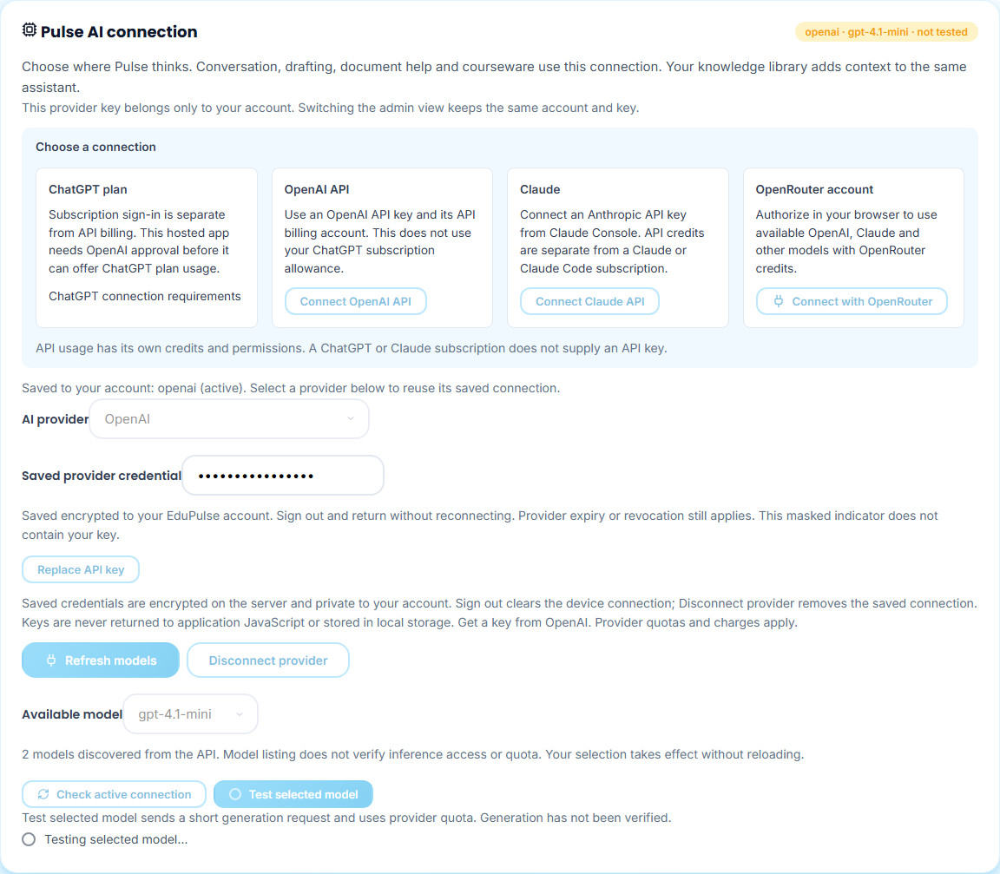

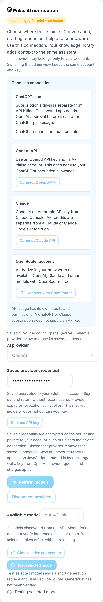

For an authenticated account, credentials are encrypted in the account database. **Saved provider credential** is a fixed masked indicator; it never contains the key. Each provider keeps its own selected model and optional Claude workspace. **Sign Out** clears the device connection and retains those saved account connections. Reopening the same account restores its active provider. To switch back to another saved provider, select it and choose **Use saved connection**; another key or consent is unnecessary while its credential is valid.

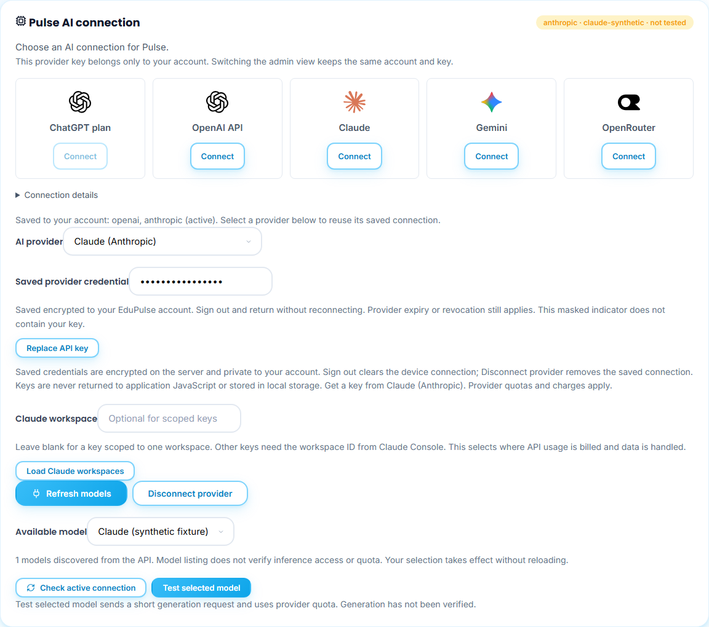

**Disconnect provider** removes that provider's encrypted key and active selection. Other saved providers stay available and are not selected automatically. A non-secret disconnect marker prevents another device's old cookie from restoring the removed credential. Provider expiry, revocation, billing, model withdrawal and account permission changes still apply. A connection-store error retains the credential; it does not claim a successful reconnect or silently use someone else's key. Existing valid account-bound cookies are imported when an account has no stored connection history; an expired or already-lost cookie cannot recover a missing key.

## Requests, lists, dialogs and Pulse

The academic page and **Notifications** popover reserve their content with skeletons while records are pending. An empty message appears only after the request finishes. Background refreshes retain already loaded records. The same notification state is used by the full Notifications page.

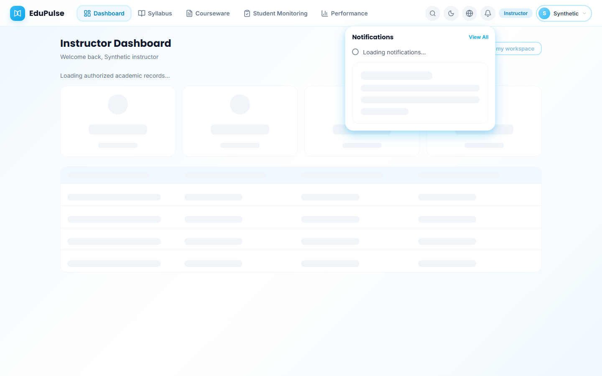

The **Official student directory** shows a table skeleton while results load. Selection and registration wait for the appropriate request; registration displays a spinner until its save callback finishes.

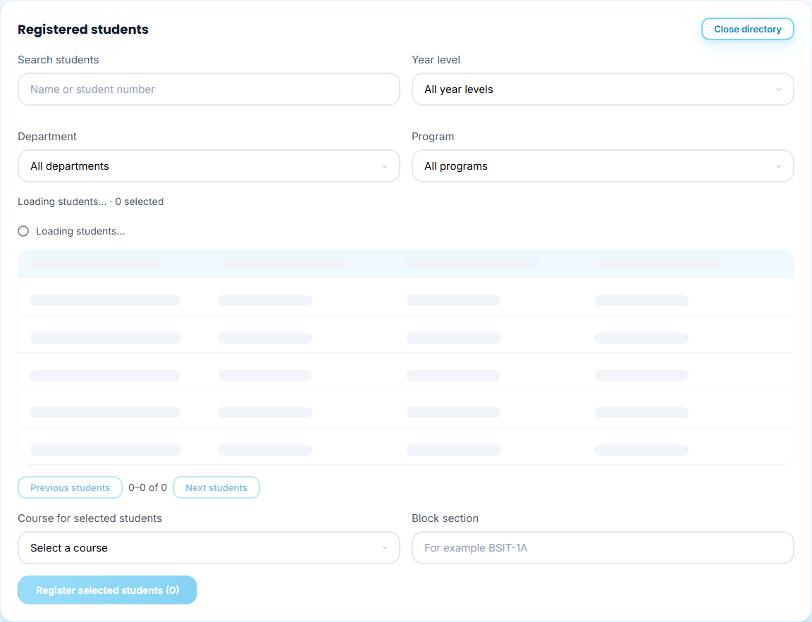

Pulse shows three animated dots and **Thinking…** while waiting for an answer, then **Still working…** for a longer request. **Stop response** remains available. The indicator disappears on completion, cancellation or failure, with the existing prompt/error recovery. No completion percentage is invented.

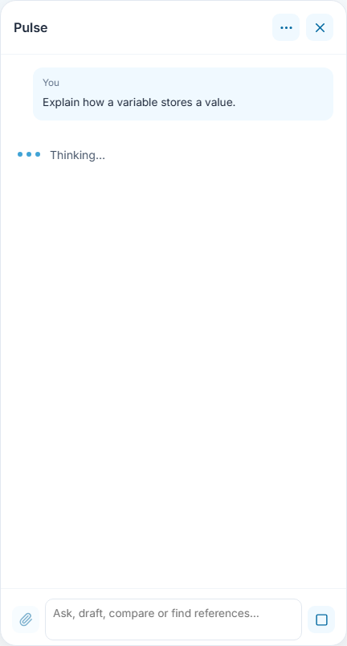

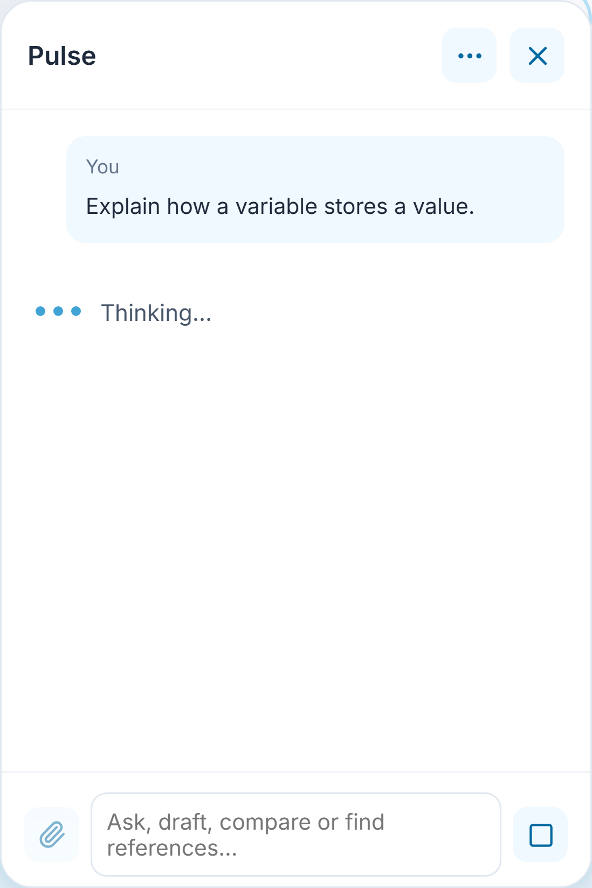

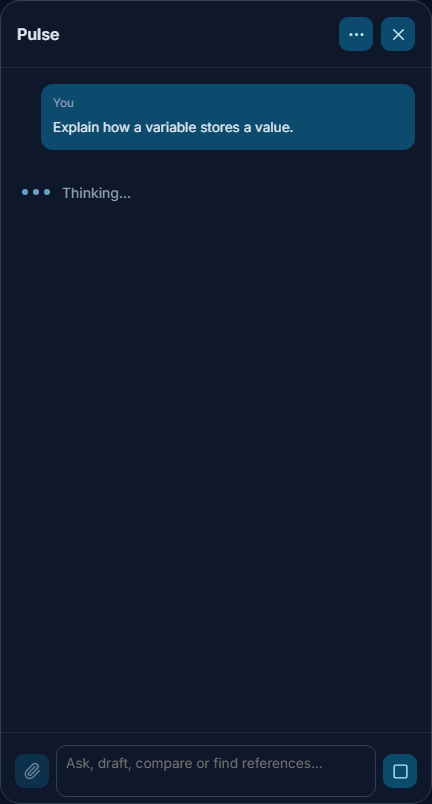

The approved-syllabus dialog shows **Reading approved file…** with a spinner while retaining/checksumming and parsing the document. Its file and confirmation controls cannot submit another import while that work is pending. The retained-file limit is **750 KB**. Completion still requires a matching course code and usable outline; a spinner is not evidence of approval.

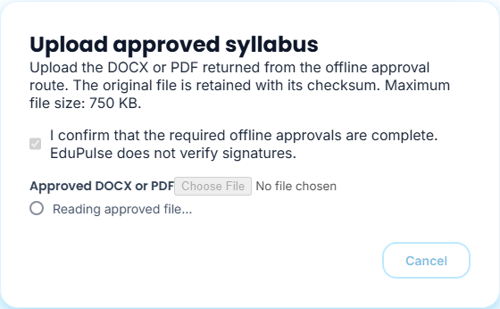

The System Admin overview uses skeleton cards and rows until account counts and service checks return. It no longer shows initial zero counts as though loading had finished. A later **Refresh** keeps the last data and shows a spinner.

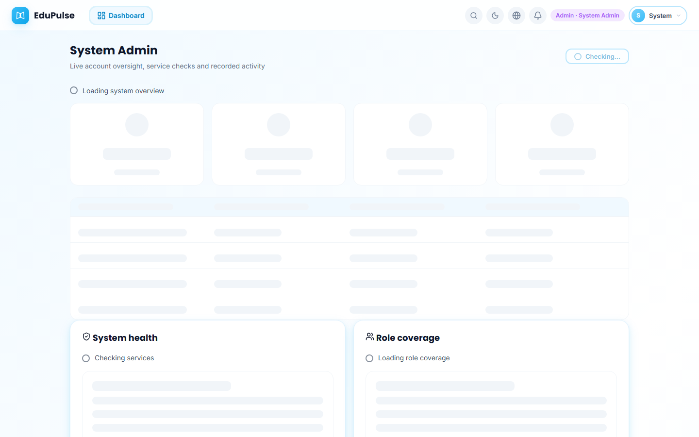

## Loading audit by surface

| Surface and roles | Feedback and completion boundary |
| --- | --- |
| Initial authenticated route, all accounts | Page skeleton while the auth session is resolving; no artificial route-transition delay. |
| Syllabus, courseware and content editor, academic staff | Workspace skeleton during initial load. Existing backup/recovery controls remain in **Data & Privacy**. |
| Academic dashboards, records, course loading, monitoring, performance, all assigned roles | Existing record/KPI/table skeletons and refresh spinners retained. Charts use returned records; no sample progress is introduced. |
| System Admin checks, accounts and audit | Initial skeletons; refresh and account action spinners; existing error/retry state. |
| Provider restore, model discovery/selection, connection checks, Claude workspace lookup and disconnect | Initial skeleton, operation-specific status and pending action spinner. Successful save follows the server response. |
| OpenRouter authorization | Status during initiation; callback retains its existing authenticated code-exchange and failure recovery. Consent belongs to the external provider. |
| On-device model | Real model-download progress and cancel control retained. |
| Knowledge library | Initial list skeleton; queued items use dots, extraction/indexing use spinners; OCR keeps its real processing progress. |
| Pulse messages and conversations | Dots while generating; skeleton while reading history; spinner while updating a conversation or memory. **Close history** remains available. |
| Notification popover and page | Skeleton for the first record request, then data, error or empty state. |
| Student directory and confirmed roster save | Table skeleton, retained rows on refresh, spinner for registration. |
| Syllabus DOCX/PDF import and approved-file modal | Existing scanning progress retained; approved-file read adds a spinner. No invented percentages. |
| Courseware generation | Existing week/job progress and cancellation retained. |
| Document reader | **Preparing PDF…** spinner while export runs. **Save** waits for its supplied callback and keeps the draft on failure; account autosave/recovery is a separate workspace operation. |
| Profile, delivery settings, assignments, reviewed marks, offline review, student response submission and appeal | Pending action spinners using the existing operation state; duplicate submission disabled. |
| Search, language, account, role, action menus, static dialogs and presentation navigation | Open immediately from already available state; no network request means no added loader. |

Statuses have readable text and `role="status"`; pending regions use `aria-busy`, decorative animation is hidden from assistive technology, and duplicate actions wait for completion. Reduced motion stops dots, shimmer and rotation without removing status text. Theme variables preserve the existing solid light/dark surfaces. Loading is not success, verification, publication or an actual student result.

Backend retention, encryption, isolation, migration and verification limits are in [ADR-004](../../backend-system/decisions/004-account-provider-retention.md) and the [release record](../../versions/2026-11-07-loading-and-connections/README.md).
