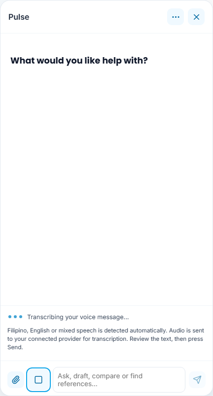
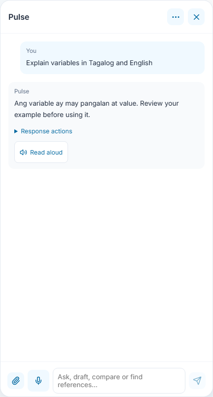
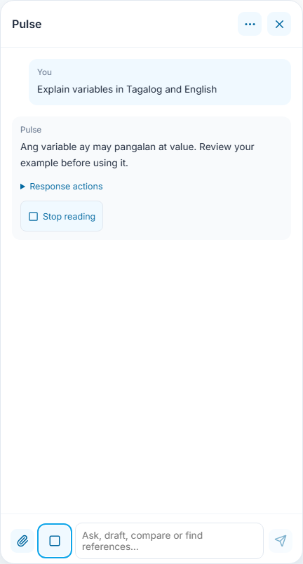
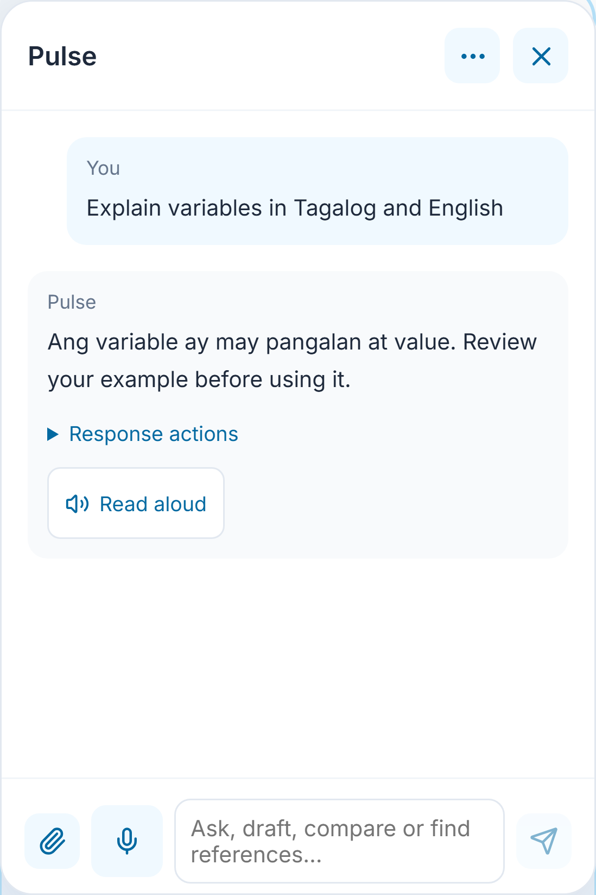
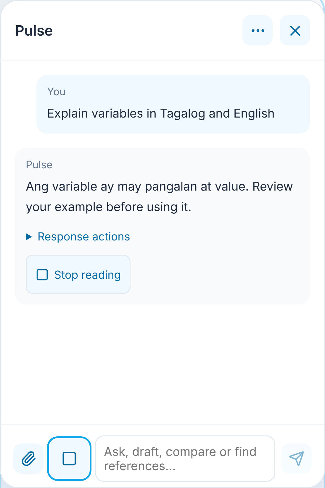

# 20 - Voice messages and provider errors

Captures use synthetic microphone recording, playback, account and provider transports. They exercise the actual controls, raw upload and cancellation lifecycle. They do not establish physical microphone quality, audible playback or live transcription accuracy.

## Record with one button

Select the **Voice input** microphone icon beside the message box and allow microphone access. It starts recording immediately. There are no language or mode dropdowns and no automatic chat submission. Previous device language/conversation preferences are ignored.

Speak Filipino/Tagalog, English or a mixture. The provider detects the language automatically. The microphone becomes a square **Stop recording** icon in the same position beside the input field.

Select **Stop recording**. The microphone is released and **Transcribing your voice message** appears while the recorded audio is transcribed. The same square icon can **Cancel transcription**. Canceling discards a late result; it does not place text into another account or reopened conversation.

The transcript is appended to the existing draft in the text field. Review or edit it, then choose **Send**. Stopping the recording never runs spoken instructions or sends a chat prompt automatically. Recognition can make mistakes, especially with mixed speech or noise; the editable transcript is the review step.

Recording is capped at 45 seconds and 1 MB; the time limit ends recording and transcribes once. Canceling the microphone permission prompt, closing Pulse, changing account/view, opening history/workspace or hiding the tab cancels recording/transcription. Reloading never restarts the microphone or replays transcription. Typed chat stays available if recording is unsupported.

## Connected provider and privacy

Automatic multilingual transcription uses the account's active **OpenRouter**, **OpenAI** or **Gemini** connection. OpenRouter and OpenAI use dedicated speech models; Gemini uses the selected Gemini model's audio input. The selected chat model is not changed. Other connections receive an explanation directing them to a supported connection; EduPulse does not silently switch keys/providers or retry paid transcription.

Microphone access requires HTTPS and browser permission. The recorded clip is sent through EduPulse to that connected provider only after Stop or the 45-second limit. Provider transcription usage may consume API credits. EduPulse does not save an audio file, audio database row or audio history; the normal chat history receives text only if you choose Send. The provider's own audio processing/retention terms apply. Audio and transcripts are not stored as reload hints.

The backend permits only supported audio containers with matching signatures, bounds upload bytes, uses fixed provider endpoints and existing account-owned encrypted credentials, request leases, rate limits and disconnect cancellation. It returns a bounded transcript. A missing connection, unavailable speech model, invalid recording, silence or provider failure produces an explanation without inserting a fabricated transcript.

[OpenRouter transcription](https://github.com/OpenRouterTeam/docs/blob/main/guides/overview/multimodal/stt.mdx), [OpenAI file transcription](https://developers.openai.com/api/docs/guides/speech-to-text), and [Gemini audio input](https://ai.google.dev/gemini-api/docs/audio) document the provider interfaces. Browser SpeechRecognition's single-language setting is no longer used for dictation.

## Read a reply aloud

Every Pulse text reply offers **Read aloud**. This uses available browser/device voices, independently of microphone support, without another AI request. A spoken excerpt is capped at 2,400 characters; the full text stays in chat. Select **Stop reading** below the reply or the square stop icon beside the input field to end playback. Another reply replaces the current playback. Recording/transcription cannot be replaced by reply playback.

Playback uses the browser's voice/language behavior. Closing Pulse, changing view or hiding the tab stops playback; reopening or reloading never resumes it. Unavailable or failed playback leaves typed chat available.

## Permission and provider recovery

Denied microphone permission does not upload audio. Allow access for this site before trying again. Provider credit/authentication failures stop transcription, preserve the typed draft and restore the microphone button. No automatic retry or automatic chat follows the failure.

OpenAI errors retain their existing categories: exhausted credits, project/organization spending caps and usage limits direct the owner to provider billing; temporary rate limits include a validated retry interval when supplied. Reconnecting a key does not add credits. [OpenAI error guidance](https://developers.openai.com/api/docs/guides/error-codes).

