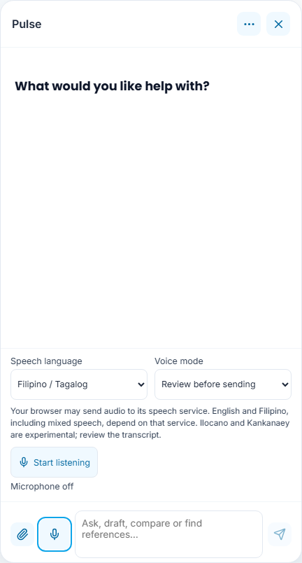
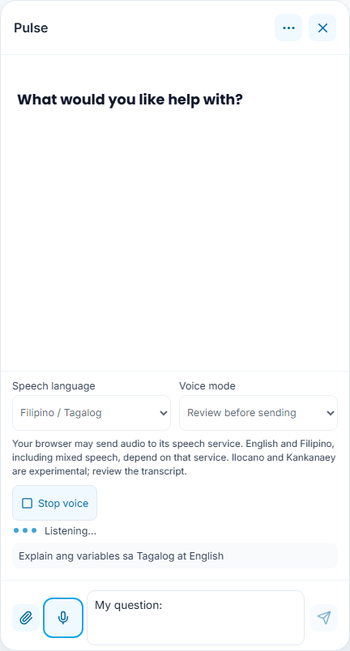
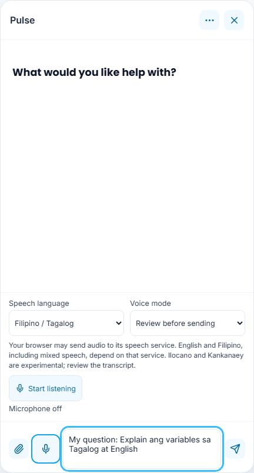
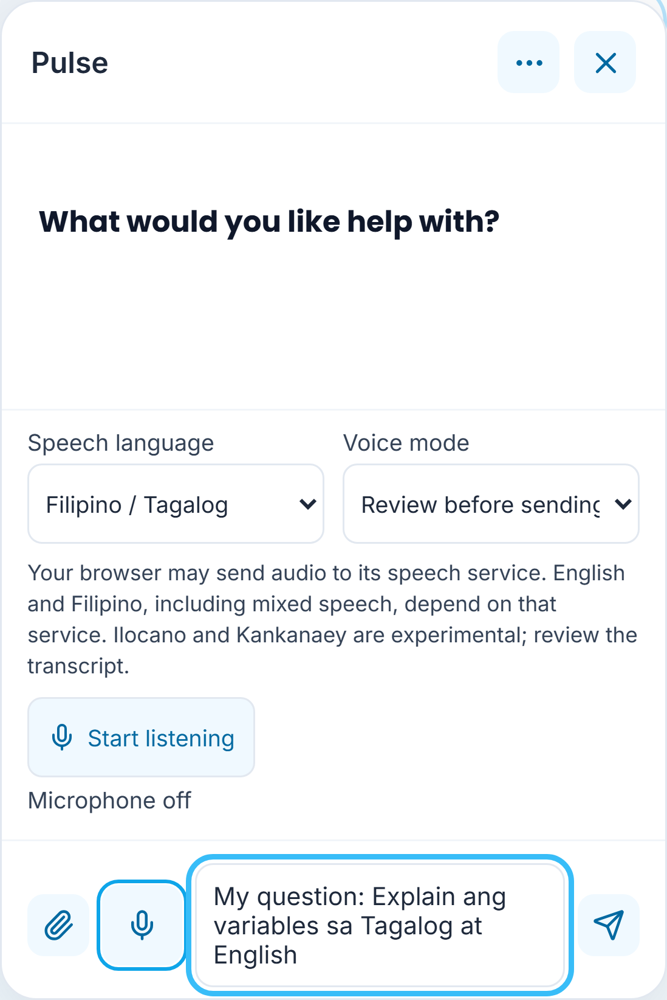
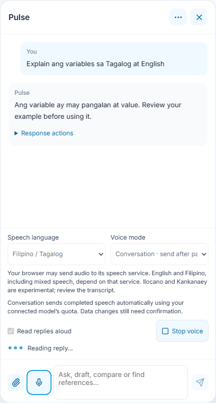
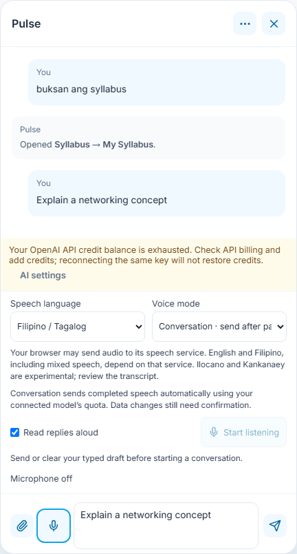
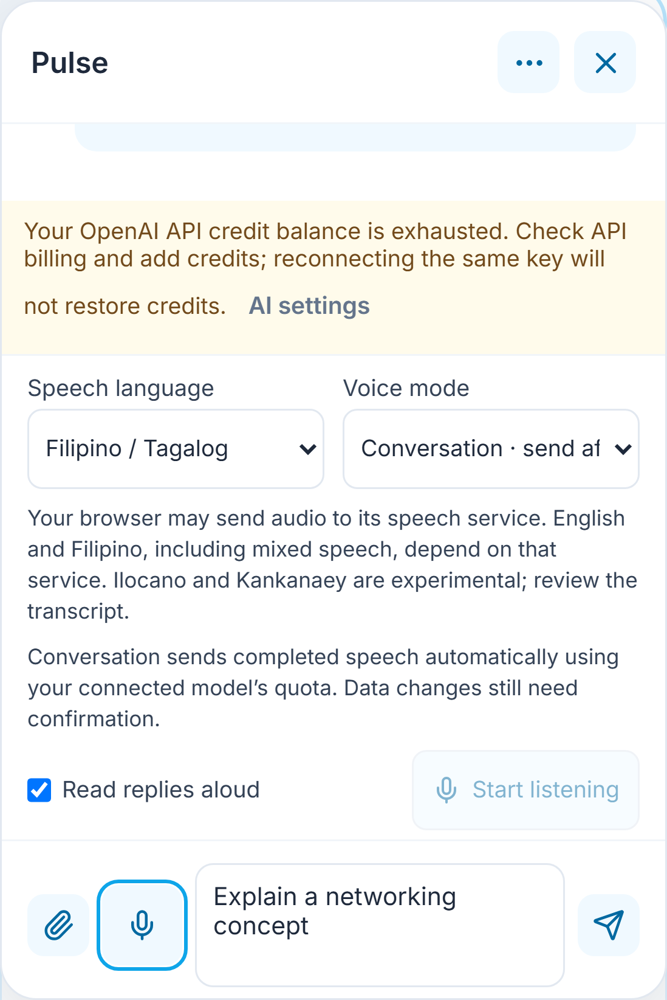
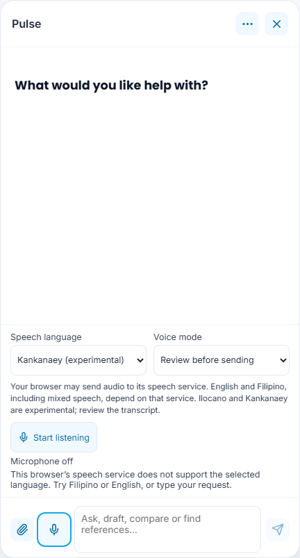
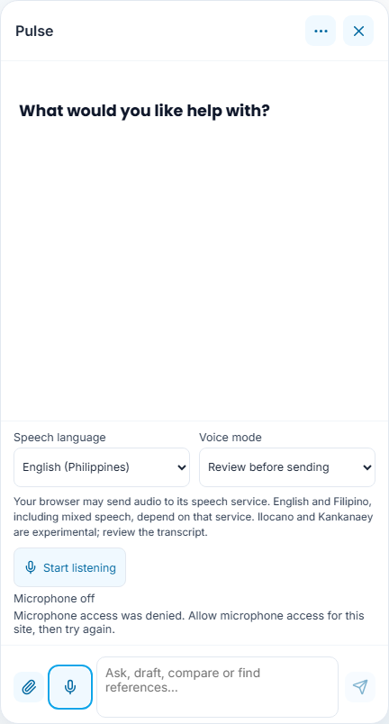
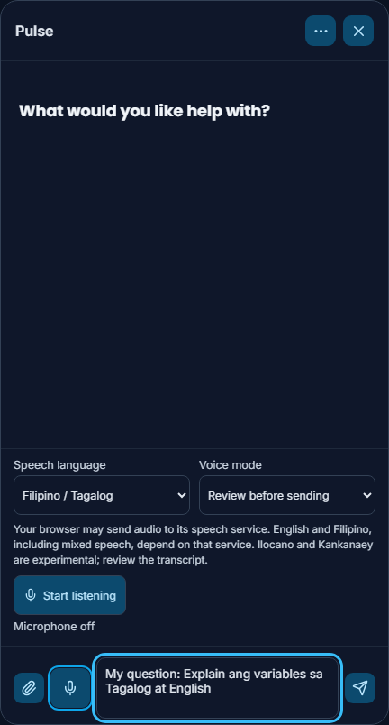

# 20 · Voice input and useful provider errors

These captures use synthetic speech recognition, speech playback, account and provider transports. They exercise the actual chat controls and request lifecycle, not a real microphone, speech-service language accuracy, live paid inference or account billing. Physical-device speech recognition and pronunciation remain browser/device dependent.

## Enable voice in Pulse

Open **Pulse options** (the three-dot button), then **Voice input**. Voice is off initially. The controls appear inside the chat; there is no microphone permission request until you choose **Start listening**. The microphone button beside the message box disables voice again.

Choose **Speech language**:

* **Filipino / Tagalog** is the default. Mixed Tagalog/English speech is sent to the browser’s recognition service using that language preference; code-switching accuracy is not guaranteed.
* **English (Philippines)** requests English recognition.
* **Ilocano (experimental)** and **Kankanaey (experimental)** request those languages only if the browser’s service supports them. Their presence in the list is not evidence of supported recognition. An unsupported-language error asks you to use Filipino/English or type instead.

Your browser may send audio to its own speech service. EduPulse does not upload audio to the OpenAI API, record raw audio or store audio files. Recognition therefore does not consume the connected OpenAI model’s token allowance. Sent text still uses the normal Pulse provider and conversation-history rules.

## Review before sending

Keep **Voice mode → Review before sending**, then choose **Start listening** and allow the browser microphone prompt. **Listening…** and a live transcript show what the browser hears. The message’s **Send** button waits until recognition finishes. **Stop voice** ends listening; it does not submit an unfinished transcript.

After the browser finalizes the utterance, its transcript is appended to your existing typed draft. Edit it, then choose **Send**. Transcripts and typed questions share the existing 4,000-character limit. One listening turn is bounded to 45 seconds.

## Optional conversation mode

Choose **Conversation · send after pause**. This explicitly enables automatic submission of completed speech. Send or clear an existing typed draft first. **Read replies aloud** uses available device/browser voices; it does not call an OpenAI audio API. Start listening when ready.

Pulse pauses recognition while handling the request and reading a reply. After a successful turn it can listen again. Generated text and quick replies can be read aloud; long replies are limited to a spoken excerpt of 2,400 characters, with the full text left in chat. Device voice/language availability and autoplay rules can prevent playback; the controls report that failure rather than claiming success.

Existing navigation can understand mixed commands such as “buksan ang syllabus,” “ipakita ang dashboard,” and “pumunta sa records.” The account’s existing page permissions still apply. Spoken instructions use the same tools as typed instructions; data changes still require the existing confirmation card. Voice does not grant role switching, approval or publication rights.

**Stop voice**, “stop voice,” or “itigil ang boses” ends the voice session. The spoken stop phrase works while listening. Closing Pulse, opening its history/office, changing account/view, or hiding the browser tab stops microphone and playback. Stopping voice during an already submitted request ends audio; **Stop response** is the control for canceling that request. Changing language or mode also stops the current voice session. Language, mode and playback preferences are remembered on this device for that account/view; recording never restarts automatically on reload.

## First-request OpenAI errors

Connecting a key or listing a GPT-5.6 model does not establish available API credits or generation permission. A first inference request can be rejected. Previously, several newer OpenAI HTTP 429 codes became the same “quota or rate limit” message.

| OpenAI response | Pulse guidance |
| --- | --- |
| `credit_balance_exhausted` | API credits are exhausted; review billing. Reconnecting the key does not add credits. |
| `project_spend_limit_exceeded` | Review the selected project’s spend cap. |
| `organization_spend_limit_exceeded` | Review the organization’s enforced spend cap. |
| `organization_usage_limit_exceeded` | Review the approved organization usage tier/limit. |
| `insufficient_quota`, including the legacy error type | Review API billing and usage. ChatGPT subscription usage is separate. |
| `slow_down`, other HTTP 429 throttling | Wait before retrying; a valid **Retry-After** interval is included. Persistent failures should be checked against the model’s request/token limits. |
| HTTP 503 / `server_is_overloaded` | The selected model is temporarily overloaded; follow its retry window. |

The same classification is used for discovery and generation. EduPulse does not retry paid inference or switch models automatically after these errors. It retains the saved credential and the failed prompt. **AI settings** is available beside a credit/rate-limit failure. In conversation mode, the voice loop stops on a failed request and places the transcript in the box for review instead of repeatedly resubmitting it.

The screenshot alone cannot establish which limit the owner’s real request hit, and this change cannot increase a provider’s credits or spending limits. [OpenAI’s error guide](https://developers.openai.com/api/docs/guides/error-codes) distinguishes these codes and explains that retrying billing/spend/usage failures will not restore access.

## Permission and language failures

A denied microphone, missing audio device, unsupported language, speech-service network failure or silence ends the listening session with a readable explanation. Unsupported browsers retain typed chat. Recognition requires a secure context; production permits microphone access only from EduPulse’s own origin, with browser permission still required. See [MDN’s speech-recognition guidance](https://developer.mozilla.org/en-US/docs/Web/API/SpeechRecognition) for browser availability and remote-service behavior.

Existing theme variables and reduced-motion dots are retained. **Speech language**, **Voice mode**, playback and start/stop controls have visible labels and keyboard access; changing a setting does not silently start the microphone.

[Release validation](../../versions/2026-11-07-voice-and-quota/validation/results.md) distinguishes synthetic transports, native provider-envelope tests and deployment evidence.
