# 21 · Automatic records and course students

The examples use synthetic account, directory, workspace and academic transports. They show the real interface and request lifecycle. Native PostgreSQL tests and a rolled-back hosted canary separately check persistence, access removal and retained attempts; these images are not real student activity.

## Syllabus and Course

**Syllabus** has exactly three tabs: **My Syllabus**, **Shared Repository** and **Syllabus Builder**. Opening Syllabus defaults to **My Syllabus**. The former roster tab has moved to **Student Monitoring → Students**; an old `syllabus?tab=register` link redirects there.

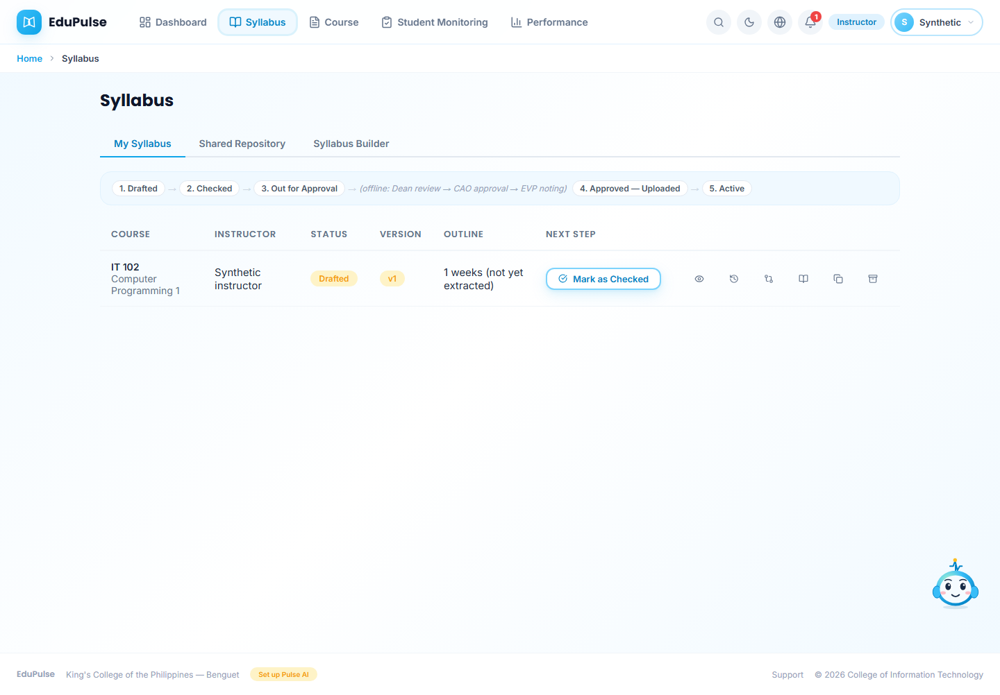

The instructor navigation and page title now say **Course**. The existing course/week workspace, generated materials, assessments, review, publishing, document/presentation readers and three-dot action menus remain. The `/courseware` address and saved course/week links still work. Student navigation retains **My Courses**. An active approved syllabus is still required for generation and release.

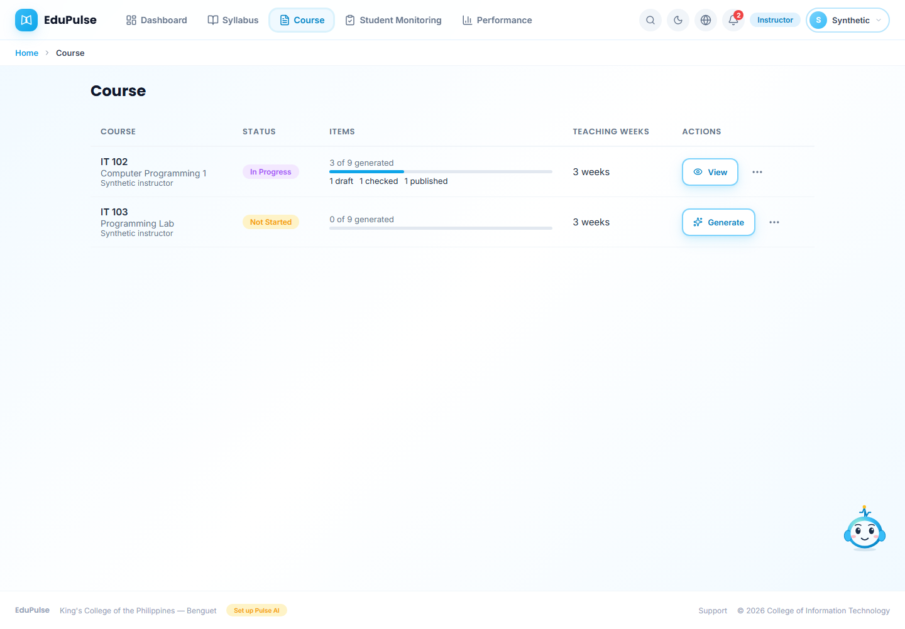

## Manage course memberships

Open **Student Monitoring → Students**. **Assessment Scores** and **Learning Material Access** remain available in the same page. The legacy **Scoring Sheet** address opens assessment scores.

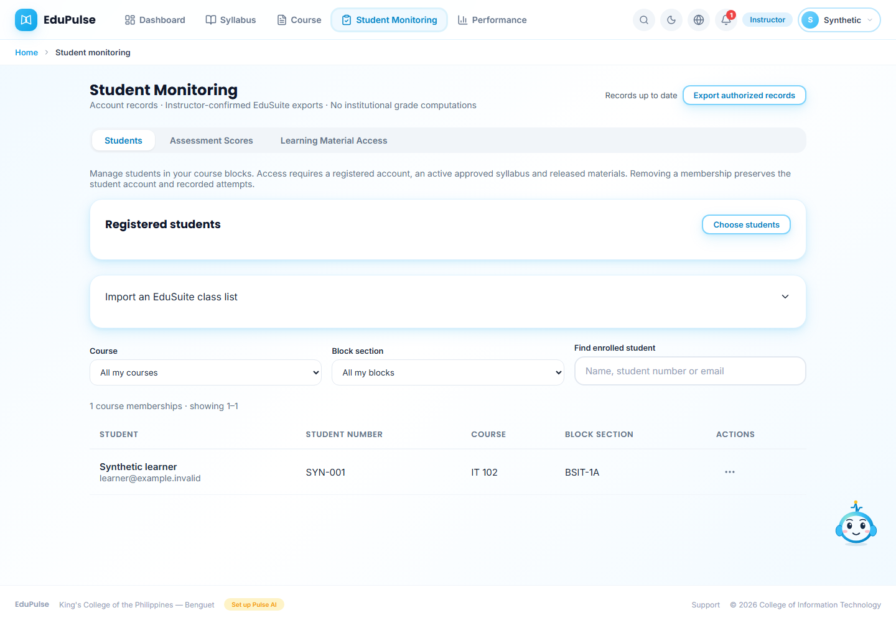

Use **Choose students** to select registered accounts. The directory retains its search, year-level, department, program and pagination controls. Choose **Course for selected students**, enter **Block section**, then **Register selected students**. The action waits for a revision-checked save. Failed saves retain the selection; background refresh never confirms or resubmits the registration.

**Import an EduSuite class list** expands the existing CSV, Excel, PDF, Word and text importer. It still reads the actual file and previews its rows before **Register Course**. Import failures leave the file/preview available. An email is required for account-based access; a name-only imported row does not create an account or grant access.

The roster combines this owner's saved registrations and authorized enrollment records. Filter by **Course**, **Block section** or **Find enrolled student**. The table contains individual course memberships, so a learner in two courses can appear twice. It does not become a college-wide editable student directory.

Open a student's three-dot menu:

* **Change block** opens **Change student block**. Enter **New block section** and choose **Save block assignment**. The database enforces a maximum of 35 students per course block; a failed change rolls back.
* **Remove from course** opens a confirmation. **Confirm removal** withdraws that course membership after the save. **Cancel** leaves it unchanged. The student account, official profile and past attempts remain. Missing-email file rows can be edited/removed locally without claiming account access.

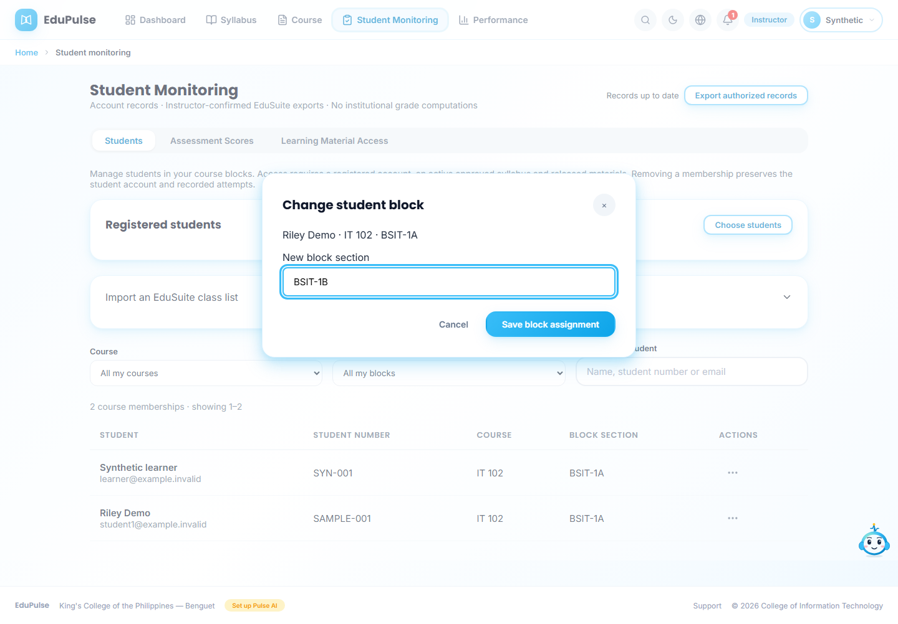

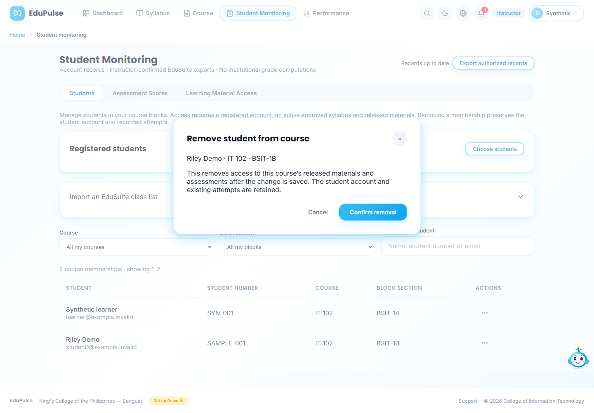

For imported institutional class lists, a saved instructor membership decision is applied again during workspace projection and direct shared imports. A later sync cannot silently restore a removed learner. Explicitly registering the account again restores membership. Enrollment alone does not release drafts: an active approved syllabus and published, released materials are still required.

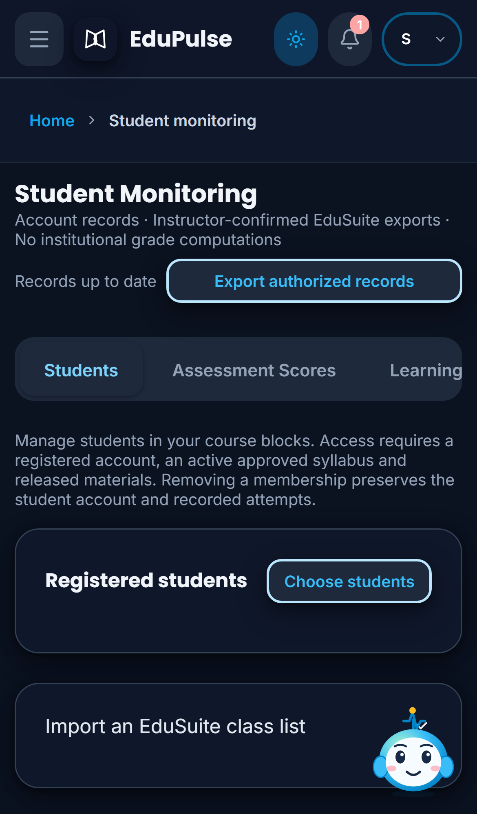

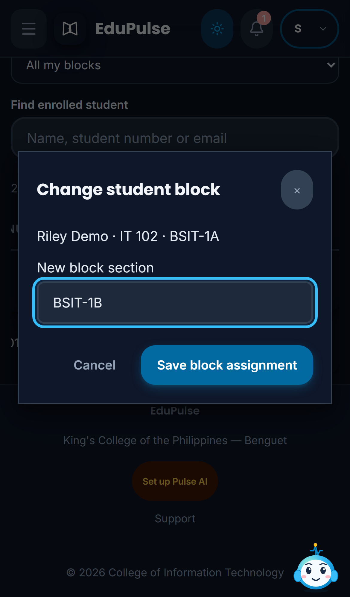

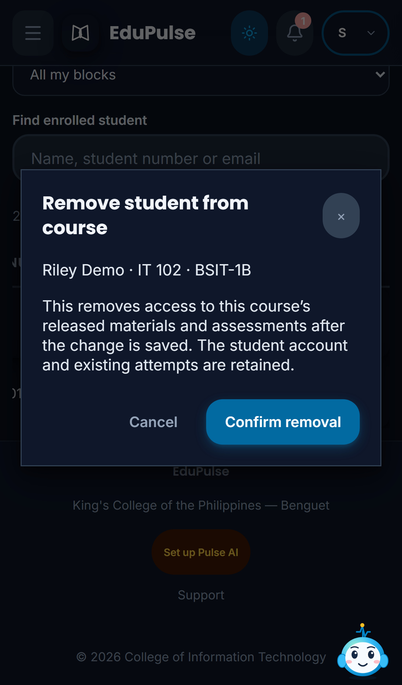

## Automatic refresh and sync

The persistent **Refresh records** and **Sync my workspace** buttons have been replaced by a compact status. **Export** / **Export authorized records** remains available after records load.

* Records load on entry and revalidate about once a minute while visible and online. Returning focus or connectivity rechecks stale data. An account-scoped cross-tab signal invalidates the cache without sending records or credentials.
* Only one record read runs at a time. A completed mutation during a read invalidates its response and causes a newer read. Existing records and open forms remain during background reads.
* Normal workspace saves already project their confirmed contents transactionally. An instructor's older, clean cloud workspace is reconciled once per account session after loading. Dirty edits, saves, conflicts and workspace errors block that reconciliation.
* Workspace background recovery reads before retrying a failed save. A matching saved snapshot recovers a lost response; a changed revision preserves local edits and requires conflict review. It never overwrites the newer revision automatically.
* Offline tabs pause requests and retain the current account's loaded view. Transient record failures retry with increasing delay, from 15 seconds up to five minutes. An error offers **Retry connection**; authorization failures clear the loaded records. A network reconnect is not proof that a request succeeded.
* Changing account, assigned role or admin view isolates the record cache and cancels obsolete reads. Delayed responses cannot populate the next role's view. Role checks and server RLS remain authoritative.

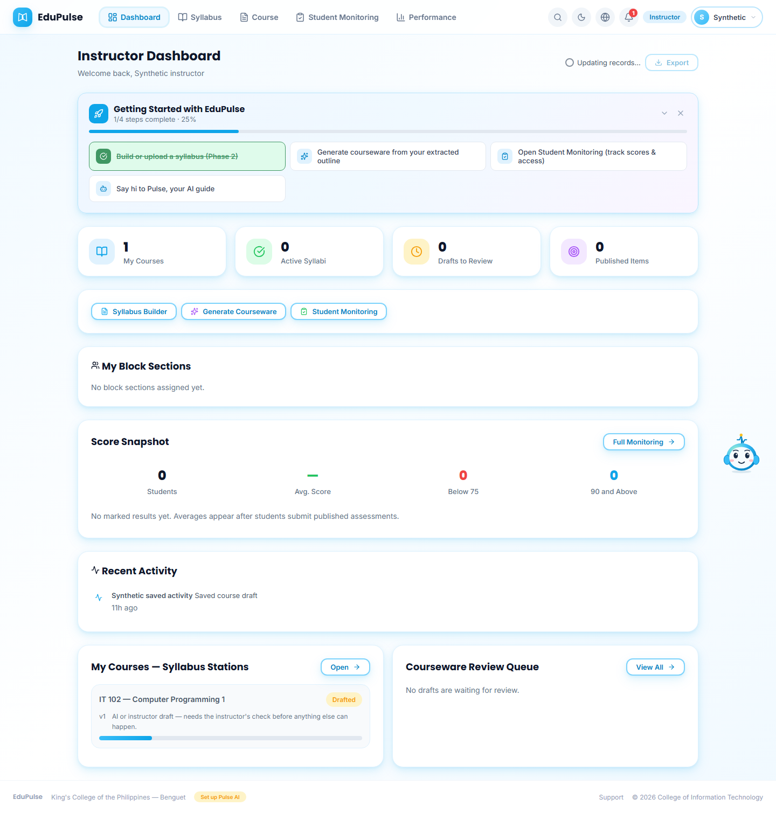

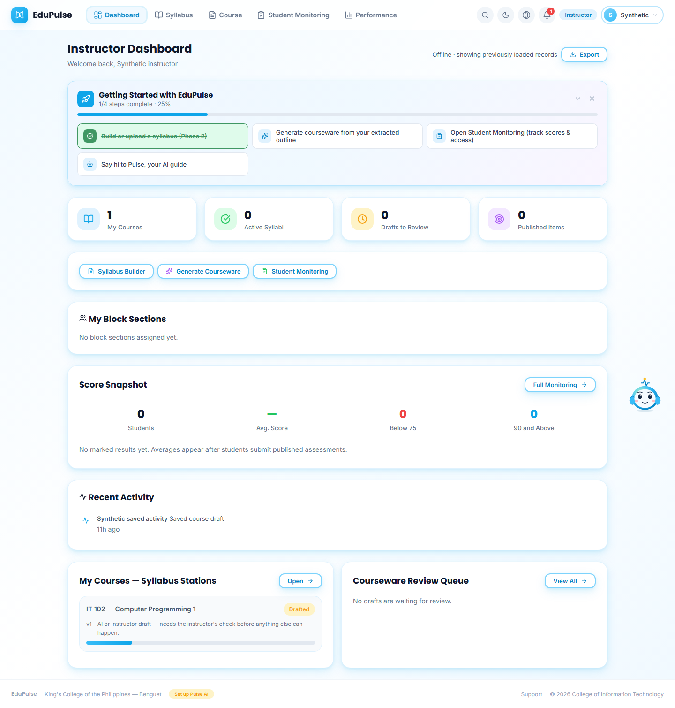

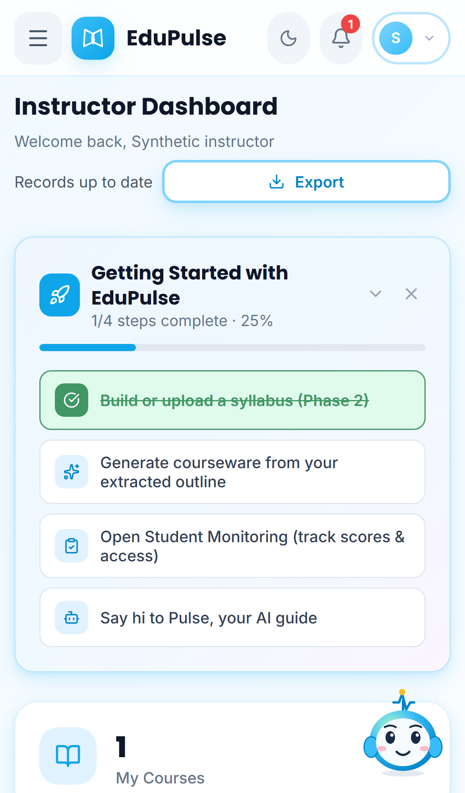

**Records up to date** follows a successful authorized read. Pending workspace edits, conflicts, errors, loading and offline state have distinct text. No student scores or completion are guessed. Background work does not submit assessments, mark answers, approve syllabi, publish material, send reminders or call a paid model. Those business actions retain their existing confirmation and audit boundaries.

[Release validation](../../versions/2026-11-07-automatic-records-and-course-rosters/validation/results.md) distinguishes UI fixtures, native SQL checks and hosted validation.
