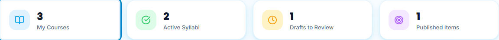
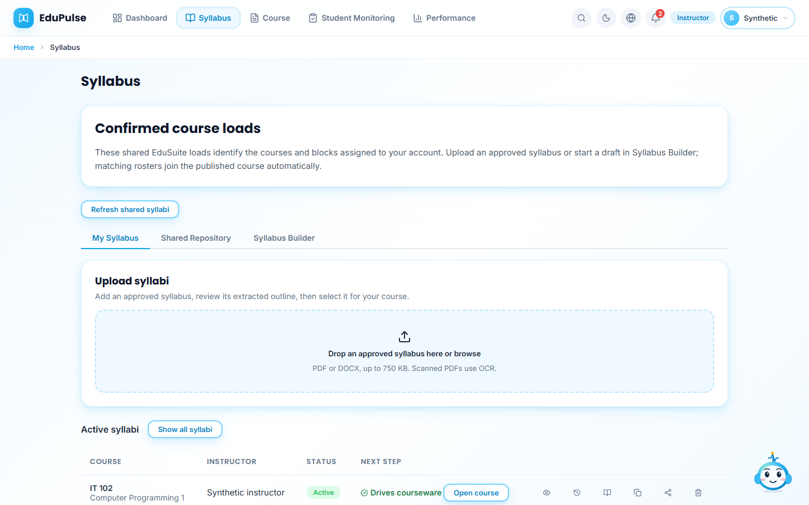
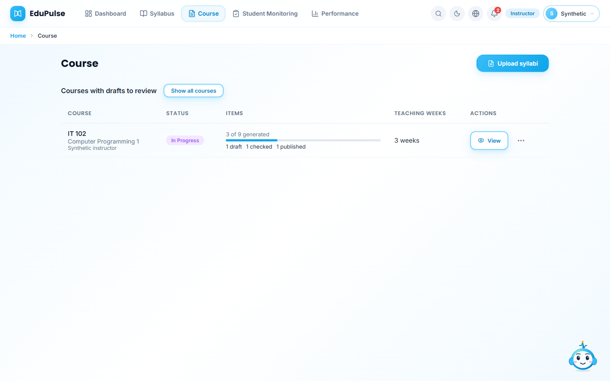
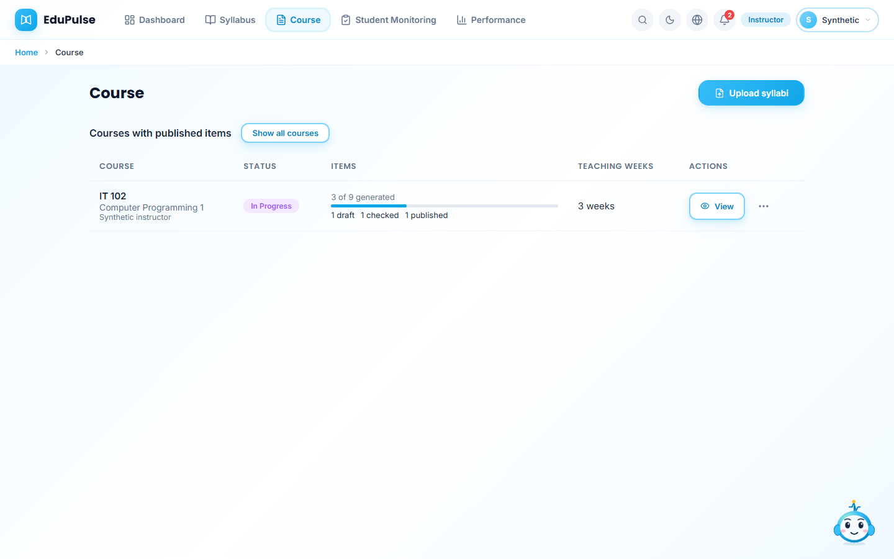
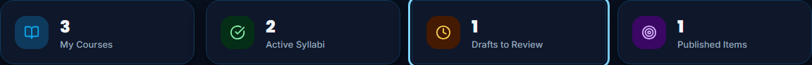
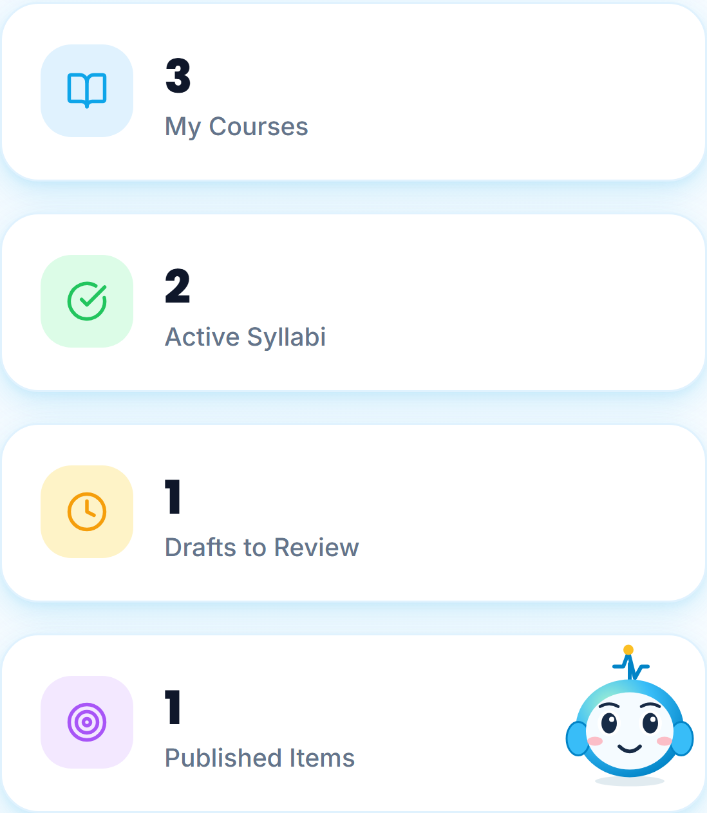
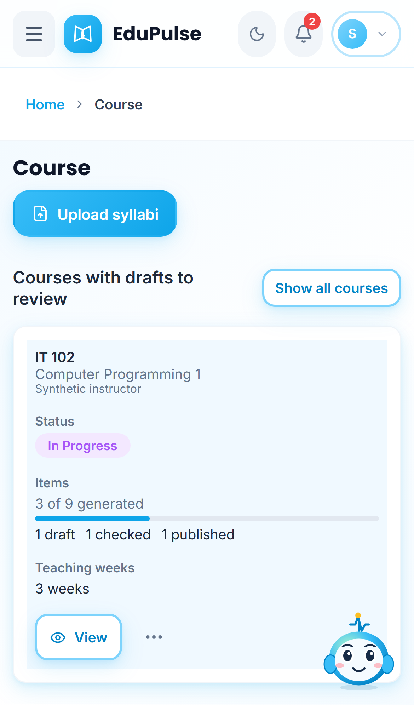

# 22 · Instructor summary-card navigation

The instructor dashboard's four summary cards are links. Click or tap a card, or focus it with **Tab** and press **Enter**. Browser Back returns to the dashboard; opening a link in another tab also works. This navigates only: it does not generate, check or publish content.

| Card | Destination |
| --- | --- |
| **My Courses** | **Course**, using its existing active-syllabus and extracted-outline requirements |
| **Active Syllabi** | **Syllabus → My Syllabus**, filtered to **Active** |
| **Drafts to Review** | **Course**, showing eligible courses containing drafts |
| **Published Items** | **Course**, showing eligible courses containing published content |

**Upload syllabi** in Course opens the approved-file intake in **My Syllabus**. That upload area stays visible above the filtered active list; [Manual 30](../30-approved-syllabus-intake/README.md) shows scanning, review and selection.

## Active syllabi

**Active syllabi** identifies the filter. **Show all syllabi** restores the full list. Changing a Syllabus tab also clears the filter, so a draft saved from the builder is visible when returning to **My Syllabus**.

## Courseware destinations

The heading reads **Courses with drafts to review**. **Show all courses** restores the normal course list. **View** opens the existing weekly workspace; its three-dot menu retains **Review drafts** and the other existing actions.

**Published Items** opens **Courses with published items**. The course row still shows its complete generated, draft, checked and published counts. Selecting a course opens its full weekly workspace. The filter selects courses; it does not change content or student access. Zero-count cards remain links and show an honest empty-state message.

## Keyboard, dark mode and mobile

Focused links have a visible outline. Their accessible names identify the card and their descriptions expose the recorded count.

Cards stack on phones and the filtered course list keeps the existing mobile layout. These images use synthetic account/workspace data: three syllabi, two active, one draft item and one published item. They are UI evidence, not real student activity or a hosted-account persistence test.

[Manual 36](../36-instructor-syllabi/README.md) adds course-labelled block cards, course/block monitoring links that survive reload, and actual marked score rows. My Syllabus no longer has Version or Outline columns; its history remains available through one control.
