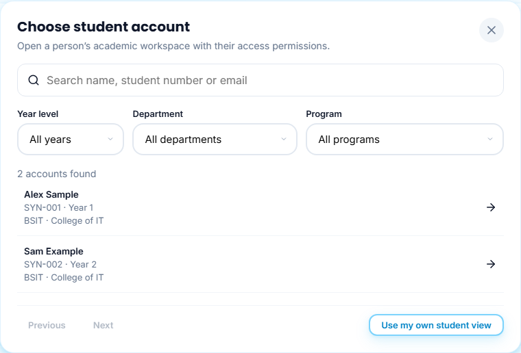
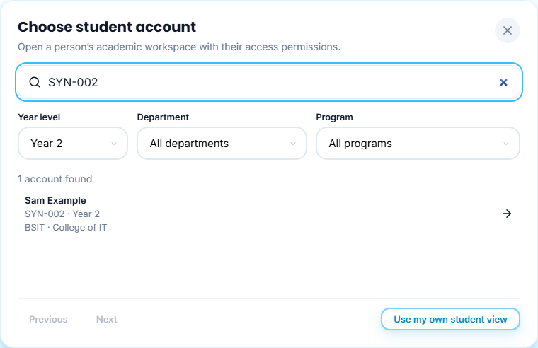
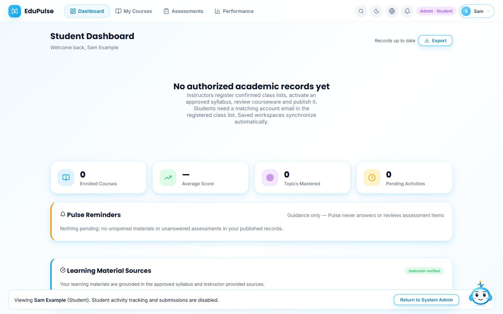
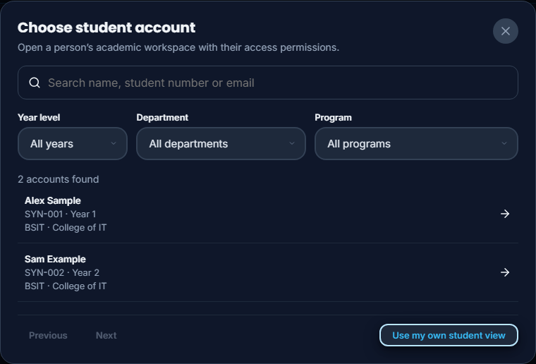
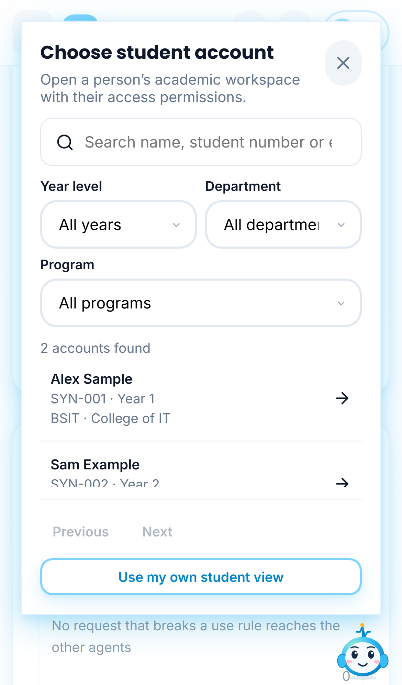
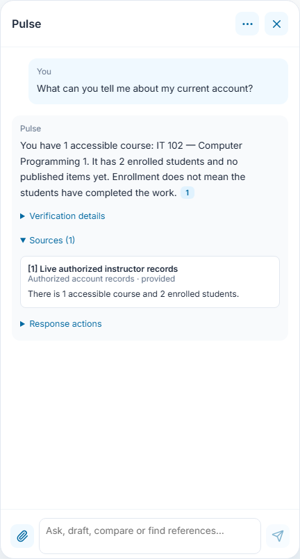
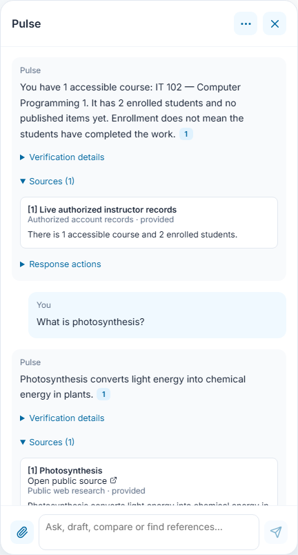
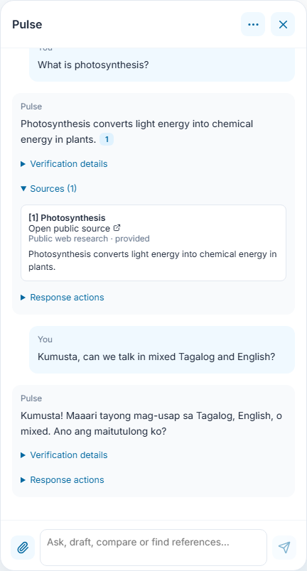
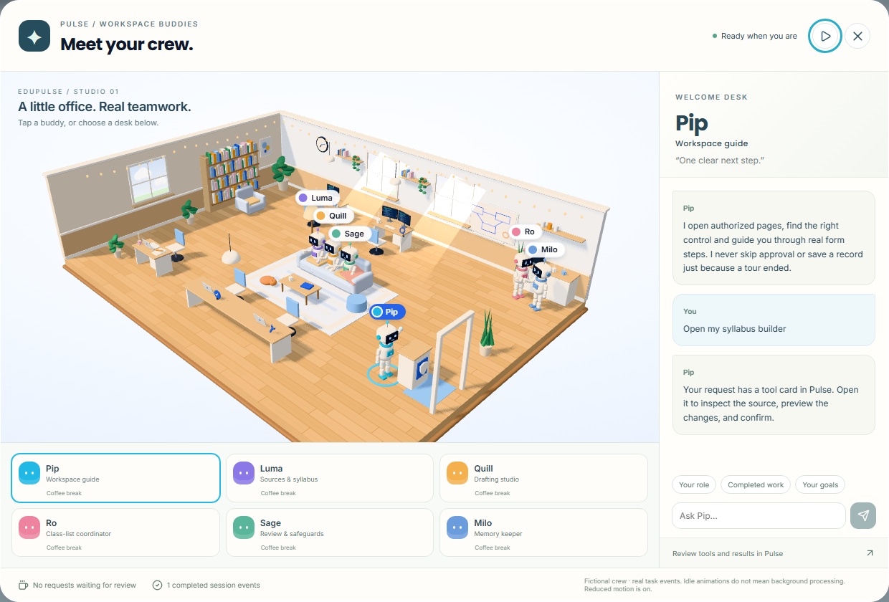

# 23 - Account support and Pulse context

The screenshots use synthetic account, academic and model transports. They show the real interface, not live student records, provider inference or Google authentication. Native SQL tests and a rolled-back hosted canary separately verify authorization, delivery and persistence.

## Select a person after choosing a role

Sign in as the verified System Admin. Open **Switch View** in the top bar, or **Switch view** in the account menu on a phone. Choose **Student**, **Instructor**, **Dean** or **Associate Dean**. The console's **Open view** buttons open the same account picker.

**Search accounts** accepts a name, student number or email. Student accounts also have **Year level**, **Department** and **Program** filters. The result count reflects the filters; **Previous** and **Next** move through pages of up to 50 accounts. Loading shows a spinner, failures show **Retry**, and an unavailable account does not change the current view.

Choose a person's row to open their academic view. The account name and a persistent support banner identify the person selected. **Return to System Admin** exits. The admin's Google sign-in, AI provider connection, private conversations and knowledge library remain with the admin. Academic reads and permitted saves use the selected account's access rules and changes are attributed to the admin. Switching views discards responses belonging to the previous view and uses a separate pending-workspace cache.

Support views can inspect released materials and assessment questions, but do not record student access, start attempts, submit responses or appeal as the student. This preserves actual student activity in instructor statistics. The selected person's password and sign-in session are never shared or replaced. Account profile and credential editing requires returning to the admin account.

**Use my own student view** (or the corresponding role name) retains the previous role-only view using the admin's own workspace. It does not select a student's identity or enrollment.

On smaller screens the account results scroll, and the filters and actions remain available within the dialog. Escape and **Close account selection** cancel selection without changing accounts.

## Ask about authorized account records

Ask Pulse about courses, syllabi, rosters, released materials and saved activity. Answers use the server-authorized academic snapshot and, where relevant, the saved syllabus workspace. A failed data read is reported as unavailable rather than zero records. Source details identify live account records separately from public guidance and Internet sources.

The source counts include all accessible paginated records. Any bounded list included in an answer is identified as a partial listing. A first-open record shows access, not completion or mastery; drafts and checked items are not published items.

## Ask a public question or chat naturally

Public factual questions can trigger web research without the phrase "search the web." Explicit document-only questions stay within the selected sources. Educational drafting can research the selected course even when the private library is empty. Public search uses the requested public topic, not recalled private transcripts, account identifiers or rosters. Missing search results are not claimed as verification.

Casual conversation does not require uploaded files. Pulse supports natural English, Tagalog and mixed-language replies according to the connected model; these controlled screenshots do not establish language accuracy for a real provider.

## Shared agent memory

The agents already share a run state. Completed replies now add concise, durable handoffs with outcome and source provenance in Supabase. Handoffs are scoped to the signed-in owner, conversation and selected account; there is no institution-wide pool of private student information. They include concise executed stage/status labels and prior outcomes, not hidden reasoning, authorization, current grades or proof of an action.

Use **Conversations and memory** in the Pulse menu to reopen or delete a conversation and control **Automatic memory**. Disabling automatic memory stops handoff recall and saving. Deleting a conversation cascades to its handoffs. Recent handoffs are limited to three per prompt, retained as a bounded recent history per conversation/subject, and ignored after 30 days for recall. Non-sensitive saved preferences are still managed through the existing memory controls.

## Verify courseware delivery

An instructor reviews a draft, marks it checked, and explicitly publishes it from an active syllabus with an approved uploaded document and extracted outline. Enrolled students then receive release notices and can access released items; a future release date still gates access. Actual student material opens and saved assessment attempts feed instructor records. An unenrolled account cannot read or submit the item, and the Associate Dean does not receive scores.

At the 8 November hosted audit there were 288 enrollments, 96 draft items, six checked items and zero publications, access events or attempts. The lack of activity is consistent with nothing being published. This release does not approve, publish, complete or grade those real records automatically. The hosted canary proved delivery using isolated test users and rolled every test record back.

Named-person questions first check registered profiles under existing directory permissions. Replies include only accessible name, student number, year, department and program, with bounded matching lists; they do not publish account credentials or search the Internet using retrieved private record content. Course-context replies include the recorded instructor name. A public-person question with no authorized directory match can continue to public research without claiming an EduPulse account exists.

Connected-provider and on-device inference use the same authorized context and research boundaries. On-device handoffs are labelled as client-reported prior outcomes; they are not verified business actions. If the online context service is unavailable, local conversation can continue with a clear limitation and without inventing account records. Source details label record evidence as **Authorized account records**, separately from **Your library** and **Public web research**. Losing the admin session or role closes account selection and clears the selected subject.

## Keep keyboard control after a buddy handoff

After a buddy sends a request to Pulse, Tab and Shift+Tab keep focus inside the open office, even if the send control becomes disabled. Escape closes the office and returns to Pulse. Opening an account picker from a cross-role request closes the office first.

