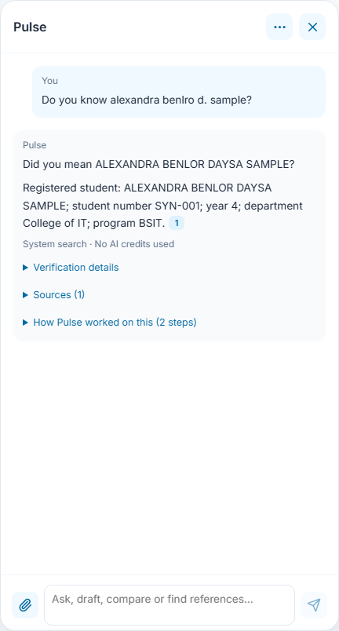
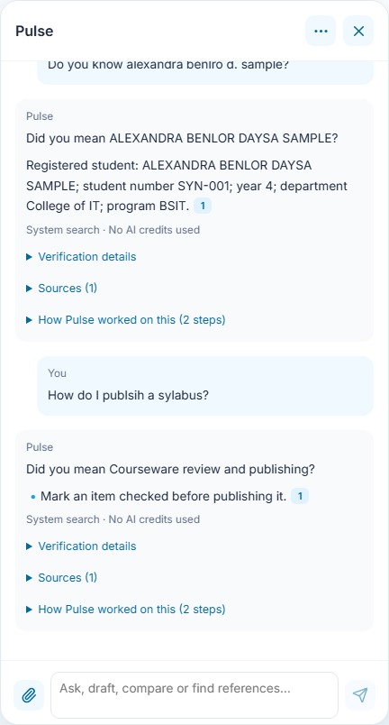
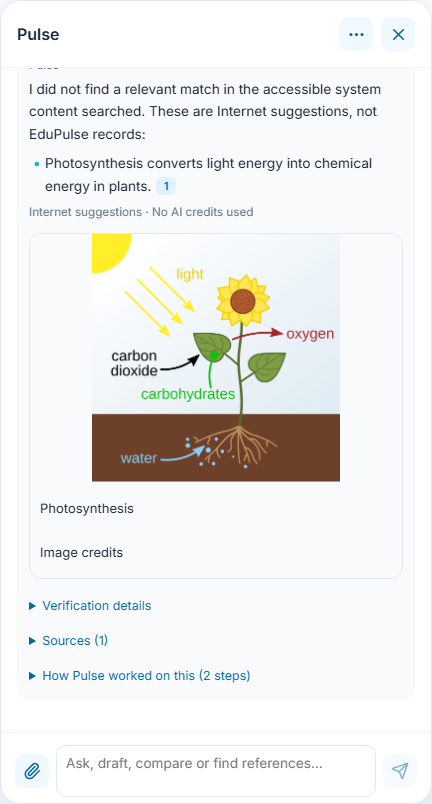
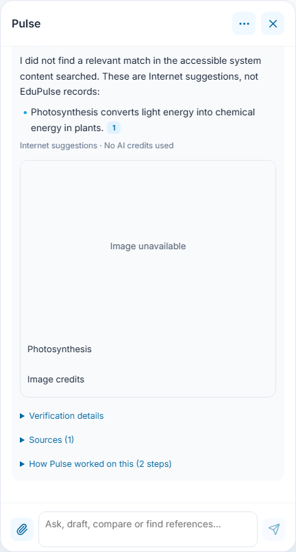
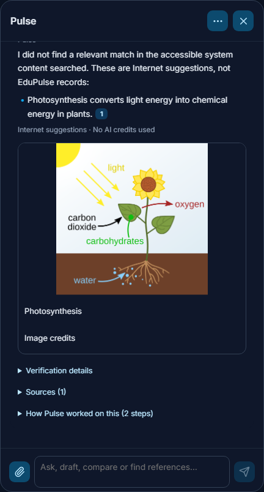
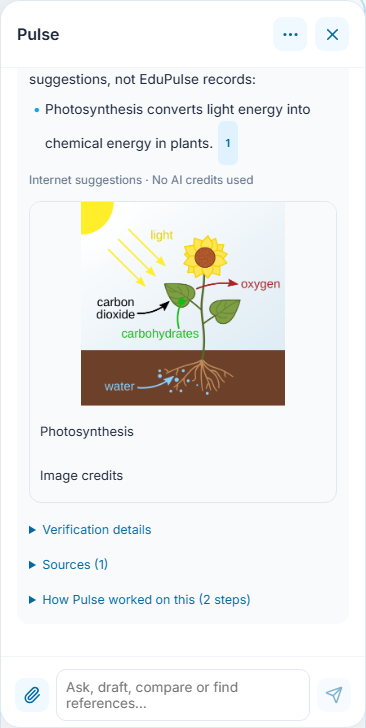

# 24 - System-first search without AI credits

Pulse searches accessible EduPulse records and content before public Internet suggestions. The System Search agent uses keyword matching, spelling tolerance and quoted evidence. It does not call a generation or embedding model for ordinary lookups, even when an AI provider is connected. New drafting, rewriting and detailed reasoning retain the existing model and confirmation workflows.

## Find a registered person

Ask a name question such as **Do you know alexandra benlro d. sample?**. Initials, punctuation, partial names and small spelling mistakes can match authorized directory candidates. A single sufficiently close candidate starts with **Did you mean** and shows the recorded profile with its citation. Multiple matches stay a list; this never selects an account, changes enrollment or establishes that similarly named Internet people are the same person. Student numbers require exact matches and are never autocorrected.

Only the current account's permitted directory, course and faculty records are available. Student sessions retain their own-profile boundaries. Failed record reads are reported as unavailable, rather than no records. Candidate searches are bounded; refine a common name or use its exact student number. Admin support continues to use the selected person's academic permissions and the admin's own private library.

## Ask for help without connecting a provider

Ask a workflow or content question. Product guidance, saved syllabi and materials, accessible course outlines and released learning materials, attachments and indexed private-library passages can supply quoted answers. Simple searches show **System search · No AI credits used**. If both system and public searches miss a general explanation, a ready connected model can still answer from general knowledge; that fallback can use AI credits and does not claim Internet verification. Without a ready model the search result remains available with refinement guidance. Private-record failures and document-only requests never become invented model answers. No record is edited by searching. Informational questions such as **How do I create a syllabus?** stay on the read-only answer path; explicit generation and editing commands retain their preview/confirmation controls.

Sources and verification details remain expandable. Quotes retain their provenance; keyword matching is not proof that a source is correct. Explicit selected-file and document-only scope stays local, and assessment-answer restrictions still apply before retrieval. A connected server is required for current hosted records; this feature does not claim that a signed-out or disconnected browser has a fresh copy of private records.

## Read Internet suggestions and images

When no relevant accessible system content matches an ordinary public question, Pulse labels its next answer **Internet suggestions**. Keyless fallback uses Wikipedia and says when broader coverage or current facts were not verified. Explicit requests for current news, broader Internet research or sources outside Wikipedia retain the existing provider/on-device research path after the system scan; that path can use AI credits. Private identifiers and private-record failures never become public identity searches. Explicit no-web requests stay within system content.

Image cards use thumbnail URLs actually returned by the source API. The title opens the source, and **Image credits** opens the file's attribution page. Text results remain usable when no thumbnail is supplied. Failed image loads show **Image unavailable** while retaining source and credit links. Images illustrate a source; they do not identify a registered student or verify a claim.

## Evidence behind these screenshots

Account records and response transports are synthetic; the real deterministic answer builder renders these examples. The image is an unmodified Wikimedia thumbnail of *Photosynthesis_en.svg* by At09kg, Wattcle and Nefronus, [CC BY-SA 4.0](https://creativecommons.org/licenses/by-sa/4.0/). [Original and attribution](https://commons.wikimedia.org/wiki/File:Photosynthesis_en.svg). Its checked-in fixture makes the browser capture repeatable. The live API probe and native authorization checks are separate from these interface captures; see the [release validation](../../versions/2026-11-09-system-first-search/validation/results.md).
