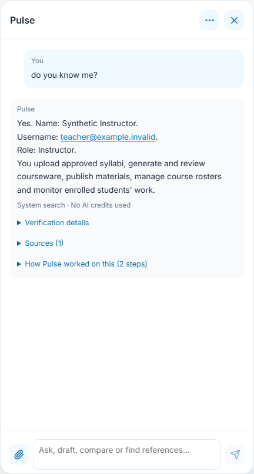
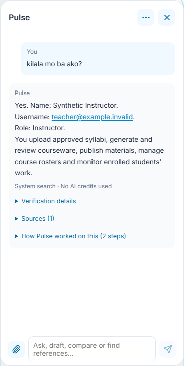
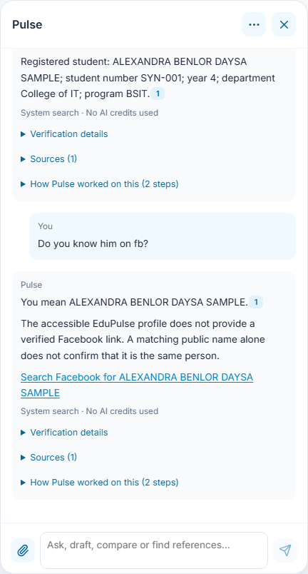
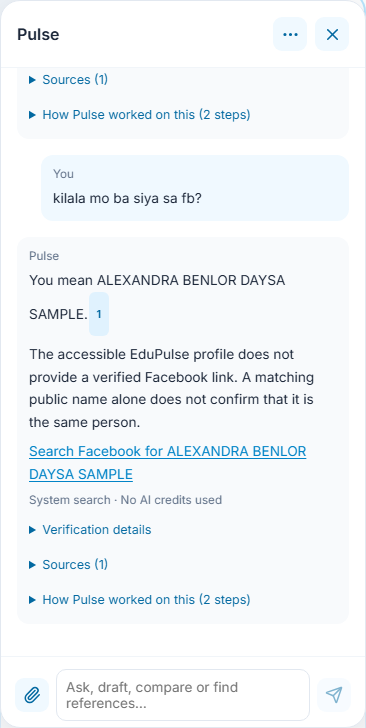

# 24 - System-first search without AI credits

Pulse searches accessible EduPulse records and content by default. Internet suggestions require an explicit web/online search request. The System Search agent uses keyword matching, spelling tolerance and quoted evidence. It does not call a generation or embedding model for ordinary lookups, even when an AI provider is connected. Only explicit educational drafting/revision uses a generation model. Detailed application explanations remain on the system-search path; a miss does not invoke a model.

## Find a registered person

For your own account, ask **do you know me?**, **who am I?**, **what is my username?** or **kilala mo ba ako?**. Pulse uses the verified session to show your name, username, role and the work available to that role. It does not use Internet suggestions or a model for these questions. A signed-out visitor gets a sign-in explanation. In a System Admin support view, the answer distinguishes the signed-in admin from the selected person's username and role; explicit Admin learner actions retain separate Admin attribution and cannot replace independent student work.

Ask a name question such as **Do you know alexandra benlro d. sample?**. Initials, punctuation, partial names and small spelling mistakes can match authorized directory candidates. A single sufficiently close candidate starts with **Did you mean** and shows the recorded profile with its citation. Multiple matches stay a list; this never selects an account, changes enrollment or establishes that similarly named Internet people are the same person. Student numbers require exact matches and are never autocorrected.

Only the current account's permitted directory, course and faculty records are available. Student sessions retain their own-profile boundaries. Failed record reads are reported as unavailable, rather than no records. Candidate searches are bounded; refine a common name or use its exact student number. Admin support continues to use the selected person's academic permissions and the admin's own private library.

## Keep the person in follow-up questions

After a recorded person answer, ask **Do you know him on fb?** or **kilala mo ba siya sa fb?**. Pulse resolves the person from the recent conversation and reads the currently authorized record again. It does not search the letters ?FB? as a separate subject. Missing or multiple possible people require a name or student number. A clear new question such as **What is photosynthesis?** starts its own topic.

The answer identifies the same recorded name and says when no verified Facebook link is available. **Search Facebook for ALEXANDRA BENLOR DAYSA SAMPLE** is a manual search link using only the name, not a discovered or verified account. Pulse does not attach unrelated public images or assign a groundedness percentage to that public identity. These lookups still need no model key.

Private history is a search hint, not access evidence. A completed account switch resets its private conversation context. Retained follow-ups remain subject to current record access, and unavailable records do not become Internet identity claims. Inline answer links and emphasis use the existing safe Markdown renderer; citation numbers retain their source buttons.

## Ask for help without connecting a provider

Ask a workflow or content question. Product guidance, saved syllabi and materials, accessible course outlines and released learning materials, attachments and indexed private-library passages can supply quoted answers. Simple searches show **System search · No AI credits used**. If the accessible system content does not answer the question, Pulse offers refinement guidance. It does not silently use general-knowledge generation or public research. Private-record failures and document-only requests never become invented model answers. No record is edited by searching. Informational questions such as **How do I create a syllabus?** stay on the read-only answer path; explicit generation and editing commands retain their preview/confirmation controls.

System citation numbers now open a separate **Source reference** dialog with fresh authorization and an explicit link into the related EduPulse page. [Manual 44](../44-instructor-course-workspace/README.md#use-pulse-as-system-chat) shows the dialog and no-activity source reader. Other source/verification details remain expandable. Quotes retain their provenance; keyword matching is not proof that a source is correct. Explicit selected-file and document-only scope stays local, and assessment-answer restrictions still apply before retrieval. A connected server is required for current hosted records; this feature does not claim that a signed-out or disconnected browser has a fresh copy of private records.

## Read Internet suggestions and images

Ask explicitly to **search online**, **search the web** or browse the Internet when that is the intended task. After the authorized system lookup, permitted explicit public research can return **Internet suggestions**. The keyless lookup uses Wikipedia and reports its coverage limits; it does not invoke the generation provider to invent current-news coverage. Private identifiers, private-record failures and source-only/no-web scope do not become public identity searches. The retained images below demonstrate controlled Internet-suggestion rendering; they do not imply that every ordinary topic question automatically browses.

Image cards use thumbnail URLs actually returned by the source API. The title opens the source, and **Image credits** opens the file's attribution page. Text results remain usable when no thumbnail is supplied. Failed image loads show **Image unavailable** while retaining source and credit links. Images illustrate a source; they do not identify a registered student or verify a claim.

## Evidence behind these screenshots

Account records and response transports are synthetic; the real deterministic answer builder renders these examples. The image is an unmodified Wikimedia thumbnail of *Photosynthesis_en.svg* by At09kg, Wattcle and Nefronus, [CC BY-SA 4.0](https://creativecommons.org/licenses/by-sa/4.0/). [Original and attribution](https://commons.wikimedia.org/wiki/File:Photosynthesis_en.svg). Its checked-in fixture makes the browser capture repeatable. The live API probe and native authorization checks are separate from these interface captures; see the [release validation](../../versions/2026-11-09-system-first-search/validation/results.md).
