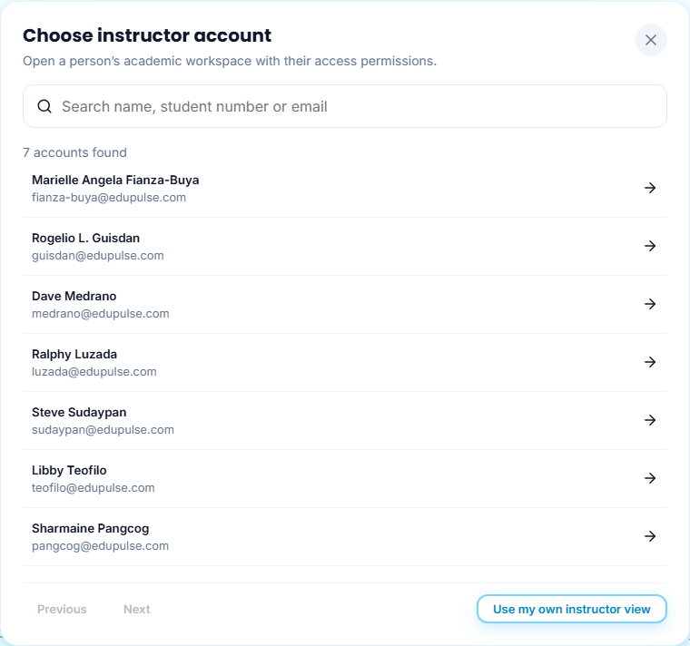
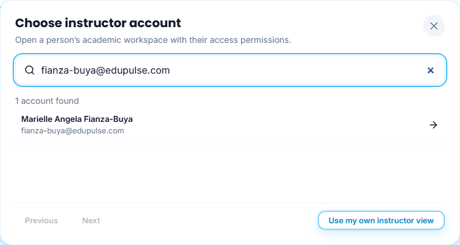
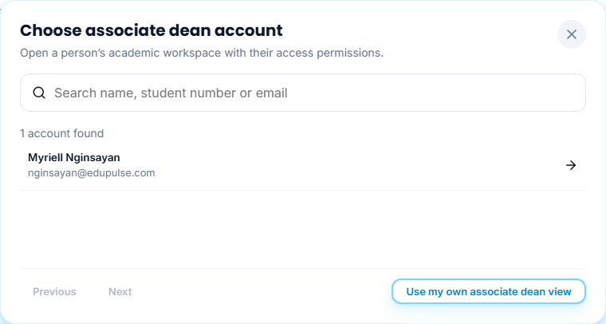
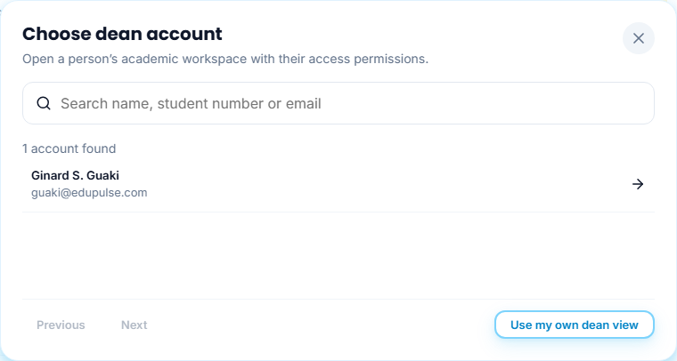
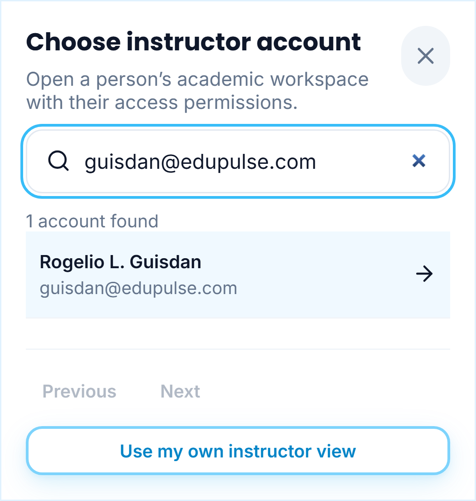

# 25 - Named staff test accounts

Nine named staff test accounts are registered with confirmed email/password access. Login IDs use the owner-requested lowercase **lastname@edupulse.com** format. These are app-only test addresses, not verified institutional or personal mailboxes. Unique temporary passwords are provided privately outside the repository; they are not shown in screenshots or guides.

| Staff member | Role | App-only login |
| --- | --- | --- |
| Ginard S. Guaki | Dean | guaki@edupulse.com |
| Myriell Nginsayan | Associate Dean | nginsayan@edupulse.com |
| Marielle Angela Fianza-Buya | Instructor | fianza-buya@edupulse.com |
| Rogelio L. Guisdan | Instructor | guisdan@edupulse.com |
| Dave Medrano | Instructor | medrano@edupulse.com |
| Ralphy Luzada | Instructor | luzada@edupulse.com |
| Steve Sudaypan | Instructor | sudaypan@edupulse.com |
| Libby Teofilo | Instructor | teofilo@edupulse.com |
| Sharmaine Pangcog | Instructor | pangcog@edupulse.com |

## Open a named academic view

As the verified System Admin, open **Switch View** and choose **Instructor**, **Dean** or **Associate Dean**. The matching **Open view** control in Role coverage opens the same picker. These captures use the nine new staff names with controlled transports and synthetic IDs, without a private Google session. The live database also retains older role-only accounts, which may appear alongside the named staff.

Use **Search accounts** to find an exact surname or login ID. Choose the named row to open that person's permitted academic workspace. **Use my own instructor view** keeps the admin's own workspace and does not select one of these people. See [Manual 23](../23-account-support-and-pulse-context/README.md) for support-view boundaries and returning to the admin.

The corrected Associate Dean is **Myriell Nginsayan**. **Marielle Angela Fianza-Buya** is an **Instructor**. The Dean is **Ginard S. Guaki**.

## Test a staff sign-in

Sign out, then use the person's app-only login and their privately supplied temporary password on the normal sign-in form. Test accounts use real Auth identities and the same role permissions as other accounts. A new instructor starts with their own empty academic workspace until course ownership or assignments are confirmed. Registration does not transfer the earlier placeholder instructor's workspace or create course loads, qualifications, publications or student progress.

The existing preview personas remain sample data and do not sign in to these accounts. A named staff member appearing in a capture is not evidence of a live sign-in; the separate [validation receipt](../../versions/2026-11-09-named-staff/validation/results.md) records actual hosted Auth and API checks.
