# 26 - Generate from the actual course outline

**Who:** instructor. **Where:** **Course**, then a teaching week. Existing review, edit, document, presentation, PDF and delivery actions remain available.

1. Review the week's syllabus topics, outcomes, teaching activities and assessment format before **Generate** or **Regenerate week**. Generation always produces one complete learning document. It adds a discussion, laboratory, essay, report or project guide when the plan calls for that work, and an interactive assessment only when a quiz/test response format is planned. "Learning" alone does not request a quiz. This original sample week has five loop topics and a discussion: the result has **2 items generated**, both **Draft**, with no readiness quiz.

   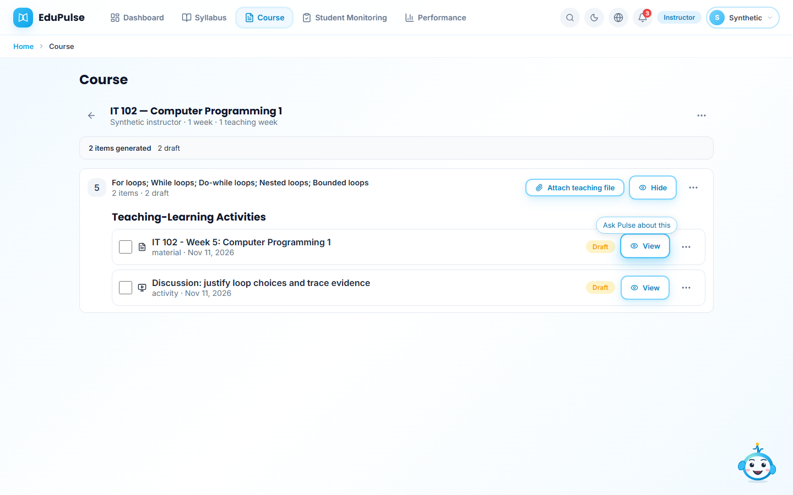

2. Choose **View** on the learning material. Read its explanations and worked examples rather than relying on an overview. The writer receives the supported topics (up to 40), outcomes and supplied institutional/course context. Each lesson call handles one outline topic. Validated parts are saved as an unfinished preview; the complete lesson is assembled when the requested plan finishes. The sample starts with **State, conditions and loop counters** and **Worked example and boundary cases**.

   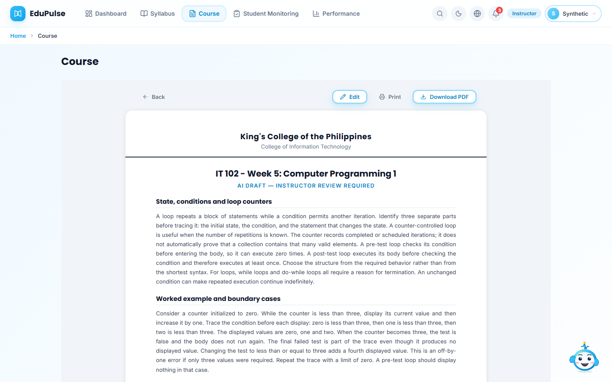

3. Continue through the complete document. This sample includes a nested-loop trace, boundary cases, independent practice and review criteria. Generated text must pass schema, minimum-body-length and topic-completeness checks. These checks can reject a thin response but cannot certify teaching quality or factual accuracy. A connected model can still fail or require better supplied references.

   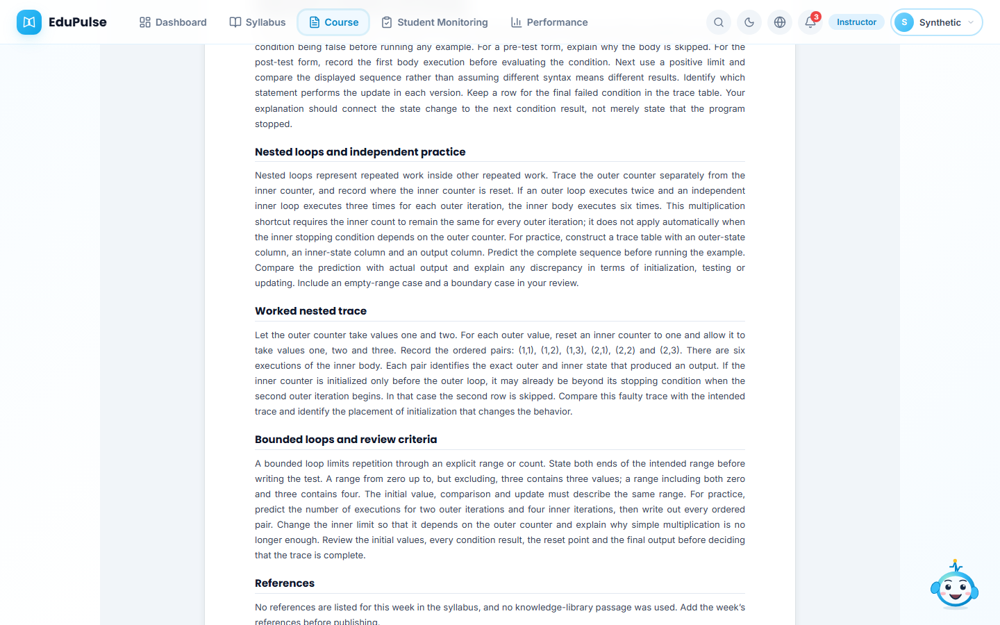

4. Read **References** and then **AI draft review** at the end. Material coverage combines its bounded parts; activity and assessment reviews concern their own outcomes and format. Coverage indicates detected outline alignment; statements marked for verification still need instructor review. There is no answer-key line for a document with no objective questions. Missing references remain visible and must be resolved before publication.

   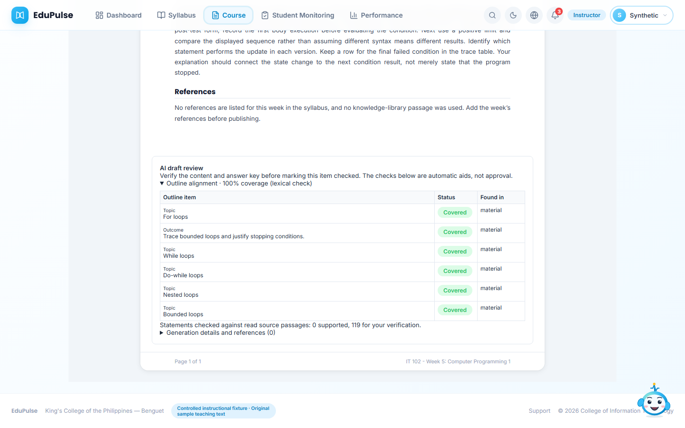

5. Open the discussion's **View** action. Its **Purpose and preparation**, **Discussion tasks**, and **Expected output and review** follow the planned activity. A laboratory or written deliverable similarly stays a guide rather than becoming a multiple-choice quiz. Planned interactive assessments retain the platform's current 3-5-question limit, mapped topics and supported multiple-choice, True/False or instructor-marked written response types. No institutional grading weight, deadline or duration is invented.

   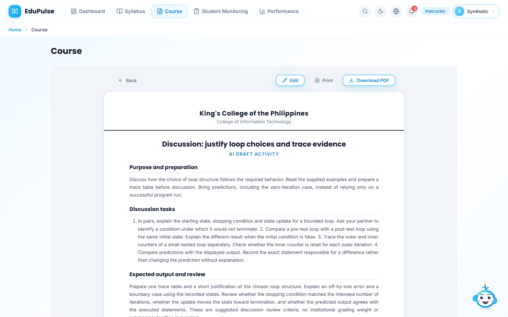

**Generate missing content** skips completed saved types. Explicit regeneration preserves checked/published types before inference and removes obsolete unreviewed AI types only after a complete successful replacement. A changed syllabus or edited draft cancels the replacement. The original draft comparison survives interruption and reload: **Resume** cannot silently overwrite a later instructor edit. **Regenerate week** explicitly starts a new plan. Generation never checks or publishes material or records student completion.

## Save parts and resume

The progress row reports saved parts while the next lesson is generating. **Stop generation** stops further inference. The unfinished item has **View**, so its available teaching sections can be read before the entire week finishes. Existing saved materials remain alongside the preview.

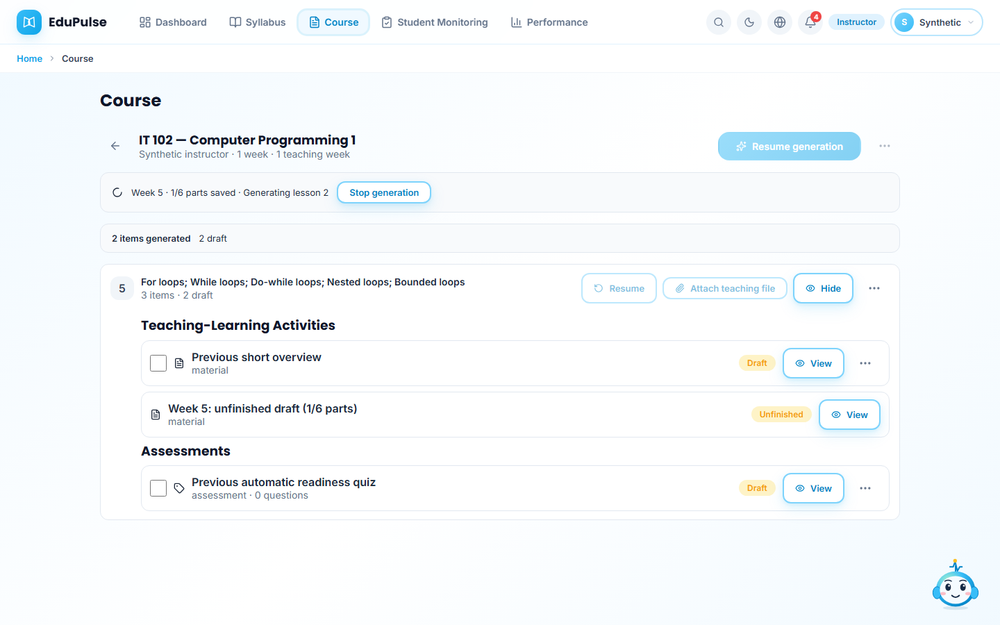

A part that fails content checks does not discard other valid parts. The app tries other independently planned parts, then reports **Generation did not finish**. **Generate All Content** also proceeds to other teaching weeks for these content failures. Connection, quota, timeout and persistence errors stop additional calls. Failed or in-flight calls may need to run again; acknowledged successful parts are not inferred again.

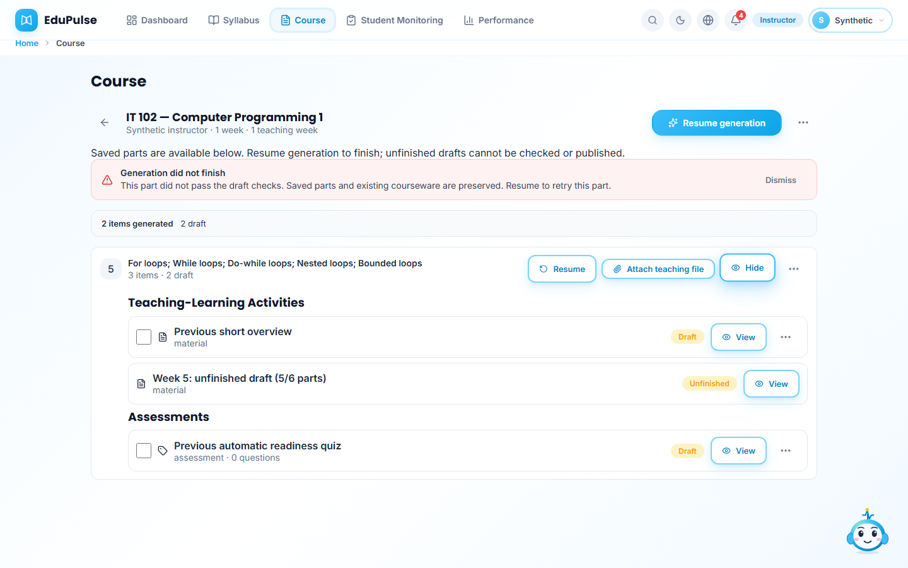

After a deliberate reload, the owner workspace restores the saved parts and offers **Resume** for the week or **Resume generation** for missing course content. Reload does not start AI calls. Resume checks the input/plan fingerprint; changed input starts a fresh plan instead of mixing incompatible parts. A provider may be changed before resuming; the original provider/model/request identifiers remain recorded for each completed part.

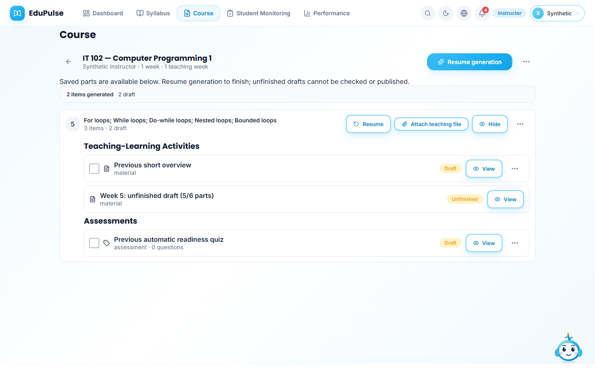

The unfinished reader shows its saved sections and an unfinished subtitle. It supports **Print** and **Download PDF**, retaining that subtitle, but has no **Edit**, **Check**, **Publish** or delivery action. Complete the plan before reviewing its final items. The API and database also reject changing a marked checkpoint to checked, published or hidden.

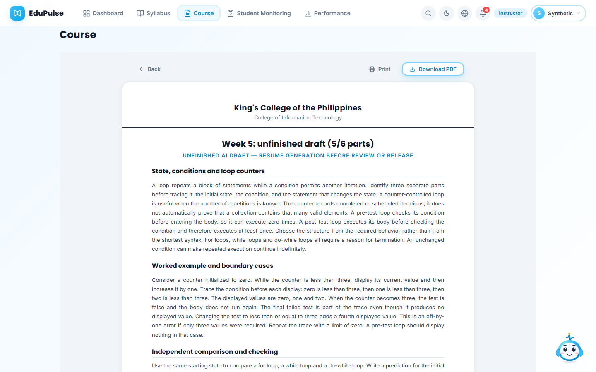

The Course list counts complete items separately from **1 unfinished week**. Its **View** action opens the existing course. Resume is available in light/dark and narrow layouts without changing the restored navigation.

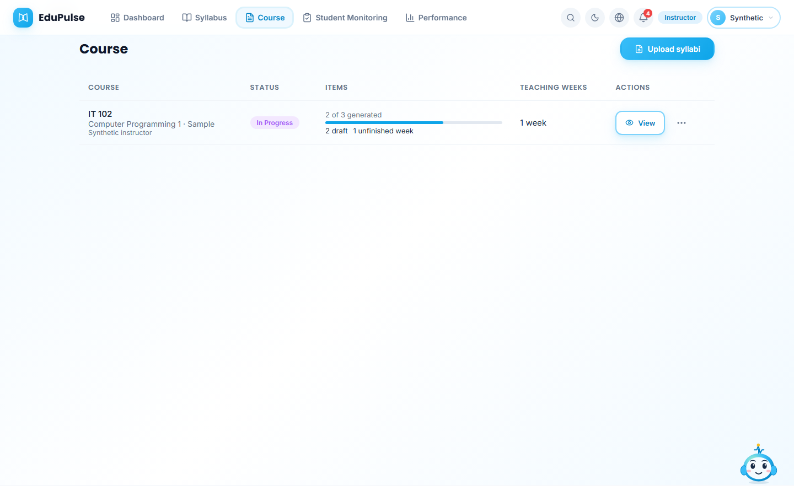
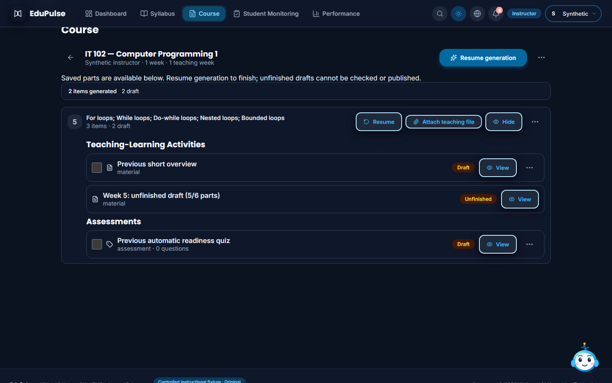
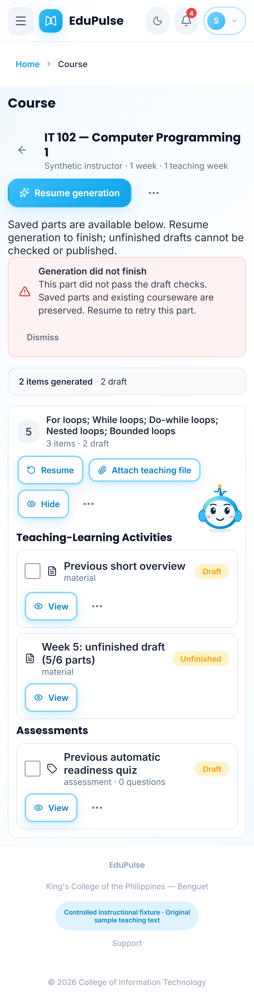

## Evidence boundaries

These captures use original sample loop teaching text through the actual courseware graph with controlled account, provider and workspace transports. They demonstrate rendering, planned outputs, final evaluation, incremental saving and explicit resume; they do not establish hosted sign-in, paid-provider quality or student activity. The current native HTTP test uses the real API and isolated database to save five acknowledged parts, recover them after a failed activity call and assemble the final week. Database tests separately enforce the draft-only checkpoint boundary. Historical local-model evidence remains in the [original validation](../../versions/2026-11-09-outline-driven-courseware/validation/results.md); current evidence and limitations are in the [resumable courseware release](../../versions/2026-11-10-resumable-courseware/validation/results.md).

## Read references before regenerating

Section 7 books/links now accompany weekly resources in every generation input. The bounded writer receives selected actual passages and citation numbers. Outline coverage is distinct from factual support: the outline states what to teach and is not counted as proof for a generated explanation. Read passages appear as numbered references; unscanned book metadata and planned teaching resources remain separately labelled. Saved copies and source review are described in [Manual 31](../31-retained-syllabus-sources/README.md).

## Section scopes and two output groups

For the updated outline, each week's items are organized under **Teaching-Learning Activities** and **Assessments**. Each section retains its own outcomes, Contents text and assessment format; a week can include multiple sections and shared sections can span weeks. **Attach teaching file** accepts a readable PDF, DOCX, HTML, TXT or Markdown file up to 2 MB, retains/indexes its private copy and saves a separate instructor draft without generation. Long files show a bounded reading excerpt with the original retained copy available. Generated teaching documents and activity guides remain separate reviewable items within the teaching group.

Assessments use the preceding teaching output and the section's supported type. When no type is specified, the system chooses a format suited to the stated outcomes/activities; an explicit Pulse instruction can request a supported alternative. Several section assessments remain separate 3–5-question items. Written lists, identification, essays, matching pairs and documented follow-along work are instructor marked. Previously saved syllabi and completed items remain readable; checked/published content and attached teaching files are preserved during new generation.

The updated section flow prepares readable retained references first. If no usable matching source is available, generation asks you to read or attach one. Inaccessible references cannot support citations. Highlight a passage in a teaching document or assessment and use **Find source for selection**; [Manual 31](../31-retained-syllabus-sources/README.md) shows the source popover and explicit chat explanation.

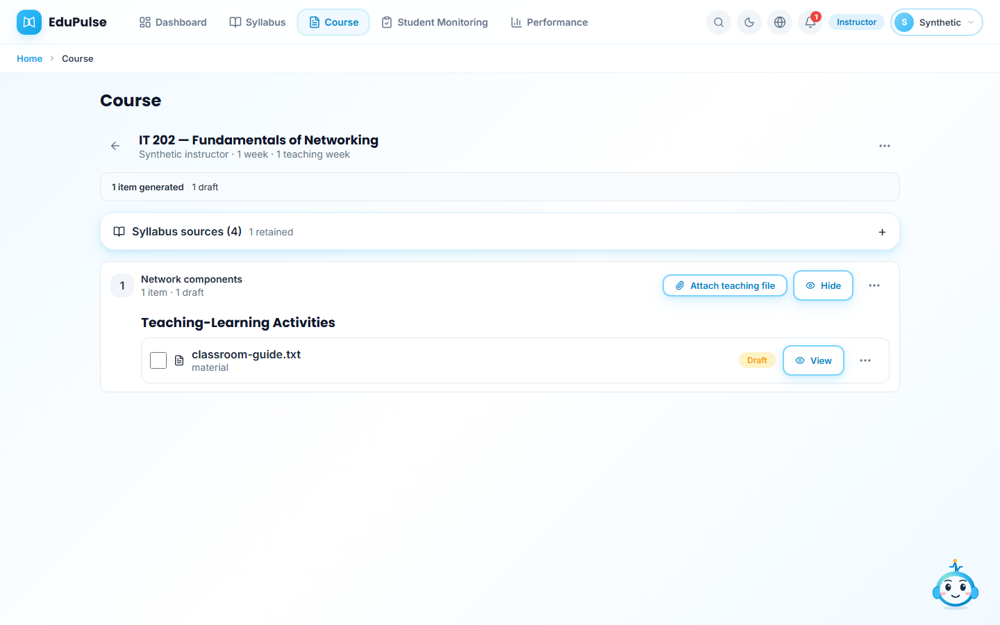
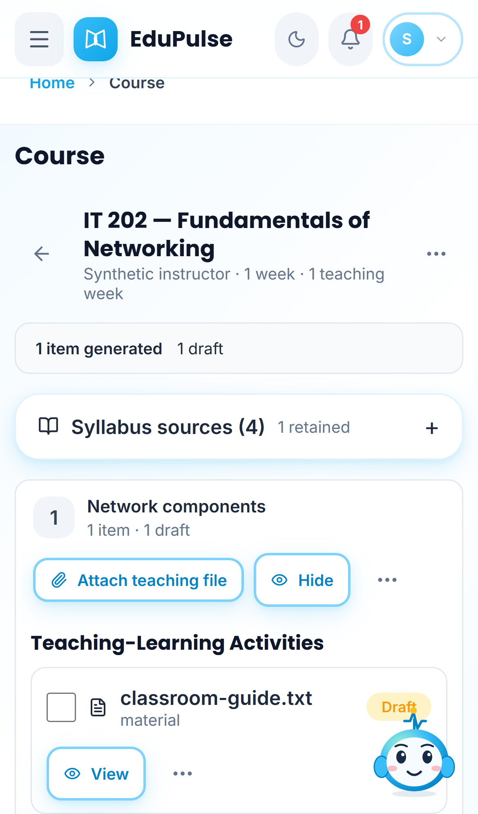

These attachment captures use an original sample TXT file and controlled workspace/source transport. They verify an actual extraction, saved draft, readable content and reload without inference; they do not prove hosted authorization or publication.

Course progress and **Generate missing content** count every section assessment separately. A week with two assessment scopes remains incomplete when only one has been saved; generating the missing scope preserves the first assessment and its stable section identity.
