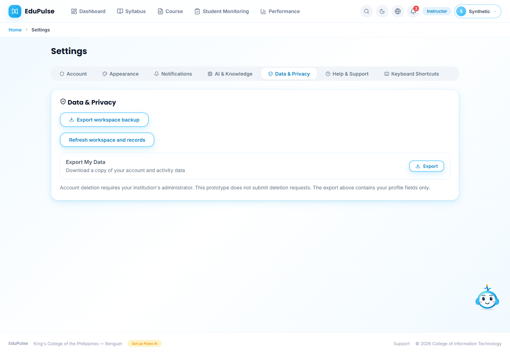
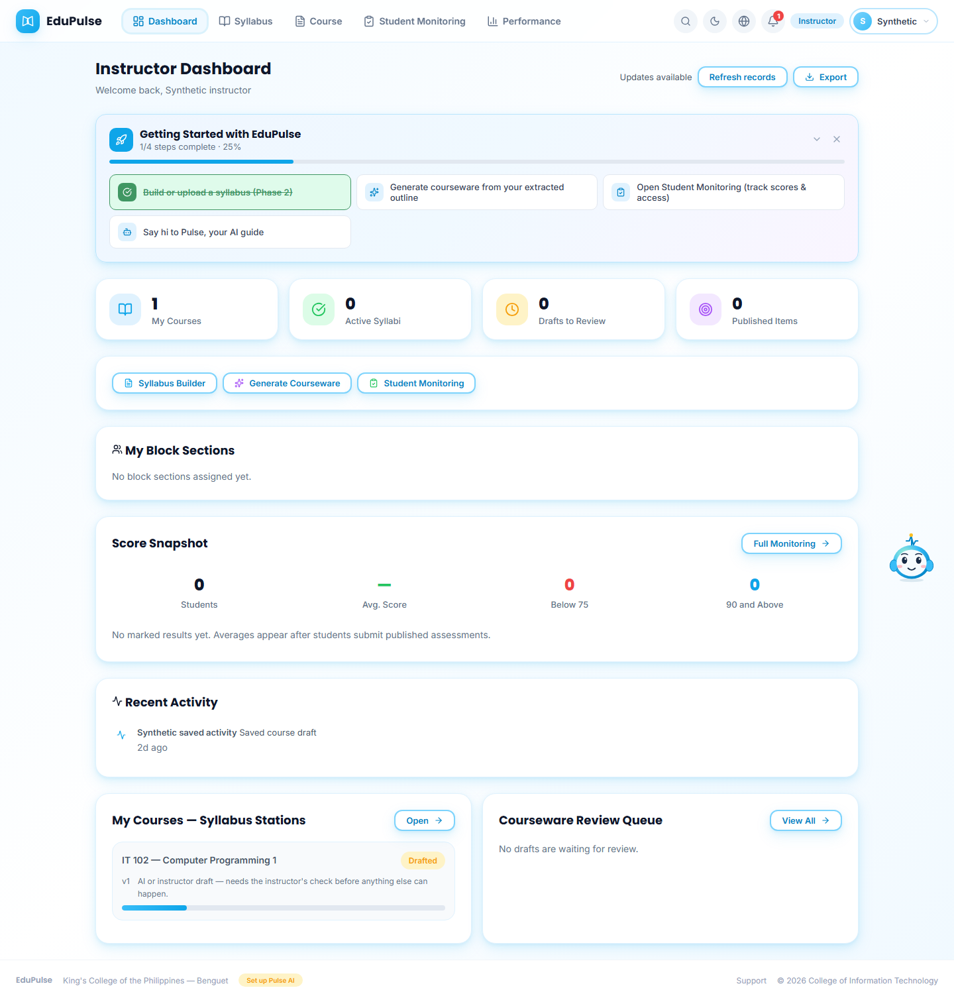
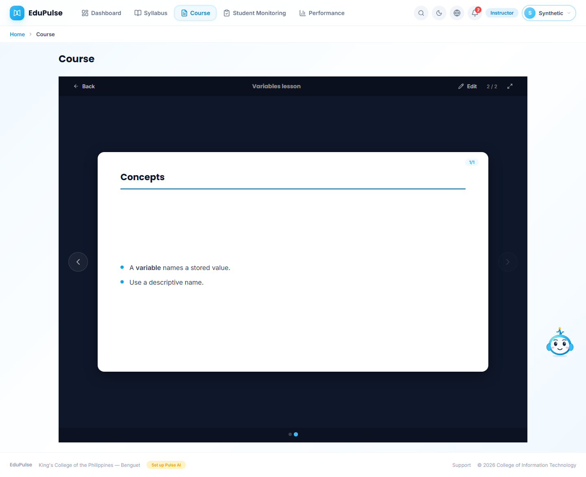

# 27 - Keep loaded work and refresh when ready

**Who:** signed-in academic roles. **Where:** **Course**, published material readers and **Settings → Data & Privacy**.

1. Opening an account or a different support subject loads its authorized records. Returning to the browser tab preserves the current workspace; focus, visibility, reconnect and timers do not reload it. In **Course**, navigate away and return through the main navigation: the selected course, expanded weeks, item selection, reader mode and presentation position remain in memory. **Back to courses** and browser Back still honor their explicit destinations. The presentation's **Edit** action uses the same readable header styling as **Back**. This sample returns to slide **2 / 2** of **Variables lesson**.

   

2. To deliberately revalidate, open **Data & Privacy** and choose **Refresh workspace and records**. The button is disabled while a load, save, pending edit or conflict requires attention. A manual refresh retains the mounted page and uses existing revision/conflict checks. **Export workspace backup**, save retry and **Load latest after export** recovery remain available where applicable.

   

3. When another tab announces a saved change, the loaded records remain visible with **Updates available**. Choose **Refresh records** when ready. The signal contains no names, records, credentials or command payloads, and is scoped to the account's channel. Storage notices likewise do not apply another tab's workspace automatically.

   

4. During an authorized refresh, **Updating records…** uses a spinner while the existing dashboard remains visible. First identity loads still use skeletons. Offline/error states retain the loaded snapshot; failed reads require **Retry connection** or a manual refresh. A failed mutation is never resubmitted automatically.

   

Student document/presentation readers also retain their open material and view mode when returning through navigation. Restoring a reader does not record another material-open action. Assessment sessions, answers and submissions are not automatically restored or replayed; their existing explicit start/submit controls remain. View preferences store identifiers and UI state, not extra copies of material, secrets or assessment answers, and are isolated by account, role and support subject.

A full browser reload now retains the selected course, expanded weeks, selected items, reader/document mode, slide position and delivery dialog reference in this tab. Fresh authorization and current content availability are still required before a reader or delivery dialog can reopen. Explicit close/back actions update the retained preference. Saved workspace drafts retain their existing account-specific device journal. The sample below returns to **2 / 2** after a browser reload, rather than restarting the presentation.

Admin-selected person views and header surfaces follow the [account restoration steps](../23-account-support-and-pulse-context/README.md#reload-the-selected-account-without-returning-to-dashboard). Restoring a view does not replay generation, delivery, submission or assessment-start actions. If view-hint storage is unavailable, those references remain in memory and may be lost on reload.

These captures use controlled sample accounts, workspaces and records. Browser tests count requests, preserve reader/slide state, exercise stale-response role isolation and confirm no extra writes or student material-open event on reader return. They do not establish hosted student activity or paid inference. See [validation](../../versions/2026-11-09-cached-workspaces/validation/results.md).
