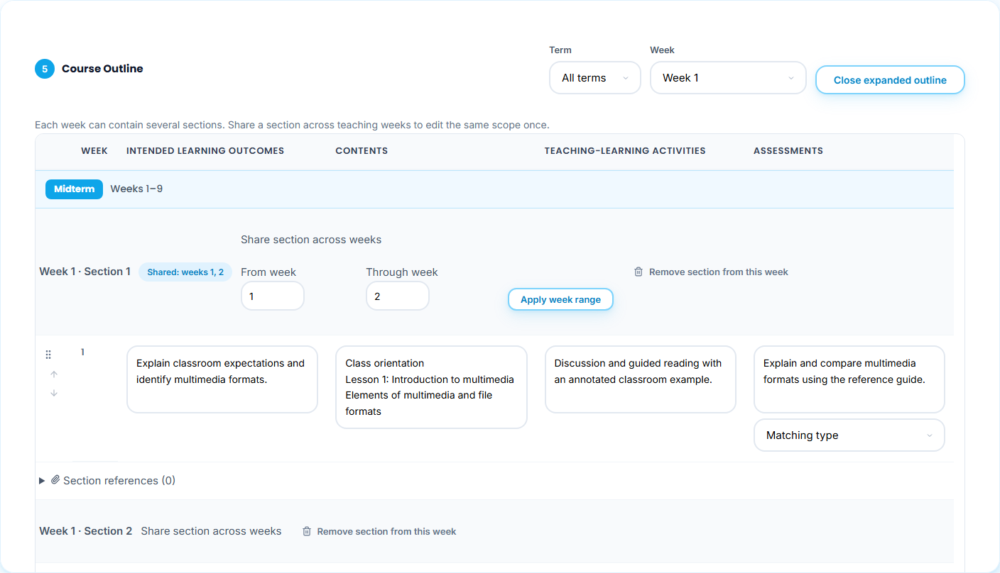
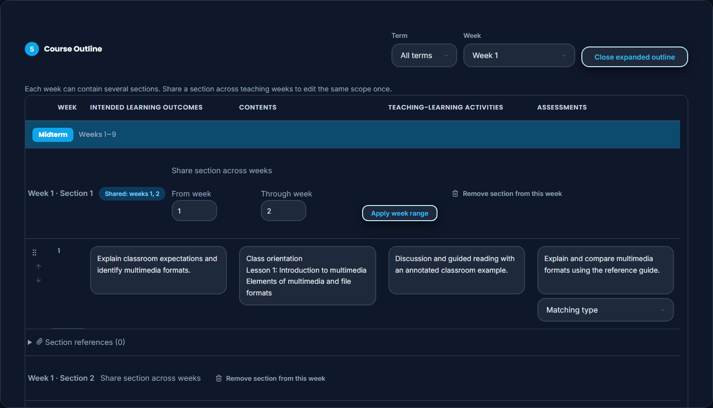
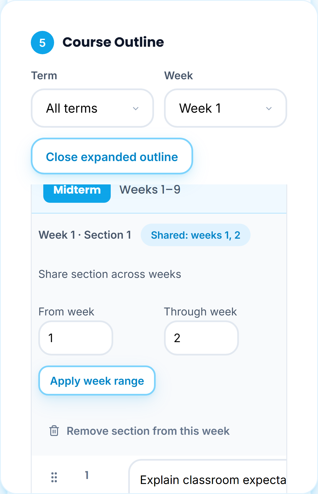
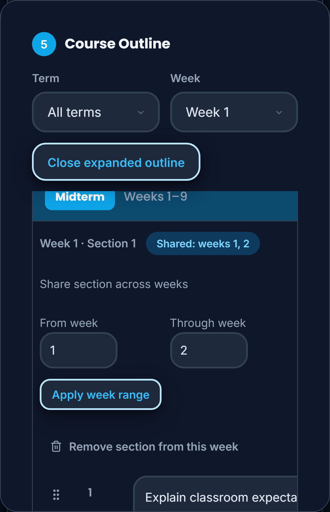
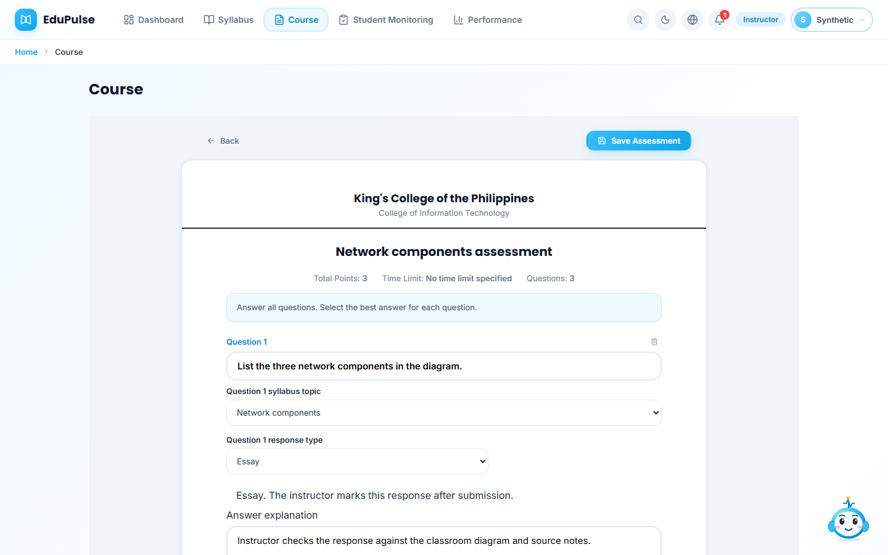
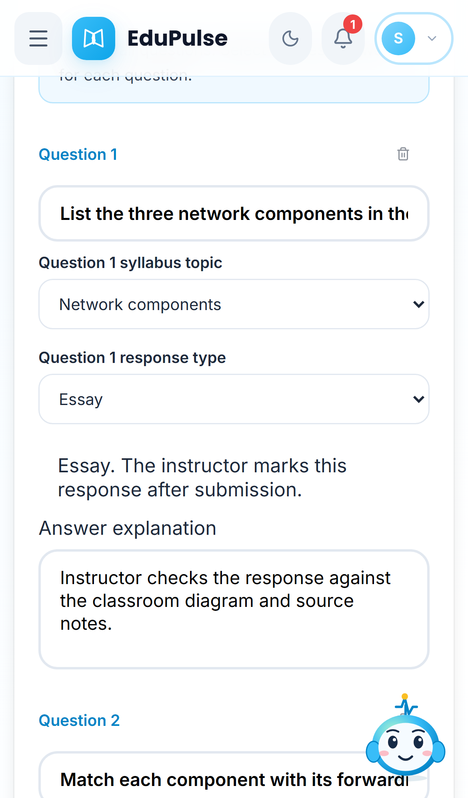

# 28 · Outline sections and assessment formats

**Who:** instructor · **Where:** **Syllabus Builder → Course Outline**.

The columns are **Week**, **Intended Learning Outcomes**, **Contents**, **Teaching-Learning Activities** and **Assessments**. Contents is one growing text field per section; line breaks preserve its topics. The old numbered topic fields and teaching-material dropdown are removed.

1. Enter outcomes, contents, teaching-learning activities and assessment details. Choose one assessment type, or leave **System chooses a suitable type**. The choices are **Multiple choice**, **True or false**, **Enumeration**, **Identification**, **Essay**, **Matching type** and **Follow-along / Step-by-step documentation guide or criteria**. Earlier saved type notes remain visible as earlier notes; they are not new choices.
2. **Add section to week 1** adds another scope with its own fields. Separate orientation and a first lesson can remain in the same week. **Remove section from this week** removes that association while other shared weeks retain it.
3. Expand **Share section across weeks**, choose **From week** and **Through week**, then **Apply week range**. Only existing teaching weeks are accepted. Examination weeks cannot be included. Shared sections show their week numbers, and edits propagate to every covered week. Calendar slots remain distinct; shared scopes cannot be silently moved with the week swap controls.
4. **Expand outline**, Term/Week filtering and keyboard controls remain available. The table scrolls horizontally on phones. Existing section links remain under **Section references**; new readable files belong in **References**, and teaching documents can be attached in **Course**. Review and save the syllabus separately.

These captures show sample instructor form content and controlled preview workspace transport. They verify actual editing controls and layout, not hosted authorization, paid inference, approved signatures or student completion. Native checks cover section serialization and workspace validation; source and courseware flows are described in [Manual 26](../26-outline-driven-courseware/README.md) and [Manual 31](../31-retained-syllabus-sources/README.md).

The assessment reader also offers these seven response types for each question. Change the type and select **Save Assessment** to persist it. Enumeration, identification, essay, matching and follow-along responses use the existing instructor-marked response workflow; choosing a type does not auto-grade those responses.

Pulse can complete one existing section or field without regenerating its siblings. Shared section content updates every linked week; existing IDs and associations remain unchanged. [Manual 38](../38-targeted-outline-edits/README.md) shows explicit preview and placement.
