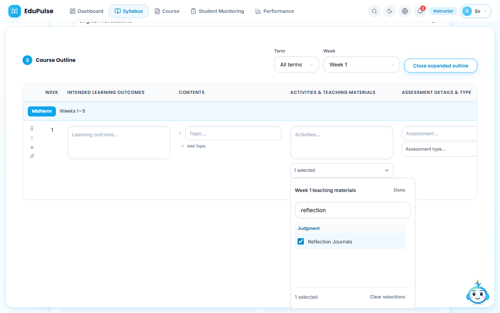
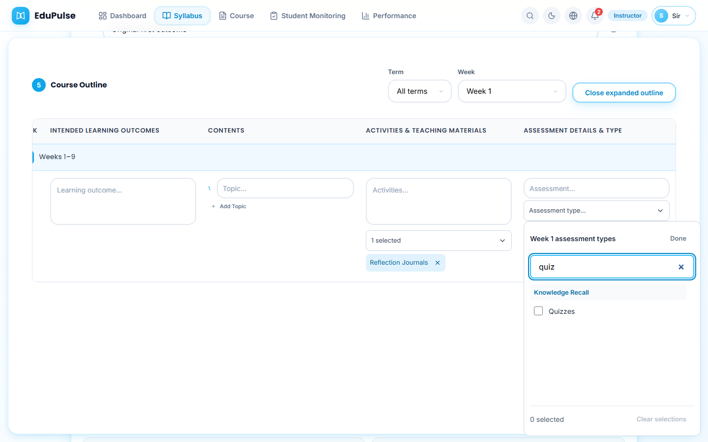
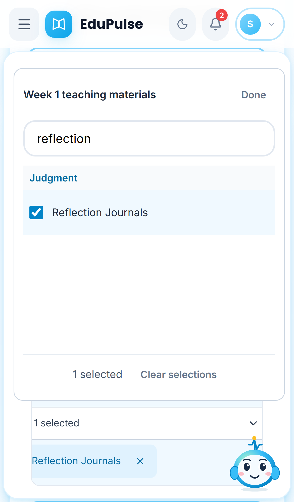
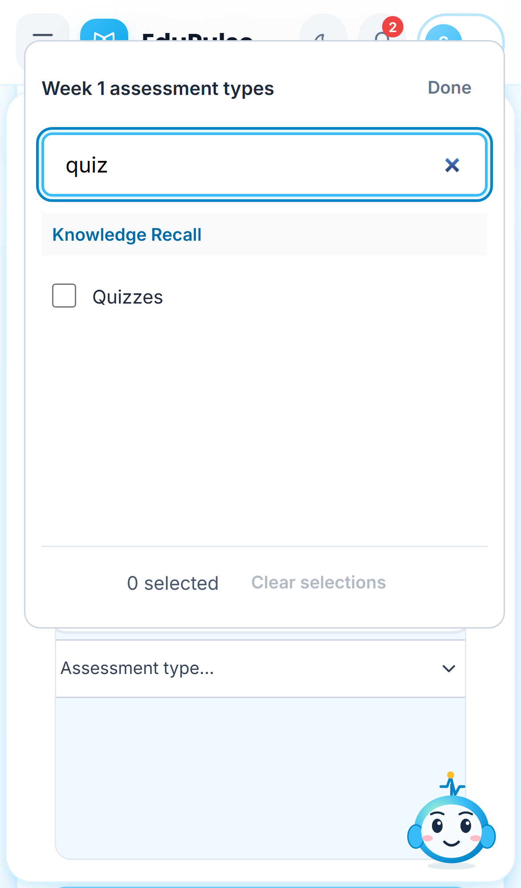
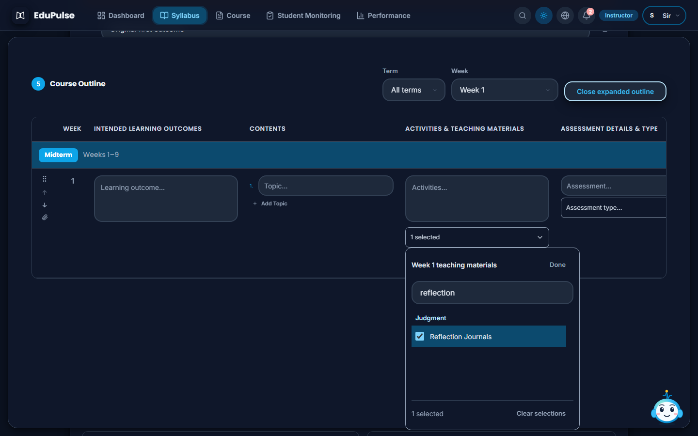
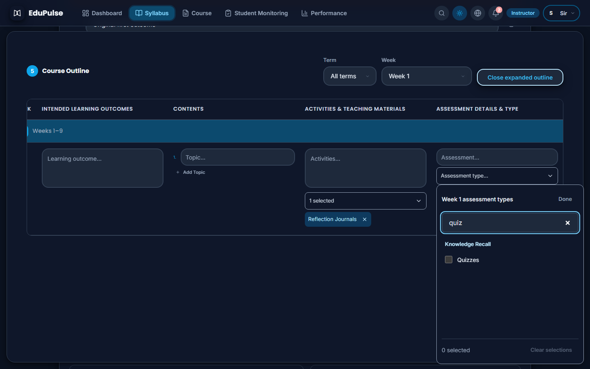
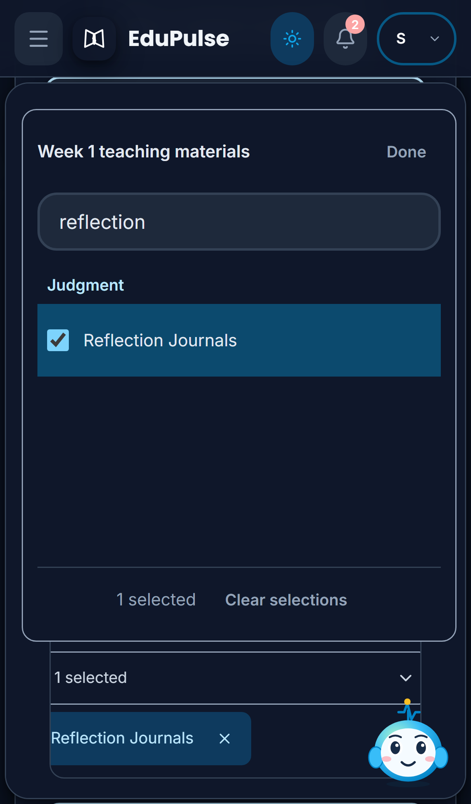
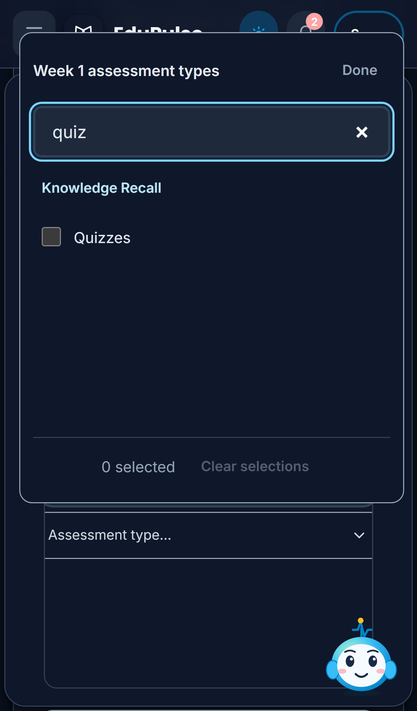

# 28 - Choose outline materials and assessment types

**Who:** instructor. **Where:** **Syllabus Builder**, Section 5 **Course Outline**. The selectors use the same saved `teachingMaterials` and `assessmentTypes` arrays as before; activities and assessment-detail text remain separate fields.

1. Open a week's **Teaching materials...** selector. The options appear above the table in a panel sized to the viewport. **Search options...** filters by option or category. Category headings and checkbox rows use one scrolling list, avoiding overlapping sticky headings and nested scrollbars. In this preview sample, searching for reflection leaves the matching teaching choices visible.

   

2. Select or clear checkboxes. The field and panel show the selected count, and removable chips remain beside the field. Opening the selector again preserves selections, including previously saved values not in the current option catalog. Selection changes only that week's chosen array; it does not rewrite the activity instructions or assessment details. **Clear selections** clears that selector's array; normal syllabus-save and approval rules still apply.

   

3. **Done** or **Escape** closes the panel and returns focus to its field. Clicking or tabbing outside also dismisses it. Enter/Space or Arrow Down opens the field; search receives focus, and native checkbox keyboard controls remain available. Escape closes this selector before the expanded outline. Selected chips have individually named remove buttons.

4. On a phone, the panel stays within the viewport and can reposition as the page/table or visual viewport changes. Checkbox labels and panel actions have at least 44px targets. Long labels and selected chips wrap, while the outline keeps its existing horizontal scroll.

   

   

5. Solid dark surfaces retain readable labels, selected states and visible keyboard focus. Search, counts, removal and dismissal work the same in both themes.

   

   

   

   

These are preview curriculum/form examples with a controlled preview-workspace read. They verify the real selector rendering and local form interactions, not authenticated persistence, generated teaching content or student activity. Browser tests additionally measure viewport bounds, label height and non-overlap; preserve activity text and selection across reopening; and exercise keyboard dismissal, empty search, removal, both themes and the existing outline filters/move controls. See [validation](../../versions/2026-11-09-outline-selectors/validation/results.md).
