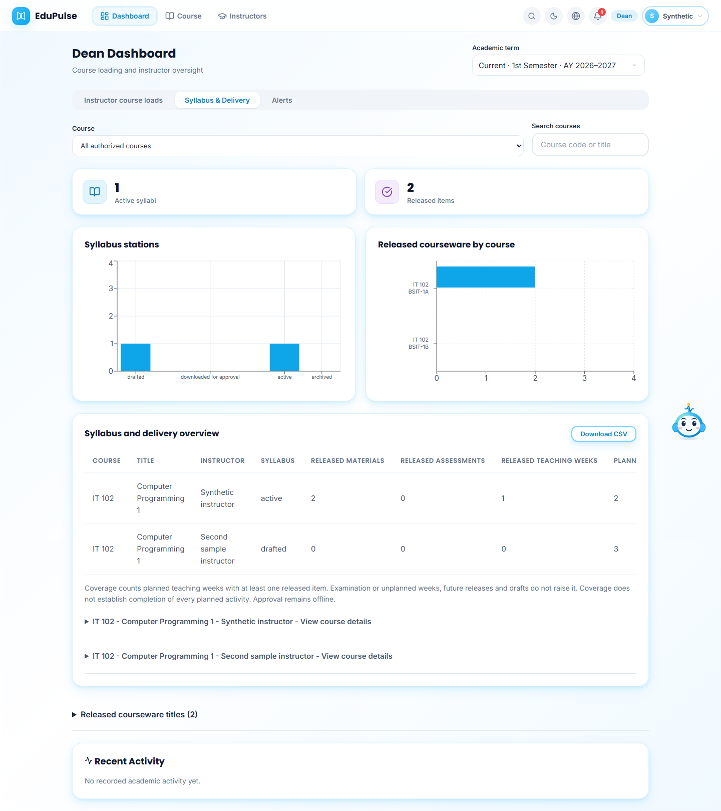
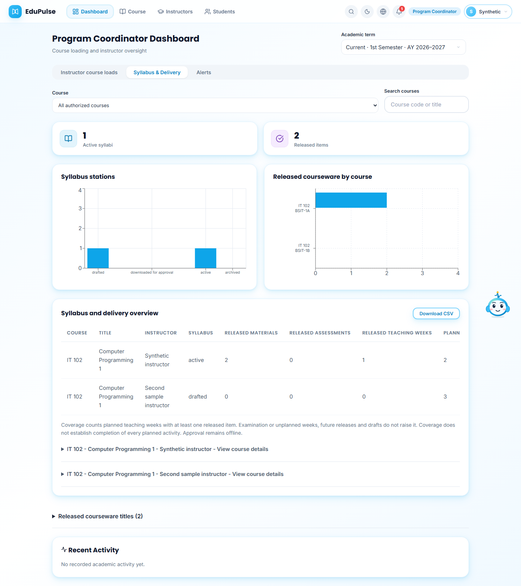
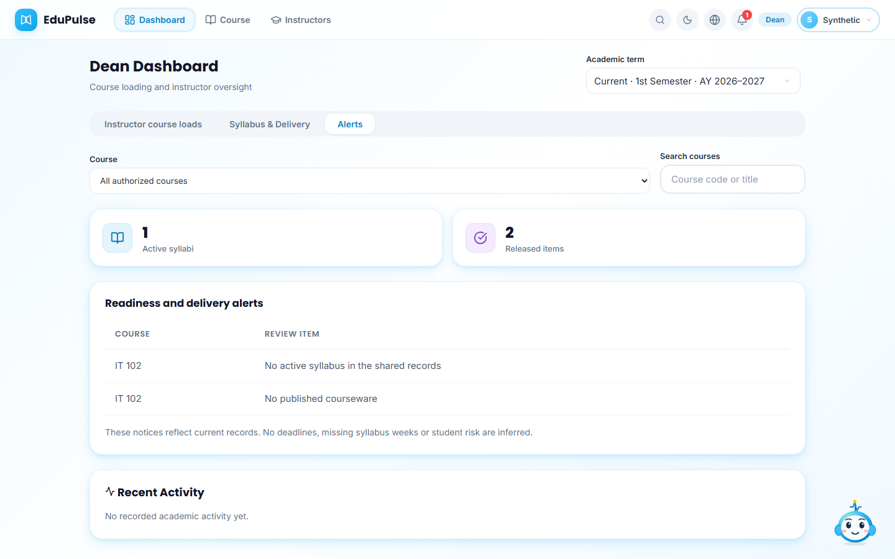
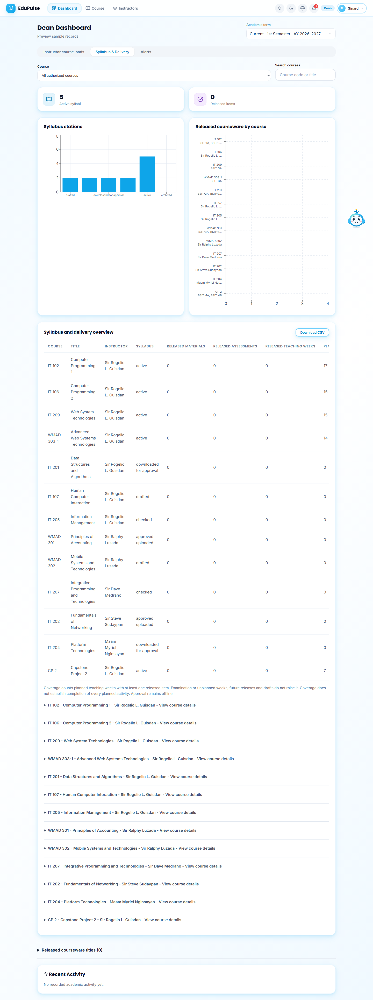
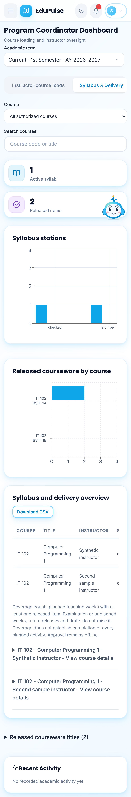
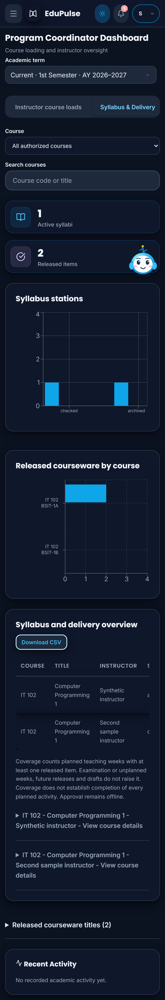

# 29 - Review syllabus readiness and delivery together

**Who** Dean and Program Coordinator. **Where** Dashboard → **Syllabus & Delivery** or **Alerts**. Use **Instructor course loads** for per-instructor assignments and delivery by block.

1. Open **Syllabus & Delivery**. **Course** includes instructor/block context when available, and **Search courses** filters the same records used by every summary card. Courses with the same code remain separate saved course identities. This controlled sample contains two IT 102 records with different instructors/blocks, one active syllabus and two released items.

   

2. Read **Syllabus stations** and **Released courseware by course** once in the same view. The release chart keeps each course row visible; its tooltip retains the full instructor/block label. The **Syllabus and delivery overview** table contains course, title, instructor, status, blocks, students, released material/assessment counts, released teaching weeks, planned teaching weeks and coverage. Scroll its bounded region horizontally for later columns, or use **Download CSV** for all columns.

3. Coverage counts planned teaching weeks with at least one released item. A future release, retained/draft item or item outside the planned teaching weeks does not raise coverage. The first sample record therefore has one of two teaching weeks covered (50%) despite two released items; the second has zero of three. This does not certify that every planned activity is complete or that the course is late. **View course details** retains publication status and confirmed class lists. **Released courseware titles** provides an optional combined title list.

4. Program Coordinators receive the same syllabus/delivery evidence, with their existing restricted scope. They have no **Review Inbox**, assessment scores or student material-access records. The table and CSV do not add score fields.

   

5. **Alerts** lists readiness and delivery gaps shown in the course records. Open **Course → Student directory** to review block rosters.

   

6. Review and approval take place outside EduPulse. There is no Review Inbox or correction-request dialog.

7. Old `tab=syllabi` and `tab=delivery` links replace their tab parameter with `tab=overview`, preserving other query parameters and browser history. Dashboard/Pulse guidance points to the combined view. In preview, the former distinct status and delivery sections appear together under the same tab and remain sample data.

   

8. Phone views keep the horizontal tab row and bounded table scrolling, with solid dark surfaces. Refresh follows the [manual cache workflow](../27-cached-workspaces/README.md); opening another tab or regaining browser focus does not reload the page.

   

   

These captures use controlled role/account records or preview sample data. They do not establish hosted authentication, real student completion, new publications or paid inference. The native coverage test and browser scopes/aliases/export checks are recorded in [validation](../../versions/2026-11-09-combined-oversight/validation/results.md). No database, authorization, approval or grading operation changed.

The term-wide views complement the [instructor course load workspace](../36-dean-activity-records/README.md).
