# 30 · Add a course from an approved syllabus

## Current assigned-course intake

Open **Course**, select a course assigned by the Dean, then use **Upload syllabi** in **Weeks and topics** while no active unsuspended syllabus is selected. Drop/browse an approved PDF or DOCX, compare the extraction with the original, acknowledge approval and choose **Use syllabus for course**. The course code must match that selected load. A separate assigned course can appear before any syllabus exists; uploading a different subject does not add it to the Dean's teaching load.

**Choose a shared syllabus from the system** offers received copies for that course. **Use approved shared syllabus** requires acknowledgment and server verification of the retained approved copy. The ready topic view replaces the initial upload area; the **Syllabus** tab inside that course retains optional draft, sharing and offline-approval work. Initial source reading/retention and readable-text indexing follow the explicit intake, with inaccessible entries disclosed.

[Manual 44](../44-instructor-course-workspace/README.md#add-the-approved-syllabus-for-a-loaded-course) is the current signed-in route. The 750 KB approved-file limit, extraction review, signature acknowledgment and revision-checked save below still apply.

## Earlier intake layout and parser examples

The captures below retain the earlier preview/unscoped upload layout and genuine generated-file parser exercises. Their former global Course upload entry and an outside-catalog course becoming visible are not the current assigned-only Instructor navigation. Use the selected loaded course for current intake; the parser compatibility and review limits remain relevant.

**Who:** instructors · **Where:** Course > assigned course > Weeks and topics > Upload syllabi.

An approved copy can supply the syllabus directly for a Dean-loaded course. You do not need to create a syllabus draft first. The original PDF or DOCX is retained alongside its extracted outline. This selects the syllabus for generation; it does not generate, check or release learning materials automatically.

## Upload and review

When Course is empty, choose **Upload syllabi**.

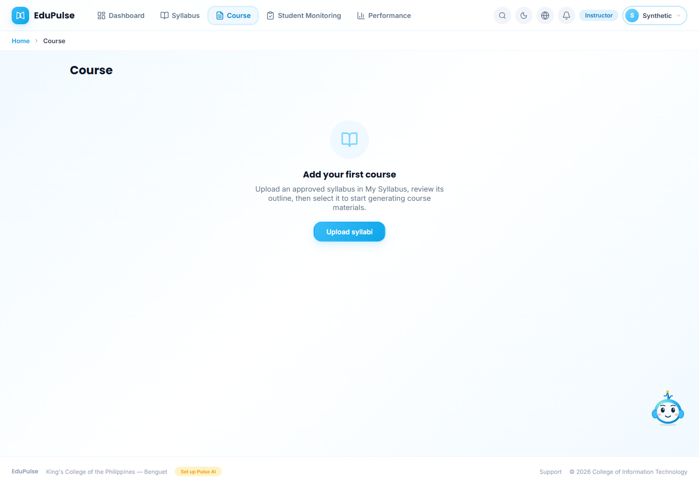

The link opens **My Syllabus** and focuses the upload area. Drop one approved PDF or DOCX onto it, or click/press Enter to browse. The file must be non-empty and no larger than **750 KB**. Scanned PDFs use the existing on-device OCR reader. Wait for scanning to finish. The total saved workspace still has its existing 3 MB limit.

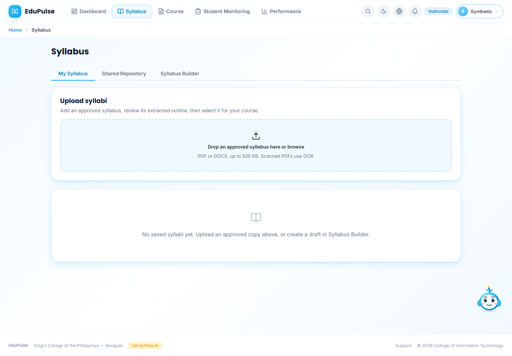

Review the extracted course code, title, week numbers, learning outcomes, contents, activities/materials and assessments. **View syllabus** opens the seven-section view; **Original file** downloads the uploaded copy for comparison. Missing or unmapped text needs checking against that original. Missing institutional text is not filled with institutional defaults in this intake.

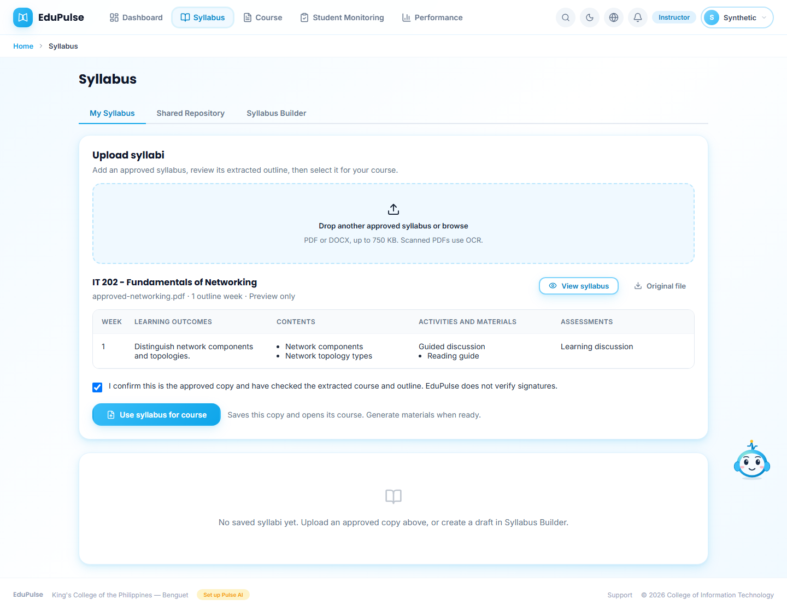

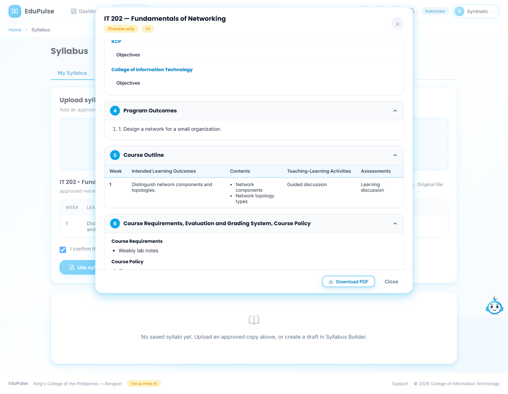

Confirm that this is the approved copy and that you checked the extraction. EduPulse does not verify signatures. Choose **Use syllabus for course**. EduPulse waits for the revision-checked save, then opens the course's weekly workspace. Each upload creates a separate syllabus; existing materials and rosters remain available. Course identity is read from the document, then checked against the selected load. A source code outside the built-in catalog does not bypass the current teaching-load requirement.

## Add another course or return to one

**Back to courses** shows the saved course. The earlier captures keep a global upload entry. The current assigned course shows the intake only until an active syllabus is available; other syllabus work is inside its **Syllabus** tab. **Open course** in an active syllabus row opens that exact syllabus's course.

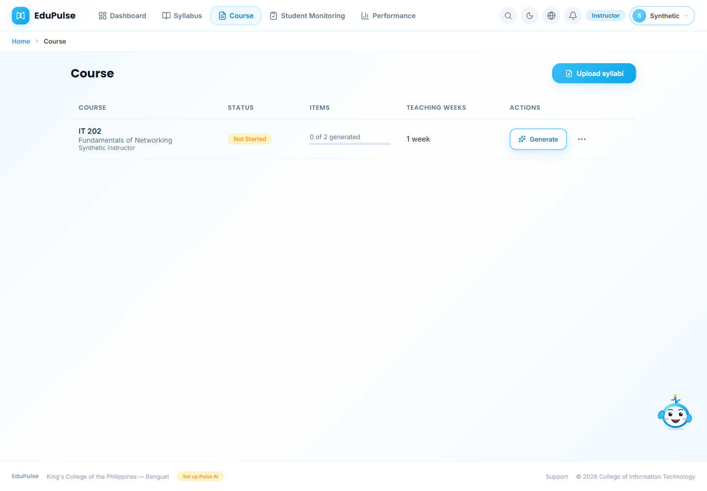

Choose **Generate** to prepare materials from the selected outline, then review them before release. Enrollment, publication, release dates and student activity retain their existing rules. See [Manual 26](../26-outline-driven-courseware/README.md).

## Retry and smaller screens

Unsupported, oversized, damaged or unreadable files display an error. Files without a readable course identity or usable weekly outcomes/contents cannot be selected. Choose a corrected file in the same upload area. Upload one syllabus at a time; review it before adding another.

If saving fails, the extraction remains on screen with the error. Retry **Use syllabus for course** after resolving the connection. No course-open success is shown before the save completes. A preview-persona session saves only its sample workspace; it does not create a hosted course.

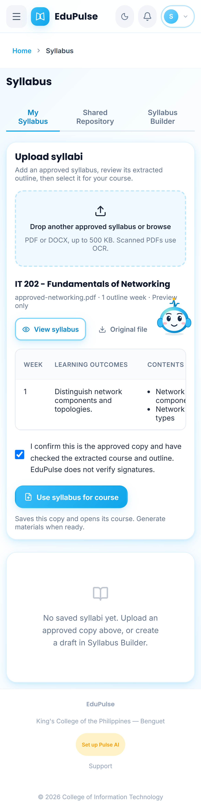

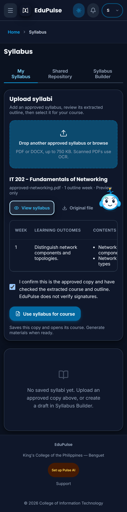

The outline scrolls horizontally within its own region on a narrow screen. The upload button, file chooser, preview and confirmation support keyboard use. Students do not get upload or activation controls.

The five-station indicator has been removed from **My Syllabus**. Optional draft preparation, sharing, saved suspension before deletion and offline approval remain for instructors who prepare a new syllabus in [Syllabus Builder](../02-syllabus-lifecycle/README.md).

## Scaled tables, larger files and unmapped rows

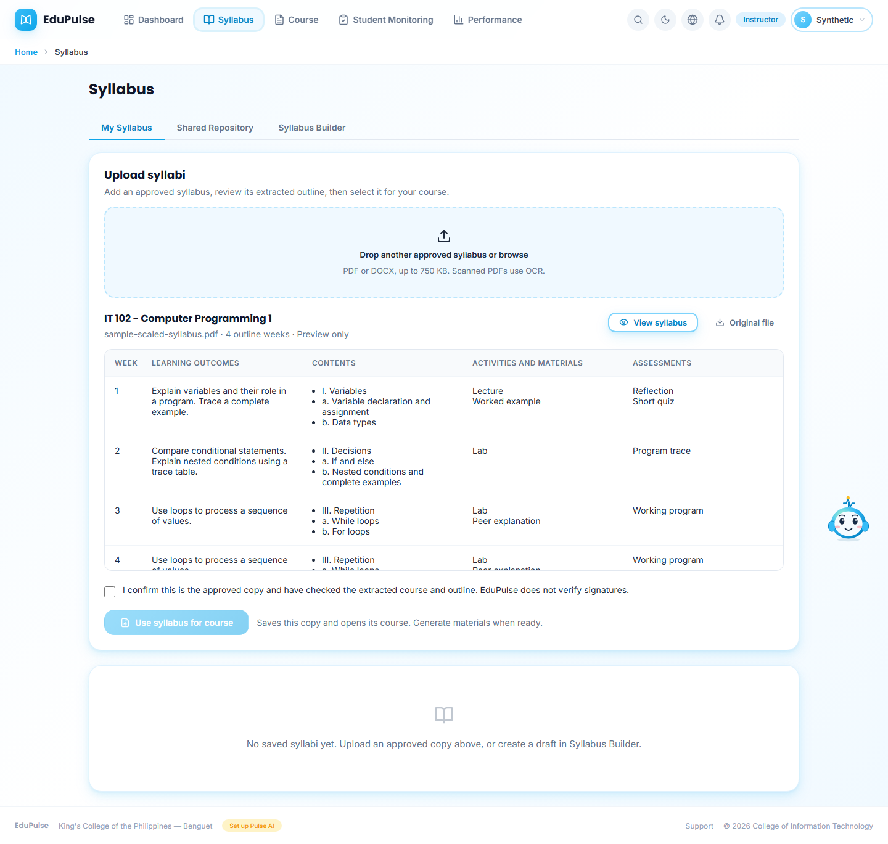

This sample is a valid 650 KB PDF with scaled, separately drawn cell borders. The actual reader preserves wrapped text, a row continued onto the next page, and the printed **Week 3 to Week 4** range. Its four extracted weeks remain a preview until you confirm and choose **Use syllabus for course**. Course code, full title and offered academic year follow the readable source fields; a catalog match does not replace explicit source identity.

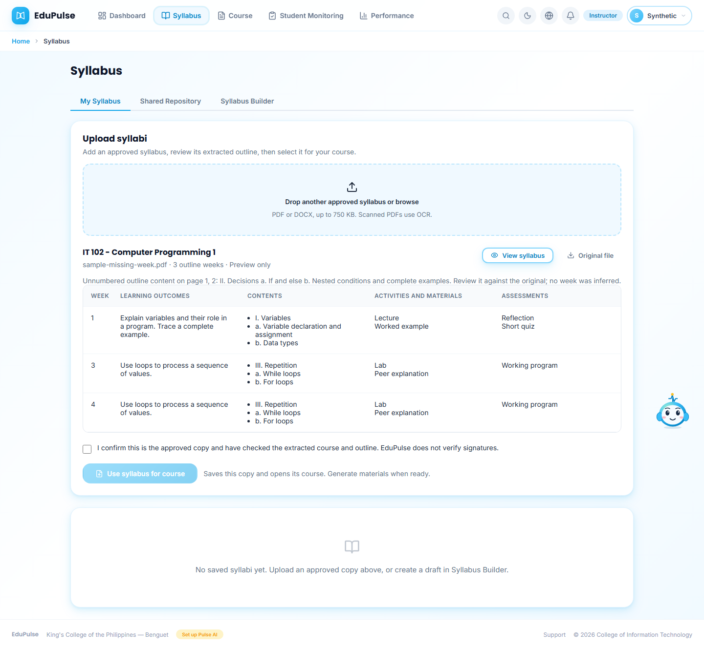

The second sample removes a printed week label. EduPulse shows the unnumbered content and its source pages as a warning. It does not create a guessed Week 2 or append that material to the previous week. **Original file** remains available for comparison. Resolve uncertain mapping against the approved document before generating affected content. Approval of the document does not establish that its extraction is complete.

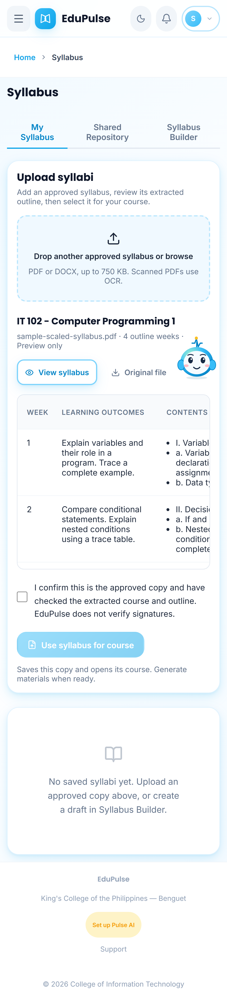

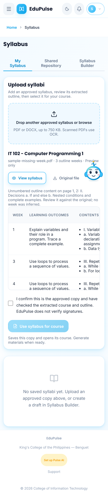

The same preview and warning remain visible on a phone; the outline scrolls within its own region. Optional draft preparation and attaching an approved copy keep their existing controls.

## Keep source identity in an optional draft

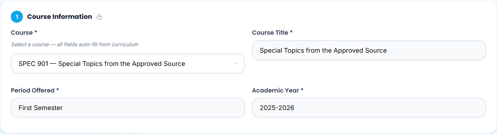

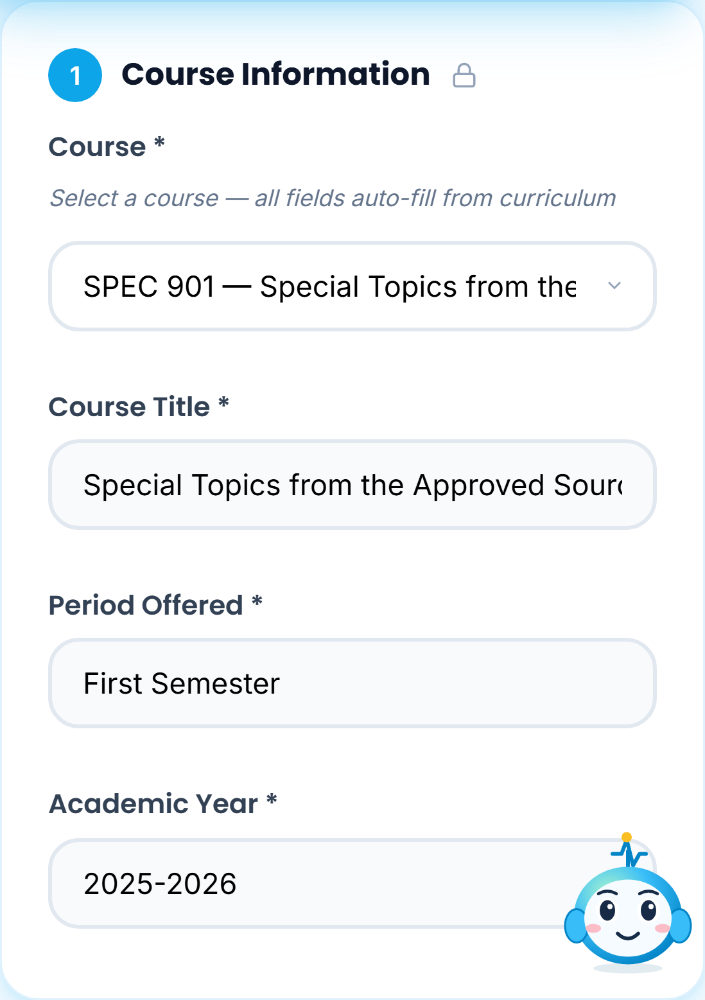

When you import through **Syllabus Builder** and choose **Use This Syllabus**, the **Course** selector retains a source code outside the built-in catalog. Its selected title and the read-only course fields retain the extracted wording and academic year. The form fields stay within their column on a narrow screen. Selecting another curriculum course explicitly replaces those fields with that course's defaults. Importing into the builder does not activate or publish the draft.

These screenshots use controlled account/workspace transport with synthetic course text and genuine generated PDF bytes read by the production parser. They demonstrate the interaction and layout, not a hosted sign-in, verified signatures, generated learning content or student completion. The owner's 14 original PDFs were also scanned and validated locally; [the compatibility validation](../../versions/2026-11-09-syllabus-file-compatibility/validation/results.md) records the source gaps without publishing private originals.
