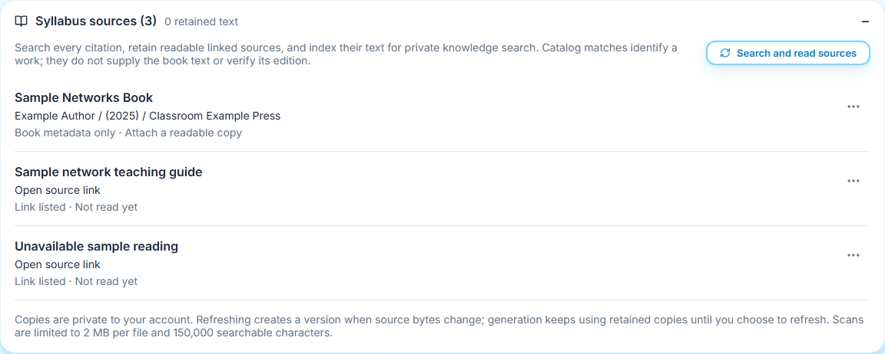
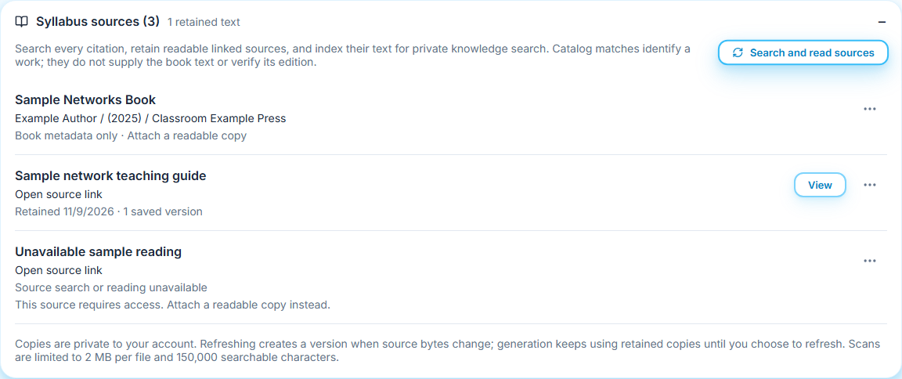
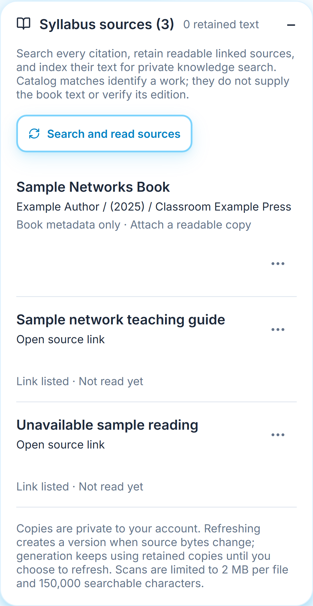
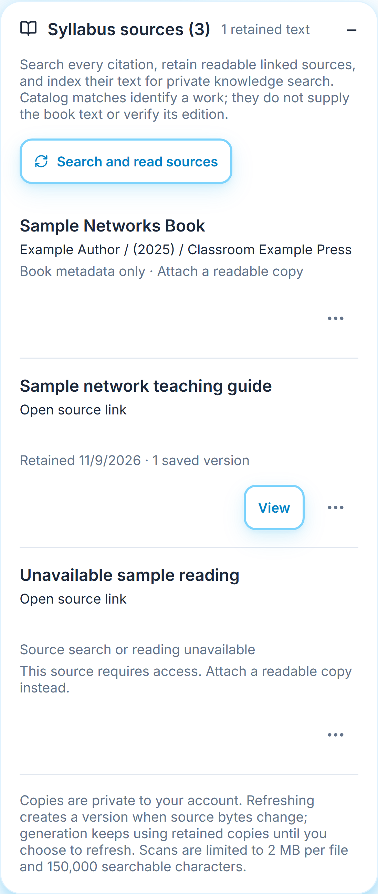
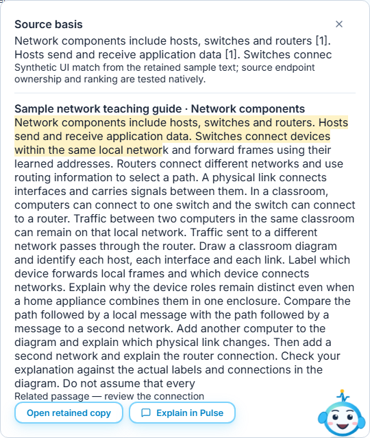
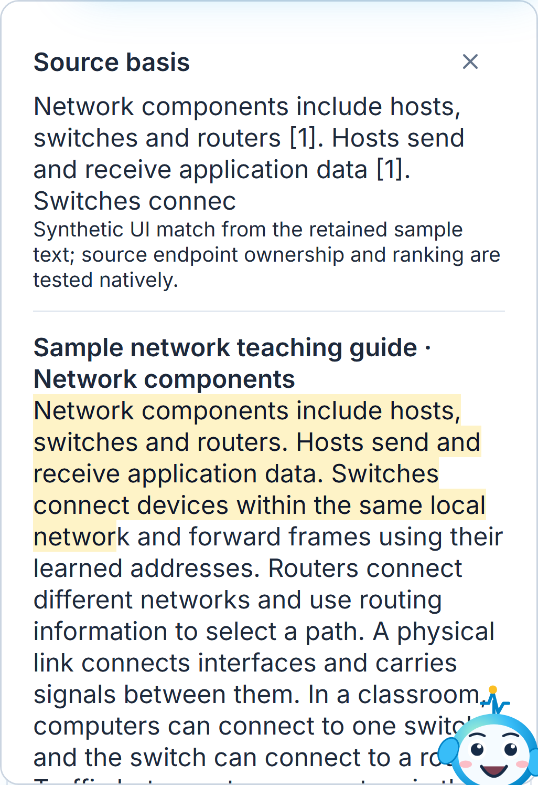
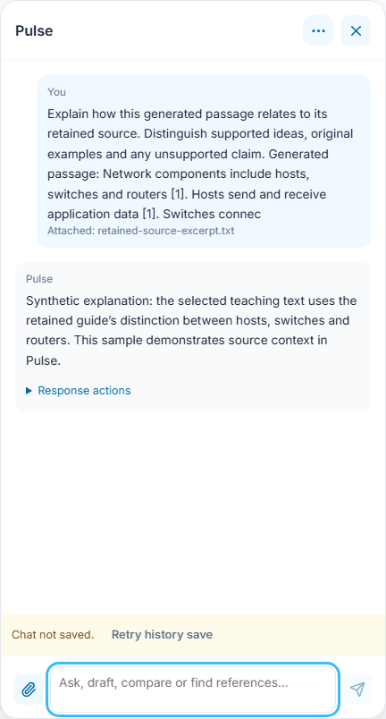
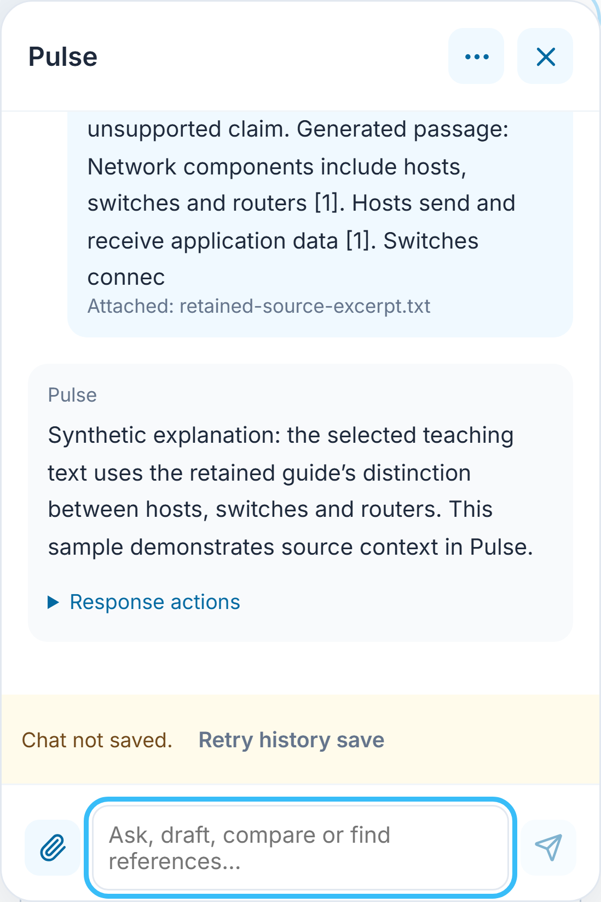
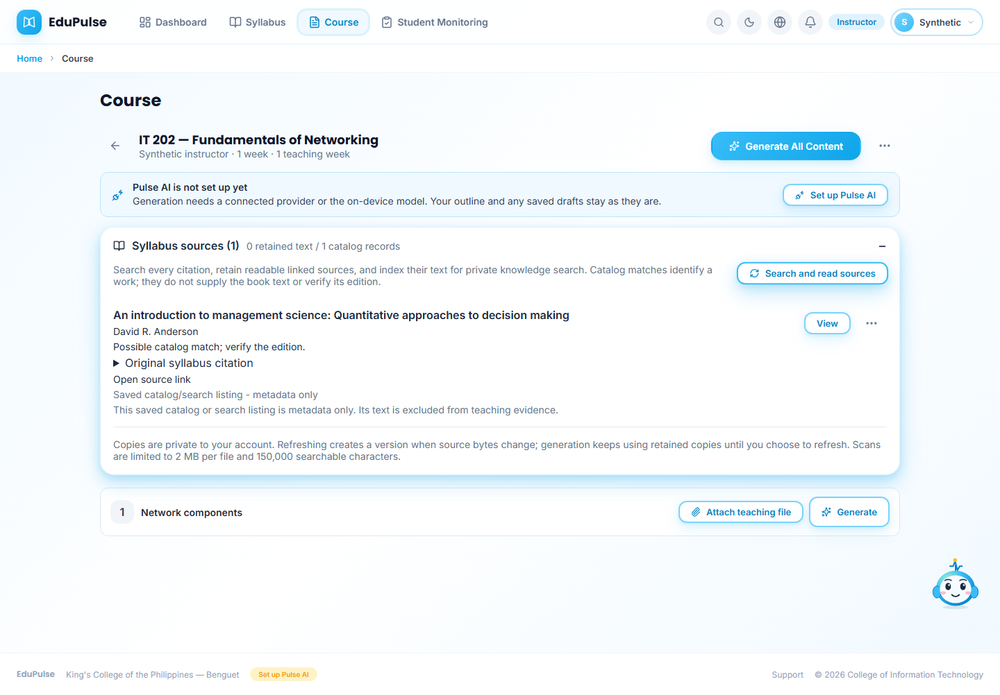
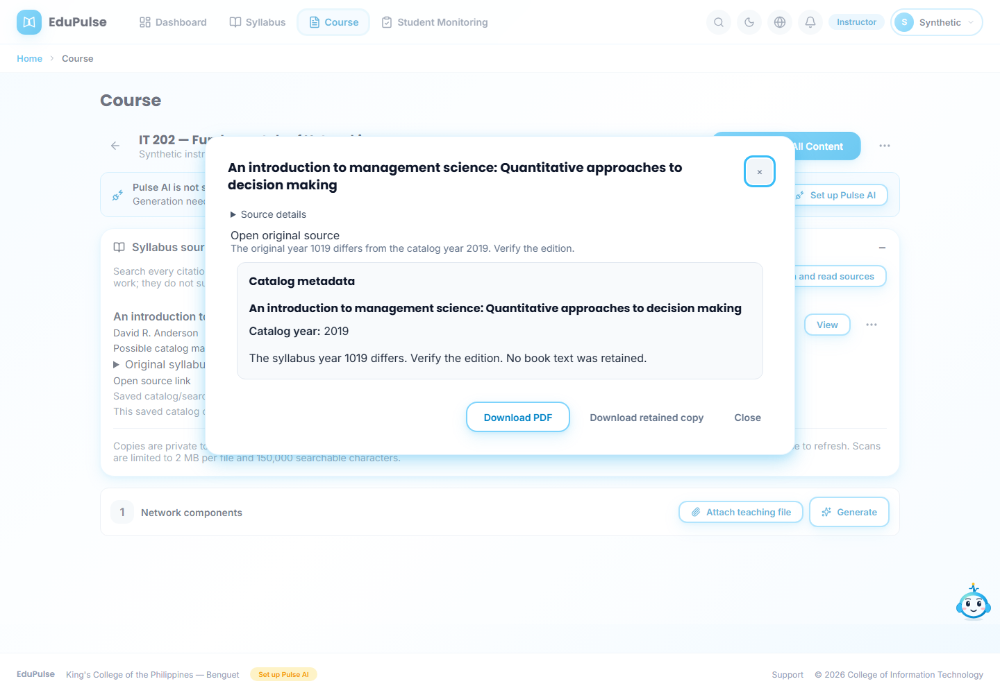

# 31 - Read and retain syllabus references

## References from every outline section

**Syllabus sources** combines overall syllabus references with the links in every teaching section. A section shared across weeks lists its source once. Generation prepares the overall references and all sections of the selected week; references belonging only to a different week are not added to that generation request. Older weeks without sections retain their existing resource links.

These captures use fictional course/source transports and a real courseware-generation adapter with controlled model output. They show one overall book entry, a readable section guide and an unavailable second section reading. The obsolete week-level resource projection is excluded. Reading and generation do not restore a link removed from the current sections, alter saved syllabus data or invent contents for the unread source. The existing 80-distinct-reference limit still applies across the complete collected list.

**Who:** instructor or System Admin. **Where:** open a course, then **Syllabus sources**. This panel appears when Section 7 or weekly resources contain references. Books and links are presented together, including older nested syllabus records.

1. Expand **Syllabus sources**. A link starts as **Link listed · Not read yet**; a book without readable text starts as **Book metadata only**. These entries are planning references, not factual evidence.

   

2. Choose **Search and read sources**, or generate a week to prepare its references automatically. Pending reads show **Searching, retaining and indexing sources...**. Reading and reviewing do not require a connected AI model. Existing copies are reused without another network download.

   

3. Check each result. The sample guide is retained; the protected example reports **Source search or reading unavailable**. A failure does not become a successful citation or discard a previously saved copy. Catalog listings and sign-in pages are not retained as book text.

   

4. Generate and open the learning material. Numbered citations refer to read passages. **References** distinguishes used passages from **Listed in the syllabus; readable text was not used for this draft**. An unread book title cannot substantiate a statement. Outline-topic coverage remains a separate alignment check.

   

5. At the end, expand **Generation details and references**. Retained sources show their saved date, checksum and **Review retained source**. The source review formats extracted headings, emphasis, lists, tables and code, retaining page markers where present. Open **Source details** for the full bibliographic entry, saved date, page count and checksum. Unpaginated HTML is not assigned invented book pages. Checks measure passage support, not correctness certification.

   

   

6. For a book, open its three-dot menu and choose **Attach readable copy**. Supply a readable PDF, DOCX, HTML, TXT or Markdown file up to 2 MB. Check that the supplied book/chapter and edition match the reference. Scanned PDFs without usable text need OCR first. The system does not bypass restricted access or obtain a full book from a catalog entry.

   

   

7. **Download PDF** exports a formatted reading copy of the retained searchable text, including source details. It is labelled as a reading copy and may be partial when the searchable extract was truncated. **Download retained copy** still returns the unchanged original bytes and verifies SHA-256 in the browser. The dialog keeps its close and download actions visible while its content scrolls. **Search or read again** checks the link again; changed bytes create a new immutable snapshot. The latest copy supplies later generation. Changing bibliographic metadata creates a separate citation association. **Remove retained version** requires confirmation; existing drafts keep their citation text and checksum, but a deleted copy cannot be reviewed later.

   

The source list retains its expanded state when returning from a document. Copies are private to the signed-in account, including during admin account support views; shared syllabi do not share private book files automatically. Up to 200 versions are retained per account. Only the first 150,000 extracted characters per copy are searchable, with truncation disclosed; original bytes remain downloadable. A source failure leaves original educational drafting available with warnings and listed references clearly separate from read evidence. Generation does not check or publish a draft.

The same controls stack on phones and use the existing dark surfaces.

The attached sample Markdown renders its headings, bold text, list and table in the reader. The PDF action exports that formatting; the original Markdown remains separately downloadable.

Scroll within the reading area to continue through the table and list. The title and download actions remain available.

## Evidence boundaries

These captures use controlled account, source and provider transports with original sample teaching text. The book attachment uses actual generated PDF bytes and extraction. They prove interaction and presentation, not a real institution's book contents or paid inference quality. Native tests separately exercise real PDF extraction, private persistence, generation citations and HTTP delivery. A live RFC download proves public fetching and cache reuse; a rolled-back hosted SQL canary proves ownership, immutable copies and denied access. See [release validation](../../versions/2026-11-09-retained-syllabus-sources/validation/results.md).

New references can be added directly in **Syllabus Builder → References** using a link or readable file, with automatic metadata extraction and retryable private indexing. See [Manual 35](../35-reference-intake/README.md). Removing a retained version also removes its associated indexed search passages; removing only the syllabus reference keeps the private copy for reuse.

Previously saved catalog/search HTML is now identified as metadata-only and excluded from teaching evidence and indexing. Its original remains inspectable. See the [older retained listing example](../35-reference-intake/README.md#older-retained-listings). Readable files attached separately remain eligible.

## Inspect the basis of a selected generated passage

Select text in the generated document or an instructor assessment question and choose **Find source for selection**. EduPulse searches the retained copies associated with that draft. The **Source basis** popover shows the selected generated passage, actual source excerpts, page/section where available, and a highlighted exact match or related sentence. A related passage is a possible basis, not verification of every generated claim. No match is reported explicitly. **Open retained copy** opens the saved text and provenance.

**Explain in Pulse** sends the generated selection and actual source excerpt to the chat panel and asks it to distinguish supported ideas, original examples and unsupported claims. This is an explicit AI request; provider access and quota still apply. A deliberate reload restores the source view after authorization and rechecks the content signature and retained-source access; it never sends another explanation or runs generation.

These four captures use controlled account/source transports and a labelled synthetic explanation. The source-selection interface and reload controls are real; native checks separately verify actual chunk lookup/highlight offsets, source ownership and denied cross-account access. They do not establish live model quality or permission to download restricted books. Existing size, extraction and partial-search limits remain visible.

The displayed quote and **Explain in Pulse** remain bound to the passage whose lookup completed. Selecting different text prepares another lookup; it cannot relabel earlier source results as evidence for the new selection.

## Repaired citations and online lookup

Syllabus import joins physical title and publisher continuation lines, repairs wrapped URL paths and DOI suffixes, separates adjacent numbered citations, and stops at approval signatories. Books/Online headings and institutional page footers are excluded. Printed detached edition suffixes are reattached only where an edition number is present. Author/year/publisher fields are separated; malformed dates and absent authors remain as printed instead of being invented. Existing saved split entries such as a trailing **making** are repaired in the source read model without modifying the original approved file or saved draft. The original invalid year remains visible until an online record can identify a possible discrepancy.

**Search and read sources** processes every entry individually, including books without links. Each completed result appears before the next is requested; existing copies are reused. Citation-specific Open Library lookup compares titles, subtitles and author metadata. A close catalog match is retained as a formatted metadata record, with a source link and explicit edition/year warnings. It does not establish that the catalog's first-publication year is the cited edition. A missing/uncertain match is reported; no replacement is invented.

**Original syllabus citation** preserves the imported wording. The summary separates **retained text** from **catalog records**. Catalog metadata cannot be indexed or used as teaching evidence. A readable supplied book/chapter can replace its metadata-only latest copy while earlier versions remain retained.

Readable public linked files and uploaded copies are indexed for private knowledge search, associated with the course when available. Failed indexing is reported separately from a successful retention. Search/catalog/login pages cannot become teaching contents. Downloads still enforce public-network checks, no credentials, a 2 MB byte cap and explicit 150,000-character truncation. No full-text access, complete book, or edition is claimed when only catalog metadata or a partial web page is available. Use **Attach readable copy** for protected, scanned or unavailable contents.

The source reader and source action menu restore after deliberate reload using scoped navigation IDs only. The source list is read again before either opens; retained content, account data and commands are not stored as navigation hints. Restoration never replays source discovery, indexing, attachment or removal.
