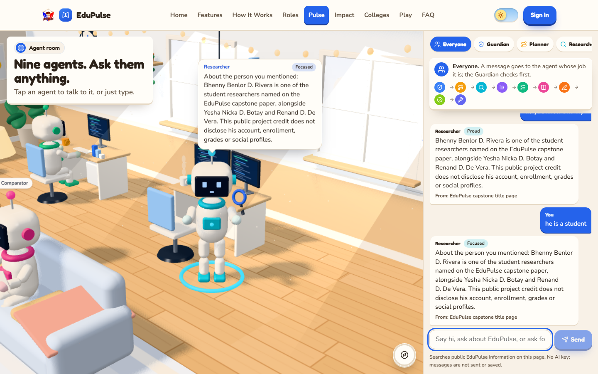
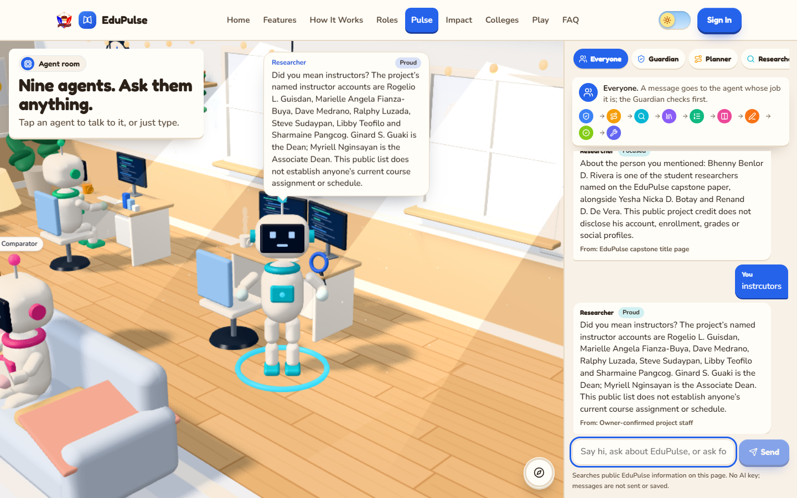
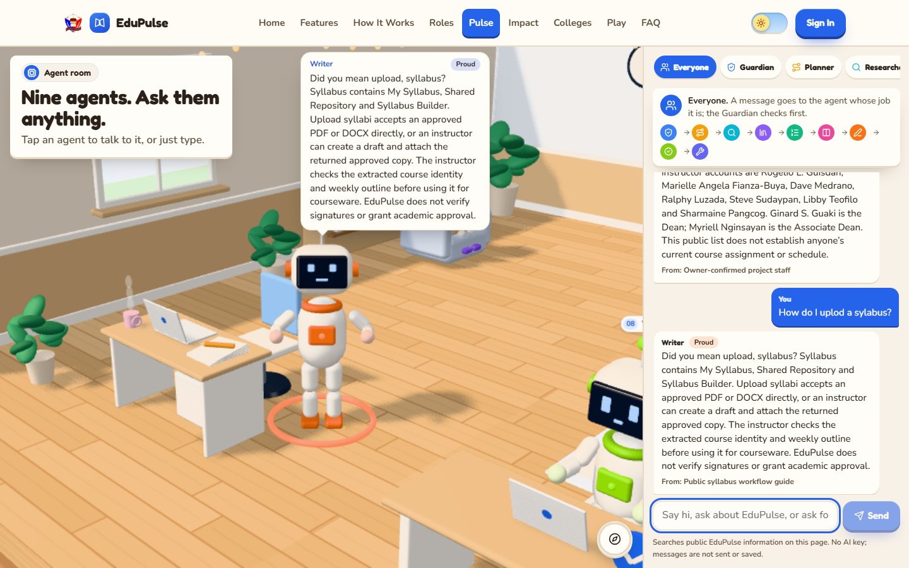
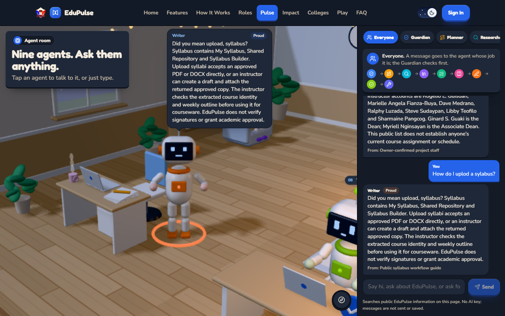
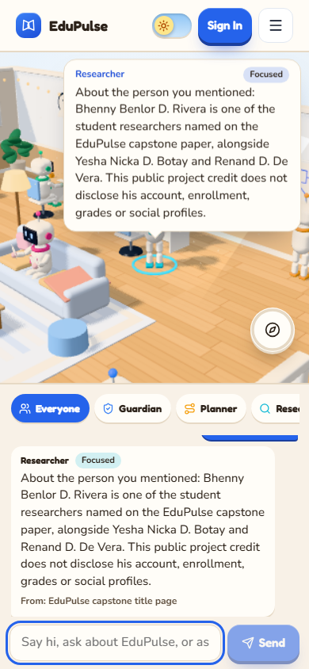
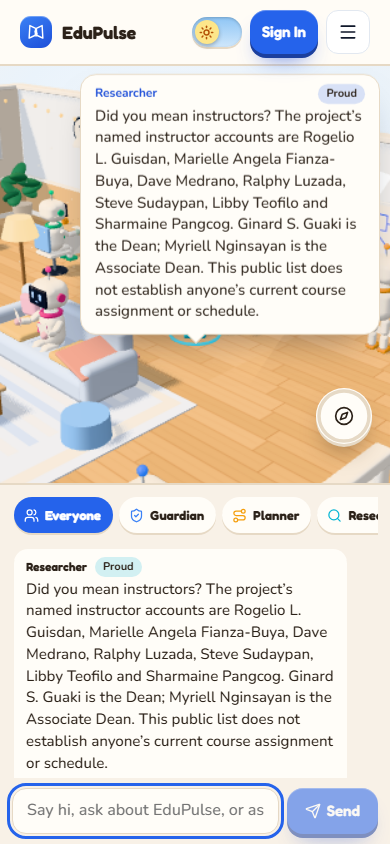
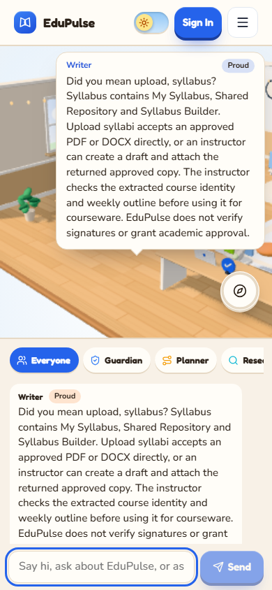

# Public Pulse information

Open **Pulse** from the public site. This room answers from public EduPulse descriptions already included in the page; no AI key or account is required. It covers features, workflows, role capabilities, confirmed staff names and project credits. It cannot search private student profiles, grades, passwords or current teaching assignments.

## Keep a person in context

Type **do you know bhenny?**, then **he is a student**. The answer keeps Bhenny's public researcher credit as the subject. It does not treat the statement as a request for assessment answers. These are credits from the capstone title page, not a student-directory search. A social-profile follow-up explains that no verified public profile is available; it does not invent a Facebook identity.

## Search with imperfect spelling

Type **instrcutors**. The reply offers **Did you mean instructors?** and the public staff list. Ginard S. Guaki is the Dean; Myriell Nginsayan is the Program Coordinator; Marielle Angela Fianza-Buya is an instructor. The reply identifies its public source. This list establishes project roles only, not current loads or schedules.

## Ask how a feature works

Type **How do I uplod a sylabus?**. The reply corrects the spelling and explains **My Syllabus**, **Shared Repository** and **Syllabus Builder**, direct approved-copy intake, extraction review and the approval boundary. A self-contained new question changes the topic. Try **students**, **features**, **PDF**, **performance** or a named instructor. If the information does not closely match, Pulse explains the limit and suggests supported topics.

The same answer remains readable in dark mode. Agent selection, moods, the room controls and assessment-answer restrictions remain available.

## Use a phone

The public chat and **Send** control fit the narrow layout. While the agent speaks, the room title gives way to its speech bubble so it cannot cover the reply. The longer information panel and composer note are hidden at this size. The desktop note states that public information is searched on the page without an AI key and messages are not sent or saved. Conversation context lasts only in the current page; it is not account memory.

## Evidence boundary

These are browser captures of the actual bundled lookup and reply code, with no chat-provider or directory-response fixture. The names shown are public project credits and owner-confirmed staff descriptions; no private student records are included. Keyword ranking and bounded edit distance support spelling corrections. They are finite retrieval rules, not a general language model or an Internet search. Authenticated Pulse uses a separate permission-checked path. [Release validation](../../versions/2026-11-09-public-pulse-search/validation/results.md) records tests and capture provenance.
