# Recorded progress and retained audit provenance

The current [teaching-set demonstration](../40-teaching-sets/README.md) extends the same provenance and normal learner RPCs across recorded classes. Its Weeks 1–3 activity remains separate from independent learner achievement, and all Week 4–5 assessments stay untouched for manual trials. [Current aggregate validation](../../versions/2026-11-12-teaching-sets/validation/results.md).

The owner authorized labelled test activity on registered BSIT accounts. A pipeline test uses the normal enrolled-student material-open and assessment-start/submit operations. Its score is calculated by the server and the saved attempt remains in the learner history and audit records. The latest monitoring correction excludes scripted exercises from independent student statistics. The underlying audit flag identifies an integration exercise; it does not establish independent student achievement. The current interface omits test labels and the Activity column at the owner's request.

| View | What is visible |
| --- | --- |
| 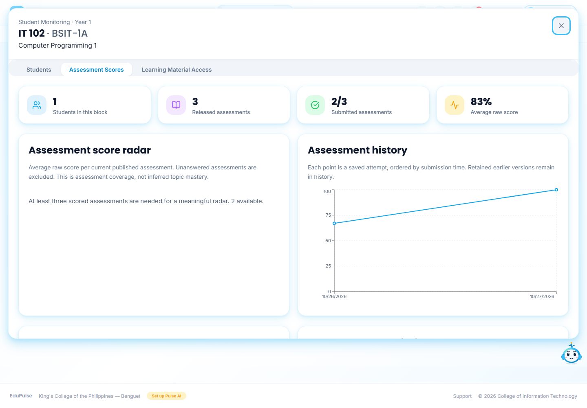 | **Student Monitoring → selected course/block → Assessment Scores** includes scoped charts and independent student scores. The flagged quiz is excluded; two other fictional student-recorded submissions remain, with an **83%** average. Expand **Topic mastery and follow-up** for individual historical attempts. The Activity column, activity-origin selector and test notice are removed. The assessment CSV matches the displayed columns; it omits the removed origin field. Audit metadata remains stored unchanged. |
| 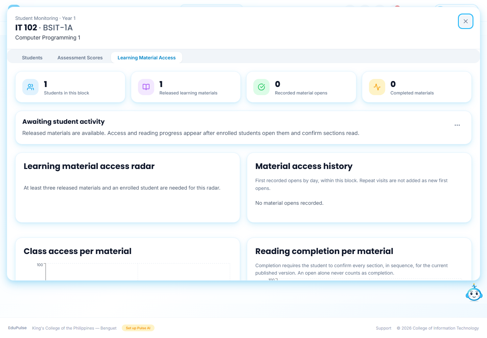 | **Learning Material Access** shows independent first opens and reading confirmations only. The scripted-only fixture has no independent opens or completed reading. Audit history is retained. An open is an access record, not proof of finishing the reading. |
| 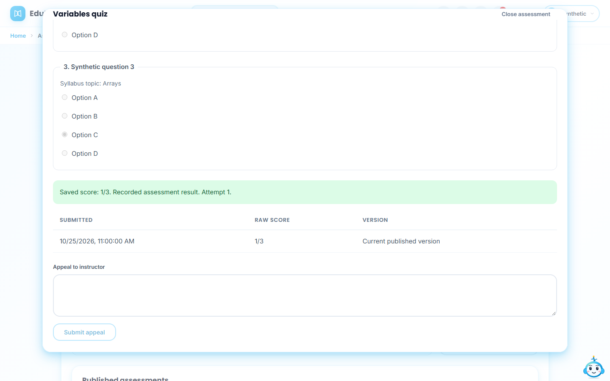 | The saved score appears directly without a test prefix. All questions appear together in the separate dialog; retained attempt controls remain. [Current view](../41-student-learning/README.md#content-filters-and-complete-assessment-view). |
| 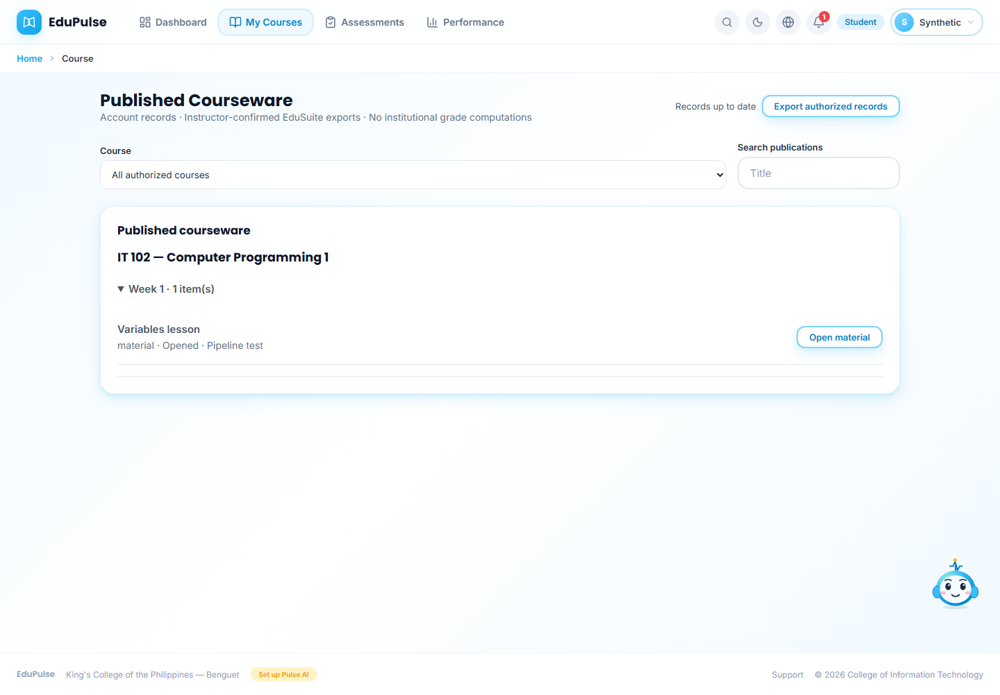 | The publication list shows **Opened** without a test suffix. |
|  | A student's saved result omits the test label on a narrow screen. |
| 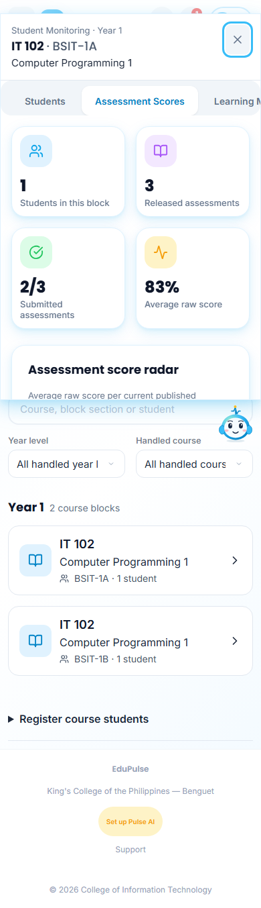 | The charts and responsive score rows remain reachable without the origin notice or filter. |

These screenshots use synthetic UI transports. They demonstrate presentation and filtering, not hosted persistence. The [validation record](../../versions/2026-11-10-pipeline-progress/validation/results.md) separates SQL authorization/scoring, browser presentation and live seed evidence.

## Learner-facing publication content

Student content and saved scores remain available. Private teacher AI review traces, raw retrieved source excerpts and marked-answer review metadata are excluded from publication payloads. Instructors retain these details in their authoring workspace. This projection does not regrade attempts, change publication versions during backfill, or create learner activity.

## Verified live integration exercise

On 10 November 2026, the researchers released a reviewed IT 103 Week 12 material, activity and four-question assessment through the real instructor workspace. Three registered BSIT accounts used authorized labelled tests through the normal learner APIs. Their persisted scores were 4/4, 3/4 and 2/4, with six recorded material/activity opens. Fresh instructor reads matched the exact saved attempt versions, scores and access rows. These entries retain their audit provenance in storage; the current student/monitoring interface does not display the test indicator. They are integration results, not independent learner achievement or institutional grades. No account password was reset, and the approved syllabus remained unchanged.

## Three distinct scored assessments

**Assessment score radar** requires at least three distinct, active, current-version assessments with graded attempts in the selected course, block, date and activity scope. Three students answering one quiz still supply one axis. Unanswered assessments and pending marking do not supply an axis; a genuine zero score does.

| View | What is visible |
| --- | --- |
| 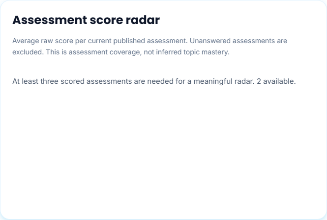 | Two scored assessments retain the explanation and count; no polygon is invented. |
| 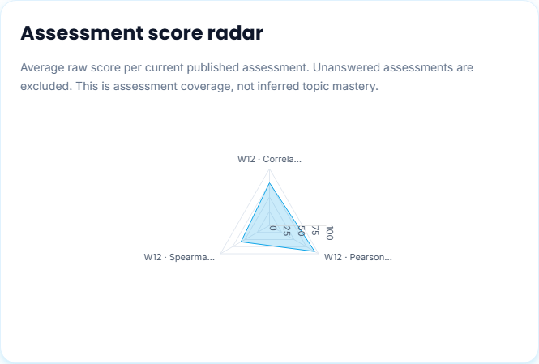 | Three separate quizzes produce three axes with a 0–100 scale. Full names and values remain in the chart's accessible description and tooltip. Extra plot margin keeps the labels within narrow panels. |
| 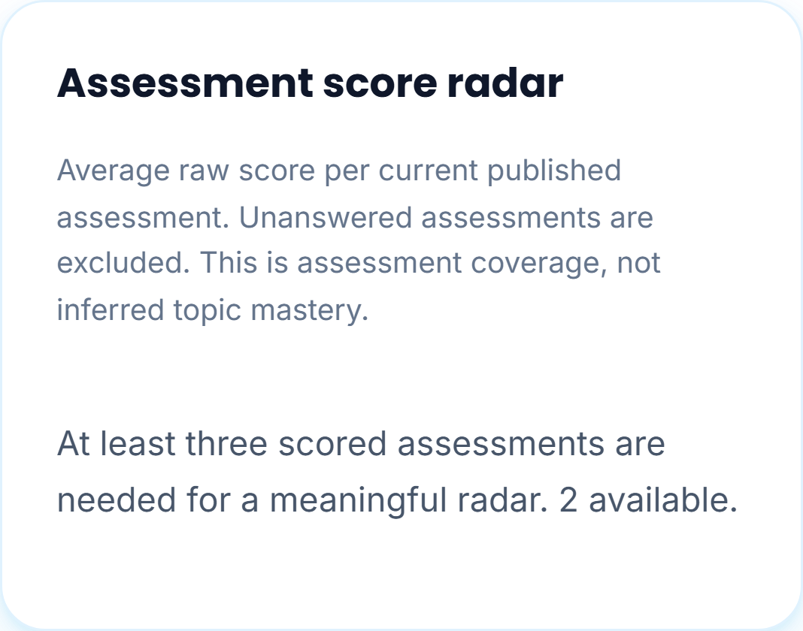 | The same minimum applies on a phone. |
| 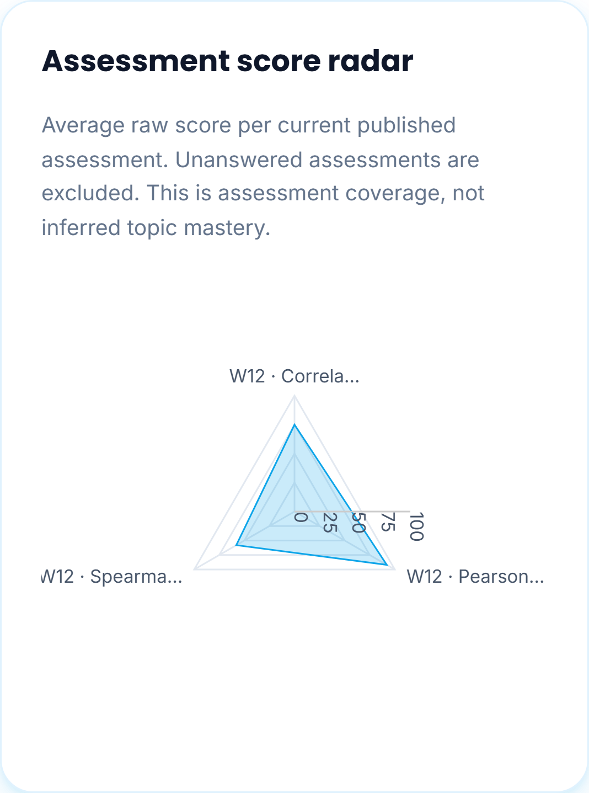 | The triangle uses the same recorded percentages, without adding missing scores. |

These images use synthetic, anonymous presentation data. Separately, on 11 November the researchers extended the live IT 103 Week 12 practice with two reviewed quizzes: **Pearson Coefficient: Calculation and Limits** and **Spearman Ranks: Computation and Interpretation**. Both follow the approved correlation outline. The same three registered BSIT test learners now have nine saved attempts across three distinct assessments. Fresh instructor and learner reads agreed; class averages are **75%**, **92%** and **58%**. Each new attempt retains **Pipeline test** provenance. These are integration exercises rather than independent learner achievement.

The historical seeded radar is an integration exercise. Current Student Monitoring excludes those scripted attempts and requires actual student submissions for its axes. The figures above illustrate the radar threshold with anonymous presentation fixtures; they are not evidence of independent production student achievement.

Timed submissions now save the verified student account email alongside the authorization UUID, so scores match their roster rows and block filters. Missing historical labels were repaired from account IDs without regrading, changing answers, publication versions or test provenance.

Reading completion now uses version-bound sequential confirmations in the full student Document reader. Earlier first opens and pipeline-test labels never become completed reading automatically. [Manual 37](../37-instructor-monitoring/README.md) describes the merged instructor workflow.

## Current attempt table and dashboards

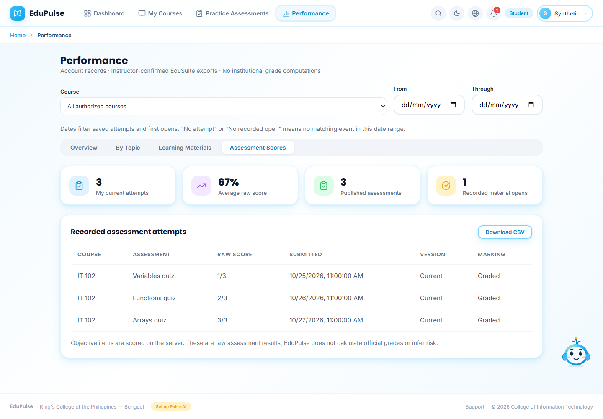
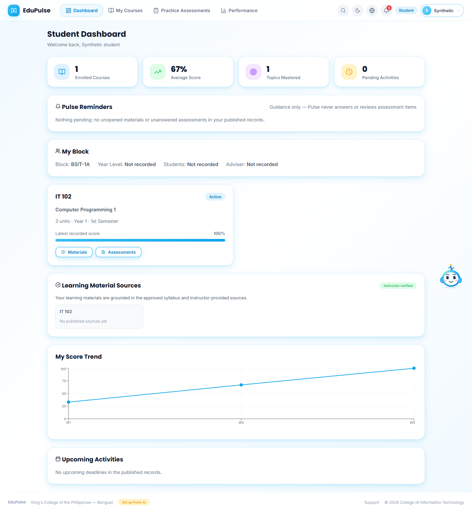
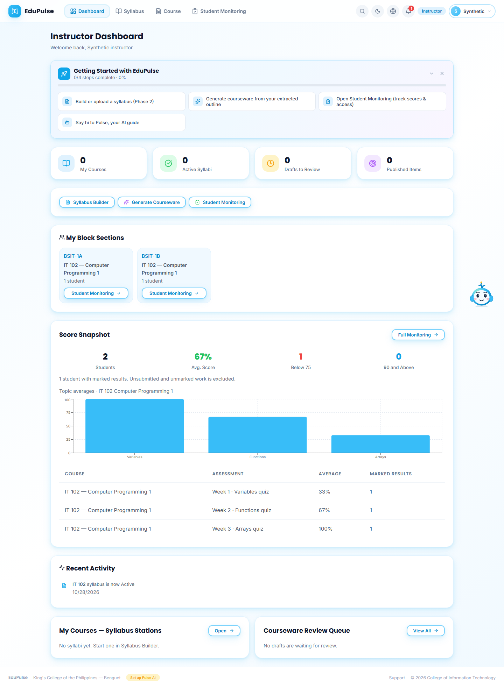

Recorded attempts retain course, assessment, raw score, submission date, current/earlier version and marking status. The redundant Activity column is omitted. Dashboards show the same saved values without test labels; underlying provenance remains in audit storage.

Student practice and Performance summary cards use the shared dashboard SummaryCard component. Their colored icons and spacing match the dashboard; the saved scores, material opens and table columns below them are unchanged.
