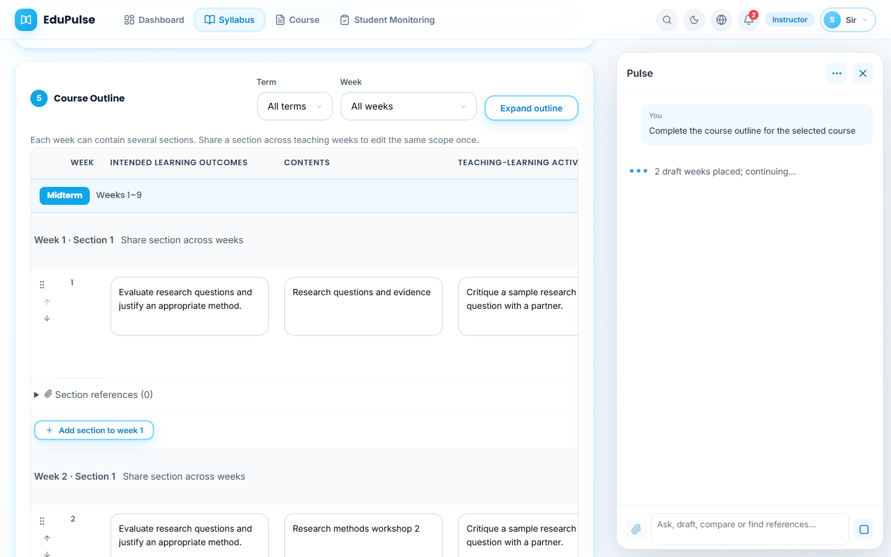
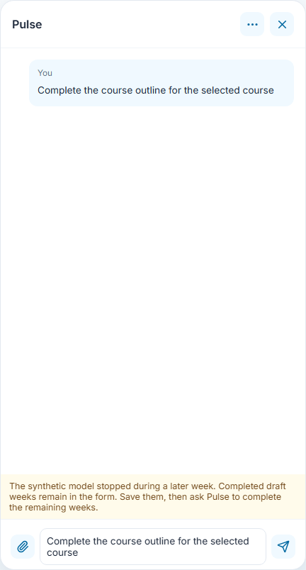
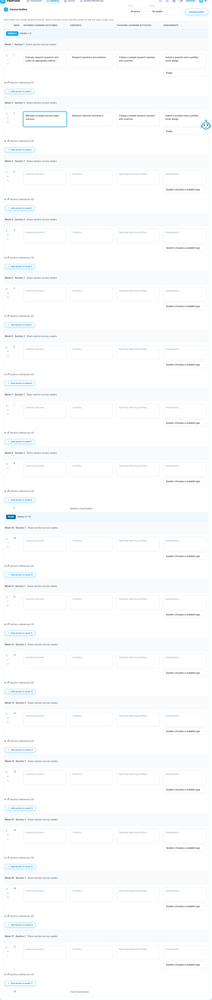
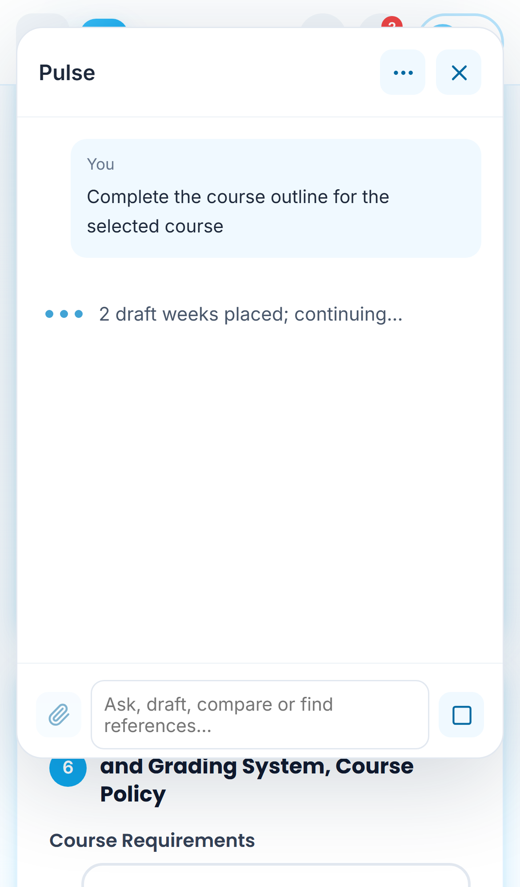
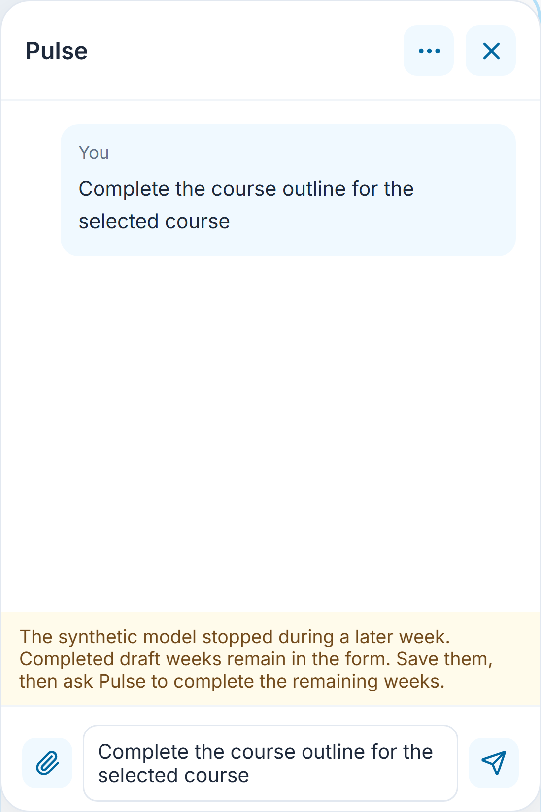

# Generate an outline week by week

Select the course in **Course Information**, open Pulse, then ask it to complete the outline. Both connected providers and on-device models use the same validated contract. Each completed week is placed directly in the open draft fields as the next step runs. The placed-week indicator reports progress. Examination slots and completed weeks remain unchanged for completion requests.

Same-course syllabus references remain available to the existing bounded sequence-research pipeline. Source patterns are educational examples; they do not confer institutional approval. File-only requests keep their source restriction. The model cannot supply new section IDs or change teaching-week relationships.

A later failure rejects the current chunk and leaves completed draft fields editable. There is no separate Use week or Use completed weeks confirmation for generated syllabus content. Manual edits to a target reject conflicting placement; independent fields remain intact. Save completed work explicitly, then ask **complete the remaining weeks**. Stop cancels subsequent inference and preserves completed chunks.

The existing outline inputs, supported assessment types, resources and manual editing remain. **Save as Drafted** persists explicitly and keeps the builder open. **Mark as Checked**, approval, activation and publication remain separate controls. Reload restores the last explicit saved syllabus and never restarts inference.

Captures use original sample teaching text and controlled model transport through the real progressive client and mounted form. They do not establish live model quality or hosted account mutation. [Manual 42](../42-editable-syllabus-workspace/README.md) covers owned drafts, week follow-ups and save-in-place. The [targeted contract](../38-targeted-outline-edits/README.md) preserves immutable section IDs and shared scopes without requiring unrelated sections in model output.
