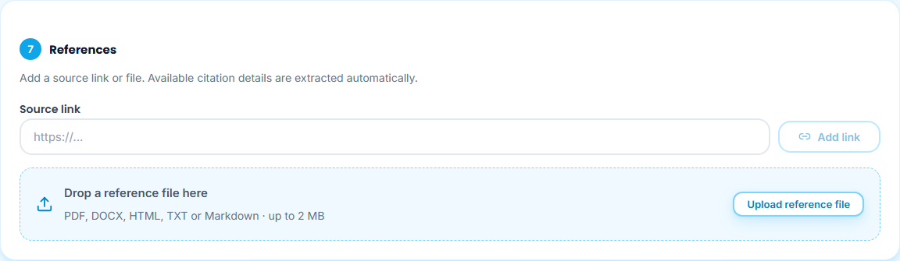
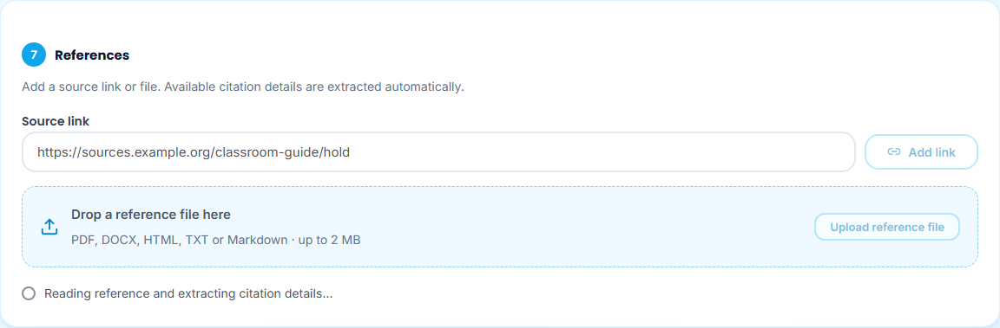
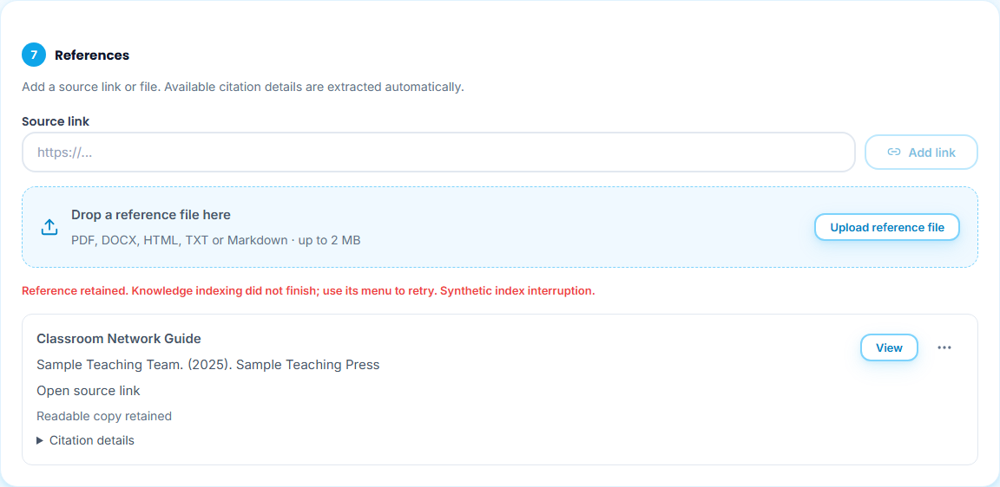
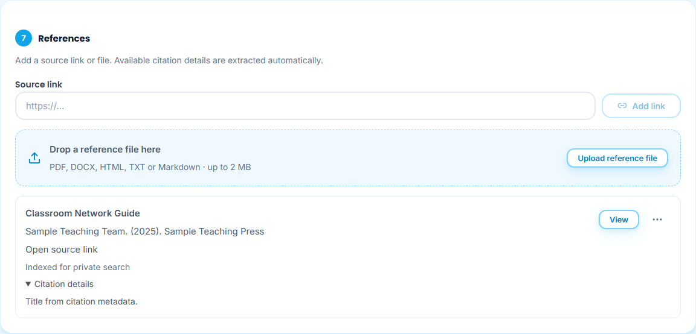
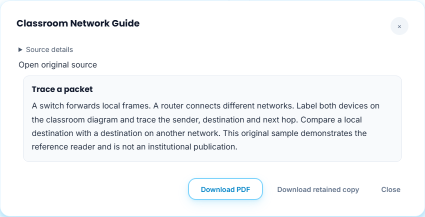
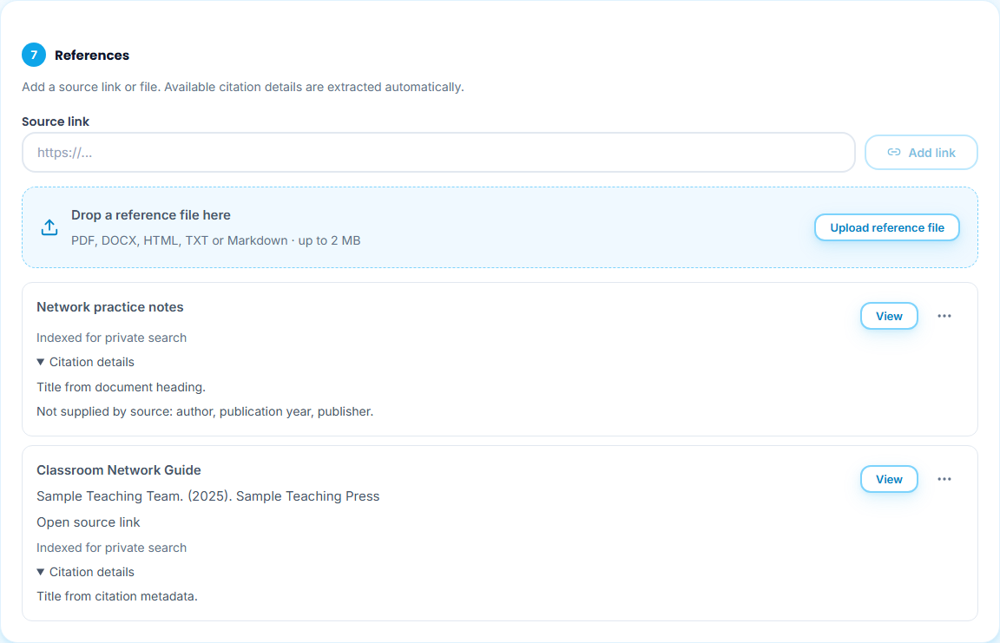
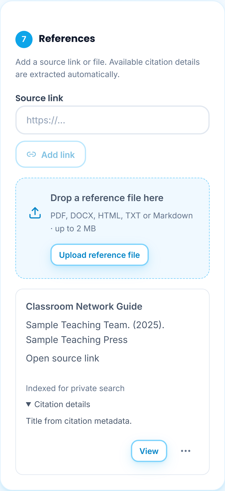
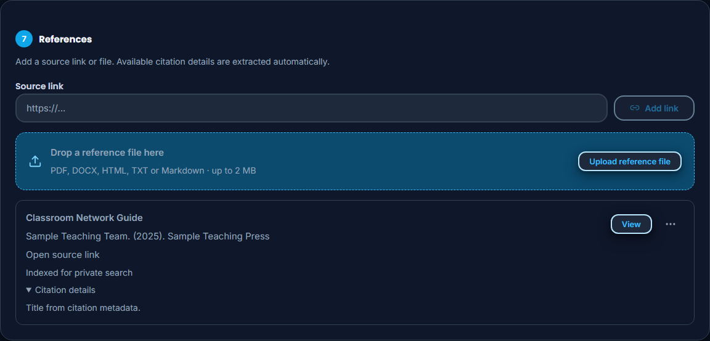

# 35 - Add reference links and files

**Who:** instructor or System Admin in an instructor view. **Where:** **Syllabus Builder → References**.

1. Paste a public URL into **Source link** and choose **Add link**, or use **Upload reference file**. You can also drop one PDF, DOCX, HTML, TXT or Markdown file into the file area. The limit is 2 MB. Manual title/author/year/publisher entry fields have been replaced.

   

2. Wait for **Reading reference and extracting citation details...**. The controls stay disabled during the operation.

   

3. A readable copy is retained before search indexing begins. If indexing fails, the reference and retained copy remain. Open the reference's three-dot menu and choose **Index for search** to retry.

   

4. Check the title and extracted author, publication year and publisher. **Citation details** identifies the title's source and shows unavailable metadata. A successful indexing response shows **Indexed for private search**. Source metadata is reported as supplied, not independently authenticated.

   

5. Choose **View** to read the retained extraction. **Download PDF** creates a formatted reading copy; **Download retained copy** returns the unchanged original. The original source link remains available.

   

6. A source without explicit authors, publication year or publisher leaves those fields absent. The sample Markdown file uses its heading as the title and lists missing citation details; no year is derived from upload or file creation time.

   

7. **Save as Drafted** saves these reference associations with the syllabus. Intake and indexing do not save, check or publish the syllabus. **Download PDF draft** includes its citation details and links. Existing imported references remain listed; **Remove reference** removes this syllabus's association and keeps the reusable private source. To delete a retained version and its indexed passages, use **Course → Syllabus sources → Remove retained version**.

The same controls stack on a phone and retain the existing dark surfaces.

Readable copies supply course generation through exact citation associations. Indexed passages can also answer authorized private-library questions, with page/section locations and retained-source provenance. Keyword search does not require a connected generation provider; semantic retrieval uses the existing local embedding model. This does not make private files visible to students, another account or the public landing page.

Catalog/search listings may supply citation metadata but are not retained or indexed as teaching content. Sign-in pages, unsupported files, unreadable scans, unavailable links and resource limits remain explicit failures. Prefer an accessible chapter or readable copy. At most 80 references are collected for a syllabus, 200 source versions are retained per account and the existing 50-document library limit still applies. Only the first 150,000 extracted characters per source are searchable; truncation is disclosed.

**Evidence boundary:** these captures use original sample text and controlled source/persistence/index responses. Native tests separately exercise actual isolated extraction, immutable bytes, local pgvector/keyword indexing, citation provenance and cross-account denial. Browser tests verify delayed persistence and a real generated PDF. They do not establish hosted metadata coverage, perfect bibliographic parsing, factual correctness of every source or genuine student completion.
