# 36 - View Dean course, instructor and student records

**Current Course flow — 15 November:** Dean and Program Coordinator now use one Course page with summary cards and course cards. A selected course opens a page-sized instructor-load modal with read-only syllabus/teaching inspection. The old Course list/Course loads tabs below are superseded. See [the current Course guide](../46-course-load-workspace/README.md). The dated screenshots are retained as historical captures while broad recapture is paused.

**Who:** Dean, including an authorized System Admin support view. Main navigation is **Dashboard**, **Course**, **Instructors** and **Students**. These pages read authorized academic records.

## Dashboard summaries

Each summary is a keyboard-accessible link. Other Dean summaries use the same icon, color, card and focus treatment.

| Card | Destination |
| --- | --- |
| **Released Courses** | **Course → Course records** |
| **Courses Loaded** | **Course → Course loads** |
| **Approved Syllabi** | **Course → Syllabi**, filtered to approved and active syllabi |
| **Not Yet Routed for Approval** | **Course → Syllabi**, filtered to Drafted and Checked |

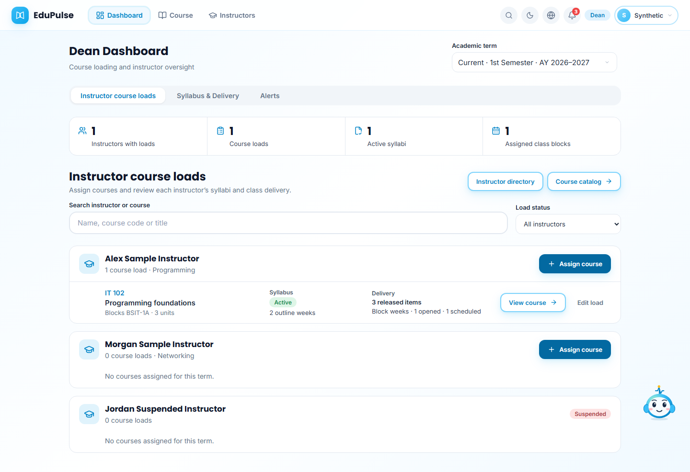

## Course and instructor records

**Course records** lists course codes, titles, instructors, students and recorded activity. **Course loads** shows saved assignments and recorded blocks; **Confirmed course-load records** expands when imported rows exist. **Student class lists** lists current memberships with **Download CSV**. **Syllabi** provides a status filter and **View outline**.

**Instructors** provides name search and instructor cards. Select one for saved courses, statuses, released items, submissions and material opens. **Teaching instructors** filters to instructors assigned to saved courses.

Pulse navigation follows the same role destinations: a Dean's request to open course loading opens **Course → Course loads**. The Program Coordinator's request retains **Course Loading**.

| View | Desktop | Phone |
| --- | --- | --- |
| Course records |  | 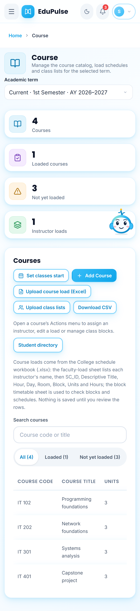 |
| Course loads |  | 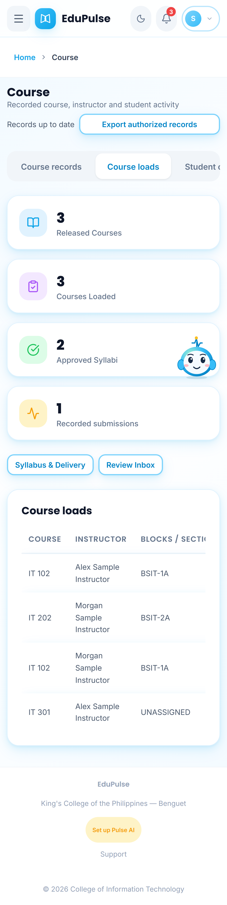 |
| Student class lists |  | 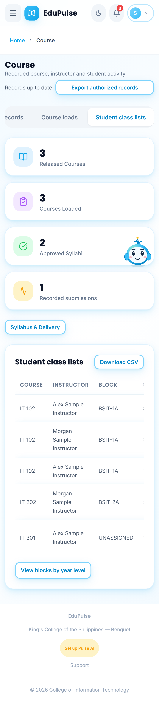 |
| Instructor cards | 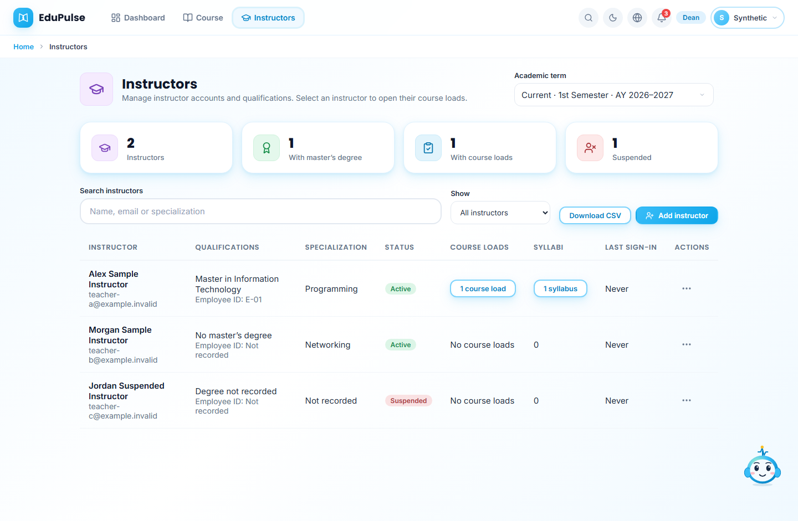 | 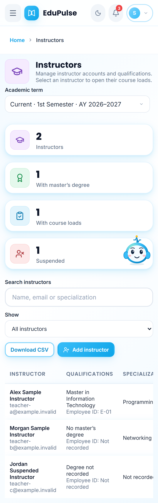 |
| Instructor detail | 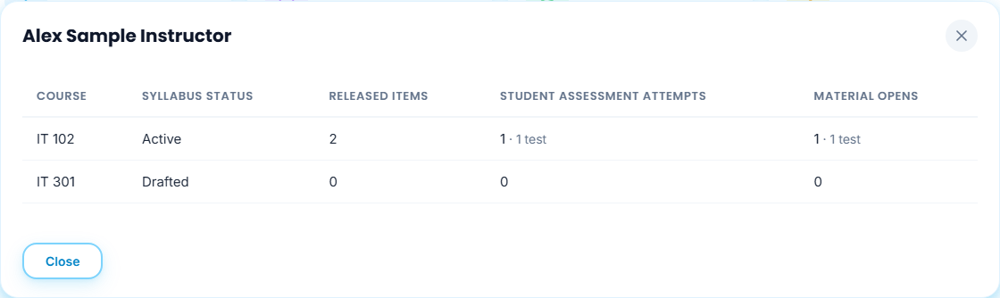 | 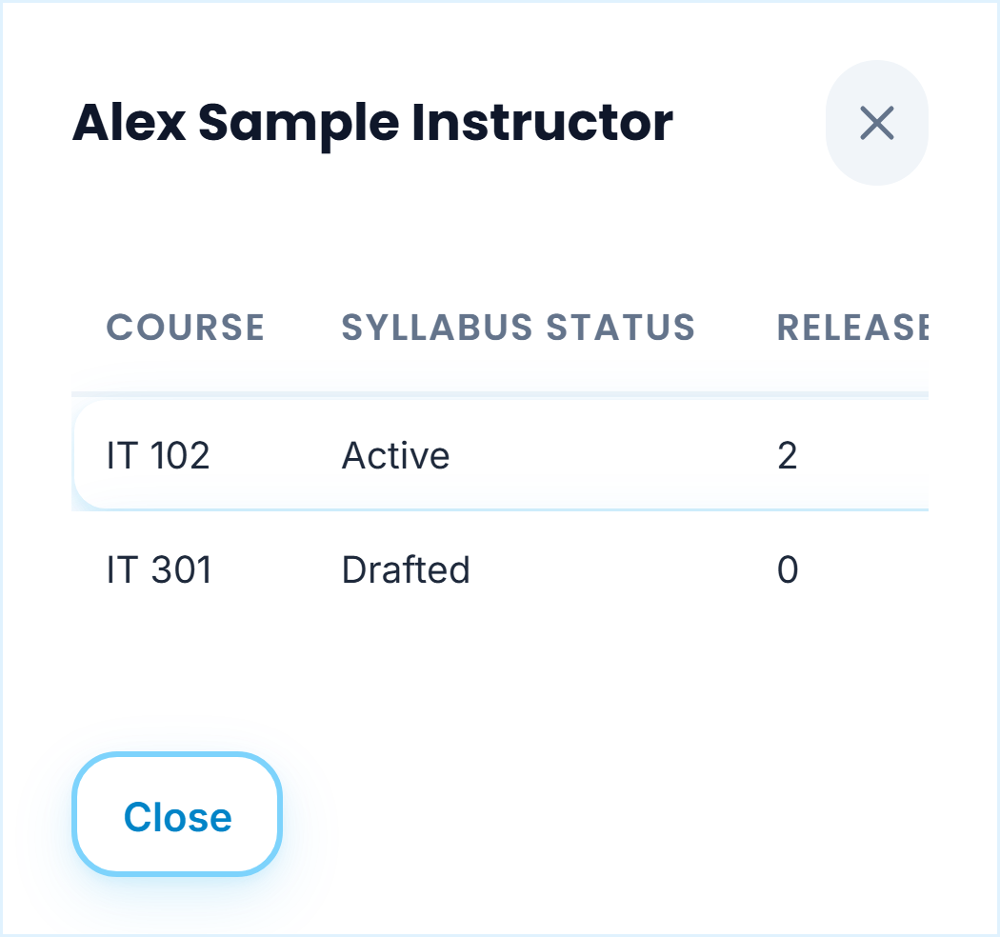 |

Catalog totals group course codes; separate saved offerings retain instructor and membership context. Released items exclude inactive and future releases. Submission counts use each learner's latest current-version attempt. Counts have no test suffix; provenance remains in stored audit fields. Opens do not establish completed reading; enrollment does not establish assessment completion.

**Syllabus & Delivery**, **Students → View student performance** retain oversight and read-only results. Review and approval take place outside EduPulse. Dean File Import, Templates, History and block-edit controls are removed. Saved records remain. The Program Coordinator retains the separate shared intake workflow.

## Browse blocks by year and download students

1. Open **Students**. Summary cards open all students, blocks, recorded years or course memberships. Below them, year-level headings contain block cards. Year comes from the registered student directory, falling back to recorded roster or course/block metadata; **Year level not recorded** and **Mixed year levels** remain explicit. The system checks only students already in the authorized course memberships.
2. Select a block. The dialog lists each learner once within that block, with ID, name, email, recorded year, course codes and activity. **Search students** narrows the visible rows. **Download CSV** exports the complete block membership, including rows hidden by the search.
3. Browser reload restores the current route and dialog after fresh account and record verification. It does not replay imports, enrollment changes, assessment actions, material opens or inference. A withdrawn record displays **Record unavailable**. **Close**, the close icon and Escape dismiss the dialog; it stays closed after reload.
4. **Registered students** opens the deduplicated student list with the same search/download controls.

| View | Desktop | Phone |
| --- | --- | --- |
| Year groups | 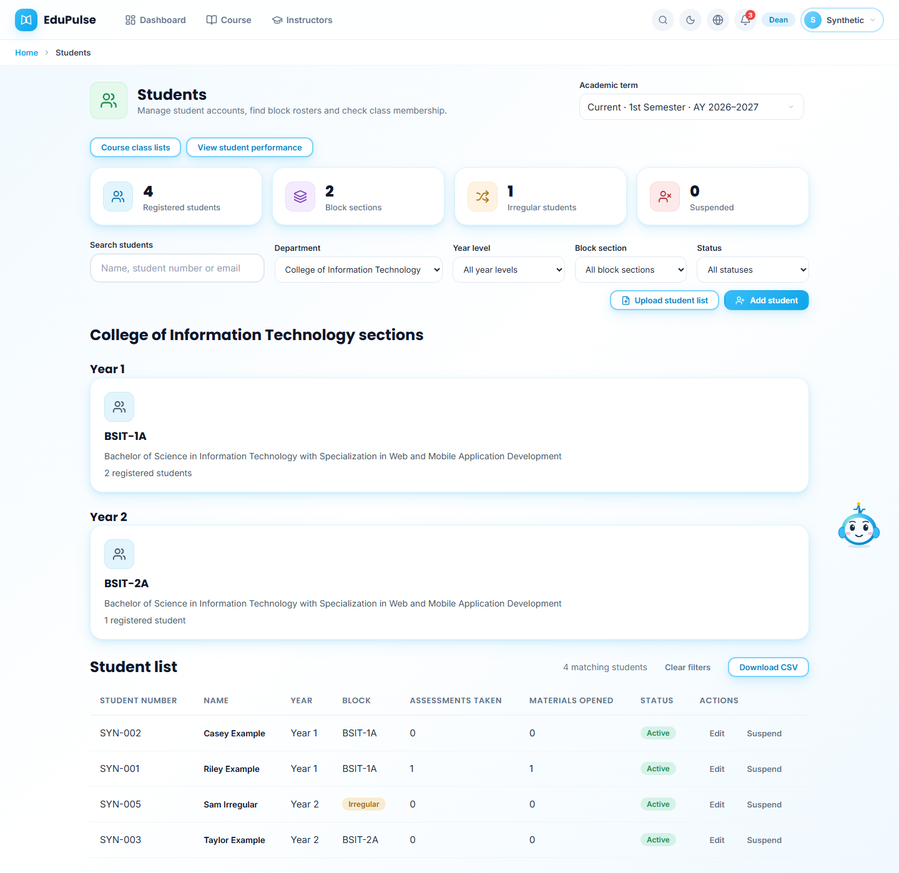 |  |
| Block students | 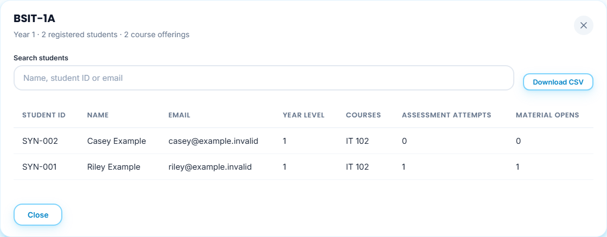 | 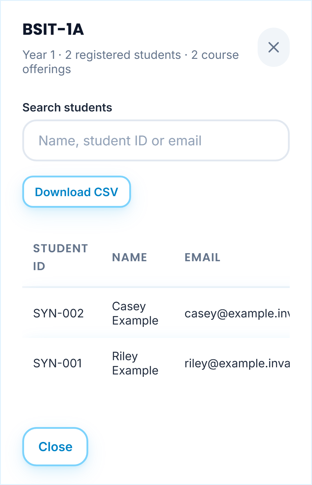 |
| Restored dialog |  |  |
| All students | 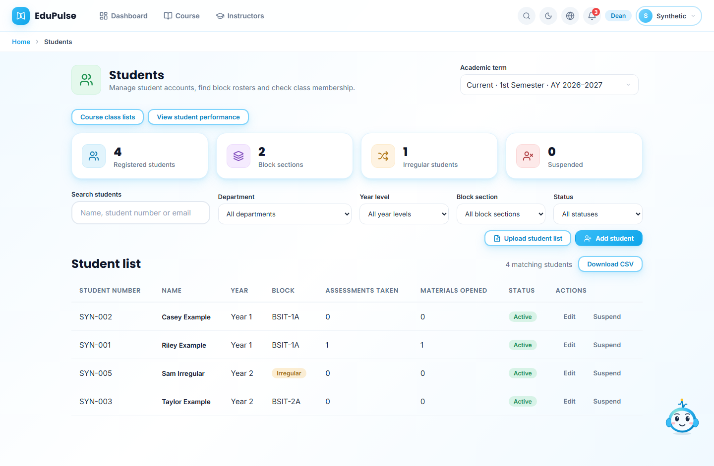 |  |
| Solid dark mode |  |  |

Phone navigation exposes all four destinations under **Open menu**. Wide tables scroll within their own region.

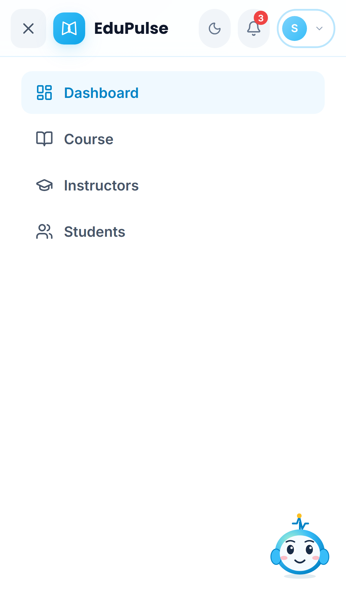

## Summary and outline dialogs

**Syllabi** opens the recorded list; **View outline** displays the selected saved week/outcome/content rows. The **Instructors**, **Blocks / Sections** and **Recorded year levels** summaries open their corresponding lists. If a restored detail is no longer in the current authorized projection, the dialog presents **Record unavailable** without the old roster.

| View | Desktop | Phone |
| --- | --- | --- |
| Syllabi | 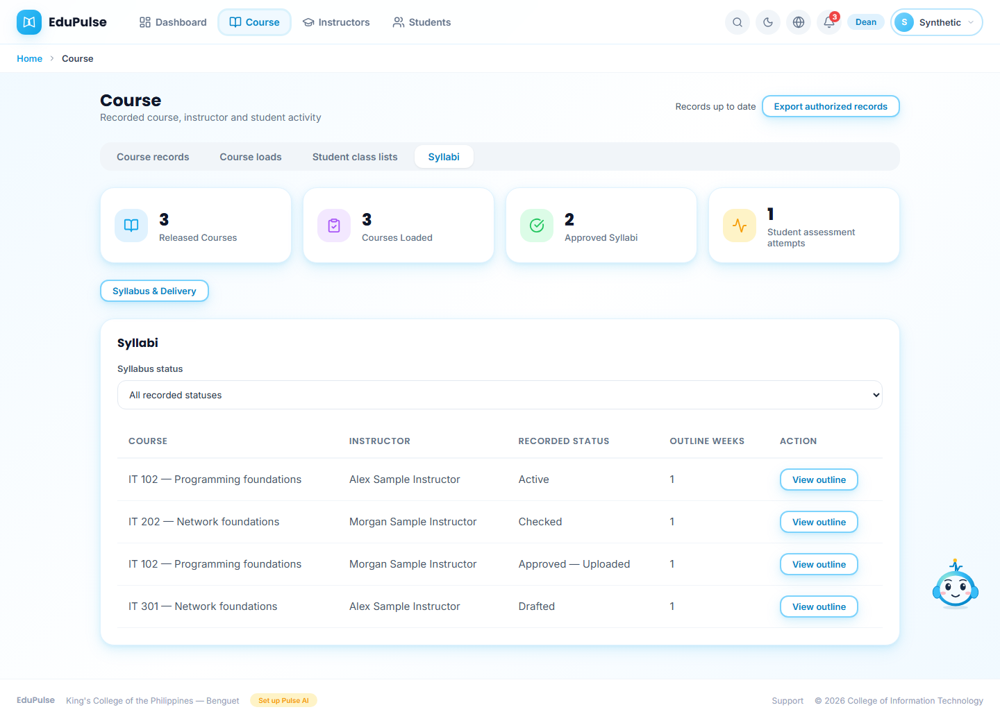 |  |
| Saved outline | 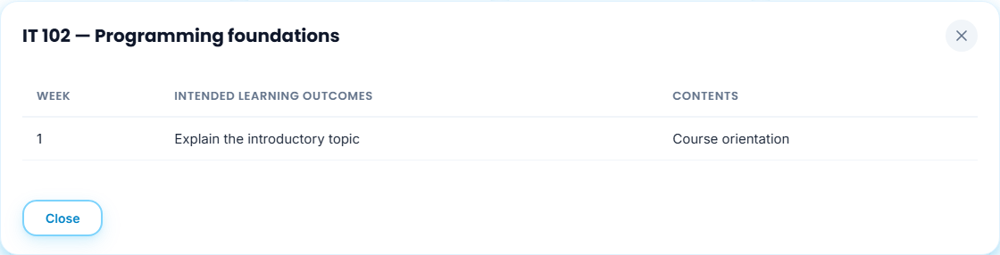 |  |
| All instructors |  | 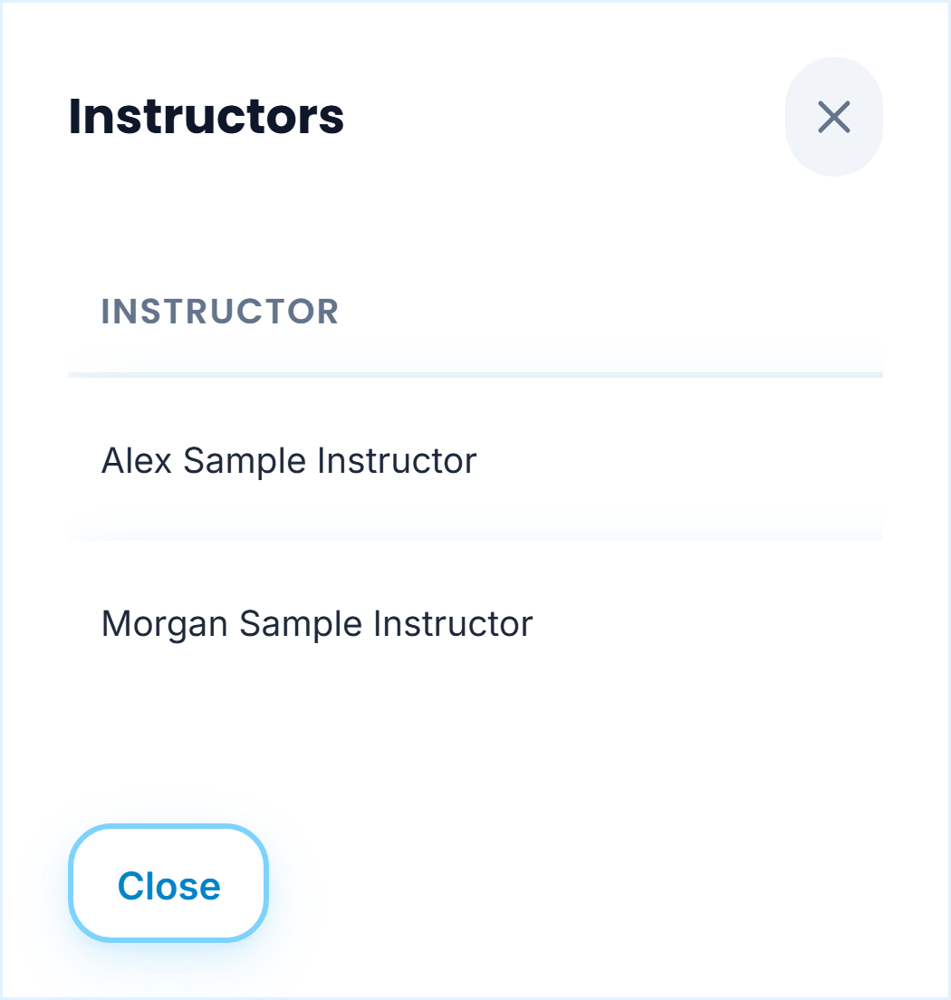 |
| All blocks |  |  |
| Year levels | 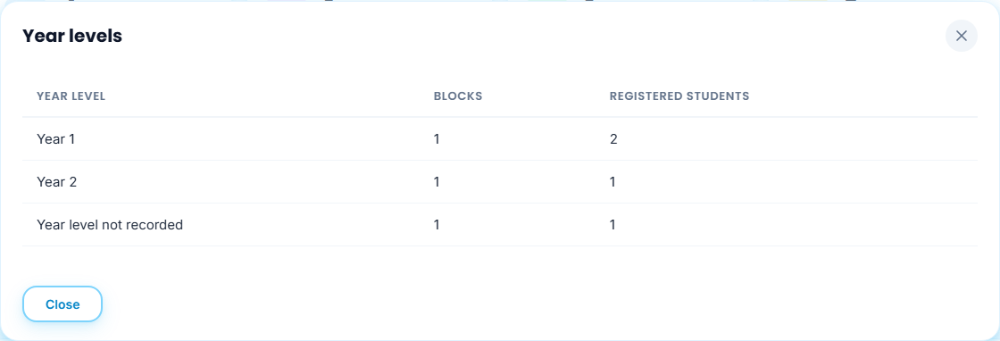 | 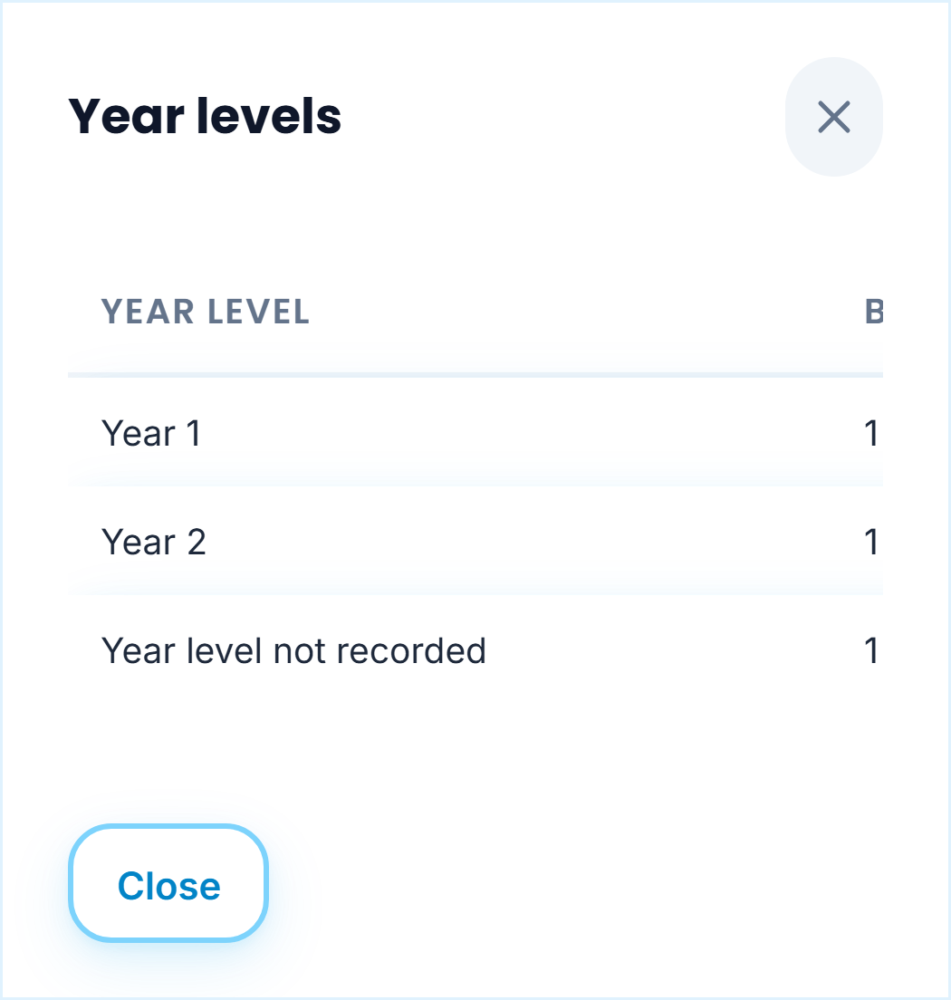 |
| Withdrawn record |  |  |

## Existing links and access

Dean `/course-loading` opens **Course loads**; its instructor tab opens **Instructors**. Dean `/records?tab=sections` opens **Students**. Old import-tab addresses fall back to **Course records**. Program Coordinator Records/Course Loading/Monitor, imports, templates, history and block correction retain their existing role permissions. New `/instructors` and `/students` routes are Dean-only.

Captures use original synthetic records and controlled account/API transport: four syllabus instances, three course codes, four students, five memberships and three blocks. One current attempt and one open retain test provenance in fixture data, without visible suffixes. The images demonstrate UI behavior, not hosted authentication or real student achievement. See [validation](../../versions/2026-11-11-dean-activity-records/validation/results.md).

## Curriculum population update

Course loads include **Curriculum load** with units, year and semester from the recorded curriculum. Counts labelled **Student assessment attempts** refer to learners, not instructor syllabus submissions. The instructor approval/signatory process remains offline. [Assignment and genuine-activity guide](../38-curriculum-population/README.md).

### Department home blocks - 18 November 2026

The current directory includes all six departments and groups home blocks by program and recorded year, independently of course enrollment. Use Department to narrow the Students list and Blocks / Sections. Department selection stays in the URL on reload. A block card shows its actual directory members even when it has no courses. The 2027-x-xxxx intake is Year 1; other IDs retain their recorded year. The owner-confirmed allocation places 2,286 existing active students into 109 blocks of at most 35. It creates no teaching load, course enrollment or learner activity.

The student Dashboard shows its own recorded home block and size before any syllabus or course is assigned. Individual registered students, including students from other blocks/departments, remain selectable by the assigned instructor. No nationality is inferred from IDs or names.
