# 36 - View Dean course, instructor and student records

**Current Course flow — 15 November:** Dean and Program Coordinator now use one Course page with summary cards and course cards. A selected course opens a page-sized instructor-load modal with read-only syllabus/teaching inspection. The old Course list/Course loads tabs below are superseded. See [the current Course guide](../46-course-load-workspace/README.md). The dated screenshots are retained as historical captures while broad recapture is paused.

**Who:** Dean and Program Coordinator, including an authorized System Admin support view. Main navigation is **Dashboard**, **Course**, **Instructors** and **Students**. These pages read authorized academic records.

## Dashboard summaries

Each summary is a keyboard-accessible link. Other Dean summaries use the same icon, color, card and focus treatment.

| Card | Destination |
| --- | --- |
| **Released Courses** | **Course → Course records** |
| **Courses Loaded** | **Course → Course loads** |
| **Approved Syllabi** | **Course → Syllabi**, filtered to approved and active syllabi |
| **Not Yet Routed for Approval** | **Course → Syllabi**, filtered to Drafted and Checked |

## Course and instructor records

**Course records** lists course codes, titles, instructors, students and recorded activity. **Course loads** shows saved assignments and recorded blocks; **Confirmed course-load records** expands when imported rows exist. **Student class lists** lists current memberships with **Download CSV**. **Syllabi** provides a status filter and **View outline**.

**Instructors** provides name search and instructor cards. Select one for saved courses, statuses, released items, submissions and material opens. **Teaching instructors** filters to instructors assigned to saved courses.

Pulse navigation follows the same role destinations: a Dean's request to open course loading opens **Course → Course loads**. The Program Coordinator's request retains **Course Loading**.

| View | Desktop | Phone |
| --- | --- | --- |
| Course records | 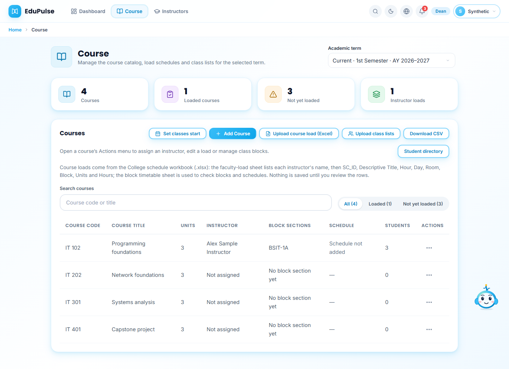 |  |
| Course loads | 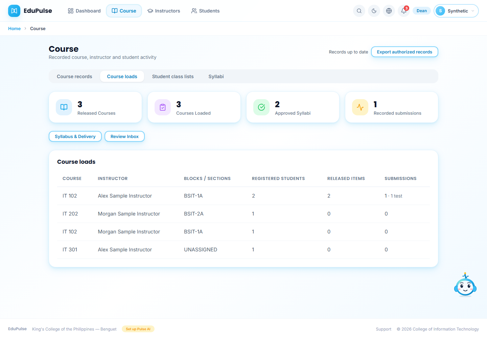 |  |
| Student class lists | 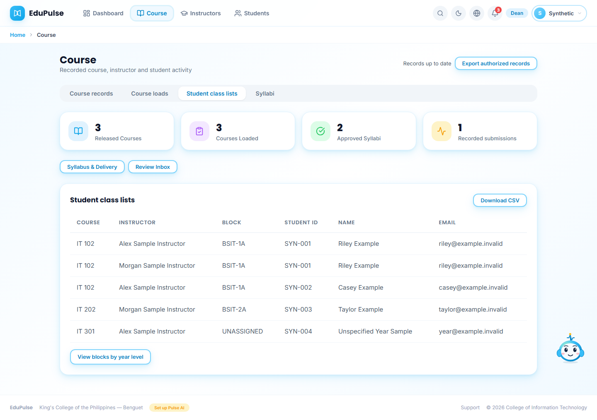 |  |
| Instructor cards |  |  |
| Instructor detail |  |  |

Catalog totals group course codes; separate saved offerings retain instructor and membership context. Released items exclude inactive and future releases. Submission counts use each learner's latest current-version attempt. Counts have no test suffix; provenance remains in stored audit fields. Opens do not establish completed reading; enrollment does not establish assessment completion.

**Syllabus & Delivery**, **Students → View student performance** retain oversight and read-only results. Review and approval take place outside EduPulse. Dean File Import, Templates, History and block-edit controls are removed. Saved records remain. The Program Coordinator retains the separate shared intake workflow.

### Unified Students page - 18 November 2026

**Students** is one page for the complete authorized student directory across all departments. There are no Student list / Blocks / Sections tabs. The summary cards precede **Search students**, **Department**, **Year level**, **Block section** and **Status** filters. With **All departments** selected, the table includes every matching department; no section cards are shown yet.

Choose a department to display its section cards grouped by recorded year. Choose a card to filter the same Student list table, or use the Block section selector. Changing department or year clears the previous block filter. Search matches name, student number or email; the filters combine. **Clear filters** restores the full directory. Pagination shows 25 students per page; **Download CSV** exports the complete filtered set, including matches on other pages, with spreadsheet-formula escaping.

Department, year, block, search, status and page remain in the URL across reload. Student details recheck the current authorized records before restoration; withdrawn records show **Record unavailable**. Filtering and reload issue no account, enrollment or learner-activity writes. Current/next semester account/import actions and previous-semester viewing restrictions remain. Instructor class-list selection and students' own home-block summaries are unchanged.

The earlier screenshots below are historical where they show separate tabs or block dialogs. Screenshot publication remains owner-paused; updated desktop/phone browser checks and capture assertions cover the unified page. [Release and validation](../../versions/2026-11-18-unified-students/README.md).

Historical Students captures (before the unified page; retained during the owner pause):

| Earlier view | Desktop | Phone |
| --- | --- | --- |
| Year groups |  |  |
| Block dialog |  |  |
| Restored block dialog | 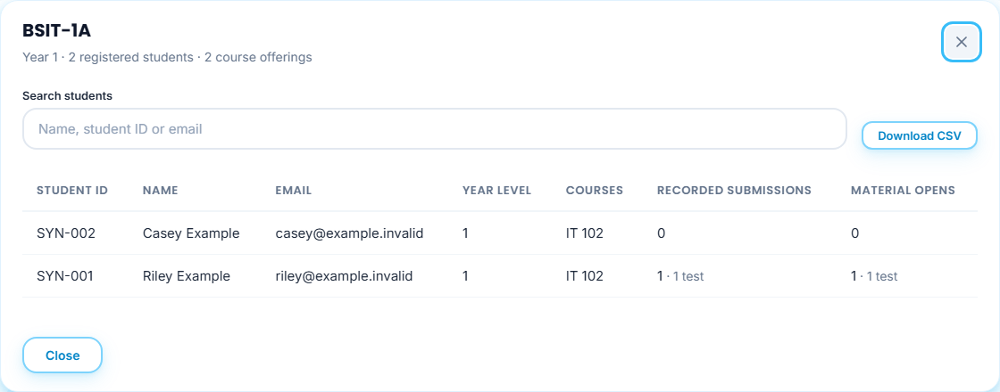 | 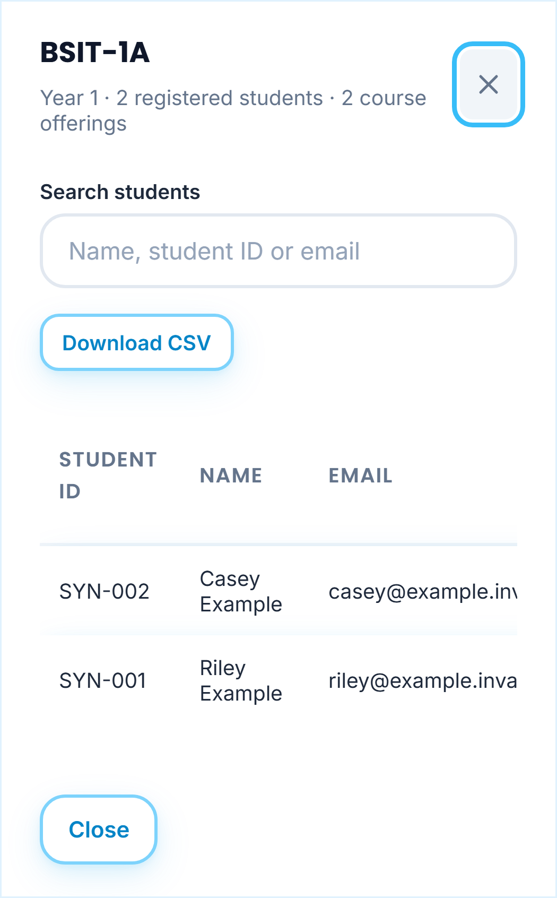 |
| All-student dialog |  | 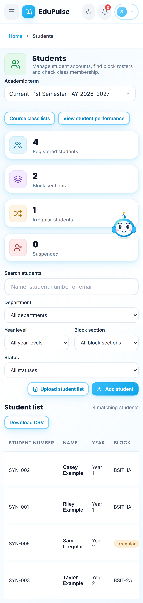 |
| Dark block view | 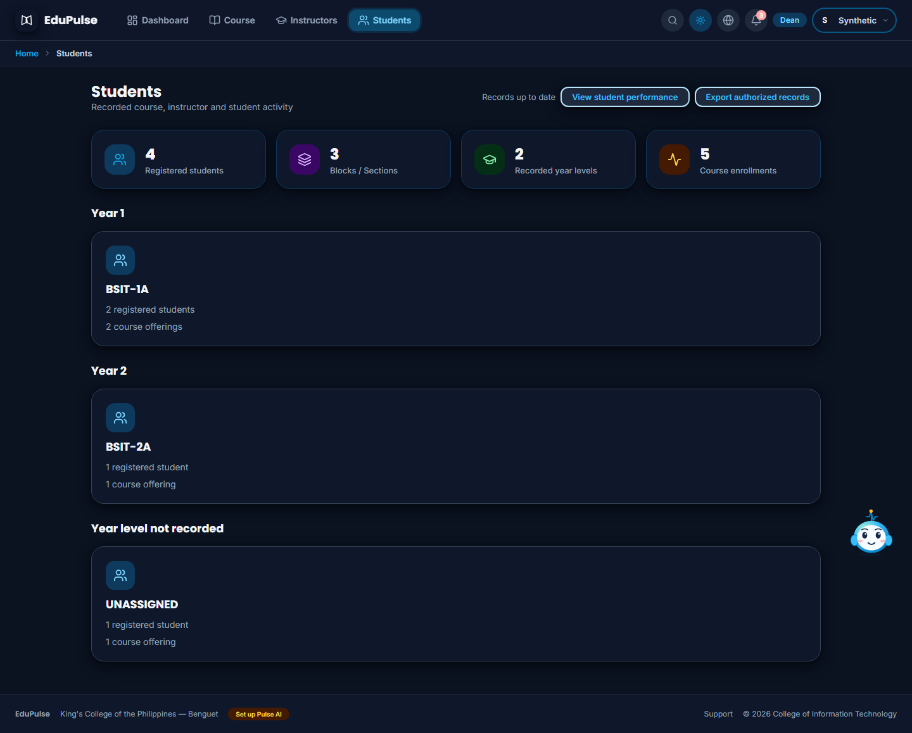 | 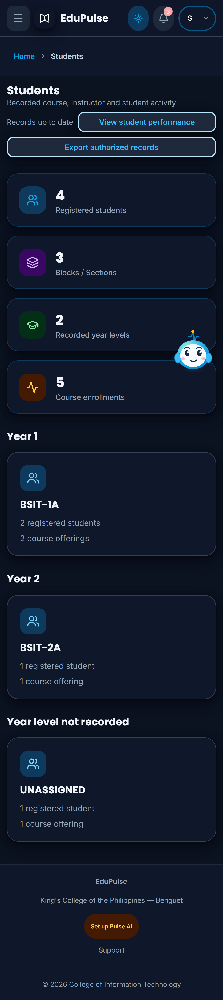 |
| Block summary dialog | 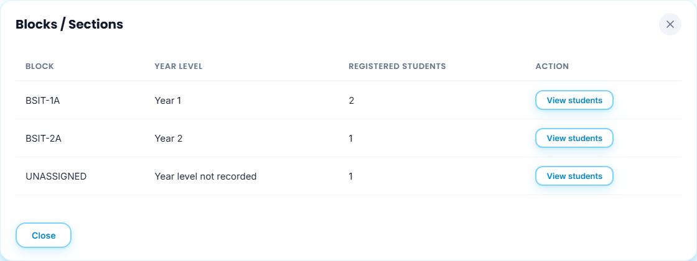 | 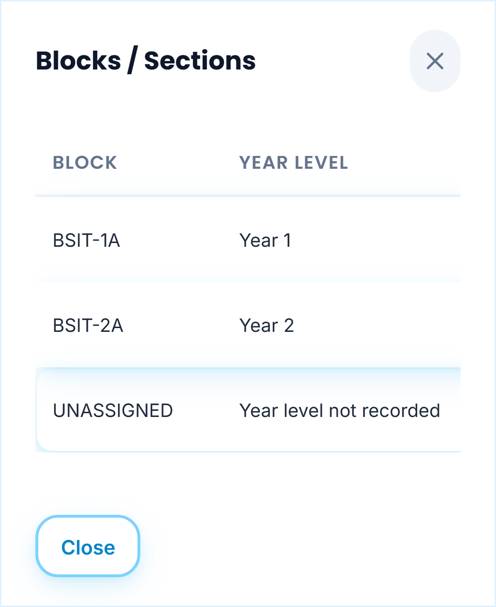 |
| Recorded-year dialog |  |  |

Phone navigation exposes all four destinations under **Open menu**. Wide tables scroll within their own region.

## Summary and outline dialogs

**Syllabi** opens the recorded list; **View outline** displays the selected saved week/outcome/content rows. The **Instructors** summary opens its list. On Students, **Registered students** clears the filters, **Block sections** focuses the Department selector, **Irregular students** opens its retained list, and **Suspended** filters the main table. If a restored detail is no longer in the current authorized projection, the dialog presents **Record unavailable** without the old roster.

| View | Desktop | Phone |
| --- | --- | --- |
| Syllabi |  | 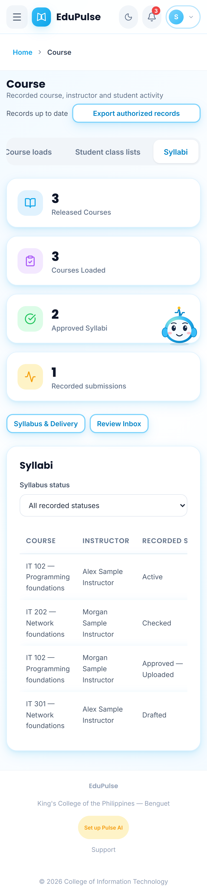 |
| Saved outline |  | 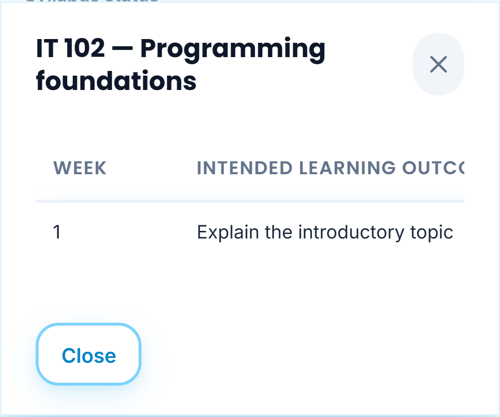 |
| All instructors | 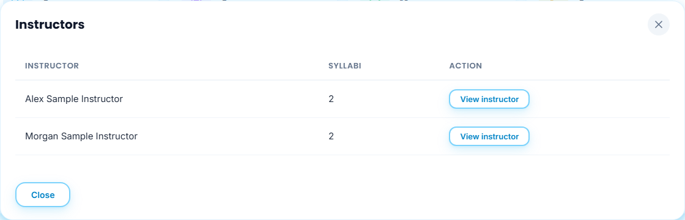 |  |
| Withdrawn record |  | 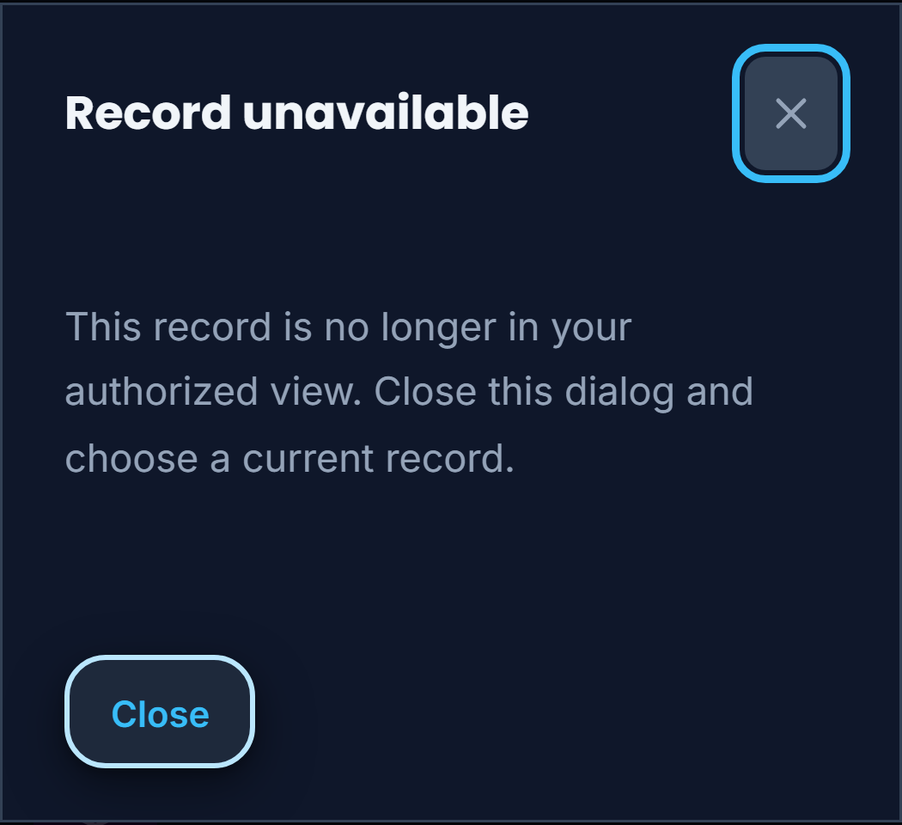 |

## Existing links and access

Dean `/course-loading` opens **Course loads**; its instructor tab opens **Instructors**. Dean `/records?tab=sections` opens **Students**. Old import-tab addresses fall back to **Course records**. Program Coordinator Records/Course Loading/Monitor, imports, templates, history and block correction retain their existing role permissions. Both Dean and Program Coordinator use `/instructors` and `/students` within their existing record and score permissions.

Captures use original synthetic records and controlled account/API transport: four syllabus instances, three course codes, four students, five memberships and three blocks. One current attempt and one open retain test provenance in fixture data, without visible suffixes. The images demonstrate UI behavior, not hosted authentication or real student achievement. See [validation](../../versions/2026-11-11-dean-activity-records/validation/results.md).

## Curriculum population update

Course loads include **Curriculum load** with units, year and semester from the recorded curriculum. Counts labelled **Student assessment attempts** refer to learners, not instructor syllabus submissions. The instructor approval/signatory process remains offline. [Assignment and genuine-activity guide](../38-curriculum-population/README.md).

### Department home blocks - 18 November 2026

The current directory includes all six departments and groups home blocks by program and recorded year, independently of course enrollment. Use Department to narrow the unified Students list and reveal its section cards. Department selection stays in the URL on reload. A block card shows its actual directory members even when it has no courses. The 2027-x-xxxx intake is Year 1; other IDs retain their recorded year. The owner-confirmed allocation places 2,286 existing active students into 109 blocks of at most 35. It creates no teaching load, course enrollment or learner activity.

The student Dashboard shows its own recorded home block and size before any syllabus or course is assigned. Individual registered students, including students from other blocks/departments, remain selectable by the assigned instructor. No nationality is inferred from IDs or names.
