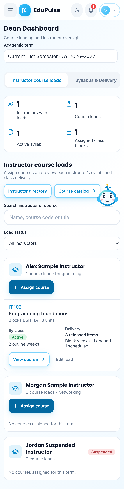
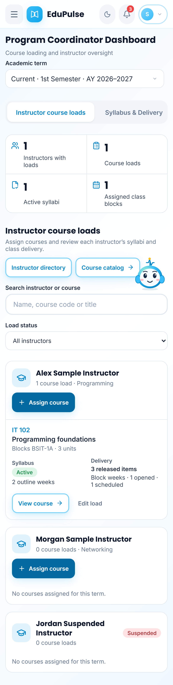
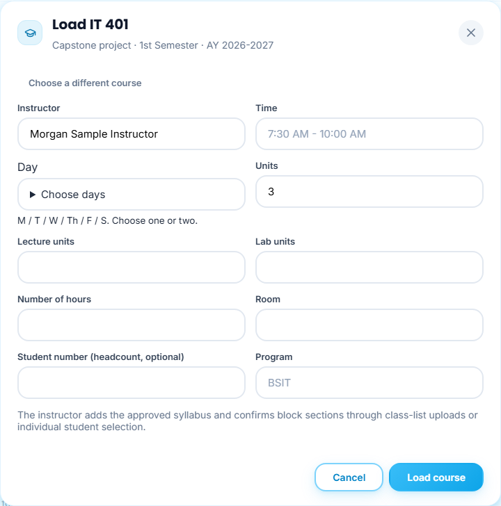
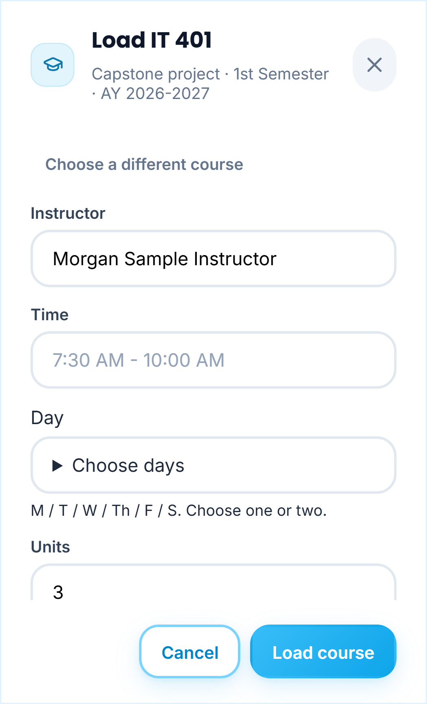
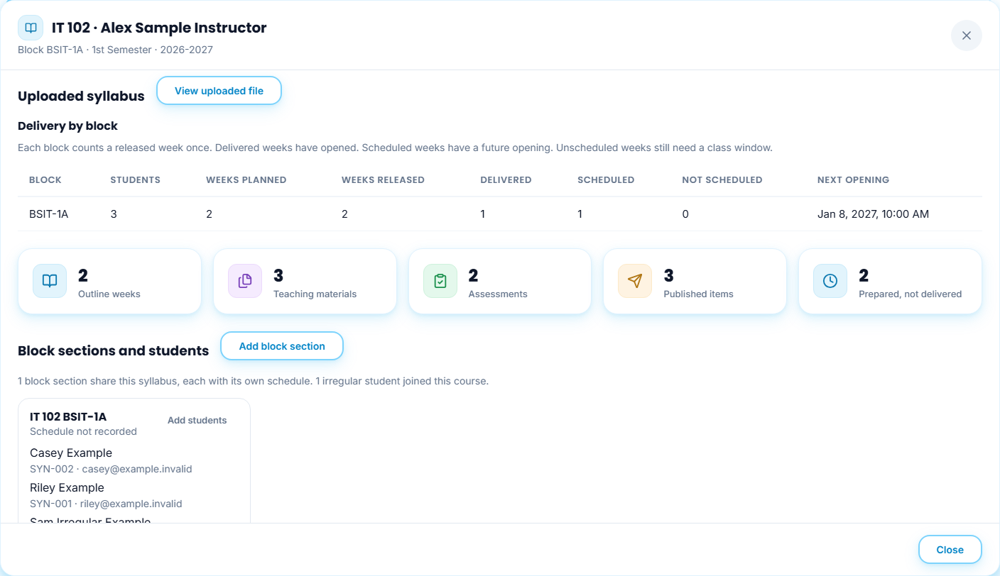
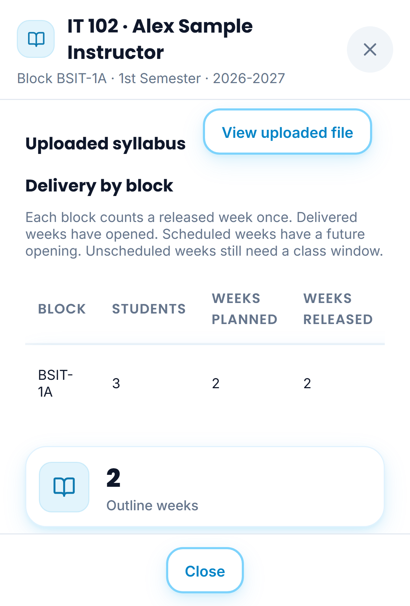
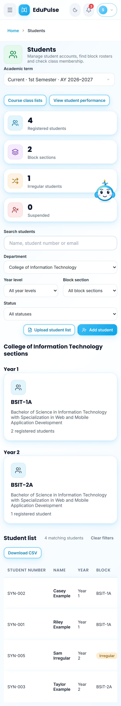

# 36 - Manage instructor course loads

**Who** Dean and Program Coordinator, including an authorized System Admin support view.

## Assign and review courses from Dashboard

1. Open **Dashboard → Instructor course loads**. Select the **Academic term**. The summary counts instructors with loads, saved course loads, active syllabi and assigned class blocks for that term.
2. Search by instructor name or course code or title. Use **Load status** to find instructors with loads, without loads, or with an assigned course that has no recorded syllabus.
3. Choose **Assign course** beside an active instructor. Select **Course to assign**, enter the schedule and load details, and select **Load course** to save. Use **Edit load** below an assigned course to change its schedule or reassign it through the existing handover flow.
4. Choose **View course** to review the approved file, outline and teaching contents. **Delivery by block** lists the enrolled roster count, planned and released weeks, opened weeks, later openings and weeks without a class window. Each released week counts once per block. Two blocks opening the same week count as two block weeks in the dashboard row.

| Screen | Desktop | Phone |
| --- | --- | --- |
| Dean Dashboard |  |  |
| Program Coordinator Dashboard |  |  |
| Assign a course to the selected instructor |  |  |
| Review syllabus and block delivery |  |  |

**Syllabus & Delivery** and **Alerts** show term-wide oversight and recent activity. A released item can open on different dates for different blocks. Block delivery uses the saved class windows and the first scheduled class meeting when the term calendar supplies the dates. Assessment scores are available to the Dean within authorized Performance views.

The selected term, filters and authorized course, assignment or reader view restore across reload. A course reassigned during the reload shows **Course load unavailable** for the former instructor's view. Unsaved schedule entries are cleared on reload, and saving always requires selecting **Load course** or **Save instructor**.

## Catalog and directories

- **Course catalog** opens **Course** for catalog records, Excel course-load intake, class-list uploads, schedules and per-course Actions. Unassigned courses appear in **Not yet loaded**. **Student directory** opens the roster workspace in the same term. [Course and class-list tasks](../46-course-load-workspace/README.md)
- **Instructor directory** opens **Instructors** for qualifications, account changes, and course-load and syllabus popovers. Select an instructor's name to open Dashboard filtered to their loads. Use **Show all instructors** to clear that selection.
- **Students** shows registered students, their recorded blocks and class membership. Select **Department** to reveal blocks grouped by year. Select a block to filter the same **Student list**. **Download CSV** exports the filtered list. **Course class lists** returns to Course for per-course roster management.

| Screen | Desktop | Phone |
| --- | --- | --- |
| Course |  |  |
| Instructors |  |  |
| Students |  |  |
| Department sections by year |  |  |

Current and next terms include authorized management controls. Previous and all-term views are read-only. The images use synthetic accounts, schedules and academic records.
