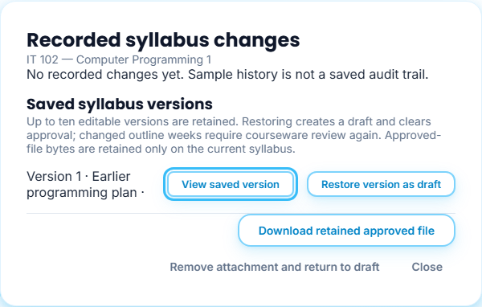
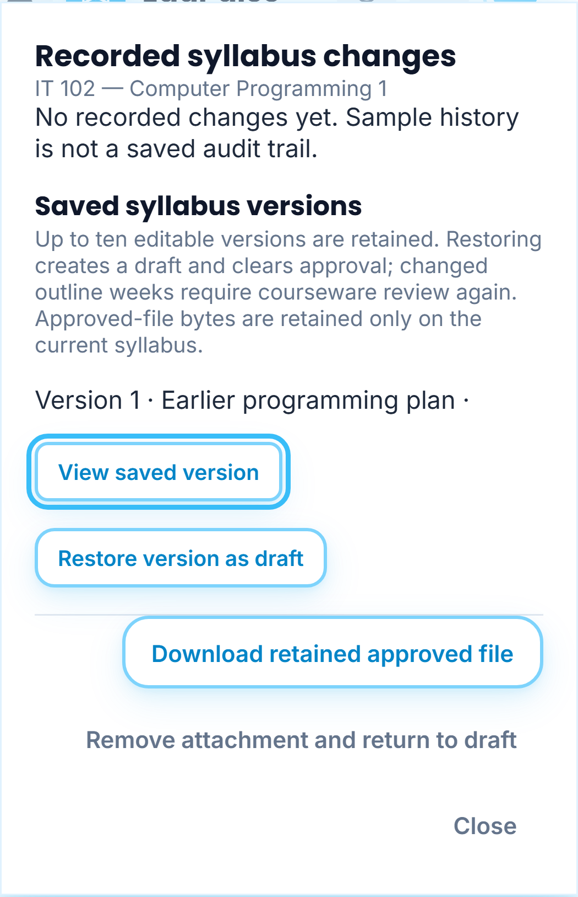

# 36 · Instructor dashboard and shared syllabi

**Who:** instructors · **Where:** Dashboard and Syllabus.

## Course-labelled block sections and recorded scores

Each **My Block Sections** card identifies a course and a block, with its enrolled-student count. The same block in two courses has two cards. **Student Monitoring** opens that course/block's assessment view; the URL retains the filters across reload.

**Score Snapshot** uses the latest marked attempt for each current published assessment version. Learners without marked work and responses awaiting marking are excluded from averages. The existing per-learner average remains; the assessment rows identify their course, percentage and marked-result count. A recorded zero is a real result. **Includes pipeline test** identifies controlled integration activity; it does not establish independent student completion. Accounts without marked results show **No marked scores yet**, without substitute scores.

## My Syllabus and one history control

My Syllabus retains Course, Instructor, Status, Next Step and row actions. The redundant Version and Outline columns and the Archive action are removed. **Version History** is the single history control; it includes recorded changes, saved editable versions, preview and restore. The offline approval and courseware review requirements remain.

## Delete a syllabus

Select the row's **Delete syllabus** button, read the confirmation and choose **Confirm delete**. This removes that syllabus and its authored courseware from the owner's workspace and withdraws its publications. Recorded assessment history and independent shared copies are retained. Cancel leaves everything in place; a failed save leaves the dialog open and preserves the records. Reload restores the confirmation reference, without replaying deletion.

## Share a saved copy

1. Select **Share syllabus** on an owned, saved syllabus. Finish any pending workspace save first.
2. Enter another registered instructor's email and choose **Share syllabus**. The recipient must be a confirmed, active instructor account.
3. **Shared Repository** lists only copies this instructor has sent, with their recipients and send dates. Use **View shared copy** to inspect the actual shared snapshot. **Remove share** requires confirmation and withdraws the received entry; independently saved drafts remain.

Sharing includes the syllabus fields and public bibliography/reference links. It excludes approved-file bytes, version history, private source copies and courseware. It grants no approval, publication, workspace access or right to the sender's retained books. Resending updates the received snapshot; a recipient's saved draft remains independent. A sender can retain at most 100 outgoing shares. Lists fail explicitly above 1,000 visible shares rather than silently omitting records.

The recipient receives the read-only entry under **My Syllabus → Shared with me**, labelled **Shared by** the sender. **Use as draft** explicitly saves an owned draft, keeping the sender label. The recipient reviews it and completes their own offline approval route. **Delete received syllabus** hides the incoming entry without deleting the sender's syllabus or an already saved draft. The recipient's Shared Repository continues to contain only their own outgoing shares.

**Refresh shared syllabi** explicitly reloads the list. Switching focus, timers and reconnects do not reload the page. Reader/history/share/delete dialogs restore bounded IDs against currently authorized data; unsaved email input and confirmation commands are not stored or replayed.

## Responsive tables

Shared academic tables and charts use the available container width. Native horizontal scrolling is conditional on real overflow; a short table has no reserved 420-pixel minimum width on a phone. Wide matrices and the multi-column outline retain scrolling when they need it. Grid children can shrink within the viewport. These shared styles apply to all roles without changing their access rights.

The screenshots use fictional accounts, sample scores and controlled account/workspace/sharing transport. Native SQL tests and a rolled-back hosted canary separately check persistence, safe snapshots, ownership, deletion and support attribution. The images do not prove a live sign-in, paid inference or student completion.

Phone component captures hide the movable companion so it does not obscure the documented controls. Unsaved uploaded-file previews remain temporary, viewable before selection, and are never added to navigation hints or saved by opening them.
