# 36 · Instructor dashboard and shared syllabi

**Who:** instructors · **Where:** Dashboard and Syllabus.

## Course-labelled block sections and recorded scores

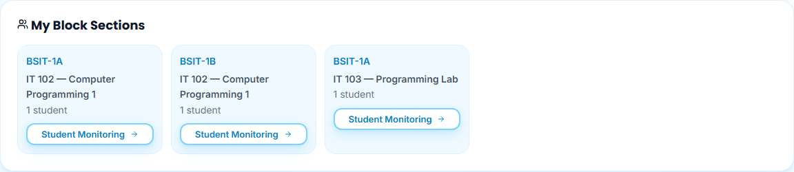

Each **My Block Sections** card identifies a course and a block, with its enrolled-student count. The same block in two courses has two cards. **Student Monitoring** opens that course/block's assessment view; the URL retains the filters across reload.

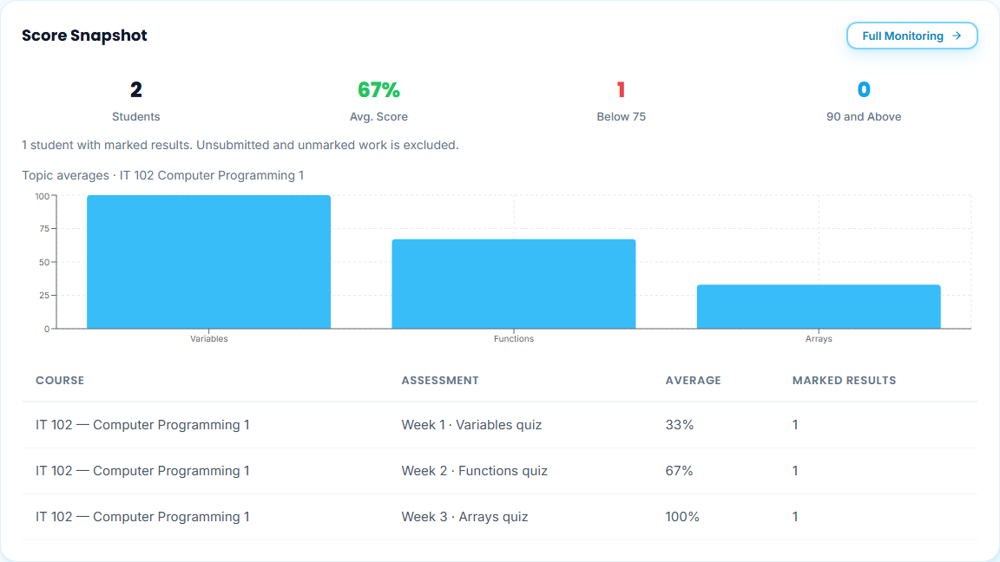

**Score Snapshot** uses the latest marked attempt for each current published assessment version. Learners without marked work and responses awaiting marking are excluded from averages. The existing per-learner average remains; the assessment rows identify their course, percentage and marked-result count. A recorded zero is a real result. **Includes pipeline test** identifies controlled integration activity; it does not establish independent student completion. Accounts without marked results show **No marked scores yet**, without substitute scores.

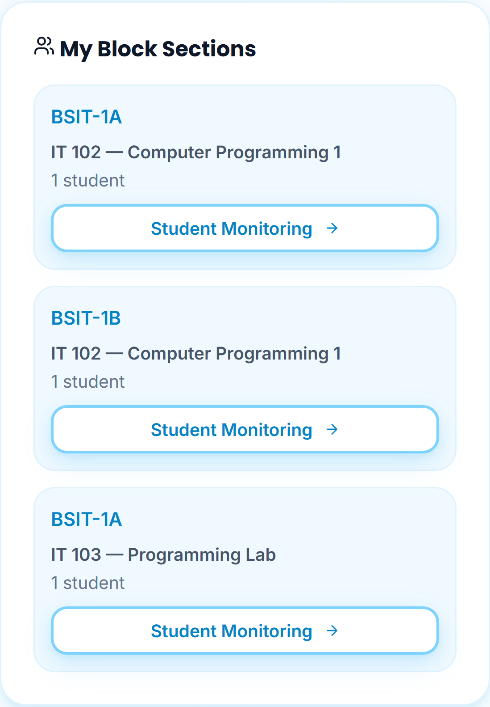
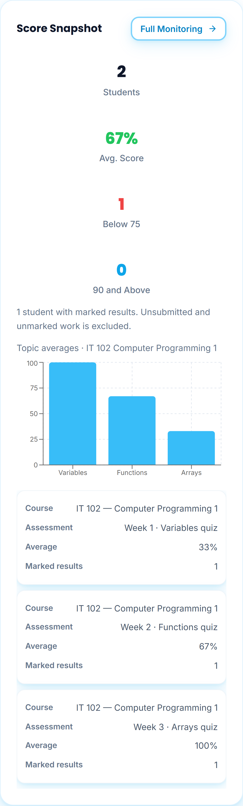

## My Syllabus actions

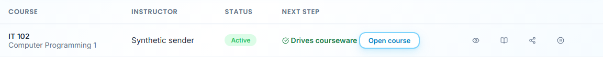
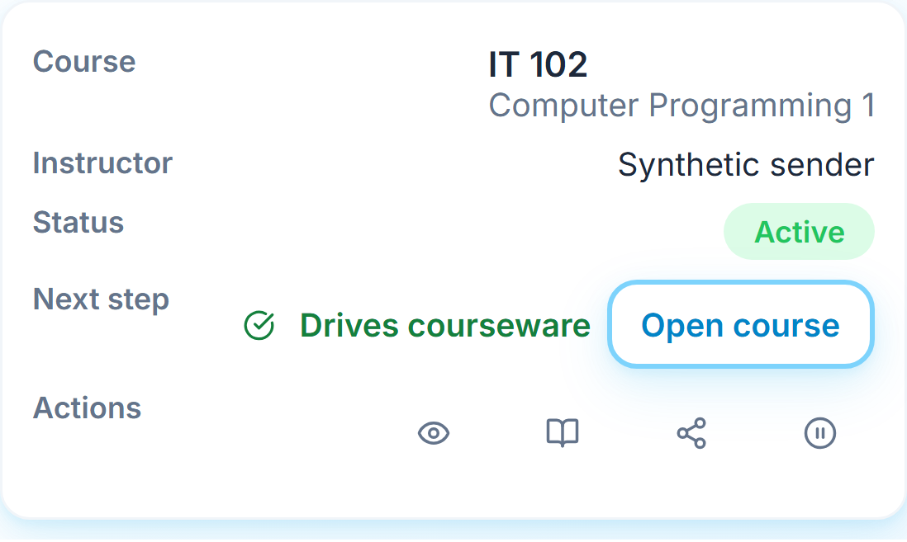

My Syllabus keeps Course, Instructor, Status and Next Step. **View Syllabus**, **Edit in Builder**, **Share syllabus** and **Suspend syllabus** are the row actions. Version History and Copy for next term are removed. Existing saved history is preserved internally; no history dialog or restore action remains. The syllabus reader retains **Download PDF** and **Download retained approved file** for an owned approved copy.

## Suspend before deletion

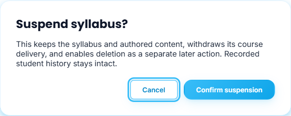
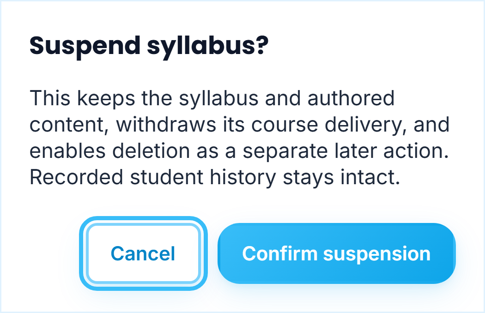

Choose **Suspend syllabus**, then **Confirm suspension**. The saved syllabus becomes Suspended, its course becomes inactive, and its published courseware is withdrawn. Authored content, approved-file bytes and recorded student history remain. **Resume syllabus** restores its previous syllabus station; courseware stays checked and needs explicit publication again.

Only after that saved suspension does the row show **Delete syllabus**. Read the separate confirmation and choose **Confirm delete**. Deletion removes the owned syllabus and authored courseware, while recorded assessment history and independent recipient copies remain. Cancel or a failed save keeps the data. The database rejects direct deletion before a prior saved suspension, including a combined suspend-and-delete payload.

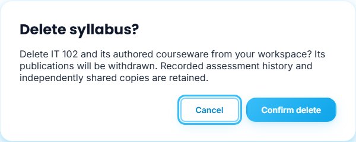
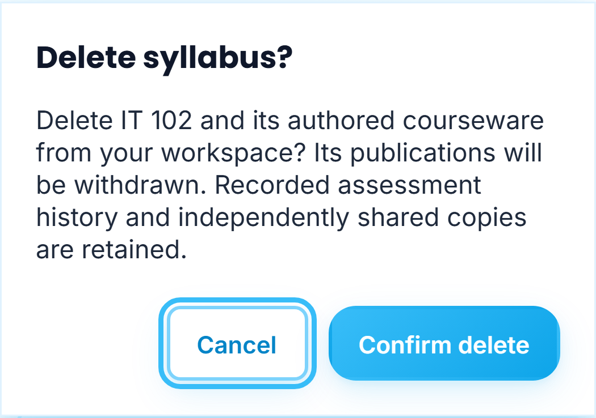

## Share with a registered instructor

1. Choose **Share syllabus** and wait for the registered instructor list to load.
2. Select **Instructor** from the dropdown, which shows the available account names and login addresses. Your own account and non-instructor, unconfirmed or disabled accounts are excluded. Selection is rechecked when sent. A failed directory load shows a retry action.
3. Choose **Share syllabus** after pending workspace changes finish saving. The recipient receives a read-only copy labelled with your name.

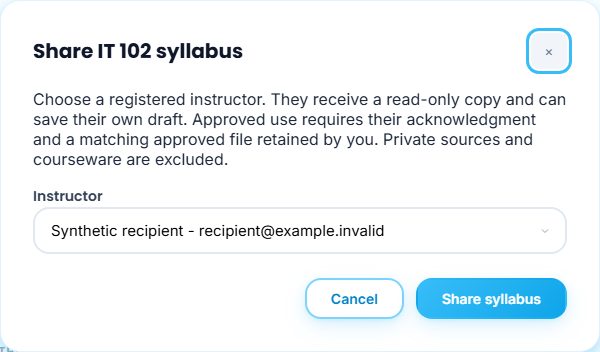
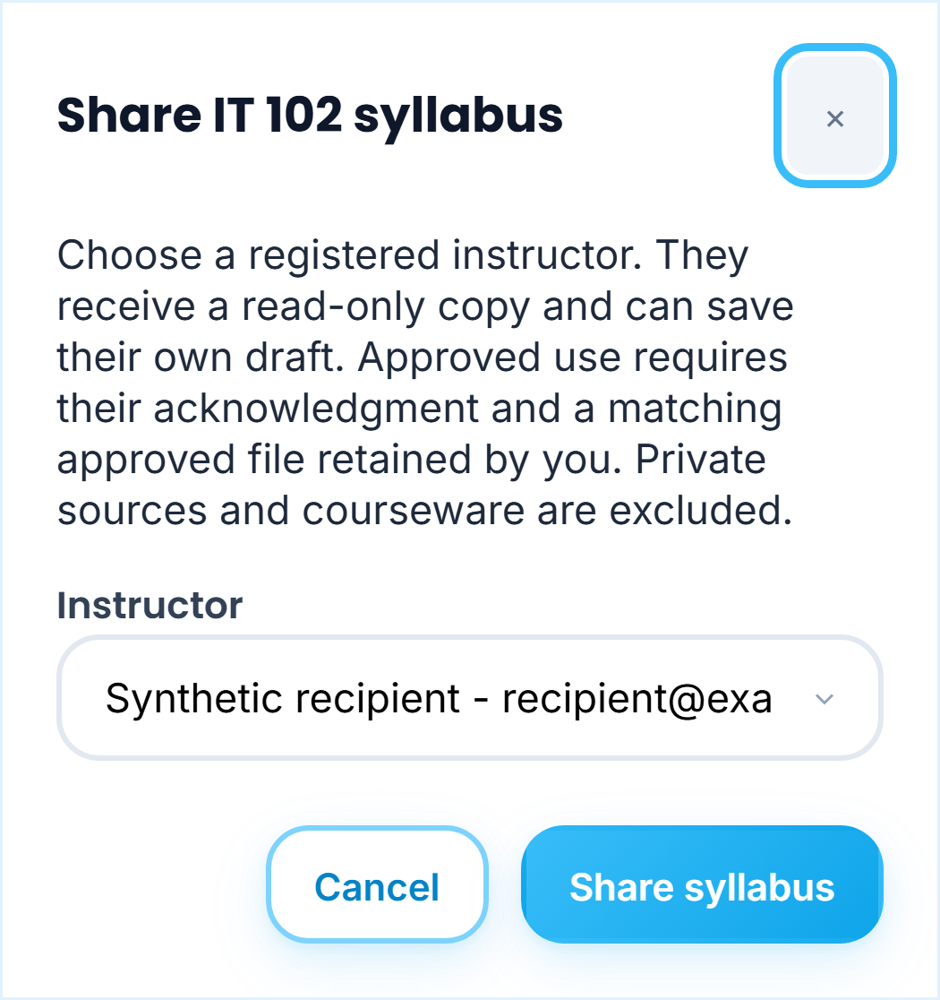

**Shared Repository** contains outgoing copies only. **View shared copy** opens the actual snapshot. **Suspend share** pauses adoption; **Resume share** re-enables it. **Delete share** is available only after saved suspension and requires a separate confirmation. Independent owned copies remain unchanged.

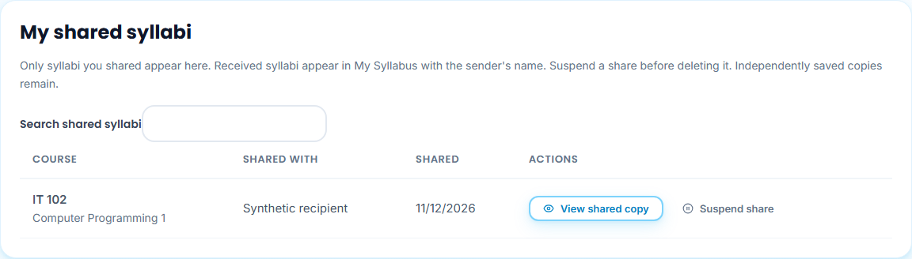
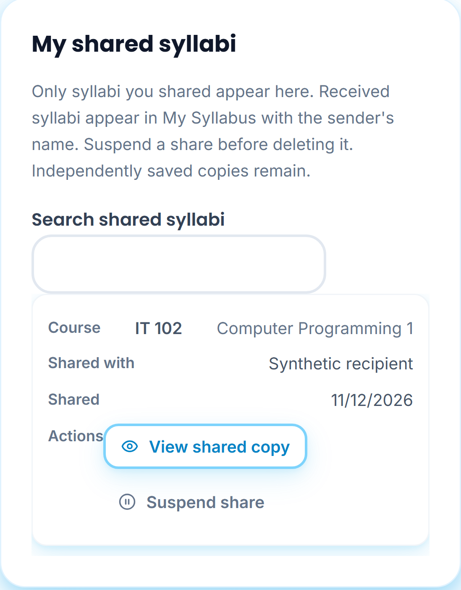

Sharing includes syllabus fields and public reference links, excluding private source copies, courseware, and history. The received read-only snapshot does not itself include approved-file bytes or grant access to the sender's workspace. There are at most 100 outgoing shares, 1,000 visible summaries and 500 available directory accounts; exceeding a capacity is an explicit error rather than a truncated success.

## Use a received syllabus

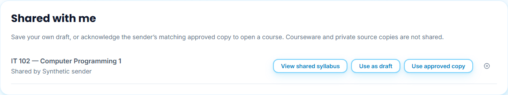
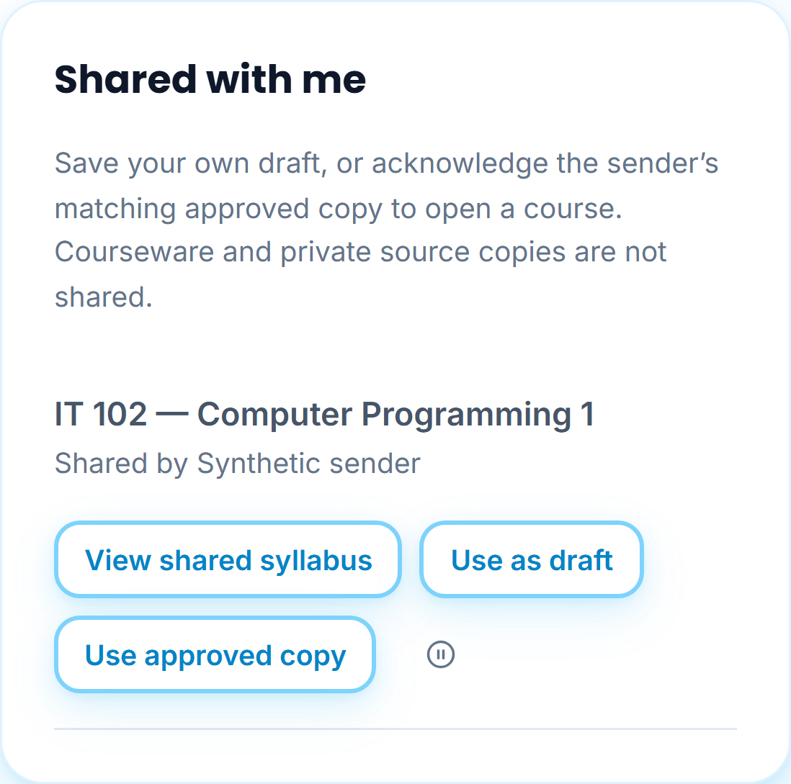

Under **My Syllabus > Shared with me**, **View shared syllabus** opens the received copy. **Use as draft** creates an owned Drafted syllabus with sender provenance and the original outline section relationships. It carries no approval; review and complete your own approval route.

**Use approved copy** opens a separate acknowledgment. Review the syllabus and confirm that the approved copy is authorized for your course and its offline approvals are complete. Choose **Acknowledge and open course**. The server requires an available share and a currently retained matching approved source file, checks its size/checksum and usable outline, then atomically saves an independent Active copy with that approved file. The course opens for content generation; publication and enrollment remain separate actions. EduPulse does not verify signatures or grant approval itself.

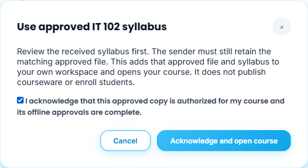
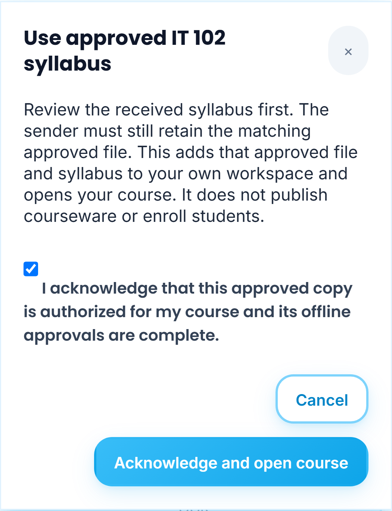

If the sender has changed the content, suspended it, removed the file, or has only a draft, approved use fails with a specific error. Ask for a fresh approved share or use the copy as a draft. Repeating the same adoption mode reuses its existing owned copy instead of duplicating it. Saving remains revision checked and bounded by the workspace size limit.

**Suspend received syllabus** pauses use of the received entry, then exposes **Delete received syllabus** as a later action. **Resume received syllabus** restores availability unless the sender has suspended the share. Removing a received entry does not delete the sender's work or an independently adopted copy.

**Refresh shared syllabi** is manual. Reader/share/suspend/delete/approved-use dialogs restore scoped IDs against currently authorized records after reload. Instructor selection and approval acknowledgment are not saved as navigation hints. Reload never repeats sharing, adoption, suspension, deletion or publication.

## Responsive tables

Shared academic tables and charts use the available container width. Native horizontal scrolling is conditional on real overflow; a short table has no reserved 420-pixel minimum width on a phone. Wide matrices and the multi-column outline retain scrolling when they need it. Grid children can shrink within the viewport. These shared styles apply to all roles without changing their access rights.

The screenshots use fictional accounts, sample scores and controlled account/workspace/sharing transport. Native SQL tests and a rolled-back hosted canary separately check persistence, safe snapshots, ownership, deletion and support attribution. The images do not prove a live sign-in, paid inference or student completion.

Phone component captures hide the movable companion so it does not obscure the documented controls. Unsaved uploaded-file previews remain temporary, viewable before selection, and are never added to navigation hints or saved by opening them.
