# 37 · Instructor student monitoring

Student Monitoring combines the instructor's former monitoring and Performance pages. Student and Dean performance views keep their existing permissions. The instructor navigation now has Dashboard, Syllabus, Course and Student Monitoring. Old instructor Performance links redirect to monitoring.

## Find a handled class

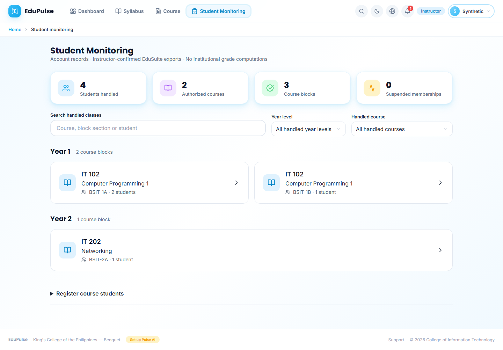

The student summary comes first, followed by **Search handled classes**, **Year level** and **Handled course**, then the year-level categories. Course cards name the course, title, block section and enrolled-student count. The same course in two blocks has two cards. Recorded block/curriculum year is preferred; otherwise consistent recorded student years are used. Missing or mixed year data stays explicit rather than being inferred from a block's spelling. Confirmed empty blocks remain visible.

Select a course/block to open its full-page class dialog. The three tabs are **Students**, **Assessment Scores** and **Learning Material Access**. Every tab uses the same icon summary-card component as Dashboard. Select a card to filter memberships, move to the corresponding chart/table, inspect delivery status, or open Course. **Available places** opens the existing registration area. Its URL preserves the selected class and tab across reload. A class that is no longer authorized cannot restore an old roster.

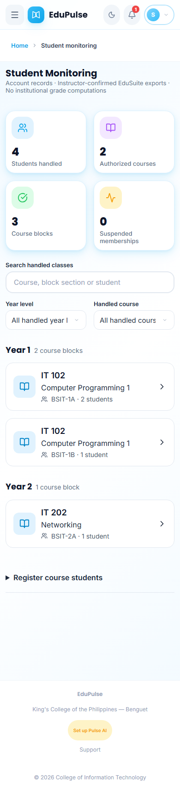

## Manage the selected course roster

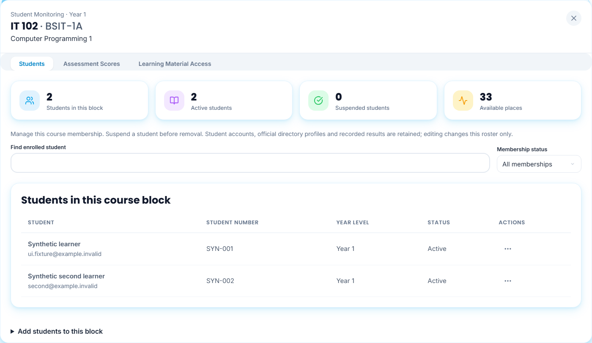

The table contains only students registered in the selected course block. Search by name, email or student number. **Membership status** filters active and suspended students. Open the three-dot **Actions for [student]** menu for **Edit**, **Suspend** or **Resume**, and **Remove**. Names stay in the student column, not repeated in long action buttons. Menus support arrow keys and Escape; closing one returns focus to its trigger. **Edit** changes this roster's name, student number, recorded year or block assignment; official directory profiles are unchanged. Moving a learner opens their new block through the handled-class cards. A block supports at most 35 students.

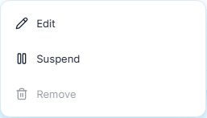
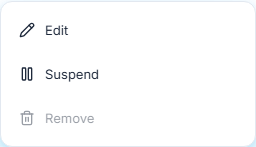

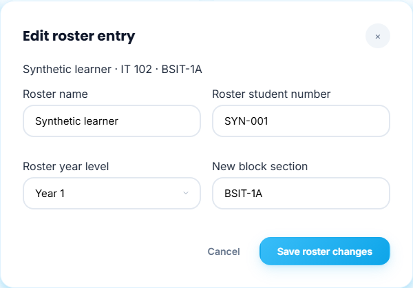

**Suspend** stops new access to that course's publications and assessments after the confirmed save. It retains the account and recorded work. **Resume** restores access subject to the course's approval/release rules. **Remove** is enabled only after suspension has been saved. The API/database also reject a removal that skips suspension. Confirm removal to remove that course membership; recorded attempts and reading history remain.

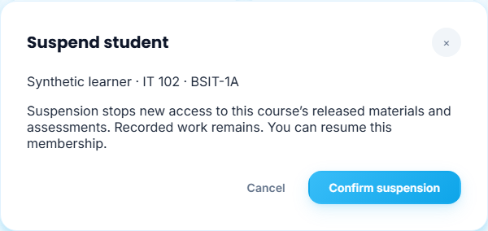

**Add students to this block** opens the official directory or the existing EduSuite file importer. Directory registration locks the selected course and block. The outer **Register course students** control can register another confirmed class. These actions create course memberships, not new authentication accounts. Failed saves retain the form and require an explicit retry; reload never confirms a pending change.

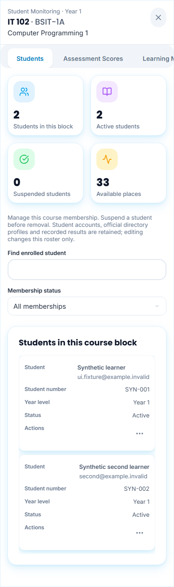

## Assessment Scores

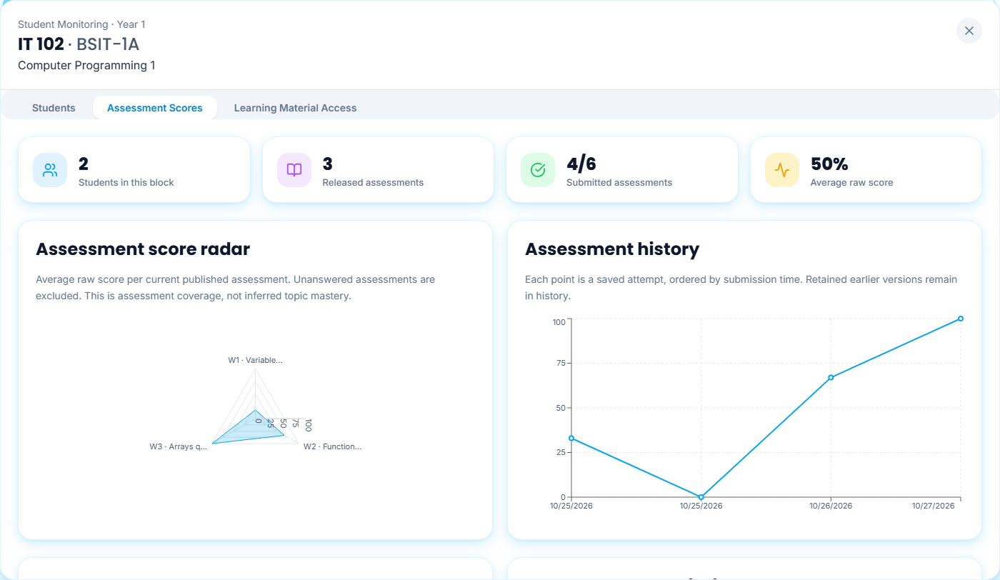

The summaries and charts use only this course block and student-recorded activity. Scripted/Admin exercises remain in the audit data and do not supply monitoring scores, opens or completion. The charts include: assessment score radar, saved attempt history, class average per assessment and submission rate. The radar needs at least three scored assessments; smaller datasets show a truthful explanation. Current-version marked results determine averages. A real zero stays zero; missing or unmarked work is not counted as zero. These are raw scores, not official grades.

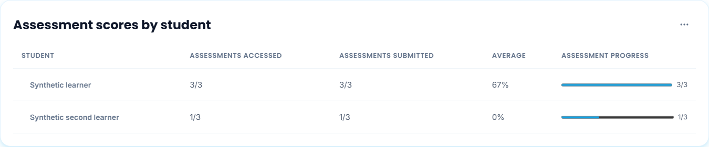

The student table shows accessed/started assessments, submitted assessments, the average and submission progress. Select a student to open the assessment breakdown, with each assessment's status, raw score, percentage and the final average at the end. Date filters constrain recorded events. Student search/progress filters constrain the list, while charts continue to describe the selected block. There is no activity-origin selector. Monitoring excludes scripted activity; audit fields and earlier records are retained. **Student result actions** contains **Download CSV**.

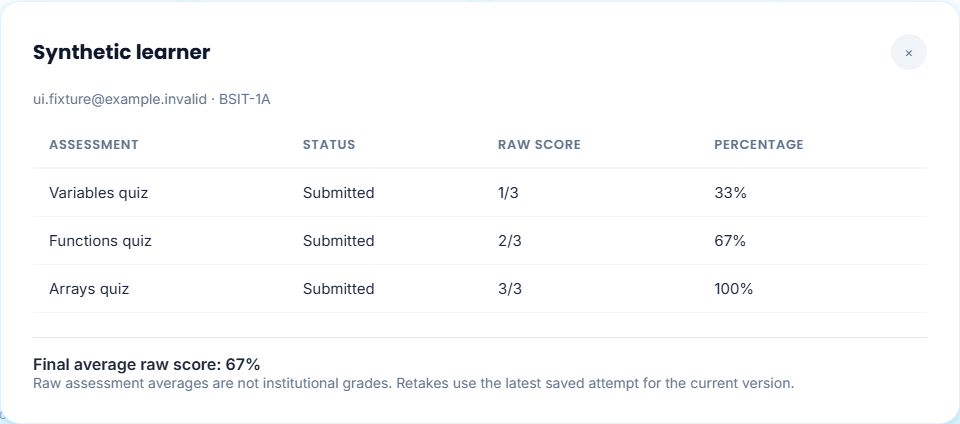

**Topic mastery and follow-up** retains mapped-topic radar/heatmaps, cutoff-based review, acknowledgments, attempt history/CSV, unanswered-assessment detail and explicit in-app reminders. Instructor marking remains available for saved written responses. The selected block is the denominator and participant list throughout; there are no unrelated “Not enrolled” rows.

## Learning Material Access

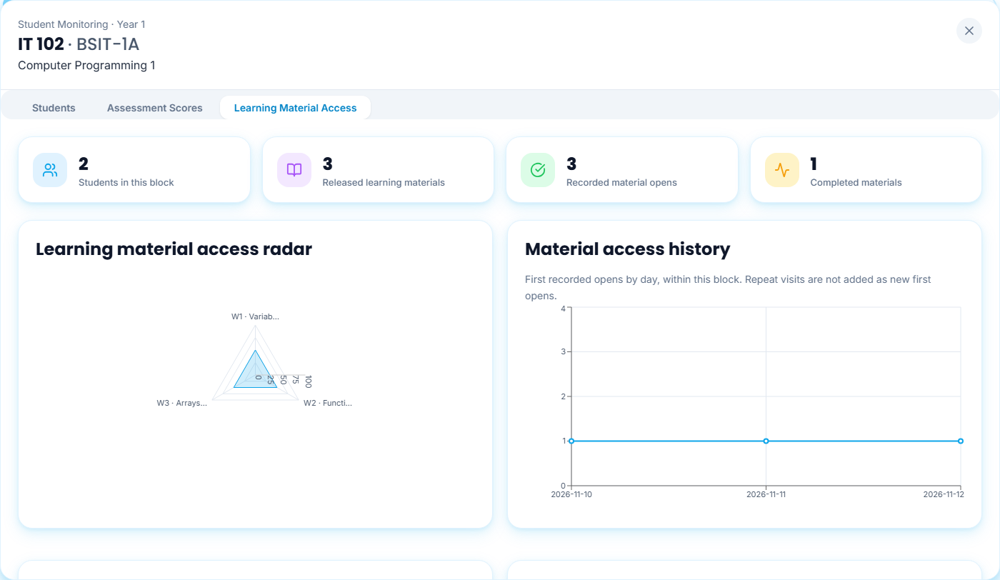

The tab includes material access radar, first-open history, class access per material and confirmed reading completion per material. The history graph counts saved first opens, not repeat visits. **Student reading progress** and the filtered table show accesses, completed materials and reading averages for enrolled block students only.

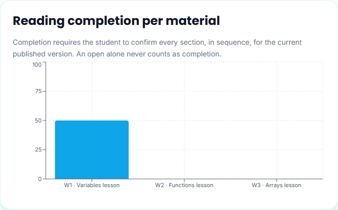
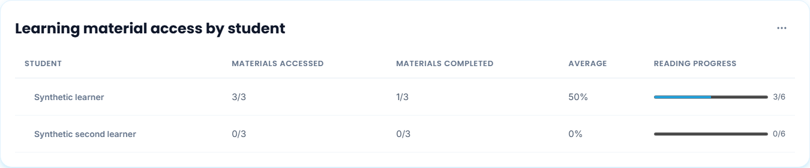

Select a student for their course materials and per-material section progress bars. The final reading average is confirmed sections divided by all released readable sections. An open alone is not completion.

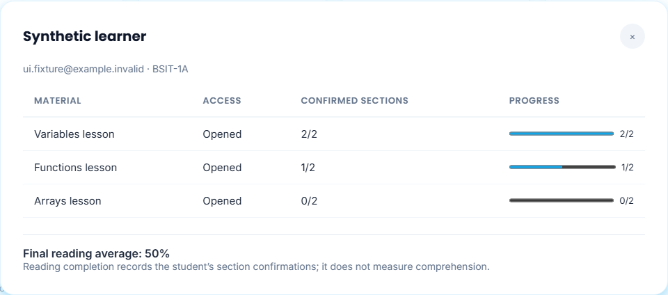

## Record actual reading progress

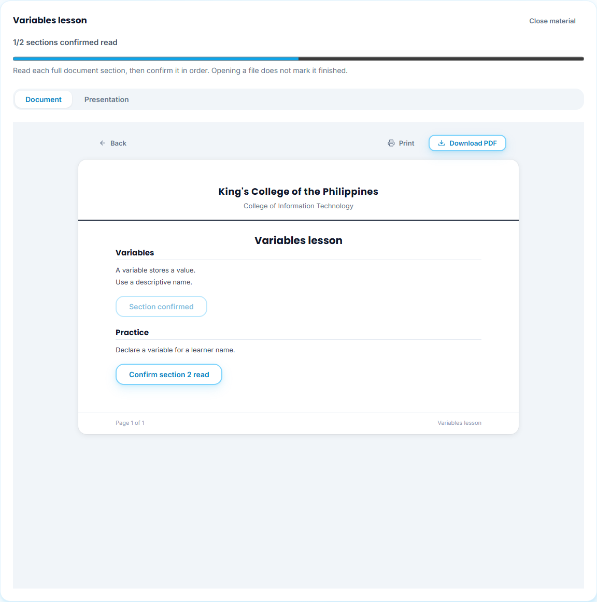

In the student's full **Document** reader, read each section and choose **Confirm section N read** in order. A later section cannot skip earlier sections. The server derives section totals from the currently published content and verifies the student's current enrollment/version. Duplicate confirmations are idempotent. A newly published version starts its own progress record; prior progress remains historical. Presentation mode points to the full Document view for confirmation.

The reader reports sections confirmed. This is the student's explicit reading acknowledgment, not a measurement of comprehension or time spent reading. A reload restores the reader and saved progress without recording another open or confirmation. Staff support previews cannot fabricate learner activity.

## Phone, keyboard and reload

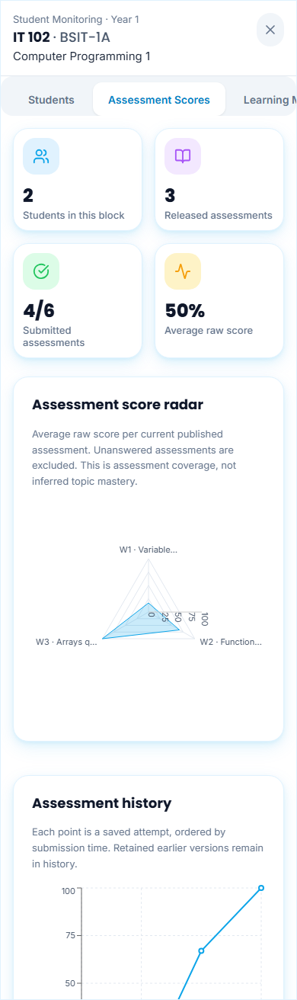
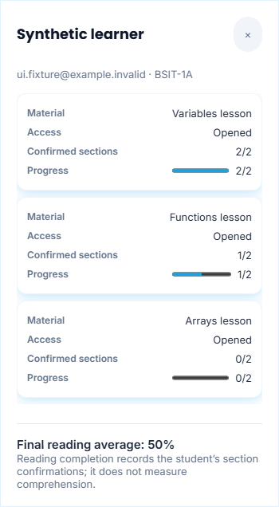

The class dialog fills the available phone width and scrolls internally, retaining space for Pulse. Table headings and CSV actions wrap into separate rows on narrow screens. Short tables use the available width; genuinely wide content keeps native overflow. Nested student/roster dialogs restore above the class dialog after reload, retain keyboard focus and close one level at a time. Stored navigation references contain only bounded class/student/action identifiers, not unsaved edits or replayable commands.

The images use fictional students and controlled account/workspace/academic transports. Database tests and a rolled-back hosted canary separately check persistence, ownership, suspension and progress. Captures are not evidence of live sign-in, independent student reading or real learner results.

Additional phone views retain the same scope and saved results:

| View | Capture |
| --- | --- |
| Student assessment rows | 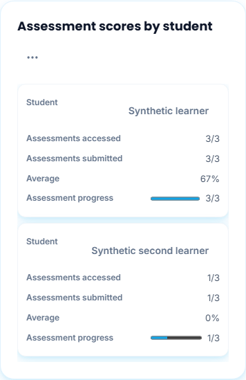 |
| Assessment breakdown | 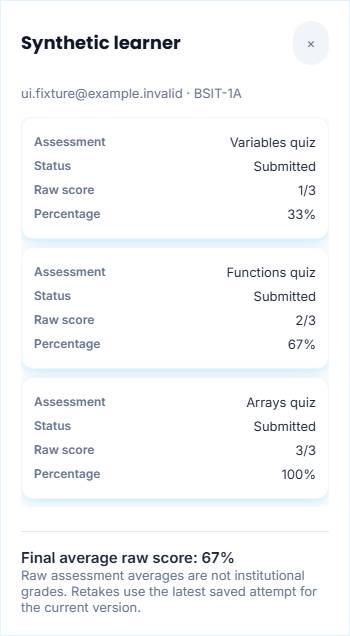 |
| Material summaries | 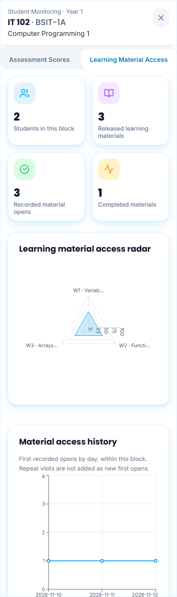 |
| Edit roster membership | 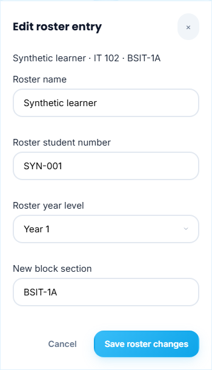 |
| Confirm suspension | 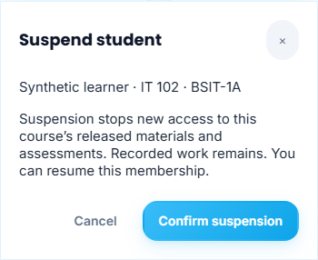 |
| Confirmed completion chart | 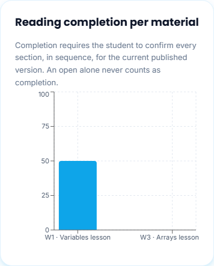 |
| Student material rows | 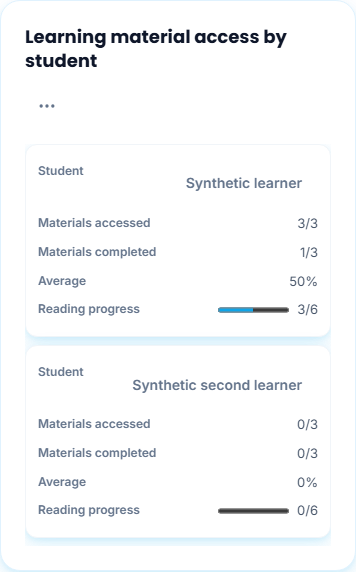 |
| Sequential student reader | 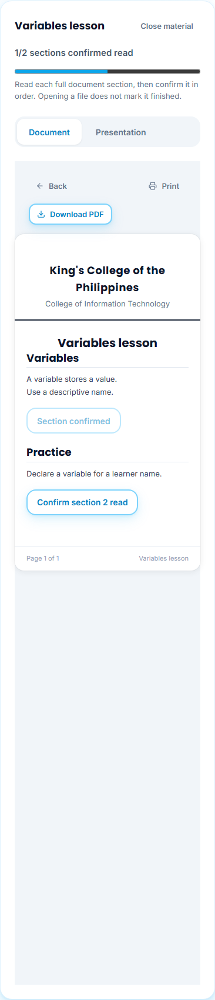 |

Phone component captures use the same 390-pixel width with a taller browser viewport to show complete charts, table rows and confirmation controls inside the actual scrolling dialog. Shorter devices scroll within that same layout.

## Bounded teaching assignments

Each named active instructor now has 5-10 saved course/block classes, rather than every block for every curriculum course. **Course blocks** counts those classes; **Students handled** counts distinct currently enrolled students across them. One student taking multiple handled courses counts once. Syllabi and recorded activity remain retained when an excess generated load is withdrawn.

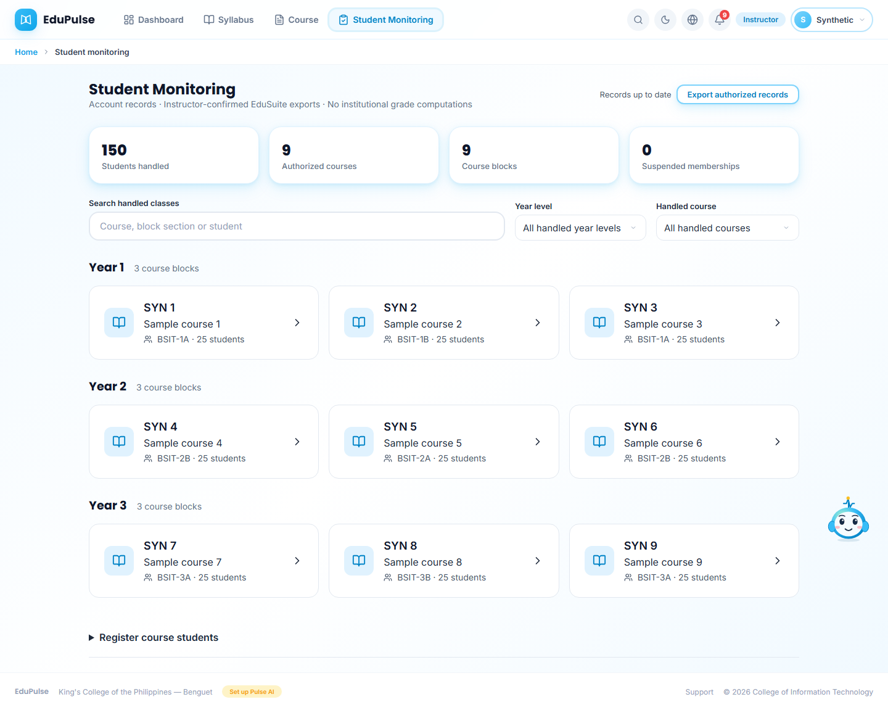
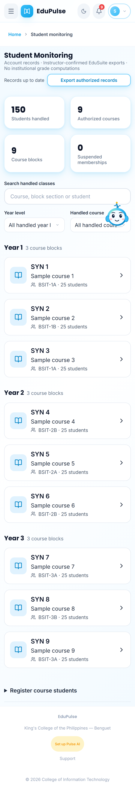

These captures use fictional accounts and controlled transports; they do not display the production students. The [live aggregate receipt](../../versions/2026-11-13-bounded-loads/evidence.json) separately records the saved allocation. Reload the current page or use **Refresh records** when updates are announced to load the saved assignments.

The owner later replaced the instructor class ceiling with a student-course cap and permitted additional instructor classes. **Course blocks** still counts actual saved classes, not a display slice. All student demonstrations retain Pipeline test provenance. See the [current student learning allocation](../41-student-learning/README.md#dashboard-and-performance); the preceding bounded-load examples document the earlier correction.

## When a course has no results

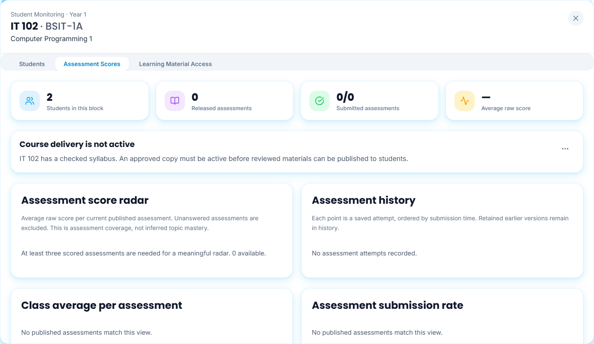
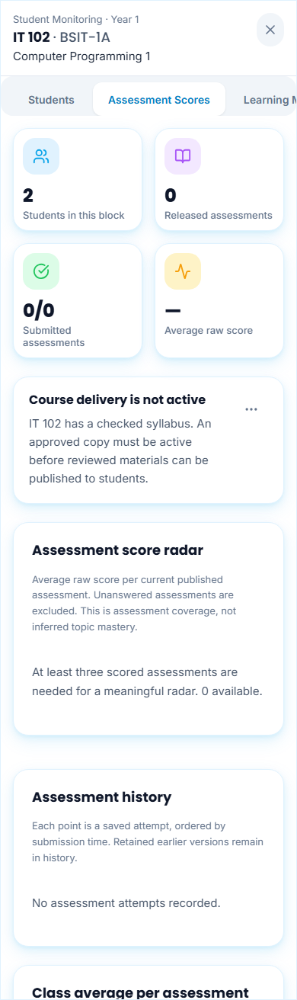

**Course delivery status** explains an inactive syllabus, missing released content, or the wait for actual student submissions/reading. Its three-dot menu offers **Review syllabus**, and **Open course** when the corresponding saved syllabus is available. Approval, publication and release dates remain explicit instructor controls. Neither opening this page nor selecting a summary card publishes content or records student activity.

A Checked syllabus is not yet an active approved release. Missing results remain unrecorded; zero is retained only for a genuinely marked zero score. **Assessment score radar** still needs three distinct scored current assessments. The system does not invent results to draw a chart. Date filters report when no saved events match those dates.

Class/tab, membership filters, pagination and an open action menu restore after reload using only account/support-subject-scoped references and current authorized records. Reload never replays Edit, Suspend, Remove, publication, reading confirmation or assessment submission. Live aggregate findings for the reported IT 104 class are recorded separately in [validation](../../versions/2026-11-13-monitoring-consistency/validation/results.md); these screenshots remain fictional UI fixtures.
