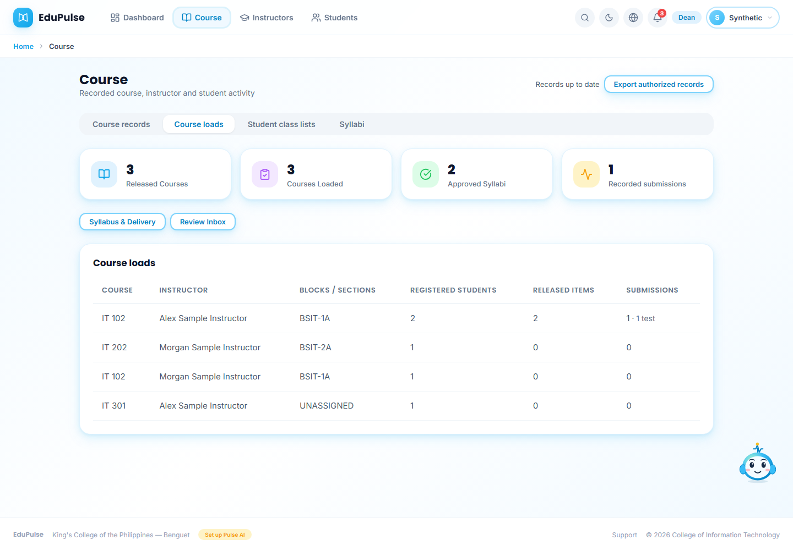
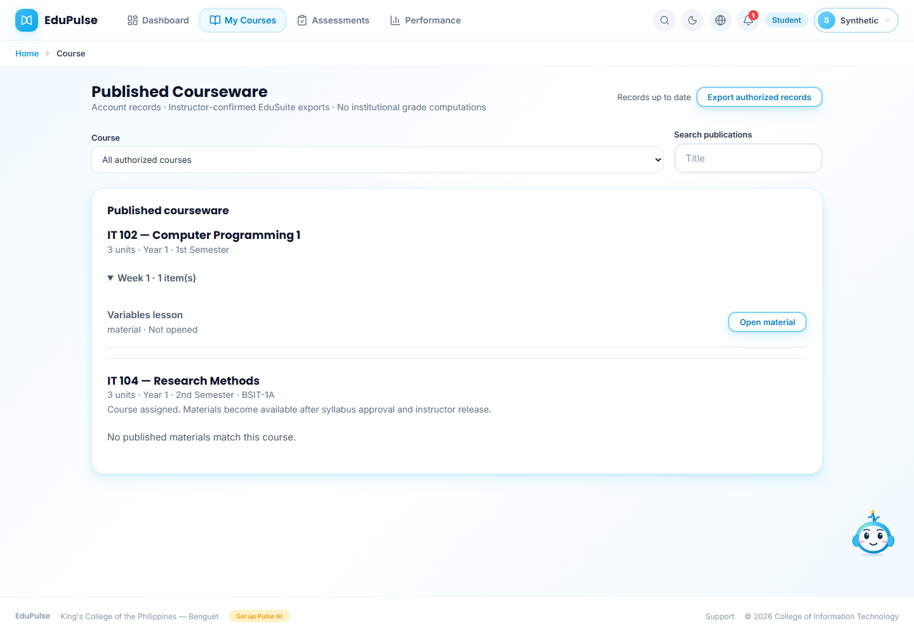
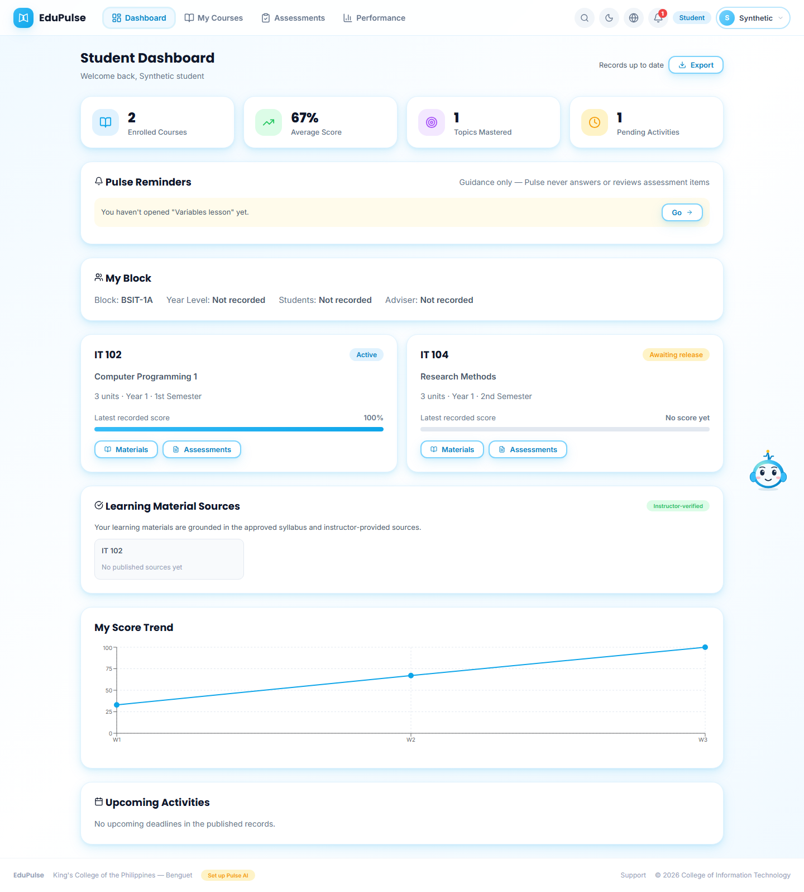

# 38 · Assigned courses, units and real activity

The owner initially authorized filling all recorded curriculum periods for active CIT students. On 13 November, the owner replaced the all-block expansion with 5-10 actual course/block assignments per named active instructor. The allocation uses the saved BSIT curriculum, including its two semesters and summer terms, with each student's recorded year. It is an owner-authorized administrative allocation, not a newly imported EduSuite export or a newly verified teaching qualification. Courses and units were not invented.

## Inspect the loads

In **Course → Course loads**, **Curriculum load** shows units, year and curriculum semester beside the instructor and assigned blocks. All-period allocations must not be interpreted as a single-semester workload. Missing syllabi remain **Drafted** and require the usual instructor check and offline signatories before activation. Existing approved files and saved courseware are retained.

Student activity counts are labelled **Student assessment attempts**. They count learner responses, not an instructor syllabus submission. Instructor syllabus approval continues outside EduPulse. Historical pipeline activity retains its provenance.

## Inspect the student course list

**My Courses** displays the student's assigned courses, curriculum units, year, period and block. Unreleased courses show **Course assigned. Materials become available after syllabus approval and instructor release.** Only assignment labels are exposed before approval: draft outlines, approved-file bytes and private teaching content stay protected. Suspended membership is explicit. These assignment labels never grant access to an unreleased material or assessment.

The images use fictional records. They demonstrate interface behavior rather than the hosted population totals. Live aggregate counts and read-boundary checks are recorded in the [release validation](../../versions/2026-11-12-curriculum-population/validation/results.md).

## Genuine performance evidence

Students must open their own published materials, explicitly confirm the sections they read, and answer assessments under their own authenticated accounts. An administrator viewing an account does not create that learner's activity. Staff support is read-only for learner actions. Missing results stay missing; artificial answers, opens and scores must not be reported as genuine student activity.

The allocation command defaults to a private dry run and supports rollback validation. It preserves original workspace backups outside Git, uses existing revision-checked save/import RPCs, and records the owner actor. Legacy `-TEST` block assignment overrides are reconciled to the owner-authorized blocks without relabelling historical activity or overriding saved suspension/exclusion decisions.

## Student dashboard consistency

**Enrolled Courses** includes both active courses and pending assignments. Course cards show curriculum units/year/period and distinguish **Active**, **Awaiting release** and **Suspended**. A pending course has no invented score. **My Block** uses recorded membership/year metadata; missing adviser or class size stays explicit.

## Next: prepared teaching drafts

The owner then requested direct authoring before provider-dependent generation. [Manual 39](../39-authored-weeks/README.md) explains the original Weeks 1–5 packs and review disclosures. Preparing drafts does not activate a syllabus, publish material or generate learner activity.

The current allocation has 64 teaching classes and 1,962 memberships across all 417 students. Every student retains at least one approved course; unassigned curriculum classes are not invented to fill counts. [Current workload validation](../../versions/2026-11-13-bounded-loads/validation/results.md) supersedes the initial 239-load population totals. The original all-block command refuses to overwrite this bounded allocation.

## Later student-course correction

The owner subsequently relaxed the instructor class ceiling in favour of at most ten subjects per student. Years 1-3 have ten recorded subjects each; Year 4 has the five subjects in the recorded curriculum. Existing approved instructor/block ownership and the class-size limit are preserved. This supersedes the earlier 64-class allocation. [Current learning guide](../41-student-learning/README.md) and [validation](../../versions/2026-11-13-student-learning/validation/results.md) describe the implemented state.
