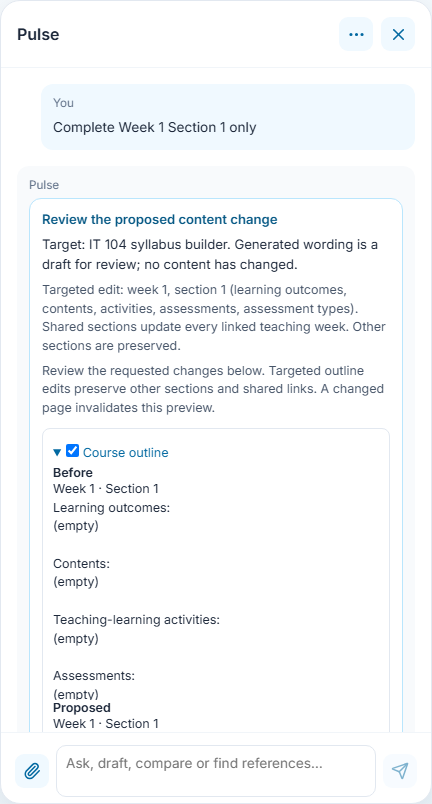
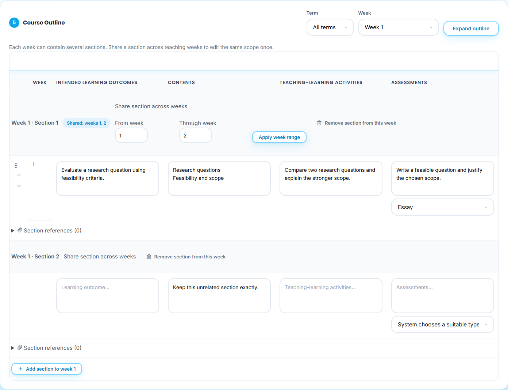
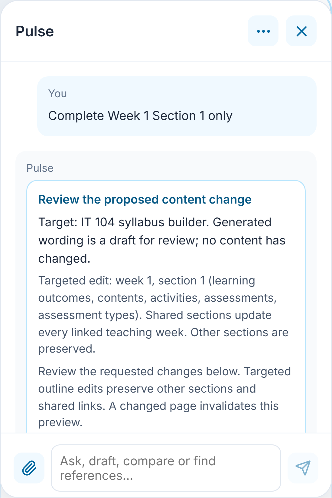
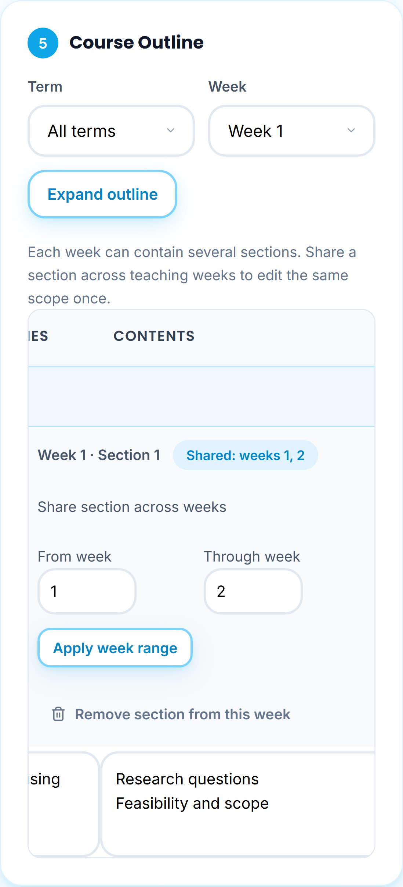

# Targeted outline edits with Pulse

**Who:** an authorized instructor. **Where:** **Syllabus Builder → Course Outline**.

## Direct draft editing

Choose the course in **Syllabus Builder**, then ask **Generate Week 1 of the course outline** or **Complete Week 1 Section 1 only**. Pulse prepares and validates educational wording and places it directly in the matching editable form fields. The requested scope keeps unrelated weeks, existing section IDs, links between shared sections, and examination weeks unchanged. AI output is still a draft, not a checked or approved syllabus.

A success response says **Updated [course] syllabus outline in the open form** and explains that the change is **not yet saved**. Review the fields and choose **Save as Drafted**. The same draft remains mounted in **Syllabus Builder** after saving, rather than returning automatically to My Syllabus. The address includes the draft identifier for reopening after navigation or refresh. Authorization is checked using the account's current workspace.

Say **can you provide Week 2 then**, **complete the next week**, or **generate all weeks**. Pulse keeps the selected course and latest completed week in the conversation and interprets these as follow-ups to the outline task; **all weeks** fills remaining missing teaching weeks rather than replacing content already completed. Examination weeks remain protected. Suggested follow-up controls include the next teaching week, remaining weeks and review.

When the editor is no longer open, Pulse offers **Open editable syllabus** for an existing authorized record. A saved draft must be reopened in **Syllabus Builder**, not merely read in **My Syllabus**, before an AI form edit. Multiple drafts must be identified by their course/context; an unrelated or unauthorized syllabus is never chosen from the global database.

## Preserved review-only workflows

File imports, courseware edits and other mutation cards retain their own confirmation rules. A stale form, a missing selected course, invalid model output, forged identifiers or conflicting shared content is rejected instead of applied. Applying educational text to a form is distinct from persisting a draft; no model request marks it Checked, downloads the approval artifact, uploads a signature or activates courseware.

The older capture sequence below documents the **previous confirmation-card workflow**, including **Apply to open form** and **Confirm and save draft**, and is retained only as historical provenance until the affected current UI scenes are recaptured. It must not be used as evidence of the new direct-application flow.

**Verification outstanding:** run the targeted Pulse/Builder browser captures, inspect generated images, run `npm run docs:check`, `npm run verify` and `npm run test:browser` before merging. Existing image assets are not recaptures of this branch.
