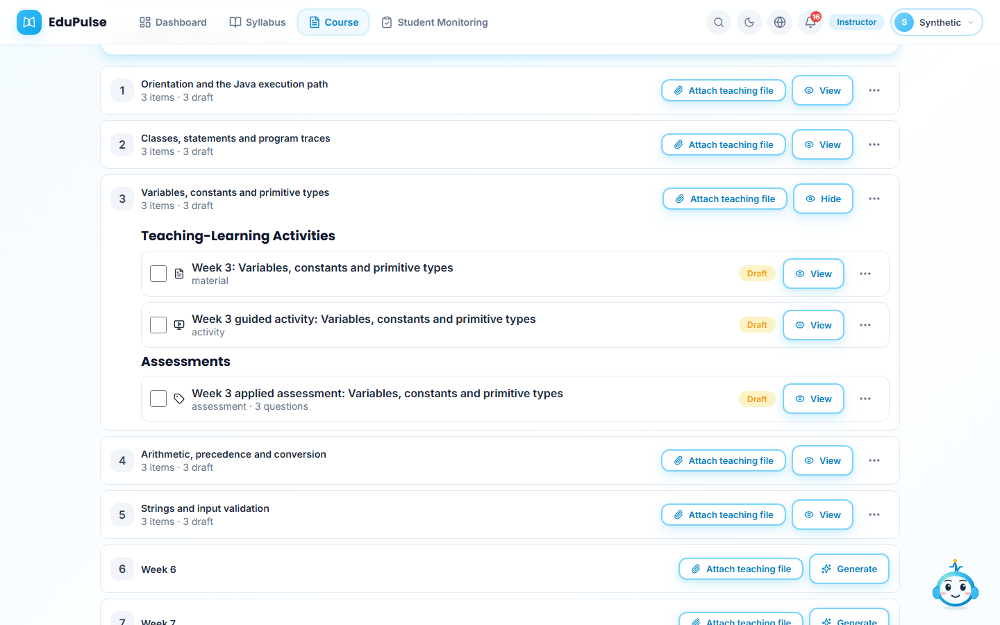
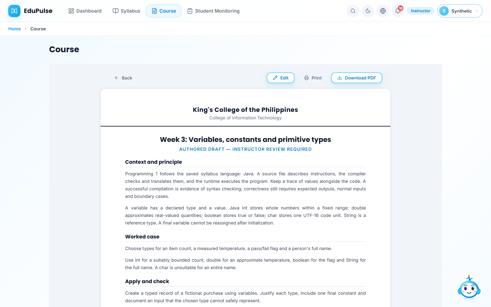
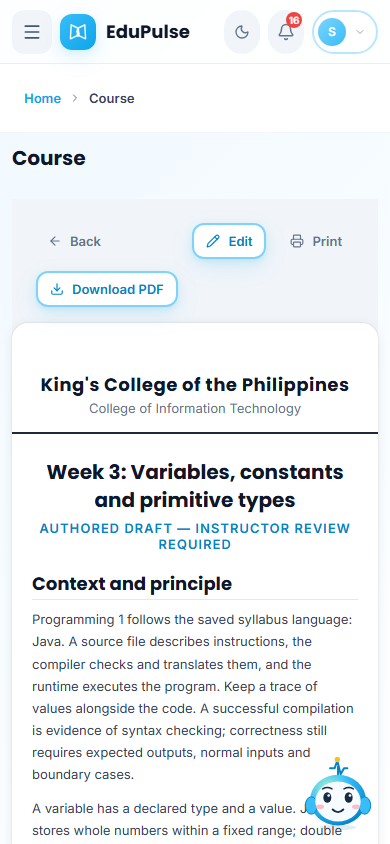
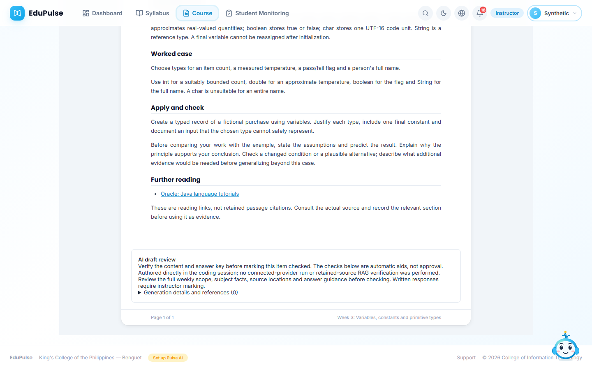
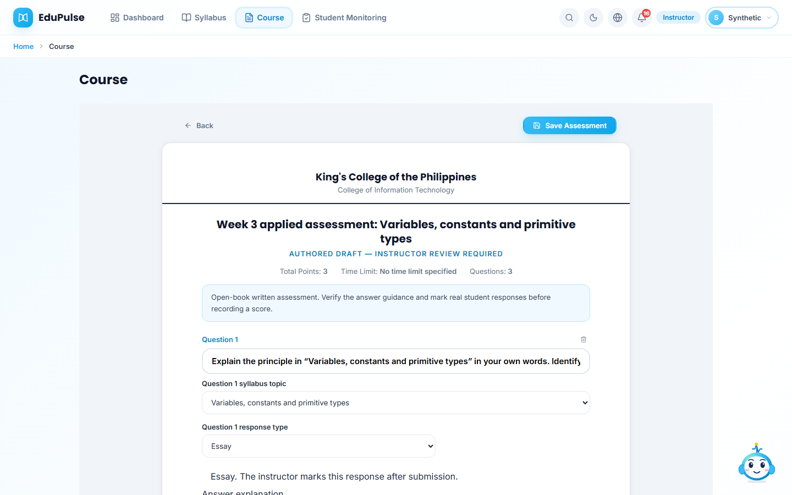

# 39 · Authored Weeks 1–5 drafts

The owner asked Codex to author the content directly before continuing delivery. The catalogue contains five original teaching packs for each of the 60 recorded curriculum courses. Each pack has a teaching document, guided activity and three instructor-marked assessment items. Duplicate instructor offerings use their own workspace/item IDs.

## Inspect a saved draft

Open **Course**, select an active approved course and expand a week. The two groups remain **Teaching-Learning Activities** and **Assessments**. New items are **Draft**, not checked or published.

Choose **View** on a material. The document explains a principle, works through a case and provides an application task. Java programming content follows the saved Java outline, rather than the older C demonstration catalogue.

At **AI draft review**, the disclosure says the content was authored directly in the coding session. No connected-provider inference, retrieved passage coverage or factual-support percentage is claimed. Reading links are further reading, not retained searchable copies. The instructor must check the full weekly scope, facts, source locations and answer guidance before marking an item checked.

The assessment combines explained reasoning with documented application. **Essay** and the combined **Follow-along / Step-by-step documentation guide or criteria** formats require instructor marking. The explanations are draft marking guidance, not recorded learner scores.

These images use fictional identities and controlled transport with the actual authored text. They do not establish hosted approval, publication or learner participation. Reload checks restore the reader without generating or recording an open/answer.

## Courses awaiting approval

Only genuinely blank Weeks 1–5 in **Drafted** syllabi are filled. Existing approved outlines, attachments, manual content, checked/published history, membership decisions and later weeks remain intact. An idempotent rerun adds nothing for a week/type that already has content. Multi-section weeks require an explicit mapping instead of flattening sections.

Draft syllabi retain the normal offline approval path. Their saved packs do not unlock student access; the normal Course reader becomes available through the approved/active lifecycle. The [review catalogue](../../session-generated/2026-11-12-authored-weeks/README.md) provides the complete original teaching/marking text for pre-approval review.

The recorded foreign-language course has no selected language. Its Japanese starter track is a proposal for instructor confirmation. Elective 2 similarly proposes a quality-engineering track because no approved specialization is recorded. Neither proposal is represented as approved curriculum content.

No student opens, reading confirmations, responses, scores, service hours, practicum hours, signatures or approvals are created. Publication and actual learner participation remain separate work after instructor review.

The owner's subsequent [teaching-set and demonstration request](../40-teaching-sets/README.md) releases selected existing approved courses and adds explicitly labelled Pipeline test activity. That later operation does not change this authoring command's draft-only behavior or grant approval to the remaining syllabi.
