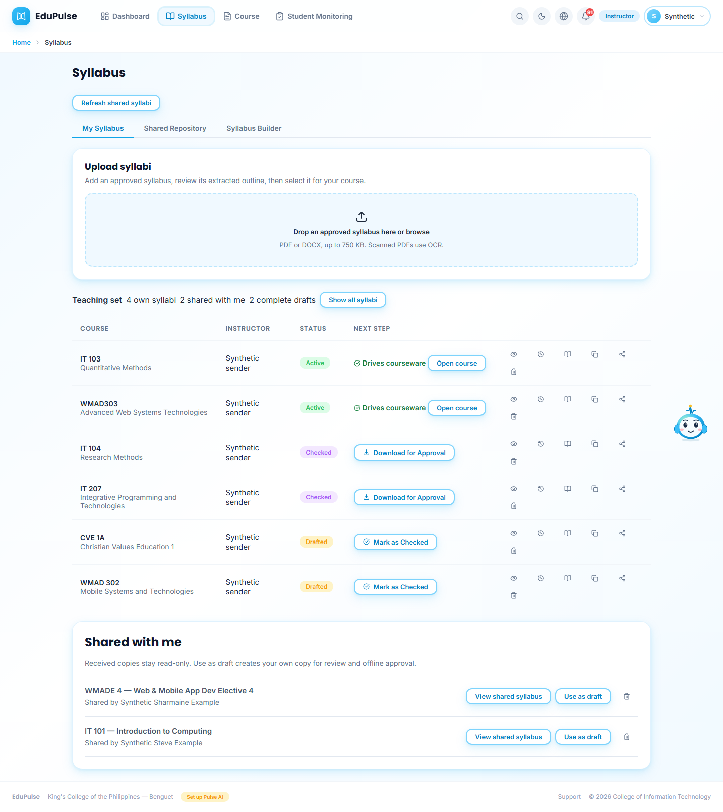
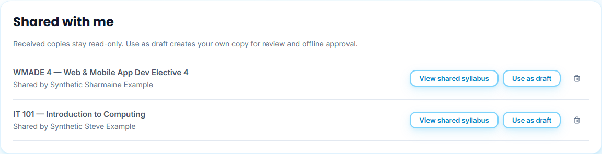
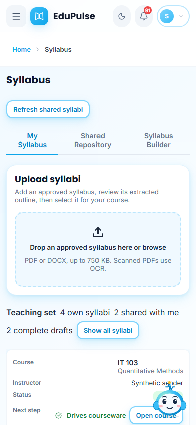
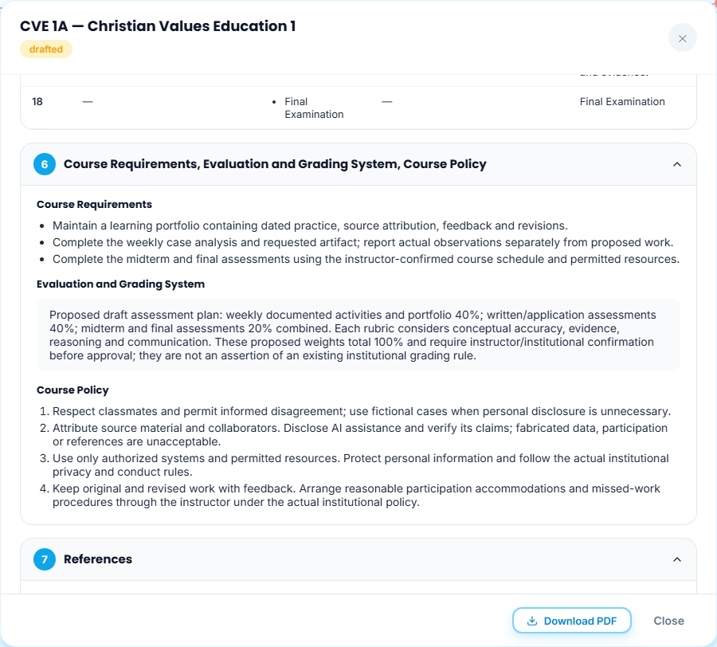
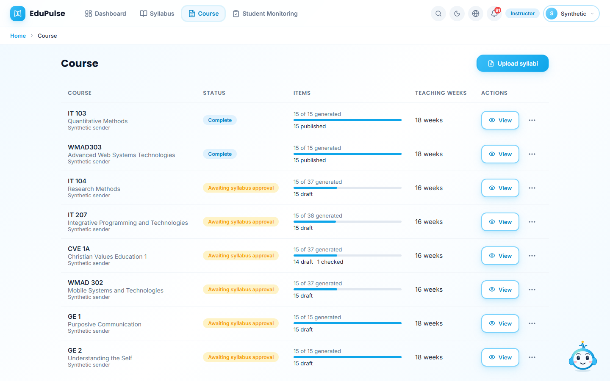
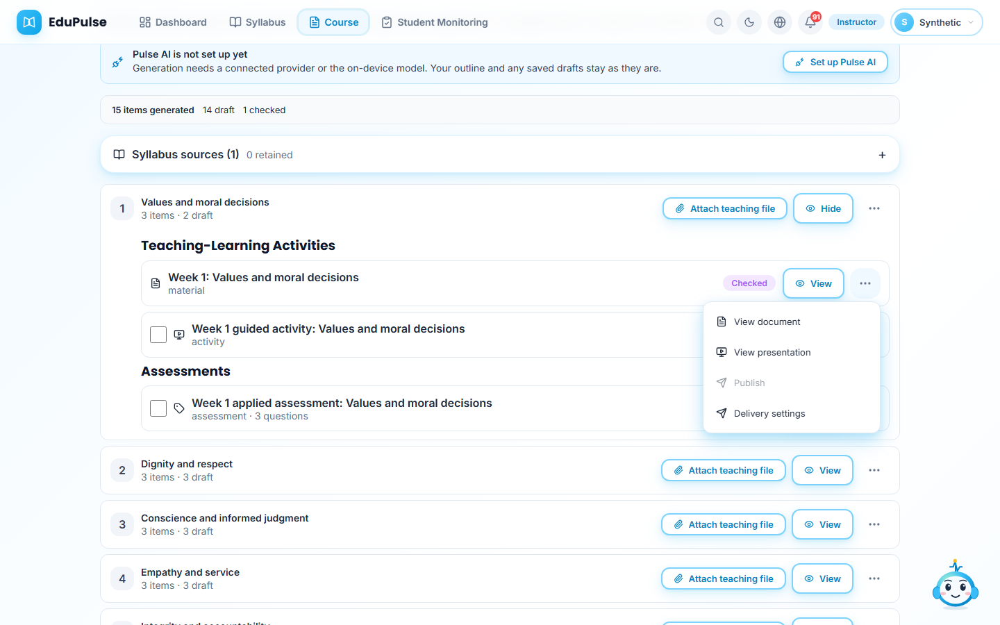
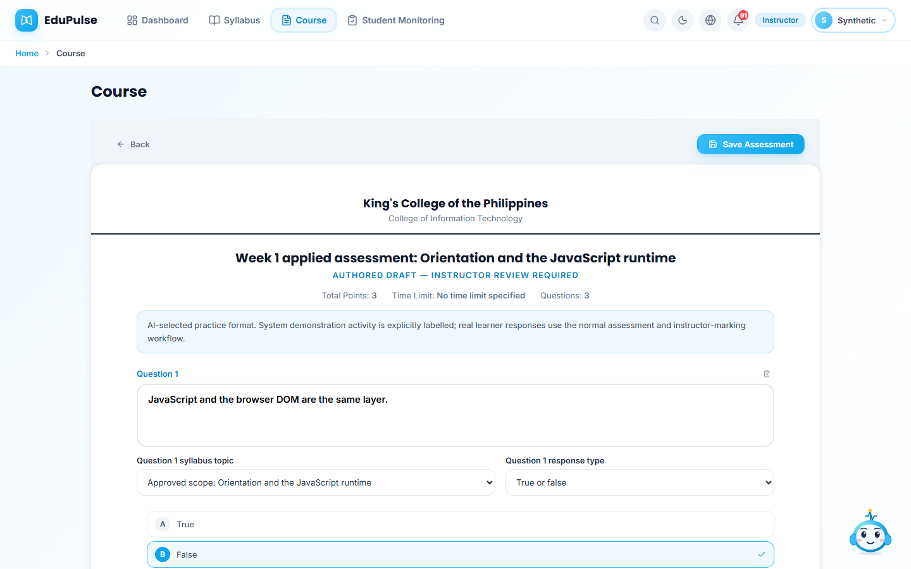

# 40 · Instructor teaching sets and labelled delivery

Each instructor's primary **My Syllabus** view shows four owned syllabus entries, two complete drafts and two received entries under **Shared with me**. Received copies identify the actual sender and remain read-only. **Show all syllabi** retains access to other assigned syllabi; no existing assignment is deleted to force the count to eight. **Show teaching set** returns to the primary selection. The selected list and authorized readers survive reload without repeating a share or save.

The two selected drafts have all eighteen proposed outline slots, requirements, policies, grading proposal and identified readings. Their application-template examination slots are Weeks 9 and 18. Instructors reconcile the calendar, proposed policies/weights and course-specific pacing with actual institutional requirements before approval. Proposed grading weights are explicitly labelled proposals; no signature, human approval or official grading policy is invented.

## Review prepared courseware

**Course** now includes owned nonarchived syllabi with prepared content even before activation. They display **Awaiting syllabus approval**. Open their weekly items to review or revise; **Publish** stays disabled until the actual approved syllabus is activated. The database retains the same active-approval and prior-checked-content safeguards.

The four own entries include existing approved courses and complete Checked syllabi where offline approval is still pending. The two complete draft entries remain Drafted. Sharing supplies a syllabus reference, not ownership of the sender's courseware, private source copies or approval attachment.

## Released examples and untouched assessments

The owner authorized a course-delivery demonstration on existing enrolled accounts. Codex reviewed and released the first five weeks for sixteen already-approved instructor offerings. Fifteen have recorded enrolled classes; one retained elective belongs to an instructor with no current block for that offering. Preserve the confirmed allocation rather than duplicating learners across owners to populate its chart.

The AI-authored practice set contains all seven supported formats across actual saved assessments: Multiple choice, True or false, Enumeration, Identification, Essay, Matching type and the combined Follow-along / Step-by-step documentation guide or criteria. Formats follow the authored task: fixed factual checks use objective types, reasoning uses Essay, and documented application uses the combined type. These are direct coding-session choices, not a claim of a connected provider run.

Three actual registered members of each enrolled course/block exercise the Weeks 1–3 pipeline. Activity remains visibly **Pipeline test**. Scripted complete/incomplete responses produce server scores; written responses use the normal instructor review operation. Materials have full, partial and first-section confirmation examples. A scripted confirmation is integration evidence, not proof that a person read or learned the content. Actual timestamps are retained; historical dates are not fabricated to decorate a chart.

Weeks 4–5 assessments are released but have no demonstration starts or responses. Their material-access records are untouched too. Other registered students remain available for manual testing. In **Student Monitoring**, choose a course/block and use **All recorded activity** or **Pipeline tests only** to see the demonstration; **Student activity only** excludes it. Radar graphs still require three distinct scored assessments and use only actual recorded values.

Screenshots use fictional identities and controlled transports with original teaching text. Hosted counts, readback, role boundaries and untouched-week assertions are recorded separately in the [release validation](../../versions/2026-11-12-teaching-sets/validation/results.md).
