# 41 - Student courses, practice and Admin demonstrations

These screenshots use fictional student records, controlled provider/API responses and the production interface. Hosted database checks and saved aggregate records are reported separately. No image proves independent student achievement or paid inference.

## Open an enrolled course

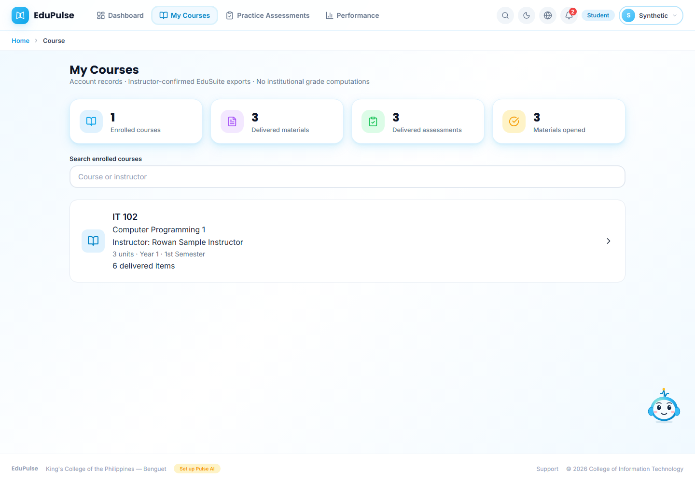

**My Courses** starts with **Enrolled courses**, **Delivered materials**, **Delivered assessments** and **Materials opened**. **Search enrolled courses** matches course code, title or handling instructor. Cards show the course, instructor, recorded units/year/semester and delivery status. Only current authorized assignments appear; pending assignments do not expose draft files.

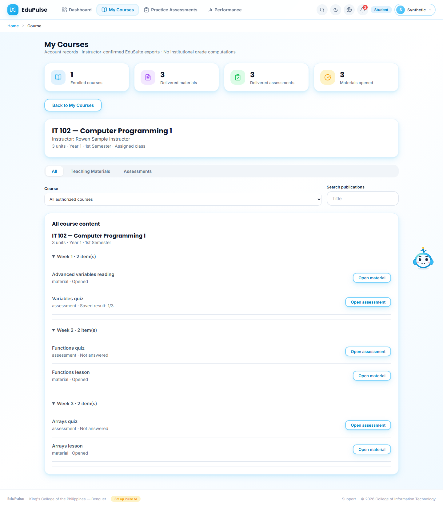

Select a course card. The course header identifies its instructor. The **All**, **Teaching Materials** and **Assessments** tabs filter a single weekly list. **All** includes both materials and assessments. The selected tab restores from the URL. **Open material** and **Open assessment** open a separate page-sized dialog above the list. **Back to My Courses** returns to the cards. The selected authorized course restores after reload; course selection never records an open or starts an attempt.

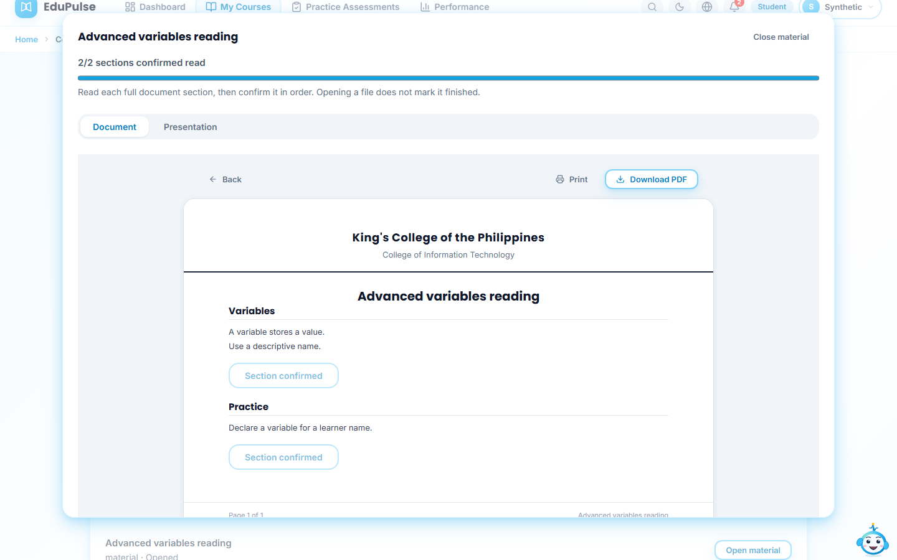

Materials become readable in the separate dialog immediately while the explicit first-open record saves. Close using **Close material**, **Back**, or Escape to return to the same course/tab. A recording failure is shown without replacing the readable document with a pending screen. **Document** and **Presentation** remain available. Confirm reading sections in order using their confirmation buttons; an open alone never marks a document finished. Reload restores the reader without replaying opens or confirmations.

Instructor assessments display every question together in one scrollable dialog, with no numbered question navigator or Previous/Next question buttons. Duration, deadline, supported response formats, saved results, allowed retakes and instructor marking remain. Answer all questions, then use **Confirm and submit responses**. **Close assessment** or Escape returns to the list. Reload restores the authorized dialog and reads any existing server session without starting another attempt; unsaved answers do not restore. Written responses can remain **Awaiting marking**; missing marks cannot become zero. These are recorded raw scores, not institutional grades.

## Practice Assessments

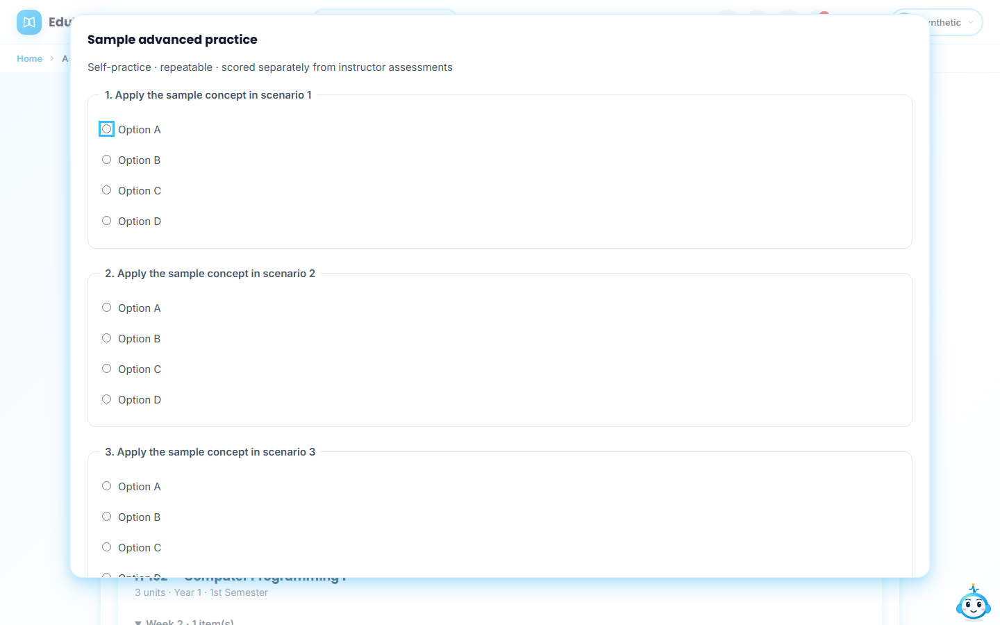

The former Assessments navigation is **Practice Assessments**. Summary cards report instructor assessments taken, practice sets, practice attempts and practice average. Saved instructor assessment results provide the baseline; pending written results remain pending. Untaken delivered instructor assessments remain accessible.

In **Advanced reading practice**, choose **Reading material** and select **Generate advanced practice with AI**. Generation uses the current account's connected provider and reading already delivered to this enrollment, including later-week reading available before its instructor assessment. It creates new application questions; private or unreleased instructor assessment questions and keys are never read. Missing provider access or invalid model output shows an explicit error rather than invented questions. This generation is explicit and is never replayed on reload.

Answer every practice question and select **Save practice attempt**. Objective practice is scored on the server. Practice questions also open in a separate dialog, with all questions together. The saved set remains available after reload; unsaved responses do not restore. **Close practice** exits. A request identifier makes retries of the same submission idempotent.

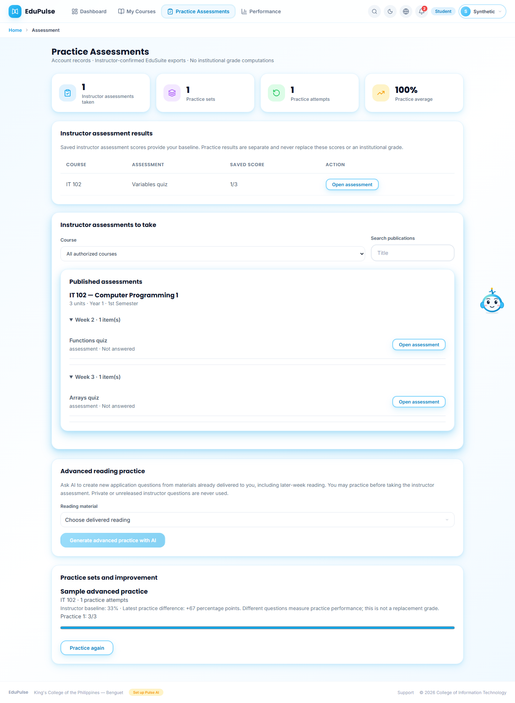

**Practice again** starts another independent attempt. History bars show every saved practice score and the page reports the latest difference from the marked instructor baseline for the same course/week when one exists. Different questions provide a practice comparison, not proof of equivalent difficulty or a replacement grade. Practice scores never overwrite instructor attempts, topic mastery or institutional grades.

## Dashboard and Performance

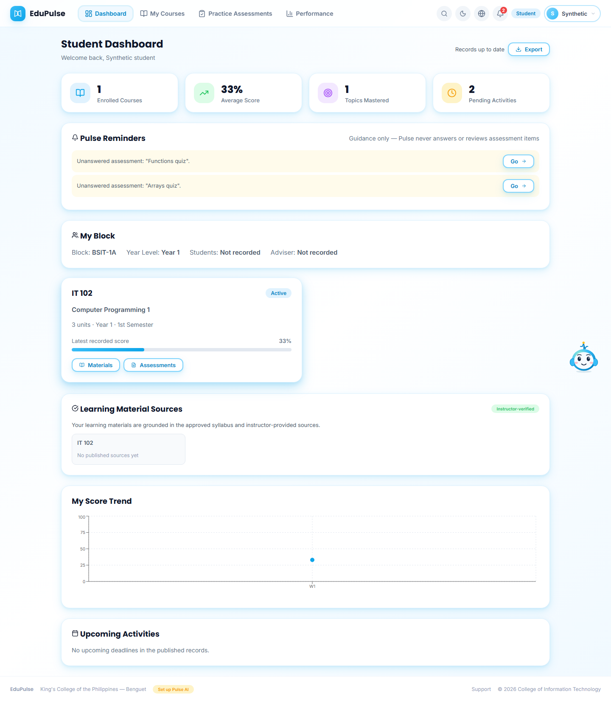
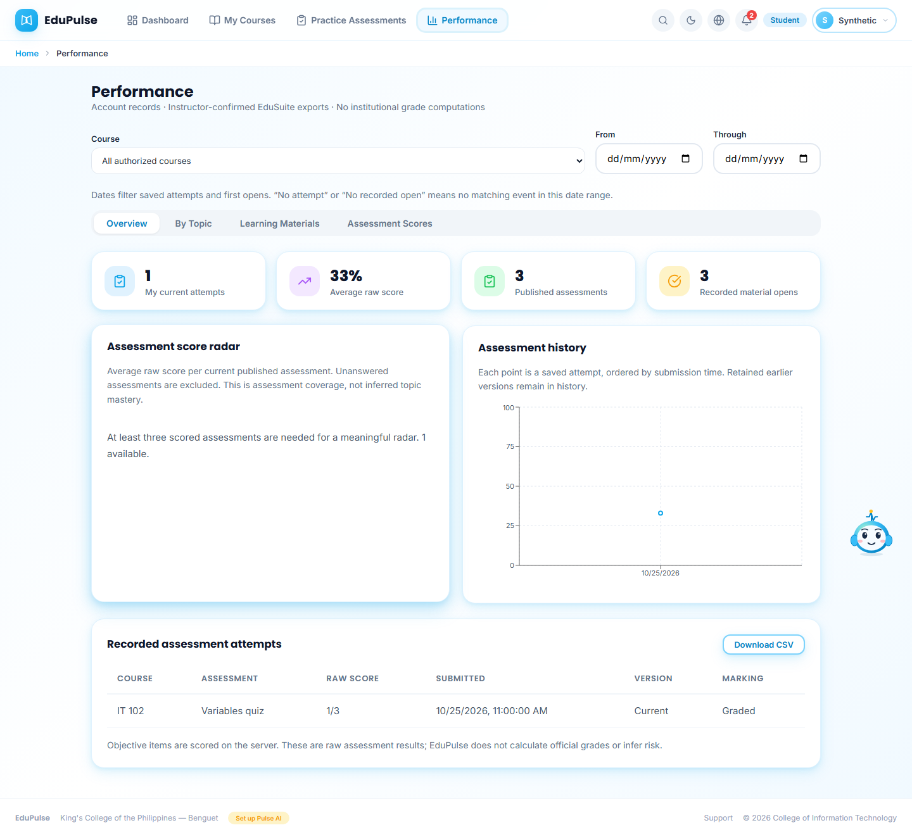

The dashboard average uses marked current-version instructor assessments, and mastered topics use saved mapped topic marks. Performance retains assessment history, raw scores, topic views and learning material access. Missing data remains explicit until an actual saved action exists. Test provenance remains in audit metadata rather than interface labels; they do not establish human comprehension or independent achievement.

The current administrative allocation caps Years 1-3 at ten subjects each. Year 4 has its five recorded curriculum subjects. Recorded year, units, class ownership and the 35-student block maximum are retained. This supersedes the earlier five-to-ten-class instructor cap; instructors can now handle more classes. Historical unselected syllabus content and activity remain retained.

## Try the student view as Admin

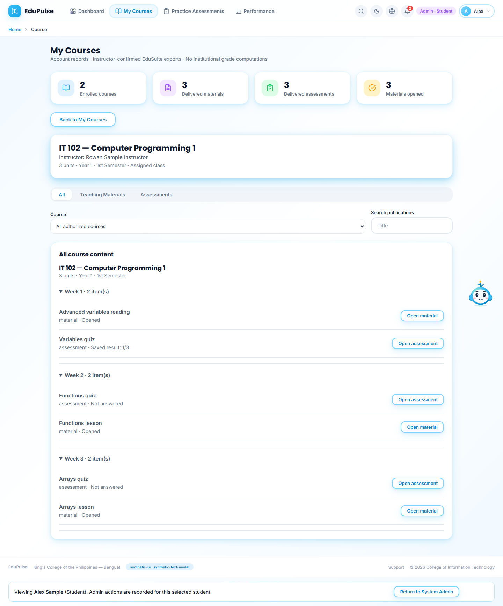

Select a student through the verified Admin account picker. The selected student learning pages provide material, assessment and practice actions directly; there is no additional checkbox or yellow demonstration panel. New opens, section confirmations, assessment sessions/responses and practice attempts use the selected student's current enrollment and release rules, retain their test flag in storage and record the Admin actor, without a visible test badge. Real student work cannot be relabelled or replaced by a demonstration. Instructor attempt limits and marking still apply.

A reload restores the authorized course or reader without recreating an action. **Return to System Admin** exits. Ordinary students cannot enable an Admin delegation by posting a subject or actor ID; live Admin and selected-account verification remains on the database boundary.

The owner-authorized data exercise covers one enrolled approved course per student in Weeks 1-3, plus allowed labelled retakes where needed for topic examples. All Weeks 4-5 assessments remain untouched for manual testing. Independent learner completion is never claimed. [Release validation](../../versions/2026-11-13-student-learning/validation/results.md) records the current aggregate evidence.

The routine **Records up to date** indicator and page-header **Export authorized records** / **Export** buttons have been removed across academic pages and signed-in dashboards. Loading/error/offline feedback and explicit **Refresh records** / **Retry connection** remain available when needed. Specific CSV downloads and the Settings workspace backup keep their existing purposes.

## Content filters and complete assessment view

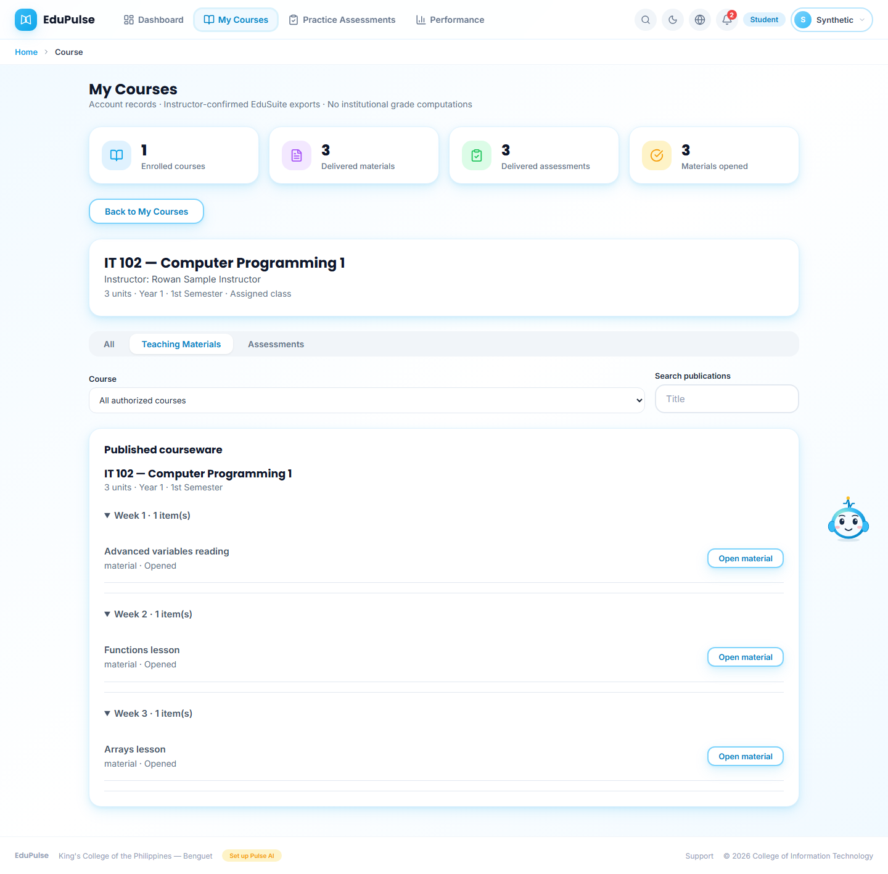
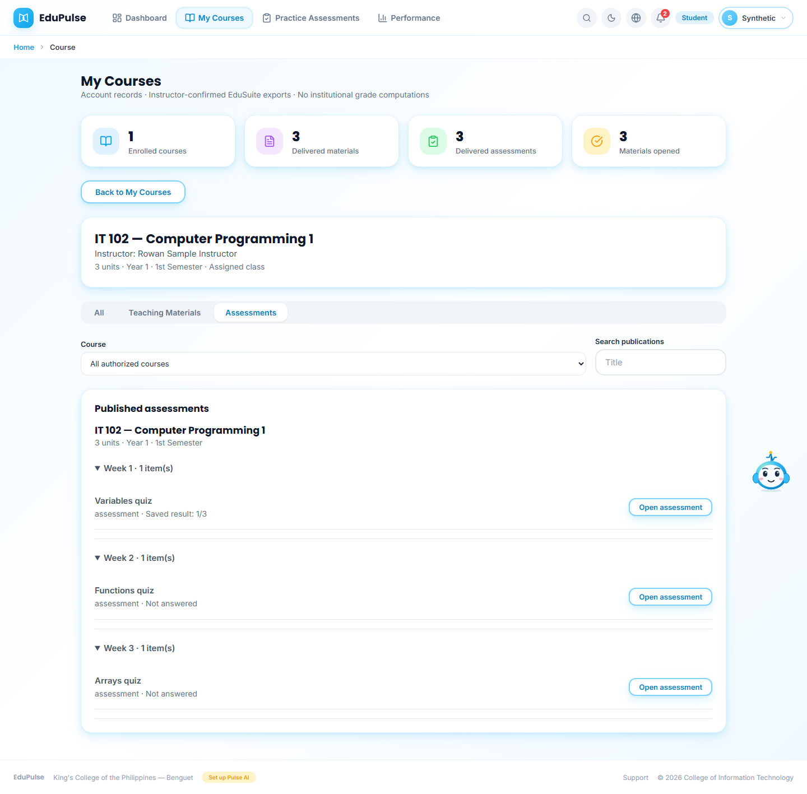
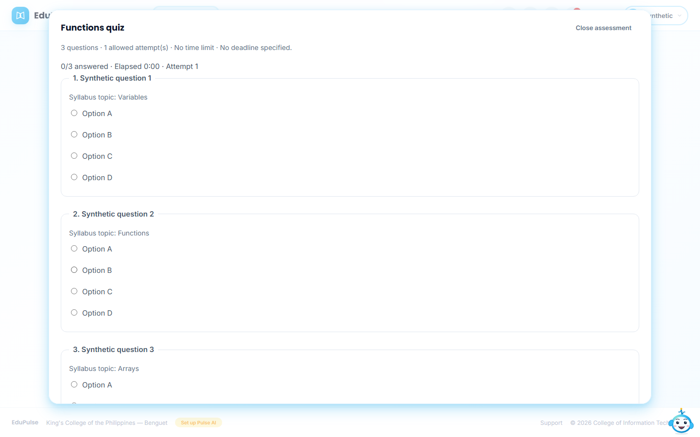
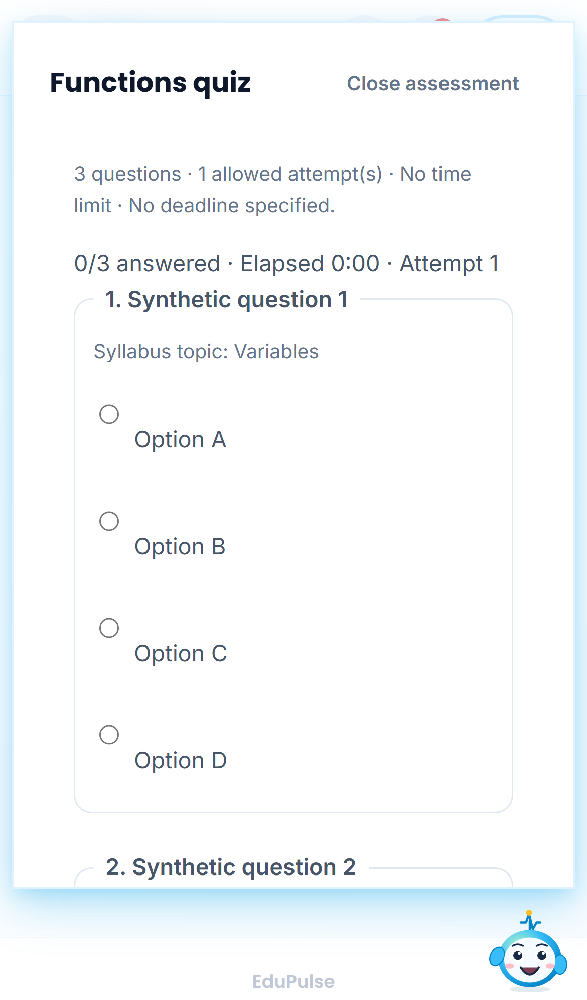

Each tab keeps the course and instructor context. Dialogs use the existing focus and Escape behavior, keep the background page in place, and scroll within the viewport. A long assessment remains one continuous question list. The server remains responsible for active enrollment, release dates, time limits, attempt limits and marks.

## Consistent summary cards

My Courses, Practice Assessments, Performance and topic summaries use the same SummaryCard component as the dashboard and other role dashboards. Each card has a colored icon tile beside its value and label, with the shared spacing, type and responsive grid. Counts, score calculations and missing-result text keep their existing meanings. Student summary cards remain informational.

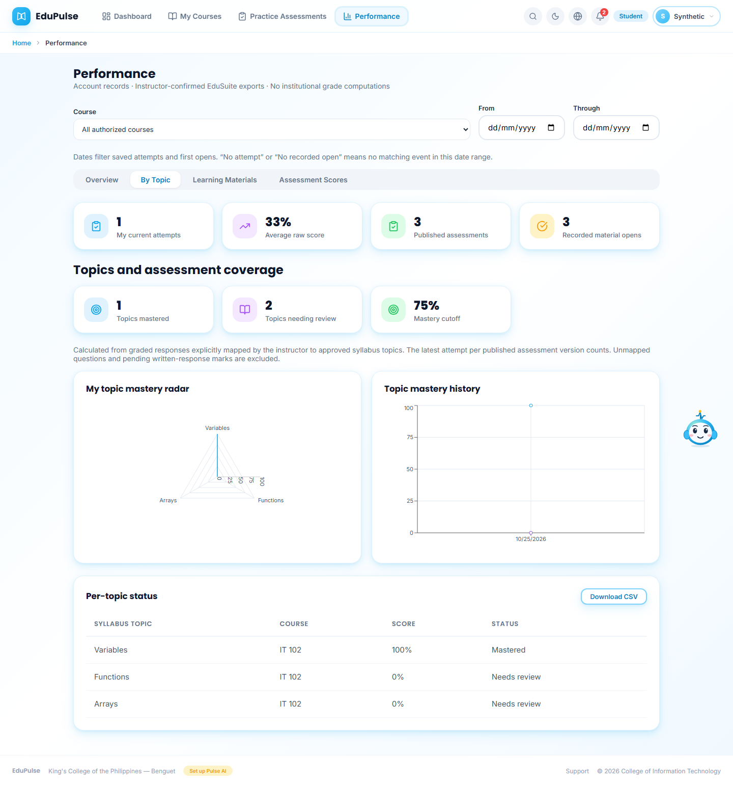

Long textual summary values wrap inside their card on narrow screens, including Not attempted before any saved practice attempt.

Textual statuses use the shared small-text size while numeric values retain the normal summary-value size, keeping long status words readable beside icons.
