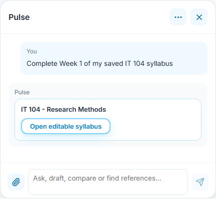
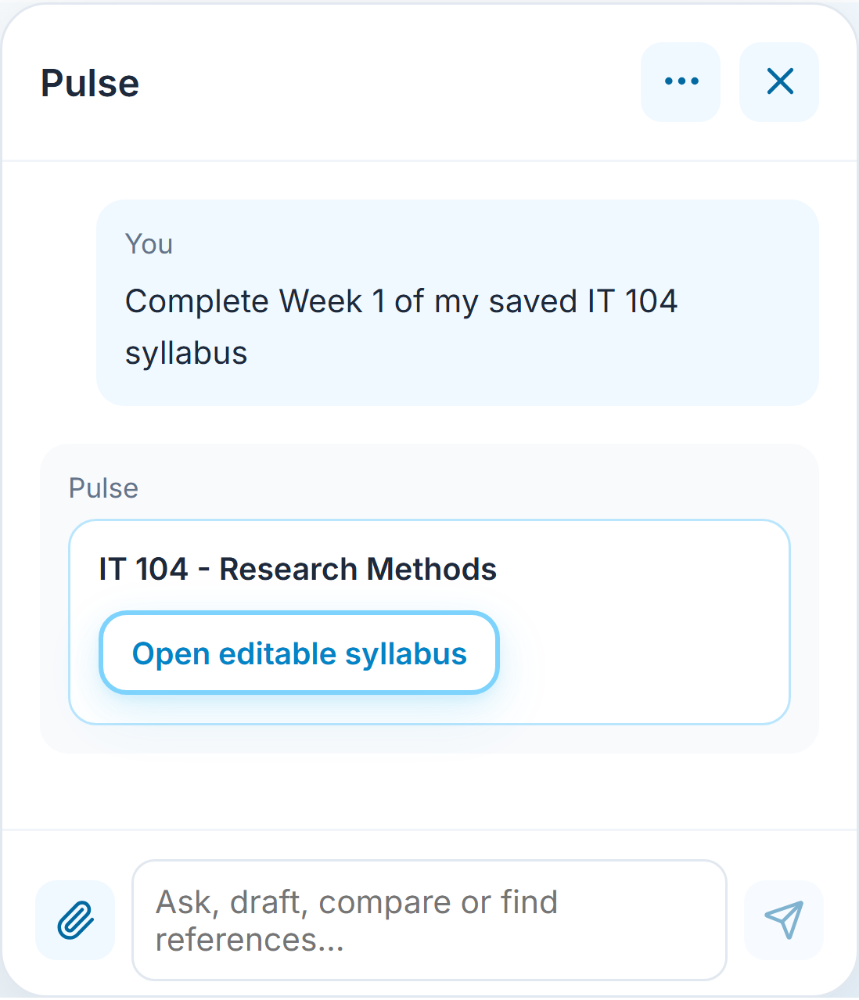
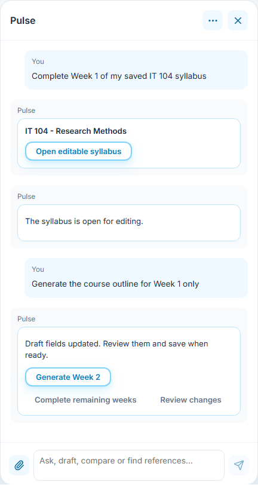
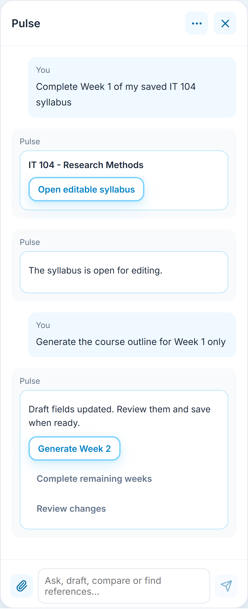
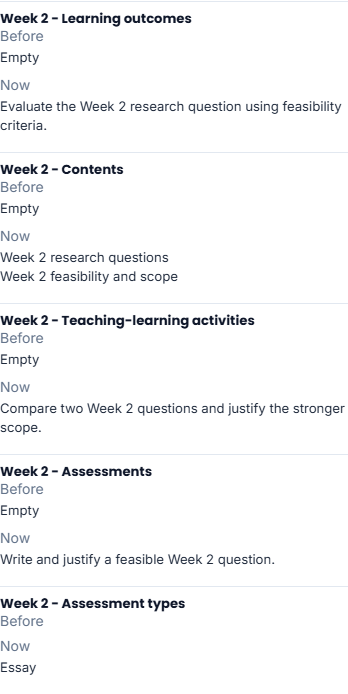
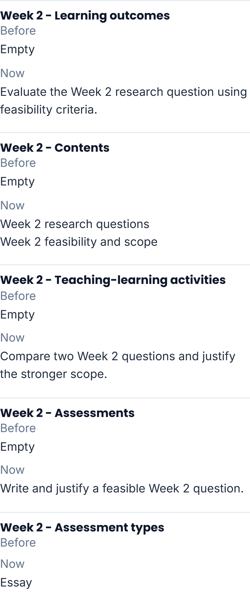
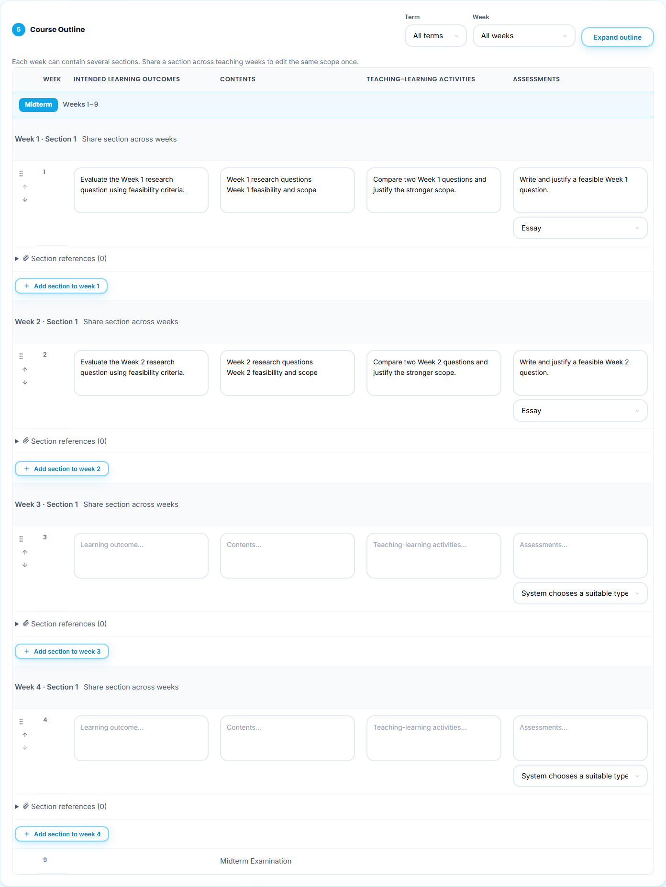
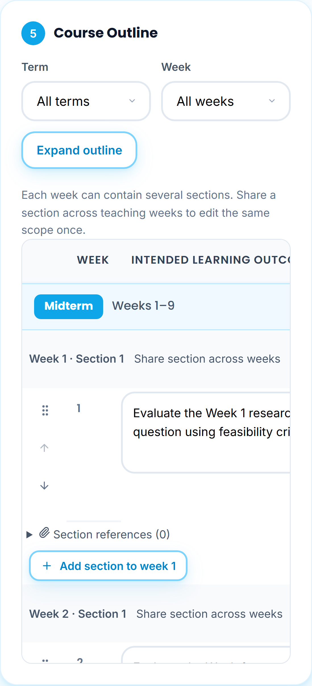
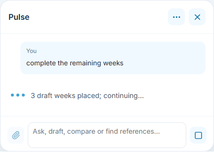
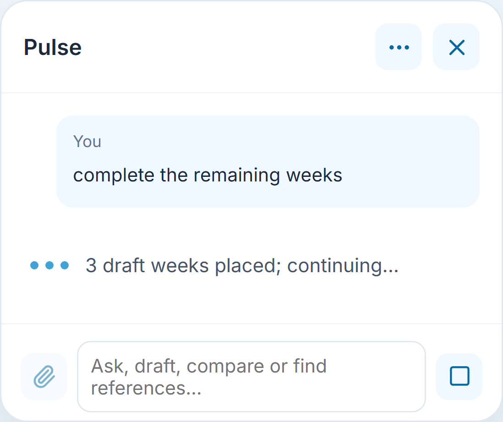

# Editable syllabus workspace with Pulse

**Who:** an authorized instructor, including a freshly authorized System Admin instructor support view. **Where:** Syllabus > Syllabus Builder.

## Open the saved draft

Ask Pulse to complete an owned saved syllabus while reading it or on My Syllabus. **Open editable syllabus** opens the selected record in Syllabus Builder. With several possible drafts, choose the intended course; Pulse does not guess an unrelated syllabus or run an Internet search for a missing editor.

The `edit` URL value is only a record reference. The builder resolves it from the current authorized workspace after startup; an unavailable or suspended record is not rendered as an editable copy. Reload does not generate, save, check or publish anything.

## Generate into the requested fields

Select a course or open the existing draft, then ask **Generate the course outline for Week 1 only**. Pulse validates the returned content and places it directly in the mounted draft fields. There is no separate chat Apply or Confirm button for generated syllabus edits. File imports, rosters and courseware retain their own confirmation controls.

Existing section IDs, shared teaching-week relationships and unrelated sections remain intact. A manual change to a generated target while inference runs rejects that chunk; independent fields remain editable. Invalid output cannot place any fields from its chunk. AI changes are Drafted and clear the edited form's approval attachment/activation metadata. The saved source is unchanged until an explicit save.

## Continue the same syllabus task

After Week 1, ask **can you provide week 2 then** or choose **Generate Week 2**. Pulse resolves the continuation in this conversation and this syllabus. A previously selected Week 1 field does not override the explicit Week 2 request. **Complete remaining weeks** fills unfinished teaching weeks and preserves completed weeks and examination slots.

**Review changes** displays Before and Now values after placement; it is optional review, not an approval gate. Sources are linked when the generation response supplies them. The latest relevant receipt offers next actions. Conversation, account, support-subject or course changes do not reuse an old mutable target.

## Save without leaving the builder

Choose **Save as Drafted** to save explicitly. The instructor remains in Syllabus Builder with the same saved syllabus ID. Reload restores that saved syllabus for editing, without another inference or duplicate copy. Unsaved fields are not navigation hints; save before reloading to retain changes.

**Mark as Checked**, offline approval, approved-file upload, activation and publication remain separate instructor actions. Generation never performs those transitions. A failed save reports its error and keeps the form available for retry.

## Progressive completion

Each validated teaching-week chunk appears in the form while the next one runs. Pulse reports the placed-week count. A later failure or Stop retains completed draft fields in the mounted form; review/save them, then ask for the remaining weeks. The incomplete chunk is never applied. A full reload restores the last explicit save and never resumes paid inference automatically.

These screenshots use fictional accounts, original sample teaching text and controlled inference/workspace transport through the real planner, validator and mounted editor. Native tests cover field/section validation, immutable IDs, shared scopes, stale edits and both provider contracts. Real local API/browser checks cover explicit save, reload and the ordinary approved-file lifecycle. They do not establish paid model quality, hosted sign-in or offline signature authenticity.
